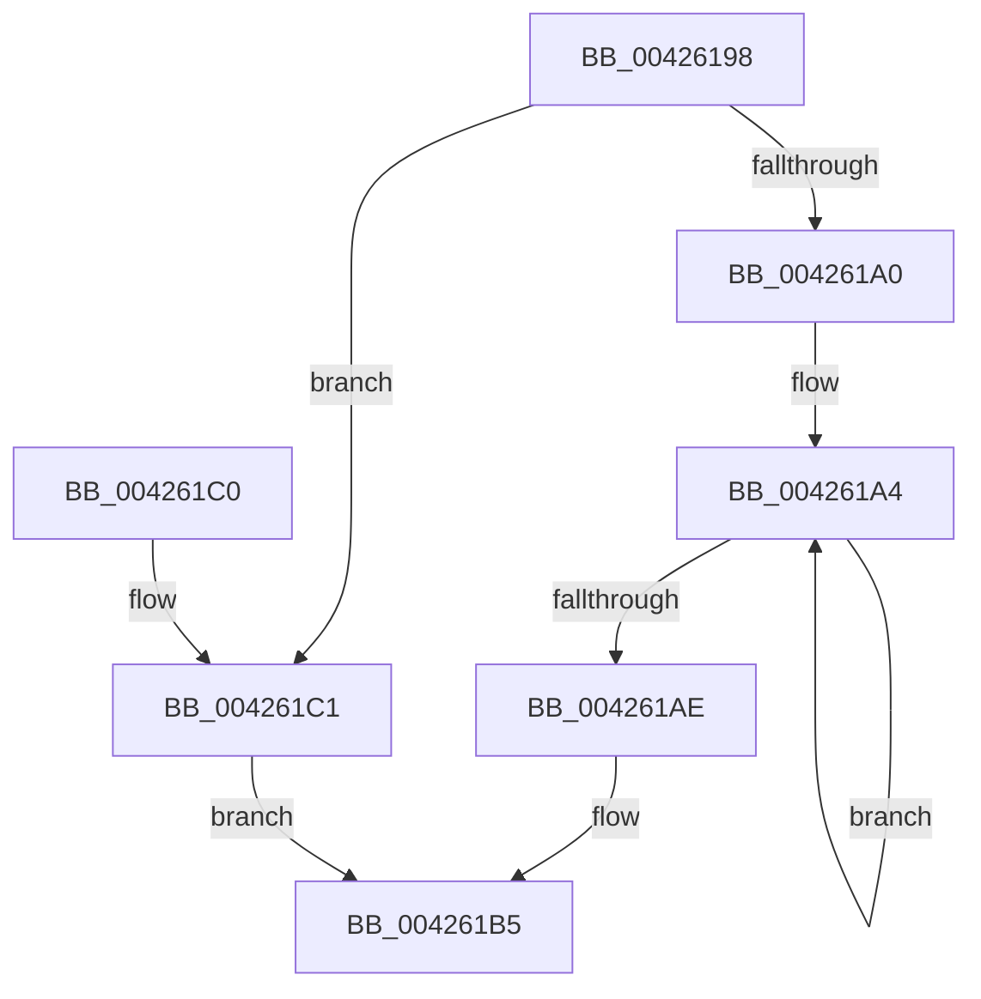

# tlgCreate1Sz_wchar_t

- RVA: `0x00426198`–`0x004261CF` (길이 `55` bytes)
- VA: `0x0000000140426198`
- 실행 섹션: `.text`
- PDB 이름 있음: `예`; PDB Function 태그: `아니요`
- unwind 정보 RVA: `0x000DB714`
- 디코드: `16`개 명령, `55/55` bytes 표시
- 미해석 바이트: `0` (있으면 어셈블리에 `.byte`로 보존)

> 이 문서는 커널 이미지의 기계어와 PDB 기호를 분석해 생성했습니다. 4번과 5번은 함수 원형과 자료형을 바이너리 사용 방식에서 추정한 C 해석이며 원본 소스 복구 결과는 아닙니다.

## 1. Dependencies

- 직접 호출 지점: **0**; 고유 호출 대상: **0**
- 직접 호출자로 확인된 함수: **42**
- RIP 상대 이미지 참조: **1**

### Outgoing calls
- 직접 디코드된 call 명령이 없습니다.

### Direct callers
- [CcPostVolumeTelemetry](CcPostVolumeTelemetry_function_00420FF8.md) at `0x00422D32`
- [Pdcv2EventWrite_ACTIVATION_CLIENT_DEACTIVATE](Pdcv2EventWrite_ACTIVATION_CLIENT_DEACTIVATE_function_00424588.md) at `0x0042470A`
- [Pdcv2EventWrite_ACTIVATION_CLIENT_DEACTIVATE](Pdcv2EventWrite_ACTIVATION_CLIENT_DEACTIVATE_function_00424588.md) at `0x00424716`
- [Pdcv2EventWrite_ACTIVATION_CLIENT_DEACTIVATE](Pdcv2EventWrite_ACTIVATION_CLIENT_DEACTIVATE_function_00424588.md) at `0x0042479D`
- [PopTraceThermalRequestPassiveHistogram](PopTraceThermalRequestPassiveHistogram_function_0042FFB4.md) at `0x0043010D`
- [PopTraceThermalRequestPassiveHistogram](PopTraceThermalRequestPassiveHistogram_function_0042FFB4.md) at `0x00430181`
- [PopTraceThermalZonePassiveHistogram](../4D/PopTraceThermalZonePassiveHistogram_function_004DDD10.md) at `0x004DDE06`
- [ExLogTimeZoneInformation](../4E/ExLogTimeZoneInformation_function_004E3B50.md) at `0x004E3C29`
- [PopTraceThermalRequestActiveActivity](../4E/PopTraceThermalRequestActiveActivity_function_004E9104.md) at `0x004E927C`
- [PopTraceThermalRequestActiveActivity](../4E/PopTraceThermalRequestActiveActivity_function_004E9104.md) at `0x004E9303`
- [KasaniSendReport](../5A/KasaniSendReport_function_005AB2E0.md) at `0x005AB56F`
- [KasaniSendReport](../5A/KasaniSendReport_function_005AB2E0.md) at `0x005AB5E5`
- [KasaniSendReport](../5A/KasaniSendReport_function_005AB2E0.md) at `0x005AB65B`
- [KasaniSendReport](../5A/KasaniSendReport_function_005AB2E0.md) at `0x005AB6D1`
- [KasaniSendReport](../5A/KasaniSendReport_function_005AB2E0.md) at `0x005AB741`
- [KasaniSendReport](../5A/KasaniSendReport_function_005AB2E0.md) at `0x005AB7B1`
- [KasaniSendReport](../5A/KasaniSendReport_function_005AB2E0.md) at `0x005AB821`
- [KasaniSendReport](../5A/KasaniSendReport_function_005AB2E0.md) at `0x005AB891`
- [KasaniSendReport](../5A/KasaniSendReport_function_005AB2E0.md) at `0x005AB901`
- [KasaniSendReport](../5A/KasaniSendReport_function_005AB2E0.md) at `0x005AB971`
- [KasaniSendReport](../5A/KasaniSendReport_function_005AB2E0.md) at `0x005AB9E1`
- [KasaniSendReport](../5A/KasaniSendReport_function_005AB2E0.md) at `0x005ABA51`
- [KasaniSendReport](../5A/KasaniSendReport_function_005AB2E0.md) at `0x005ABAC1`
- [KasaniSendReport](../5A/KasaniSendReport_function_005AB2E0.md) at `0x005ABB31`
- [KasaniSendReport](../5A/KasaniSendReport_function_005AB2E0.md) at `0x005ABBA1`
- [KasaniSendReport](../5A/KasaniSendReport_function_005AB2E0.md) at `0x005ABC11`
- [sub_005AFA55](../5A/Unknown_function_005AFA55.md) at `0x005AFB61`
- [sub_005AFA55](../5A/Unknown_function_005AFA55.md) at `0x005AFBD7`
- [sub_005AFA55](../5A/Unknown_function_005AFA55.md) at `0x005AFC4D`
- [sub_005AFA55](../5A/Unknown_function_005AFA55.md) at `0x005AFCC3`
- [sub_005AFA55](../5A/Unknown_function_005AFA55.md) at `0x005AFD39`
- [sub_005AFA55](../5A/Unknown_function_005AFA55.md) at `0x005AFDA9`
- [sub_005AFA55](../5A/Unknown_function_005AFA55.md) at `0x005AFE19`
- [sub_005AFA55](../5A/Unknown_function_005AFA55.md) at `0x005AFE89`
- [sub_005AFA55](../5A/Unknown_function_005AFA55.md) at `0x005AFEF9`
- [sub_005AFA55](../5A/Unknown_function_005AFA55.md) at `0x005AFF69`
- [sub_005AFA55](../5A/Unknown_function_005AFA55.md) at `0x005AFFD9`
- [sub_005AFA55](../5A/Unknown_function_005AFA55.md) at `0x005B0049`
- [sub_005AFA55](../5A/Unknown_function_005AFA55.md) at `0x005B00B9`
- [sub_005AFA55](../5A/Unknown_function_005AFA55.md) at `0x005B0129`
- [sub_005AFA55](../5A/Unknown_function_005AFA55.md) at `0x005B0199`
- [PopTracePowerLimitHistogram](../5D/PopTracePowerLimitHistogram_function_005D7B10.md) at `0x005D7CAB`
- [PopTraceThermalZoneActiveActivity](../5D/PopTraceThermalZoneActiveActivity_function_005D7FE0.md) at `0x005D80EE`
- [PopTraceZoneCr3Mitigated](../5D/PopTraceZoneCr3Mitigated_function_005D81B4.md) at `0x005D8271`
- [PopTraceZoneCr3Tripped](../5D/PopTraceZoneCr3Tripped_function_005D82DC.md) at `0x005D841E`
- [PopTraceZoneCr3Tripped](../5D/PopTraceZoneCr3Tripped_function_005D82DC.md) at `0x005D842A`
- [Pdcv2EventWrite_ACTIVATION_CLIENT_CALLBACK](../60/Pdcv2EventWrite_ACTIVATION_CLIENT_CALLBACK_function_00605D7C.md) at `0x00605EF2`
- [Pdcv2EventWrite_ACTIVATION_CLIENT_CALLBACK](../60/Pdcv2EventWrite_ACTIVATION_CLIENT_CALLBACK_function_00605D7C.md) at `0x00605EFE`
- [Pdcv2EventWrite_ACTIVATION_CLIENT_CALLBACK](../60/Pdcv2EventWrite_ACTIVATION_CLIENT_CALLBACK_function_00605D7C.md) at `0x00605FB5`
- [CarEtwCrashEvent](../61/CarEtwCrashEvent_function_00617800.md) at `0x00617936`
- [CarEtwRegister](../61/CarEtwRegister_function_006179D4.md) at `0x00617AB6`
- [CarEtwRegister](../61/CarEtwRegister_function_006179D4.md) at `0x00617AC6`
- [CarEtwWriteBugCheckEvent](../61/CarEtwWriteBugCheckEvent_function_00617B68.md) at `0x00617C25`
- [CarEtwWriteLiveDumpEvent](../61/CarEtwWriteLiveDumpEvent_function_00617CD8.md) at `0x00617D91`
- [CarLoadImageHandler](../61/CarLoadImageHandler_function_00618128.md) at `0x0061821A`
- [CarTipLogDriverLoad](../61/CarTipLogDriverLoad_function_006182C0.md) at `0x0061834B`
- [sub_006D9F1A](../6D/Unknown_function_006D9F1A.md) at `0x006D9FA4`
- [sub_006F3B98](../6F/Unknown_function_006F3B98.md) at `0x006F3BBA`
- [PnpTraceDeviceConfig](../../page/70/PnpTraceDeviceConfig_function_00700CC0.md) at `0x00700E94`
- [PnpTraceDeviceConfig](../../page/70/PnpTraceDeviceConfig_function_00700CC0.md) at `0x00700EA0`
- [PnpTraceDeviceConfig](../../page/70/PnpTraceDeviceConfig_function_00700CC0.md) at `0x00700EAC`
- [PnpTraceDeviceConfig](../../page/70/PnpTraceDeviceConfig_function_00700CC0.md) at `0x00700EB8`
- [PnpTraceDeviceConfig](../../page/70/PnpTraceDeviceConfig_function_00700CC0.md) at `0x00700EC4`
- [PnpTraceDeviceConfig](../../page/70/PnpTraceDeviceConfig_function_00700CC0.md) at `0x00700ED3`
- [PnpTraceDeviceConfig](../../page/70/PnpTraceDeviceConfig_function_00700CC0.md) at `0x00700EE2`
- [PnpTraceDeviceConfig](../../page/70/PnpTraceDeviceConfig_function_00700CC0.md) at `0x00700EF1`
- [PnpTraceDeviceConfig](../../page/70/PnpTraceDeviceConfig_function_00700CC0.md) at `0x00700F00`
- [PnpTraceDeviceConfig](../../page/70/PnpTraceDeviceConfig_function_00700CC0.md) at `0x00700F0F`
- [PnpTraceDeviceConfig](../../page/70/PnpTraceDeviceConfig_function_00700CC0.md) at `0x00700F20`
- [PnpTraceDeviceConfig](../../page/70/PnpTraceDeviceConfig_function_00700CC0.md) at `0x00700F31`
- [PnpTraceDeviceConfig](../../page/70/PnpTraceDeviceConfig_function_00700CC0.md) at `0x00700F42`
- [PnpTraceDeviceConfig](../../page/70/PnpTraceDeviceConfig_function_00700CC0.md) at `0x00700F53`
- [PnpTraceDeviceConfig](../../page/70/PnpTraceDeviceConfig_function_00700CC0.md) at `0x00700F63`
- [PnpTraceDeviceConfig](../../page/70/PnpTraceDeviceConfig_function_00700CC0.md) at `0x00700F94`
- [PnpTraceDeviceConfig](../../page/70/PnpTraceDeviceConfig_function_00700CC0.md) at `0x00700FA5`
- [PnpTraceDriverBlocked](../../page/73/PnpTraceDriverBlocked_function_0073CB88.md) at `0x0073CBFA`
- [PopThermalHandlePreviousShutdown](../../page/75/PopThermalHandlePreviousShutdown_function_0075F400.md) at `0x0075F728`
- [PopDiagTraceDozeDeferralDecision](../../page/76/PopDiagTraceDozeDeferralDecision_function_007612F0.md) at `0x00761432`
- [PopDiagTraceDozeDeferralDecision](../../page/76/PopDiagTraceDozeDeferralDecision_function_007612F0.md) at `0x0076143E`
- [PopSqmThermalCriticalEvent](../../page/77/PopSqmThermalCriticalEvent_function_00772678.md) at `0x007727CA`
- [PopSqmThermalCriticalEvent](../../page/77/PopSqmThermalCriticalEvent_function_00772678.md) at `0x007727D6`
- [PopSqmThermalZoneEnumeration](../../page/77/PopSqmThermalZoneEnumeration_function_00772884.md) at `0x007728EF`
- [PopSqmThermalZoneEnumeration](../../page/77/PopSqmThermalZoneEnumeration_function_00772884.md) at `0x007729E0`
- [TtmiLogDeviceArrivedTerminalEvent](../../page/77/TtmiLogDeviceArrivedTerminalEvent_function_00779508.md) at `0x007795E6`
- [TtmiLogDeviceEnumeratedTerminalEvent](../../page/77/TtmiLogDeviceEnumeratedTerminalEvent_function_00779920.md) at `0x007799FE`
- [ExpLogRefreshTimeZoneInformationCutoverFail](../../page/7C/ExpLogRefreshTimeZoneInformationCutoverFail_function_007C5BE0.md) at `0x007C5CD7`
- [CmpLogHiveFileInaccessible](../../page/87/CmpLogHiveFileInaccessible_function_0087AEAC.md) at `0x0087B1F1`
- [EtwpWriteAppStateChangeSummary](../../page/8A/EtwpWriteAppStateChangeSummary_function_008A4990.md) at `0x008A4E52`
- [EtwpWriteAppStateChangeSummary](../../page/8A/EtwpWriteAppStateChangeSummary_function_008A4990.md) at `0x008A4E65`
- [IoGetEnvironmentVariableEx](../../page/95/IoGetEnvironmentVariableEx_function_00952760.md) at `0x00952858`
- [EtwpWriteProcessStarted](../../page/A4/EtwpWriteProcessStarted_function_00A487A4.md) at `0x00A48960`
- [EtwpWriteProcessStarted](../../page/A4/EtwpWriteProcessStarted_function_00A487A4.md) at `0x00A48970`
- [EtwpWriteProcessStarted](../../page/A4/EtwpWriteProcessStarted_function_00A487A4.md) at `0x00A48980`
- [ExpLogRefreshTimeZoneInformationSuccess](../../page/A6/ExpLogRefreshTimeZoneInformationSuccess_function_00A6C204.md) at `0x00A6C329`
- [PopDiagTracePowerSettingRegistration](../../page/AA/PopDiagTracePowerSettingRegistration_function_00AA2968.md) at `0x00AA2A2D`
- [PopPotsLogPowerTransitionReliability](../../page/AA/PopPotsLogPowerTransitionReliability_function_00AAE1C4.md) at `0x00AAE36C`
- [sub_00B1A590](../../page/B1/Unknown_function_00B1A590.md) at `0x00B1A5B9`
- [sub_00B1A590](../../page/B1/Unknown_function_00B1A590.md) at `0x00B1A656`
- [sub_00B20B3E](../../page/B2/Unknown_function_00B20B3E.md) at `0x00B20B84`
- [sub_00B20B3E](../../page/B2/Unknown_function_00B20B3E.md) at `0x00B20BC0`
- [sub_00B27D04](../../page/B2/Unknown_function_00B27D04.md) at `0x00B27D25`
- [sub_00B46E44](../../page/B4/Unknown_function_00B46E44.md) at `0x00B46E4B`
- [PopPotsLogDirtyPowerTransition](../../init/C4/PopPotsLogDirtyPowerTransition_function_00C43EE8.md) at `0x00C43FC8`

### Static image references
- `0x004261C1` → RVA `0x006C8EC0` (` ?? ::FNODOBFM::`string'`; read)

## 2. Other-region calls and transfers

- 다른 실행 섹션으로 향하는 call: **0**
- 별도 외부 분기/꼬리 이동을 확인하지 못했습니다.

## 3. Assembly (complete function range)

```asm
00426198  45 33 C0                        xor r8d, r8d
0042619B  48 85 D2                        test rdx, rdx
0042619E  74 21                           je 0x1404261c1
004261A0  48 83 C8 FF                     or rax, 0xffffffffffffffff
004261A4  48 FF C0                        inc rax
004261A7  66 44 39 04 42                  cmp word ptr [rdx + rax*2], r8w
004261AC  75 F6                           jne 0x1404261a4
004261AE  8D 04 45 02 00 00 00            lea eax, [rax*2 + 2]
004261B5  48 89 11                        mov qword ptr [rcx], rdx
004261B8  89 41 08                        mov dword ptr [rcx + 8], eax
004261BB  44 89 41 0C                     mov dword ptr [rcx + 0xc], r8d
004261BF  C3                              ret
004261C0  CC                              int3
004261C1  48 8D 15 F8 2C 2A 00            lea rdx, [rip + 0x2a2cf8]
004261C8  B8 02 00 00 00                  mov eax, 2
004261CD  EB E6                           jmp 0x1404261b5
```

## 4. C-style interpretation (structured pseudocode)

```c
__int64 __fastcall tlgCreate1Sz_wchar_t(__int64 a1, __int64 a2, int a3)
{
    __int64 result;

    a3 = 0;
    if (a2 == 0) goto loc_004261C1;
    result = (result) | (-1);
loc_004261A4:
    result = (result) + 1;
    if ((*(unsigned __int16 *)(a2 + result * 2)) != 0) goto loc_004261A4;
loc_004261B5:
    *(unsigned __int64 *)(a1) = a2;
    *(unsigned int *)(a1 + 8) = (unsigned int)(result * 2 + 2);
    *(unsigned int *)(a1 + 12) = 0;
    return result * 2 + 2;
loc_004261C1:
    goto loc_004261B5;
}
```

## 5. (Beta) C Style

```c
int64_t tlgCreate1Sz_wchar_t(void *Arg1, int64_t Arg2, int32_t Arg3)
{
    uint8_t *arg1 = (uint8_t *)Arg1;

    int64_t result;

    Arg3 = 0;
    if (Arg2 == 0) goto loc_004261C1;
    result = (result) | (-1);
loc_004261A4:
    result = (result) + 1;
    if ((*(uint16_t *)(Arg2 + result * 2)) != 0) goto loc_004261A4;
loc_004261B5:
    *(uint64_t *)(arg1) = Arg2;
    *(uint32_t *)(arg1 + 0x8) = (uint32_t)(result * 2 + 2);
    *(uint32_t *)(arg1 + 0xC) = 0;
    return result * 2 + 2;
loc_004261C1:
    goto loc_004261B5;
}
```

### 관측된 메모리 오프셋

구조체 형식이 확인되지 않은 접근은 인자 기준의 오프셋으로만 기록했습니다.

| 기준 인자 | 오프셋 표현 | 폭 (bit) | 접근 |
|---|---:|---:|---|
| `Arg1` | `+ 0x0` | `64` | `W` |
| `Arg1` | `+ 0x8` | `32` | `W` |
| `Arg1` | `+ 0xC` | `32` | `W` |

## 6. Execution-region graph

[열기: 2D/3D 그래프와 함수 탐색 컨트롤 패널](../../../control-panel.html?section=text&rva=0x00426198&view=graph)

- 2D 그래프는 위에서 아래로 흐르고, 3D 그래프는 빈 공간을 드래그해 회전합니다. Shift+드래그는 이동, 휠은 확대·축소, 함수 노드 선택은 대상 보고서 이동입니다.

### Static fallback


