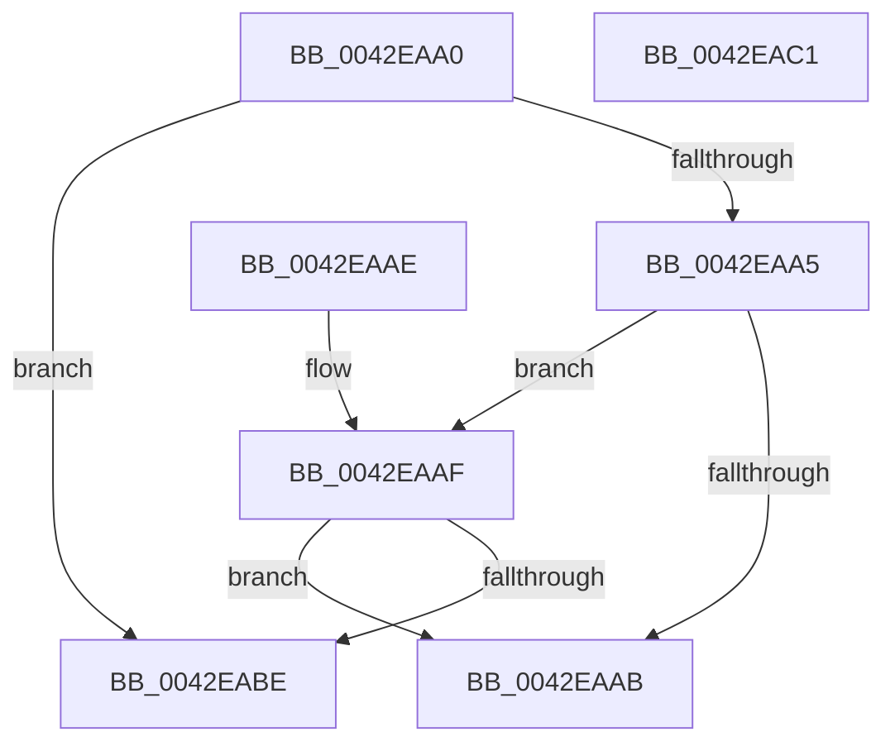

# tlgKeywordOn

- RVA: `0x0042EAA0`–`0x0042EAC2` (길이 `34` bytes)
- VA: `0x000000014042EAA0`
- 실행 섹션: `.text`
- PDB 이름 있음: `예`; PDB Function 태그: `아니요`
- unwind 정보 RVA: `0x000DB714`
- 디코드: `15`개 명령, `34/34` bytes 표시
- 미해석 바이트: `0` (있으면 어셈블리에 `.byte`로 보존)

> 이 문서는 커널 이미지의 기계어와 PDB 기호를 분석해 생성했습니다. 4번과 5번은 함수 원형과 자료형을 바이너리 사용 방식에서 추정한 C 해석이며 원본 소스 복구 결과는 아닙니다.

## 1. Dependencies

- 직접 호출 지점: **0**; 고유 호출 대상: **0**
- 직접 호출자로 확인된 함수: **358**
- RIP 상대 이미지 참조: **0**

### Outgoing calls
- 직접 디코드된 call 명령이 없습니다.

### Direct callers
- [MiLogPeriodicTelemetry](../2D/MiLogPeriodicTelemetry_function_002DB750.md) at `0x002DB83C`
- [MiLogPeriodicTelemetry](../2D/MiLogPeriodicTelemetry_function_002DB750.md) at `0x002DB8CE`
- [MiLogPeriodicTelemetry](../2D/MiLogPeriodicTelemetry_function_002DB750.md) at `0x002DB954`
- [MiLogPeriodicTelemetry](../2D/MiLogPeriodicTelemetry_function_002DB750.md) at `0x002DBB82`
- [MiLogPeriodicTelemetry](../2D/MiLogPeriodicTelemetry_function_002DB750.md) at `0x002DBCA4`
- [VmpFlushTb](../31/VmpFlushTb_function_00311BD0.md) at `0x00311F3C`
- [sub_00314756](../31/Unknown_function_00314756.md) at `0x00314764`
- [FsRtlpRequestExclusiveOplock](../3F/FsRtlpRequestExclusiveOplock_function_003F3800.md) at `0x003F3A7A`
- [CcPostVolumeTelemetry](CcPostVolumeTelemetry_function_00420FF8.md) at `0x0042131B`
- [CcPostVolumeTelemetry](CcPostVolumeTelemetry_function_00420FF8.md) at `0x004224F6`
- [VmpProcessInvalidateList](VmpProcessInvalidateList_function_00428A54.md) at `0x00428BC5`
- [PopTraceThermalRequestPassiveHistogram](PopTraceThermalRequestPassiveHistogram_function_0042FFB4.md) at `0x004300C2`
- [PopTraceThermalRequestPassiveHistogram](PopTraceThermalRequestPassiveHistogram_function_0042FFB4.md) at `0x00430139`
- [PopDiagTraceDripsHistogram](../43/PopDiagTraceDripsHistogram_function_0043B430.md) at `0x0043B573`
- [MiLogSlabEntryDemote](../44/MiLogSlabEntryDemote_function_0044CDF0.md) at `0x0044CE34`
- [MiLogContinueTrim](../4C/MiLogContinueTrim_function_004C3D34.md) at `0x004C3D78`
- [MmStoreLogConsumedPoison](../4C/MmStoreLogConsumedPoison_function_004C6B00.md) at `0x004C6B4E`
- [MmStoreLogConsumedPoison](../4C/MmStoreLogConsumedPoison_function_004C6B00.md) at `0x004C6BB4`
- [CmpThreadInfoLogStack](../4C/CmpThreadInfoLogStack_function_004CA590.md) at `0x004CA630`
- [PopTracePowerReconfig](../4D/PopTracePowerReconfig_function_004D09AC.md) at `0x004D0A29`
- [SepLogUnmatchedSessionFlagImpersonationAttempt](../4D/SepLogUnmatchedSessionFlagImpersonationAttempt_function_004D8574.md) at `0x004D8615`
- [HalpTimerQueryAndResetRtcErrors](../4D/HalpTimerQueryAndResetRtcErrors_function_004D9B30.md) at `0x004D9B7C`
- [HalpTimerQueryAndResetRtcErrors](../4D/HalpTimerQueryAndResetRtcErrors_function_004D9B30.md) at `0x004D9BB3`
- [HalpTimerQueryAndResetRtcErrors](../4D/HalpTimerQueryAndResetRtcErrors_function_004D9B30.md) at `0x004D9C1A`
- [PopTraceThermalZonePassiveHistogram](../4D/PopTraceThermalZonePassiveHistogram_function_004DDD10.md) at `0x004DDDBE`
- [PopDiagTraceRtcWakeInfo](../4D/PopDiagTraceRtcWakeInfo_function_004DEA14.md) at `0x004DEB05`
- [IoCaptureLiveDump](../4E/IoCaptureLiveDump_function_004E085C.md) at `0x004E0BDE`
- [IoCaptureLiveDump](../4E/IoCaptureLiveDump_function_004E085C.md) at `0x004E0DFA`
- [IoCaptureLiveDump](../4E/IoCaptureLiveDump_function_004E085C.md) at `0x004E0EFA`
- [IopDumpTraceLoadCrashDumpDriverFailure](../4E/IopDumpTraceLoadCrashDumpDriverFailure_function_004E2C18.md) at `0x004E2CA3`
- [PopTraceEsSetting](../4E/PopTraceEsSetting_function_004E3A64.md) at `0x004E3AA4`
- [FsRtlpRequestShareableOplock](../4E/FsRtlpRequestShareableOplock_function_004E6EC8.md) at `0x004E7179`
- [PopTraceThermalRequestActiveActivity](../4E/PopTraceThermalRequestActiveActivity_function_004E9104.md) at `0x004E923B`
- [PopTraceThermalRequestActiveActivity](../4E/PopTraceThermalRequestActiveActivity_function_004E9104.md) at `0x004E92C5`
- [MiStoreLogFullPagefile](../4F/MiStoreLogFullPagefile_function_004FC7C8.md) at `0x004FC7F5`
- [HalpCheckSratMemoryRanges](../55/HalpCheckSratMemoryRanges_function_00558CD0.md) at `0x00558D49`
- [HalpCheckSratMemoryRanges](../55/HalpCheckSratMemoryRanges_function_00558CD0.md) at `0x00558DDB`
- [HalpNumaAddRangeProximity](../55/HalpNumaAddRangeProximity_function_00558EC0.md) at `0x00558F14`
- [HalpNumaAddRangeProximity](../55/HalpNumaAddRangeProximity_function_00558EC0.md) at `0x00559003`
- [HalpNumaGetHmatConfigSize](../55/HalpNumaGetHmatConfigSize_function_00559230.md) at `0x0055946E`
- [FsRtlpOplockAckTimeoutWorker](../58/FsRtlpOplockAckTimeoutWorker_function_00582950.md) at `0x00582A28`
- [IopDumpTraceCrashDumpDisabled](../59/IopDumpTraceCrashDumpDisabled_function_00594C8C.md) at `0x00594CF5`
- [IopDumpTraceCrashDumpReconfiguration](../59/IopDumpTraceCrashDumpReconfiguration_function_00594D68.md) at `0x00594DF3`
- [IopDumpTraceDisableCrashDumpFailure](../59/IopDumpTraceDisableCrashDumpFailure_function_00594E78.md) at `0x00594F03`
- [IopDumpTraceFreeDumpStackFailure](../59/IopDumpTraceFreeDumpStackFailure_function_00594F88.md) at `0x00595013`
- [IopDumpTraceInitializeCrashDumpFailure](../59/IopDumpTraceInitializeCrashDumpFailure_function_00595098.md) at `0x00595123`
- [IopDumpTraceInitializeDumpStackFailure](../59/IopDumpTraceInitializeDumpStackFailure_function_005951A8.md) at `0x00595233`
- [IopDumpTraceLoadDumpStackFailure](../59/IopDumpTraceLoadDumpStackFailure_function_005952B8.md) at `0x00595343`
- [IoWriteDeferredLiveDumpData](../59/IoWriteDeferredLiveDumpData_function_00598CD0.md) at `0x00598DA2`
- [IopLiveDumpAllocAndInitResources](../59/IopLiveDumpAllocAndInitResources_function_005993B0.md) at `0x00599909`
- [IopLiveDumpAllocateExtraBuffers](../59/IopLiveDumpAllocateExtraBuffers_function_00599A9C.md) at `0x00599C14`
- [IopLiveDumpAllocateFromVMMemoryPartition](../59/IopLiveDumpAllocateFromVMMemoryPartition_function_0059A2D8.md) at `0x0059A3F7`
- [IopLiveDumpCaptureMemoryPages](../59/IopLiveDumpCaptureMemoryPages_function_0059B0A0.md) at `0x0059B1D1`
- [IopLiveDumpEstimateMemoryPages](../59/IopLiveDumpEstimateMemoryPages_function_0059BA80.md) at `0x0059BC28`
- [IopLiveDumpEstimateMemoryPages](../59/IopLiveDumpEstimateMemoryPages_function_0059BA80.md) at `0x0059BDAB`
- [IopLiveDumpOpenVMMemoryPartition](../59/IopLiveDumpOpenVMMemoryPartition_function_0059D508.md) at `0x0059D62A`
- [IopLiveDumpPolicyChangeWnfCallback](../59/IopLiveDumpPolicyChangeWnfCallback_function_0059D6E0.md) at `0x0059D856`
- [IopLiveDumpPolicyChangeWnfCallback](../59/IopLiveDumpPolicyChangeWnfCallback_function_0059D6E0.md) at `0x0059D936`
- [IopLiveDumpRegisterWnfNotificationCallback](../59/IopLiveDumpRegisterWnfNotificationCallback_function_0059DE08.md) at `0x0059DEA8`
- [IopLiveDumpTraceCaptureGenerateIptSecondaryDataDuration](../59/IopLiveDumpTraceCaptureGenerateIptSecondaryDataDuration_function_0059E50C.md) at `0x0059E5A2`
- [IopLiveDumpTraceCaptureProcessorContextDuration](../59/IopLiveDumpTraceCaptureProcessorContextDuration_function_0059E718.md) at `0x0059E7BE`
- [IopLiveDumpTraceCorralProcessorsDuration](../59/IopLiveDumpTraceCorralProcessorsDuration_function_0059E854.md) at `0x0059E933`
- [IopLiveDumpTraceDumpDisabledOnBoot](../59/IopLiveDumpTraceDumpDisabledOnBoot_function_0059EA10.md) at `0x0059EA7A`
- [IopLiveDumpTraceMarkImportantDumpDataDuration](../59/IopLiveDumpTraceMarkImportantDumpDataDuration_function_0059EE44.md) at `0x0059EEEA`
- [IopLiveDumpTraceMarkRequiredDumpDataDuration](../59/IopLiveDumpTraceMarkRequiredDumpDataDuration_function_0059EF80.md) at `0x0059F026`
- [IopLiveDumpTracePopulateBitmapForDumpDuration](../59/IopLiveDumpTracePopulateBitmapForDumpDuration_function_0059F158.md) at `0x0059F20E`
- [IopLiveDumpTraceUncorralProcessorsDuration](../59/IopLiveDumpTraceUncorralProcessorsDuration_function_0059F324.md) at `0x0059F403`
- [PnpTraceWatchdogViolation](../5A/PnpTraceWatchdogViolation_function_005AA2FC.md) at `0x005AA33C`
- [KeSetUserCetAppcompatOptions](../5C/KeSetUserCetAppcompatOptions_function_005C7F50.md) at `0x005C7F96`
- [PfpPartitionCreate](../5C/PfpPartitionCreate_function_005CDE8C.md) at `0x005CDED2`
- [PfpPartitionCreate](../5C/PfpPartitionCreate_function_005CDE8C.md) at `0x005CDFAB`
- [PoTraceForceIdleReset](../5D/PoTraceForceIdleReset_function_005D5C5C.md) at `0x005D5C98`
- [PopTraceBootError](../5D/PopTraceBootError_function_005D775C.md) at `0x005D7799`
- [PopTraceCr3Mitigated](../5D/PopTraceCr3Mitigated_function_005D7860.md) at `0x005D7890`
- [PopTraceCr3Tripped](../5D/PopTraceCr3Tripped_function_005D78FC.md) at `0x005D792C`
- [PopTraceEsState](../5D/PopTraceEsState_function_005D7998.md) at `0x005D79D5`
- [PopTracePowerLimitHistogram](../5D/PopTracePowerLimitHistogram_function_005D7B10.md) at `0x005D7C6D`
- [PopTraceSmbiosChange](../5D/PopTraceSmbiosChange_function_005D7D88.md) at `0x005D7DC8`
- [PopTraceThermalStandbyComplete](../5D/PopTraceThermalStandbyComplete_function_005D7E74.md) at `0x005D7EB4`
- [PopTraceThermalStandbyInitiated](../5D/PopTraceThermalStandbyInitiated_function_005D7F44.md) at `0x005D7F75`
- [PopTraceThermalZoneActiveActivity](../5D/PopTraceThermalZoneActiveActivity_function_005D7FE0.md) at `0x005D80AB`
- [PopTraceZoneCr3Mitigated](../5D/PopTraceZoneCr3Mitigated_function_005D81B4.md) at `0x005D822E`
- [PopTraceZoneCr3Tripped](../5D/PopTraceZoneCr3Tripped_function_005D82DC.md) at `0x005D8372`
- [PspProcessQosChangeNotificationInsertList](../5E/PspProcessQosChangeNotificationInsertList_function_005E2FD4.md) at `0x005E303F`
- [CarEtwCrashEvent](../61/CarEtwCrashEvent_function_00617800.md) at `0x0061783C`
- [CarEtwCrashEvent](../61/CarEtwCrashEvent_function_00617800.md) at `0x006178B2`
- [CarEtwRegister](../61/CarEtwRegister_function_006179D4.md) at `0x00617A49`
- [CarEtwRegister](../61/CarEtwRegister_function_006179D4.md) at `0x00617A71`
- [CarEtwWriteBugCheckEvent](../61/CarEtwWriteBugCheckEvent_function_00617B68.md) at `0x00617BD3`
- [CarEtwWriteLiveDumpEvent](../61/CarEtwWriteLiveDumpEvent_function_00617CD8.md) at `0x00617D34`
- [CarInitLogging](../61/CarInitLogging_function_006180B0.md) at `0x006180DD`
- [CarLoadImageHandler](../61/CarLoadImageHandler_function_00618128.md) at `0x006181E9`
- [CarTipLogDriverLoad](../61/CarTipLogDriverLoad_function_006182C0.md) at `0x0061831A`
- [VmpLogColdHint](../64/VmpLogColdHint_function_0064D8E0.md) at `0x0064D918`
- [VmpLogLargeSlatFill](../64/VmpLogLargeSlatFill_function_0064D9C8.md) at `0x0064DA00`
- [VmpLogQueryAccessedState](../64/VmpLogQueryAccessedState_function_0064DAE0.md) at `0x0064DB18`
- [VmpLogSparseSlatFill](../64/VmpLogSparseSlatFill_function_0064DC38.md) at `0x0064DC75`
- [VmpLogTbFlushSlatFlushEntire](../64/VmpLogTbFlushSlatFlushEntire_function_0064DD64.md) at `0x0064DD99`
- [VmpLogTbFlushSlatInvalidate](../64/VmpLogTbFlushSlatInvalidate_function_0064DE38.md) at `0x0064DE70`
- [VmpLogTbFlushSlatInvalidateInsert](../64/VmpLogTbFlushSlatInvalidateInsert_function_0064DF50.md) at `0x0064DF88`
- [EtwTimLogControlProtectionKernelModeReturnMismatch](../65/EtwTimLogControlProtectionKernelModeReturnMismatch_function_00651E84.md) at `0x006521C3`
- [PrpWriteTraceLoggingEvent](../66/PrpWriteTraceLoggingEvent_function_0066774C.md) at `0x00667789`
- [MiLogOutswappedProcessCommitReacquire](../66/MiLogOutswappedProcessCommitReacquire_function_0066F228.md) at `0x0066F279`
- [MiLogOutswappedProcessCommitReacquire](../66/MiLogOutswappedProcessCommitReacquire_function_0066F228.md) at `0x0066F2BA`
- [MiLogOutswappedProcessCommitReacquire](../66/MiLogOutswappedProcessCommitReacquire_function_0066F228.md) at `0x0066F2F2`
- [MiLogOutswappedProcessCommitRelease](../66/MiLogOutswappedProcessCommitRelease_function_0066F388.md) at `0x0066F3CC`
- [MiLogResetPagesCommitRelease](../66/MiLogResetPagesCommitRelease_function_0066F470.md) at `0x0066F4B4`
- [MiLogAddPhysicalMemory](../67/MiLogAddPhysicalMemory_function_006731A8.md) at `0x00673202`
- [MiLogAddPhysicalMemory](../67/MiLogAddPhysicalMemory_function_006731A8.md) at `0x00673287`
- [MiLogUpdateOldPagesInWs](../67/MiLogUpdateOldPagesInWs_function_0067EB40.md) at `0x0067EBB7`
- [MiLogDelayFaultingThread](../68/MiLogDelayFaultingThread_function_006869A4.md) at `0x006869E8`
- [MiLogUnlockVmTrim](../68/MiLogUnlockVmTrim_function_00689C7C.md) at `0x00689CF2`
- [MiLogNotifyPageHeat](../68/MiLogNotifyPageHeat_function_0068C050.md) at `0x0068C0A7`
- [MiLogNotifyPageHeat](../68/MiLogNotifyPageHeat_function_0068C050.md) at `0x0068C130`
- [MiLogNotifyPageHeat](../68/MiLogNotifyPageHeat_function_0068C050.md) at `0x0068C1A8`
- [MiLogSlabEntriesDemote](../68/MiLogSlabEntriesDemote_function_0068EE4C.md) at `0x0068EEF8`
- [MiLogSlabEntriesDemote](../68/MiLogSlabEntriesDemote_function_0068EE4C.md) at `0x0068EFD5`
- [MiLogSlabEntriesDemote](../68/MiLogSlabEntriesDemote_function_0068EE4C.md) at `0x0068F09A`
- [MiStoreLogDiscardPoisonedPage](../69/MiStoreLogDiscardPoisonedPage_function_00692D90.md) at `0x00692DFA`
- [MiStoreLogReadFailure](../69/MiStoreLogReadFailure_function_00692ED0.md) at `0x00692F16`
- [MmStoreLogDecompressionFailure](../69/MmStoreLogDecompressionFailure_function_00693208.md) at `0x006932BD`
- [MmStoreLogDecompressionFailure](../69/MmStoreLogDecompressionFailure_function_00693208.md) at `0x0069334B`
- [MmStoreLogRegionInPageError](../69/MmStoreLogRegionInPageError_function_00693450.md) at `0x00693496`
- [UcpFindOrCreateTelemetryRecord](../69/UcpFindOrCreateTelemetryRecord_function_0069B164.md) at `0x0069B206`
- [UcpLogUnexpectedCodePathEvent](../69/UcpLogUnexpectedCodePathEvent_function_0069B388.md) at `0x0069B3CE`
- [sub_006D9F1A](../6D/Unknown_function_006D9F1A.md) at `0x006D9F4A`
- [sub_006E27CE](../6E/Unknown_function_006E27CE.md) at `0x006E27F4`
- [sub_006EDFF2](../6E/Unknown_function_006EDFF2.md) at `0x006EE082`
- [sub_006EE22C](../6E/Unknown_function_006EE22C.md) at `0x006EE270`
- [sub_006EFD18](../6E/Unknown_function_006EFD18.md) at `0x006EFD36`
- [sub_006EFD18](../6E/Unknown_function_006EFD18.md) at `0x006EFD9A`
- [sub_006F23BA](../6F/Unknown_function_006F23BA.md) at `0x006F24D1`
- [sub_006F2B30](../6F/Unknown_function_006F2B30.md) at `0x006F2B47`
- [sub_006F7B82](../6F/Unknown_function_006F7B82.md) at `0x006F7BE9`
- [sub_006F7B82](../6F/Unknown_function_006F7B82.md) at `0x006F7C86`
- [FsRtlpOplockPerfSendData](../../page/6F/FsRtlpOplockPerfSendData_function_006FDB80.md) at `0x006FDBEF`
- [FsRtlpOplockPerfSendData](../../page/6F/FsRtlpOplockPerfSendData_function_006FDB80.md) at `0x006FDCEB`
- [PopDiagTraceSleepReliabilityDiagConfigUpdate](../../page/70/PopDiagTraceSleepReliabilityDiagConfigUpdate_function_007025D8.md) at `0x00702612`
- [HalpTimerTraceTimingHardware](../../page/70/HalpTimerTraceTimingHardware_function_00706350.md) at `0x00706390`
- [HalpTscReportSyncStatus](../../page/70/HalpTscReportSyncStatus_function_00707E44.md) at `0x00707EB7`
- [IopCrashDumpPolicyChangeWnfCallback](../../page/71/IopCrashDumpPolicyChangeWnfCallback_function_00719E40.md) at `0x00719FD2`
- [IopCrashDumpPolicyChangeWnfCallback](../../page/71/IopCrashDumpPolicyChangeWnfCallback_function_00719E40.md) at `0x0071A0C0`
- [IopDumpTraceForceDumpDisabled](../../page/71/IopDumpTraceForceDumpDisabled_function_0071A138.md) at `0x0071A1B2`
- [IopInitializeDumpPolicySettings](../../page/71/IopInitializeDumpPolicySettings_function_0071A444.md) at `0x0071A6BC`
- [IopTraceCrashDumpDisabledOnBoot](../../page/71/IopTraceCrashDumpDisabledOnBoot_function_0071A81C.md) at `0x0071A896`
- [NtCreateIoRing](../../page/72/NtCreateIoRing_function_00720530.md) at `0x00720A2F`
- [IoQueryEnvironmentVariableInfoEx](../../page/72/IoQueryEnvironmentVariableInfoEx_function_00721CA8.md) at `0x00721D5A`
- [PnpTraceDeviceRemovalForResetComplete](../../page/73/PnpTraceDeviceRemovalForResetComplete_function_0073C804.md) at `0x0073C84A`
- [PnpTraceDeviceRemovalForResetComplete](../../page/73/PnpTraceDeviceRemovalForResetComplete_function_0073C804.md) at `0x0073C868`
- [PnpTraceDmaGuardSystemPolicy](../../page/73/PnpTraceDmaGuardSystemPolicy_function_0073C9C0.md) at `0x0073C9F7`
- [PnpTraceDockDeviceEnumeration](../../page/73/PnpTraceDockDeviceEnumeration_function_0073CA88.md) at `0x0073CAC8`
- [PnpTraceDriverBlocked](../../page/73/PnpTraceDriverBlocked_function_0073CB88.md) at `0x0073CBCB`
- [PnpTraceIommuDeviceProperties](../../page/73/PnpTraceIommuDeviceProperties_function_0073CC80.md) at `0x0073CCC0`
- [PnpTraceRebalanceResult](../../page/73/PnpTraceRebalanceResult_function_0073CD60.md) at `0x0073CF2C`
- [PnpTraceRequestDeviceRemovalForReset](../../page/73/PnpTraceRequestDeviceRemovalForReset_function_0073D108.md) at `0x0073D181`
- [PfTCleanup](../../page/75/PfTCleanup_function_00751208.md) at `0x00751250`
- [PfTCleanup](../../page/75/PfTCleanup_function_00751208.md) at `0x00751445`
- [PfTStart](../../page/75/PfTStart_function_007517AC.md) at `0x007517FC`
- [PfTStart](../../page/75/PfTStart_function_007517AC.md) at `0x00751B1A`
- [PfDeletePartition](../../page/75/PfDeletePartition_function_00751EB4.md) at `0x00751EFD`
- [PfDeletePartition](../../page/75/PfDeletePartition_function_00751EB4.md) at `0x00751F94`
- [PfpPartitionFindOrCreate](../../page/75/PfpPartitionFindOrCreate_function_00752080.md) at `0x007520C6`
- [PfpPartitionFindOrCreate](../../page/75/PfpPartitionFindOrCreate_function_00752080.md) at `0x0075216B`
- [PpmPerfTelemetryWorker](../../page/75/PpmPerfTelemetryWorker_function_0075AED0.md) at `0x0075AFC6`
- [PopThermalHandlePreviousShutdown](../../page/75/PopThermalHandlePreviousShutdown_function_0075F400.md) at `0x0075F714`
- [PopDiagTraceAdaptiveBootOverridePrepared](../../page/76/PopDiagTraceAdaptiveBootOverridePrepared_function_00760470.md) at `0x0076053F`
- [PopDiagTraceAdaptiveOverrideClear](../../page/76/PopDiagTraceAdaptiveOverrideClear_function_007605FC.md) at `0x0076063C`
- [PopDiagTraceAdaptiveOverrideTriggered](../../page/76/PopDiagTraceAdaptiveOverrideTriggered_function_007606CC.md) at `0x0076070C`
- [PopDiagTraceBatteryAlarmStatus](../../page/76/PopDiagTraceBatteryAlarmStatus_function_00760804.md) at `0x00760884`
- [PopDiagTraceBatteryAlarmStatus](../../page/76/PopDiagTraceBatteryAlarmStatus_function_00760804.md) at `0x00760A58`
- [PopDiagTraceBatteryTriggerMet](../../page/76/PopDiagTraceBatteryTriggerMet_function_00760C60.md) at `0x00760E37`
- [PopDiagTraceDirectedDripsInitialization](../../page/76/PopDiagTraceDirectedDripsInitialization_function_007610D0.md) at `0x00761115`
- [PopDiagTraceDozeDeferralDecision](../../page/76/PopDiagTraceDozeDeferralDecision_function_007612F0.md) at `0x00761389`
- [PopDiagTraceExternalDisplayState](../../page/76/PopDiagTraceExternalDisplayState_function_00761540.md) at `0x00761580`
- [PopDiagTraceFxDeviceUnregistration](../../page/76/PopDiagTraceFxDeviceUnregistration_function_007616AC.md) at `0x007617A3`
- [PopDiagTracePowerButtonBugcheck](../../page/76/PopDiagTracePowerButtonBugcheck_function_00761F14.md) at `0x00761F69`
- [PopDiagTracePowerButtonBugcheck](../../page/76/PopDiagTracePowerButtonBugcheck_function_00761F14.md) at `0x0076212A`
- [PopDiagTraceSetHiberFileFailurePoint](../../page/76/PopDiagTraceSetHiberFileFailurePoint_function_00762D50.md) at `0x00762E06`
- [PopDiagTraceSmartSuspendPrediction](../../page/76/PopDiagTraceSmartSuspendPrediction_function_00763124.md) at `0x00763215`
- [PopDiagTraceStateTransitionFailurePoint](../../page/76/PopDiagTraceStateTransitionFailurePoint_function_00763468.md) at `0x00763544`
- [PopDiagTraceStateTransitionFailurePoint](../../page/76/PopDiagTraceStateTransitionFailurePoint_function_00763468.md) at `0x0076355E`
- [PopDiagTraceUmpoAlpcProcessingError](../../page/76/PopDiagTraceUmpoAlpcProcessingError_function_0076373C.md) at `0x0076376C`
- [PopTraceEsBgActivityPolicyUpdate](../../page/76/PopTraceEsBgActivityPolicyUpdate_function_007639E8.md) at `0x00763A39`
- [PopTraceHibernatePolicyUpdate](../../page/76/PopTraceHibernatePolicyUpdate_function_00763B18.md) at `0x00763B58`
- [PopTraceMonitorOnRequestUserInput](../../page/76/PopTraceMonitorOnRequestUserInput_function_00763BE8.md) at `0x00763C25`
- [PopTraceSleepCheckpointInitFailure](../../page/76/PopTraceSleepCheckpointInitFailure_function_00763D7C.md) at `0x00763DAC`
- [PopWnfUsb4DisplayPresenceCallback](../../page/76/PopWnfUsb4DisplayPresenceCallback_function_007656E0.md) at `0x00765816`
- [PopPolicyDeviceHandleWakeAlarmNotification](../../page/76/PopPolicyDeviceHandleWakeAlarmNotification_function_007660A4.md) at `0x0076623A`
- [PopBatteryChargeLimitSettingWnfCallback](../../page/76/PopBatteryChargeLimitSettingWnfCallback_function_00766670.md) at `0x00766741`
- [PopBatteryPublishChargeLimitStatus](../../page/76/PopBatteryPublishChargeLimitStatus_function_00766BBC.md) at `0x00766C79`
- [PopPowerAdapterAdd](../../page/76/PopPowerAdapterAdd_function_00767430.md) at `0x00767648`
- [PopPowerAdapterAdd](../../page/76/PopPowerAdapterAdd_function_00767430.md) at `0x00767857`
- [PopPowerAdapterPublishRecState](../../page/76/PopPowerAdapterPublishRecState_function_007679CC.md) at `0x00767B2E`
- [PopPowerAdapterRecOverrideWnfCallback](../../page/76/PopPowerAdapterRecOverrideWnfCallback_function_00767D30.md) at `0x00767D9F`
- [PopPowerAdapterReinitialize](../../page/76/PopPowerAdapterReinitialize_function_00767E48.md) at `0x0076800E`
- [PopPowerAdapterRemove](../../page/76/PopPowerAdapterRemove_function_00768180.md) at `0x00768234`
- [PopPowerAdapterTraceFailure](../../page/76/PopPowerAdapterTraceFailure_function_007682B8.md) at `0x00768315`
- [PopUsbErrorWNFNotificationCallback](../../page/76/PopUsbErrorWNFNotificationCallback_function_00768470.md) at `0x0076850F`
- [PopAdaptiveStandbyCheckHibernateBudgetAction](../../page/76/PopAdaptiveStandbyCheckHibernateBudgetAction_function_0076CB54.md) at `0x0076CCA0`
- [PopAdaptiveStandbyCheckHibernateBudgetAction](../../page/76/PopAdaptiveStandbyCheckHibernateBudgetAction_function_0076CB54.md) at `0x0076D00A`
- [PopAdaptiveStandbyCheckHibernateReserveAction](../../page/76/PopAdaptiveStandbyCheckHibernateReserveAction_function_0076D180.md) at `0x0076D2A9`
- [PopAdaptiveStandbyCheckRestrictedStandbyBudgetAction](../../page/76/PopAdaptiveStandbyCheckRestrictedStandbyBudgetAction_function_0076D5C4.md) at `0x0076D6A3`
- [PopAdaptiveStandbyCheckRestrictedStandbyBudgetAction](../../page/76/PopAdaptiveStandbyCheckRestrictedStandbyBudgetAction_function_0076D5C4.md) at `0x0076D9DD`
- [PopAdaptiveStandbySessionStart](../../page/76/PopAdaptiveStandbySessionStart_function_0076E8C8.md) at `0x0076E9BA`
- [PopAdaptiveStandbySessionStart](../../page/76/PopAdaptiveStandbySessionStart_function_0076E8C8.md) at `0x0076EB40`
- [PopAdaptiveStandbySessionStop](../../page/76/PopAdaptiveStandbySessionStop_function_0076EC94.md) at `0x0076ED80`
- [PopAdaptiveStandbySessionStop](../../page/76/PopAdaptiveStandbySessionStop_function_0076EC94.md) at `0x0076EE55`
- [PopSqmFanEnumeration](../../page/77/PopSqmFanEnumeration_function_007725FC.md) at `0x00772629`
- [PopSqmThermalCriticalEvent](../../page/77/PopSqmThermalCriticalEvent_function_00772678.md) at `0x00772713`
- [PopSqmThermalZoneEnumeration](../../page/77/PopSqmThermalZoneEnumeration_function_00772884.md) at `0x007728DA`
- [TtmiLogCalloutStart](../../page/77/TtmiLogCalloutStart_function_00778ED8.md) at `0x00778F26`
- [TtmiLogCalloutStop](../../page/77/TtmiLogCalloutStop_function_00779014.md) at `0x00779078`
- [TtmiLogCalloutStop](../../page/77/TtmiLogCalloutStop_function_00779014.md) at `0x0077912C`
- [TtmiLogCalloutWatchdogCrashSkipped](../../page/77/TtmiLogCalloutWatchdogCrashSkipped_function_00779250.md) at `0x007792A6`
- [TtmiLogDeviceArrivalNotified](../../page/77/TtmiLogDeviceArrivalNotified_function_007793BC.md) at `0x0077940E`
- [TtmiLogDeviceArrivedTerminalEvent](../../page/77/TtmiLogDeviceArrivedTerminalEvent_function_00779508.md) at `0x0077955D`
- [TtmiLogDeviceAssignedTerminalEvent](../../page/77/TtmiLogDeviceAssignedTerminalEvent_function_00779648.md) at `0x0077968A`
- [TtmiLogDeviceDepartedTerminalEvent](../../page/77/TtmiLogDeviceDepartedTerminalEvent_function_00779738.md) at `0x0077976E`
- [TtmiLogDeviceDepartureNotified](../../page/77/TtmiLogDeviceDepartureNotified_function_00779808.md) at `0x00779852`
- [TtmiLogDeviceEnumeratedTerminalEvent](../../page/77/TtmiLogDeviceEnumeratedTerminalEvent_function_00779920.md) at `0x00779975`
- [TtmiLogDeviceFromTerminalRemoved](../../page/77/TtmiLogDeviceFromTerminalRemoved_function_00779A60.md) at `0x00779AB1`
- [TtmiLogDeviceInputNotified](../../page/77/TtmiLogDeviceInputNotified_function_00779B94.md) at `0x00779BE6`
- [TtmiLogDeviceRundown](../../page/77/TtmiLogDeviceRundown_function_00779D00.md) at `0x00779D38`
- [TtmiLogDeviceSetInputWakeCapability](../../page/77/TtmiLogDeviceSetInputWakeCapability_function_00779E58.md) at `0x00779EA1`
- [TtmiLogDeviceToTerminalAssigned](../../page/77/TtmiLogDeviceToTerminalAssigned_function_00779F68.md) at `0x00779FAA`
- [TtmiLogDisplayPowerRequestSet](../../page/77/TtmiLogDisplayPowerRequestSet_function_0077A058.md) at `0x0077A0A9`
- [TtmiLogEnterProximity](../../page/77/TtmiLogEnterProximity_function_0077A188.md) at `0x0077A1BE`
- [TtmiLogExitProximity](../../page/77/TtmiLogExitProximity_function_0077A258.md) at `0x0077A2A1`
- [TtmiLogInactivityTimerReset](../../page/77/TtmiLogInactivityTimerReset_function_0077A36C.md) at `0x0077A3A2`
- [TtmiLogInactivityTimoutUpdate](../../page/77/TtmiLogInactivityTimoutUpdate_function_0077A43C.md) at `0x0077A472`
- [TtmiLogInitiateModernStandbyTransitionStart](../../page/77/TtmiLogInitiateModernStandbyTransitionStart_function_0077A50C.md) at `0x0077A54F`
- [TtmiLogInitiateModernStandbyTransitionStop](../../page/77/TtmiLogInitiateModernStandbyTransitionStop_function_0077A600.md) at `0x0077A636`
- [TtmiLogProximityBlockedRequest](../../page/77/TtmiLogProximityBlockedRequest_function_0077A6D0.md) at `0x0077A717`
- [TtmiLogProximityPowerPress](../../page/77/TtmiLogProximityPowerPress_function_0077A7F0.md) at `0x0077A842`
- [TtmiLogQueueCreated](../../page/77/TtmiLogQueueCreated_function_0077A940.md) at `0x0077A977`
- [TtmiLogQueueDequeueEvent](../../page/77/TtmiLogQueueDequeueEvent_function_0077AA14.md) at `0x0077AA4B`
- [TtmiLogQueueDestroyed](../../page/77/TtmiLogQueueDestroyed_function_0077AAD8.md) at `0x0077AB03`
- [TtmiLogQueueEnqueueEvent](../../page/77/TtmiLogQueueEnqueueEvent_function_0077AB6C.md) at `0x0077ABA3`
- [TtmiLogQueueHandleClosed](../../page/77/TtmiLogQueueHandleClosed_function_0077AC30.md) at `0x0077AC67`
- [TtmiLogQueueHandleOpened](../../page/77/TtmiLogQueueHandleOpened_function_0077ACF4.md) at `0x0077AD2B`
- [TtmiLogSessionActivate](../../page/77/TtmiLogSessionActivate_function_0077ADB8.md) at `0x0077ADE0`
- [TtmiLogSessionCsExitComplete](../../page/77/TtmiLogSessionCsExitComplete_function_0077AE60.md) at `0x0077AE8B`
- [TtmiLogSessionDeactivate](../../page/77/TtmiLogSessionDeactivate_function_0077AEF4.md) at `0x0077AF1C`
- [TtmiLogSessionDeviceAssignmentPolicySet](../../page/77/TtmiLogSessionDeviceAssignmentPolicySet_function_0077AF9C.md) at `0x0077AFD2`
- [TtmiLogSessionDisplayRequiredPowerRequestUpdated](../../page/77/TtmiLogSessionDisplayRequiredPowerRequestUpdated_function_0077B070.md) at `0x0077B0A7`
- [TtmiLogSessionPowerControlStart](../../page/77/TtmiLogSessionPowerControlStart_function_0077B130.md) at `0x0077B173`
- [TtmiLogSessionPowerControlStop](../../page/77/TtmiLogSessionPowerControlStop_function_0077B224.md) at `0x0077B24C`
- [TtmiLogSessionPowerRequestAcknowledged](../../page/77/TtmiLogSessionPowerRequestAcknowledged_function_0077B2CC.md) at `0x0077B307`
- [TtmiLogSessionPowerRequestCreated](../../page/77/TtmiLogSessionPowerRequestCreated_function_0077B41C.md) at `0x0077B453`
- [TtmiLogSessionPowerRequestDeleted](../../page/77/TtmiLogSessionPowerRequestDeleted_function_0077B4DC.md) at `0x0077B513`
- [TtmiLogSessionPowerStateChange](../../page/77/TtmiLogSessionPowerStateChange_function_0077B59C.md) at `0x0077B5D2`
- [TtmiLogSessionRundown](../../page/77/TtmiLogSessionRundown_function_0077B670.md) at `0x0077B6A8`
- [TtmiLogSessionWorkerPass](../../page/77/TtmiLogSessionWorkerPass_function_0077B7F8.md) at `0x0077B82F`
- [TtmiLogSessionWorkerStart](../../page/77/TtmiLogSessionWorkerStart_function_0077B8BC.md) at `0x0077B8E7`
- [TtmiLogSessionWorkerStop](../../page/77/TtmiLogSessionWorkerStop_function_0077B950.md) at `0x0077B984`
- [TtmiLogTerminalCleanup](../../page/77/TtmiLogTerminalCleanup_function_0077BA08.md) at `0x0077BA3F`
- [TtmiLogTerminalCreated](../../page/77/TtmiLogTerminalCreated_function_0077BACC.md) at `0x0077BB0F`
- [TtmiLogTerminalDestroyed](../../page/77/TtmiLogTerminalDestroyed_function_0077BBC0.md) at `0x0077BBEB`
- [TtmiLogTerminalDisplayStateChangedEvent](../../page/77/TtmiLogTerminalDisplayStateChangedEvent_function_0077BC54.md) at `0x0077BC9D`
- [TtmiLogTerminalDisplayTimeouts](../../page/77/TtmiLogTerminalDisplayTimeouts_function_0077BD64.md) at `0x0077BD9F`
- [TtmiLogTerminalHandleClosed](../../page/77/TtmiLogTerminalHandleClosed_function_0077BE70.md) at `0x0077BEAB`
- [TtmiLogTerminalHandleOpened](../../page/77/TtmiLogTerminalHandleOpened_function_0077BF4C.md) at `0x0077BF87`
- [TtmiLogTerminalOffRequest](../../page/77/TtmiLogTerminalOffRequest_function_0077C02C.md) at `0x0077C072`
- [TtmiLogTerminalOnRequest](../../page/77/TtmiLogTerminalOnRequest_function_0077C144.md) at `0x0077C18A`
- [TtmiLogTerminalRundown](../../page/77/TtmiLogTerminalRundown_function_0077C25C.md) at `0x0077C29A`
- [TtmiLogTerminalStateMachine](../../page/77/TtmiLogTerminalStateMachine_function_0077C4B4.md) at `0x0077C508`
- [PspProcessQosChangeNotificationWorker](../../page/78/PspProcessQosChangeNotificationWorker_function_00781740.md) at `0x00781847`
- [PspProcessQosChangeNotificationWorker](../../page/78/PspProcessQosChangeNotificationWorker_function_00781740.md) at `0x007818C9`
- [VmCreateMemoryProcess](../../page/7A/VmCreateMemoryProcess_function_007ACFA0.md) at `0x007AD165`
- [VmCreateMemoryRange](../../page/7A/VmCreateMemoryRange_function_007AD1D0.md) at `0x007AD351`
- [VmPinMemoryRange](../../page/7A/VmPinMemoryRange_function_007AD450.md) at `0x007AD631`
- [VmUnpinMemoryRange](../../page/7A/VmUnpinMemoryRange_function_007AD730.md) at `0x007AD7F5`
- [VmpLogAccessFault](../../page/7A/VmpLogAccessFault_function_007AE0C4.md) at `0x007AE116`
- [VmpLogAccessFaultRange](../../page/7A/VmpLogAccessFaultRange_function_007AE28C.md) at `0x007AE2DA`
- [VmpLogCreateDeleteMemoryRange](../../page/7A/VmpLogCreateDeleteMemoryRange_function_007AE428.md) at `0x007AE47B`
- [VmpLogCreateDeleteMemoryRange](../../page/7A/VmpLogCreateDeleteMemoryRange_function_007AE428.md) at `0x007AE54A`
- [VmpLogCreateMemoryProcess](../../page/7A/VmpLogCreateMemoryProcess_function_007AE668.md) at `0x007AE71E`
- [VmpLogPin](../../page/7A/VmpLogPin_function_007AE8A0.md) at `0x007AE8F3`
- [VmpLogPin](../../page/7A/VmpLogPin_function_007AE8A0.md) at `0x007AE9E9`
- [VmpLogSplitMergeMemoryRange](../../page/7A/VmpLogSplitMergeMemoryRange_function_007AEAE0.md) at `0x007AEB2B`
- [VmpLogSplitMergeMemoryRange](../../page/7A/VmpLogSplitMergeMemoryRange_function_007AEAE0.md) at `0x007AEB9F`
- [EtwTraceLeapSecondDataParseFailure](../../page/7B/EtwTraceLeapSecondDataParseFailure_function_007B7F70.md) at `0x007B7FAA`
- [EtwTraceLeapSecondDataUpdate](../../page/7B/EtwTraceLeapSecondDataUpdate_function_007B8050.md) at `0x007B80A5`
- [EtwTraceTimeZoneBiasChange](../../page/7B/EtwTraceTimeZoneBiasChange_function_007B8300.md) at `0x007B834C`
- [EtwTraceWin32kFreezeChangeNotifyStart](../../page/7B/EtwTraceWin32kFreezeChangeNotifyStart_function_007B8410.md) at `0x007B8445`
- [EtwTraceWin32kFreezeChangeNotifyStop](../../page/7B/EtwTraceWin32kFreezeChangeNotifyStop_function_007B84CC.md) at `0x007B850C`
- [EtwpTraceSystemShutdown](../../page/7B/EtwpTraceSystemShutdown_function_007B8A18.md) at `0x007B8A5C`
- [EtwTimLogBlockNonCetBinaries](../../page/7B/EtwTimLogBlockNonCetBinaries_function_007BA5B8.md) at `0x007BA85C`
- [EtwTimLogControlProtectionUserModeReturnMismatch](../../page/7B/EtwTimLogControlProtectionUserModeReturnMismatch_function_007BA9D4.md) at `0x007BAF73`
- [EtwTimLogProhibitLowILImageMap](../../page/7B/EtwTimLogProhibitLowILImageMap_function_007BB1F4.md) at `0x007BB43A`
- [EtwTimLogProhibitNonMicrosoftBinaries](../../page/7B/EtwTimLogProhibitNonMicrosoftBinaries_function_007BB550.md) at `0x007BB7DC`
- [EtwTimLogUserCetSetContextIpValidationFailure](../../page/7B/EtwTimLogUserCetSetContextIpValidationFailure_function_007BB920.md) at `0x007BBBD1`
- [CmpSaveBootControlSet](../../page/7D/CmpSaveBootControlSet_function_007DC744.md) at `0x007DCBD0`
- [CmpSaveBootControlSet](../../page/7D/CmpSaveBootControlSet_function_007DC744.md) at `0x007DCC08`
- [CmSaveMergedKeys](../../page/7D/CmSaveMergedKeys_function_007DE040.md) at `0x007DE4A7`
- [NtReplaceKey](../../page/7E/NtReplaceKey_function_007E0970.md) at `0x007E0BDE`
- [NtReplaceKey](../../page/7E/NtReplaceKey_function_007E0970.md) at `0x007E0C42`
- [CmpLogTransactionAbortedByName](../../page/7E/CmpLogTransactionAbortedByName_function_007EFF20.md) at `0x007EFF6F`
- [CmpAddRemoveRMLogContainer](../../page/7F/CmpAddRemoveRMLogContainer_function_007F01A0.md) at `0x007F02AD`
- [CmpSendUnsupportedOperationTelemetryEvent](../../page/7F/CmpSendUnsupportedOperationTelemetryEvent_function_007F180C.md) at `0x007F184C`
- [CmFcManagerOverwriteFeatureConfigurationSection](../../page/7F/CmFcManagerOverwriteFeatureConfigurationSection_function_007F4450.md) at `0x007F44F3`
- [CmFcManagerUpdateFeatureConfigurations](../../page/7F/CmFcManagerUpdateFeatureConfigurations_function_007F4CF4.md) at `0x007F4F7D`
- [CmFcManagerUpdateFeatureConfigurations](../../page/7F/CmFcManagerUpdateFeatureConfigurations_function_007F4CF4.md) at `0x007F5098`
- [HvpLogIneligibleLogHeader](../../page/7F/HvpLogIneligibleLogHeader_function_007F6938.md) at `0x007F696F`
- [CmpAddRemoveContainerToCLFSLog](../../page/7F/CmpAddRemoveContainerToCLFSLog_function_007F69FC.md) at `0x007F6BC2`
- [CmpDeleteCorruptedLogfile](../../page/7F/CmpDeleteCorruptedLogfile_function_007F6C80.md) at `0x007F6ED4`
- [MiLogCreateImageFileMapFailure](../../page/7F/MiLogCreateImageFileMapFailure_function_007FCCDC.md) at `0x007FCD22`
- [MiHotPatchProcess](../../page/80/MiHotPatchProcess_function_00803B78.md) at `0x00803CB9`
- [MiLogHotPatchManagement](../../page/80/MiLogHotPatchManagement_function_008046B8.md) at `0x00804730`
- [MiLogHotPatchManagement](../../page/80/MiLogHotPatchManagement_function_008046B8.md) at `0x00804805`
- [MiLogHotPatchManagement](../../page/80/MiLogHotPatchManagement_function_008046B8.md) at `0x00804904`
- [MiLogHotPatchOperation](../../page/80/MiLogHotPatchOperation_function_00804A04.md) at `0x00804AAB`
- [MiLogHotPatchOperation](../../page/80/MiLogHotPatchOperation_function_00804A04.md) at `0x00804C30`
- [MiLogHotPatchOperationStatus](../../page/80/MiLogHotPatchOperationStatus_function_00804E84.md) at `0x00804F55`
- [MiLogHotPatchOperationStatus](../../page/80/MiLogHotPatchOperationStatus_function_00804E84.md) at `0x008050D2`
- [MiLogHotPatchOperationStatus](../../page/80/MiLogHotPatchOperationStatus_function_00804E84.md) at `0x008051E1`
- [MiLogHotPatchOperationStatus](../../page/80/MiLogHotPatchOperationStatus_function_00804E84.md) at `0x008052CB`
- [MiLogHotPatchOperationStatus](../../page/80/MiLogHotPatchOperationStatus_function_00804E84.md) at `0x008053D4`
- [MiLogHotPatchOperationStatus](../../page/80/MiLogHotPatchOperationStatus_function_00804E84.md) at `0x008054C6`
- [MiLogHotPatchOperationStatus](../../page/80/MiLogHotPatchOperationStatus_function_00804E84.md) at `0x00805502`
- [MiLogHotPatchPagesLocked](../../page/80/MiLogHotPatchPagesLocked_function_008055FC.md) at `0x00805674`
- [MiLogHotPatchRundown](../../page/80/MiLogHotPatchRundown_function_008057A4.md) at `0x0080589C`
- [MiLogHotPatchRundown](../../page/80/MiLogHotPatchRundown_function_008057A4.md) at `0x008059CE`
- [MiLogHotPatchRundown](../../page/80/MiLogHotPatchRundown_function_008057A4.md) at `0x00805B92`
- [MiLogHotPatchRundown](../../page/80/MiLogHotPatchRundown_function_008057A4.md) at `0x00805CFC`
- [MiLogHotPatchRundown](../../page/80/MiLogHotPatchRundown_function_008057A4.md) at `0x00805EA8`
- [MiLogHotPatchRundown](../../page/80/MiLogHotPatchRundown_function_008057A4.md) at `0x008060E4`
- [MiLogInsertSecureImageActivePatch](../../page/80/MiLogInsertSecureImageActivePatch_function_00806300.md) at `0x0080634C`
- [VhdiAutoAttachOneVhd](../../page/83/VhdiAutoAttachOneVhd_function_0083BCD4.md) at `0x0083BE1D`
- [PnpTraceSetDevNodeProblem](../../page/8F/PnpTraceSetDevNodeProblem_function_008FE08C.md) at `0x008FE0E8`
- [PnpCompareInterruptInformation](../../page/90/PnpCompareInterruptInformation_function_009013F0.md) at `0x00901480`
- [PnpCompareInterruptInformation](../../page/90/PnpCompareInterruptInformation_function_009013F0.md) at `0x009014B3`
- [PnpCompareInterruptInformation](../../page/90/PnpCompareInterruptInformation_function_009013F0.md) at `0x009014EA`
- [TtmiLogInitCurrentSessionStart](../../page/98/TtmiLogInitCurrentSessionStart_function_0098AC60.md) at `0x0098AC88`
- [TtmiLogDispatchApiStart](../../page/98/TtmiLogDispatchApiStart_function_0098AFB4.md) at `0x0098AFEA`
- [TtmiLogDispatchApiStop](../../page/98/TtmiLogDispatchApiStop_function_0098B084.md) at `0x0098B0C6`
- [TtmiLogSessionMonitorControl](../../page/98/TtmiLogSessionMonitorControl_function_0098B224.md) at `0x0098B25F`
- [TtmiLogError](../../page/98/TtmiLogError_function_0098B39C.md) at `0x0098B41C`
- [TtmiLogInitCurrentSessionStop](../../page/98/TtmiLogInitCurrentSessionStop_function_0098B598.md) at `0x0098B5CE`
- [CmpTransMgrCommit](../../page/9A/CmpTransMgrCommit_function_009AE8AC.md) at `0x009AE982`
- [CmpTransMgrCommit](../../page/9A/CmpTransMgrCommit_function_009AE8AC.md) at `0x009AE9FB`
- [CmpLogTransactionAbortedWithChildName](../../page/9A/CmpLogTransactionAbortedWithChildName_function_009AED70.md) at `0x009AEDCE`
- [CmpLogFailureToGetFileSize](../../page/9B/CmpLogFailureToGetFileSize_function_009B9F5C.md) at `0x009B9F99`
- [HvpDetermineLogFileApplicationOrder](../../page/9B/HvpDetermineLogFileApplicationOrder_function_009BA694.md) at `0x009BA74E`
- [EtwpStopLoggerInstance](../../page/9B/EtwpStopLoggerInstance_function_009BEB94.md) at `0x009BEC08`
- [FsRtlCheckOplockForFsFilterCallback](../../page/9F/FsRtlCheckOplockForFsFilterCallback_function_009F67A0.md) at `0x009F6899`
- [VmpLogFaultResolveFailure](../../page/9F/VmpLogFaultResolveFailure_function_009FFBCC.md) at `0x009FFC1A`
- [PnpTraceSecureDeviceEnumeration](../../page/A2/PnpTraceSecureDeviceEnumeration_function_00A282CC.md) at `0x00A2830C`
- [PopPotsLogHibernatePerformance](../../page/A7/PopPotsLogHibernatePerformance_function_00A73834.md) at `0x00A73A35`
- [PopDirectedDripsDiagRundownDevices](../../page/A8/PopDirectedDripsDiagRundownDevices_function_00A80E08.md) at `0x00A8101D`
- [EtwpTimLogMitigationForProcess](../../page/A8/EtwpTimLogMitigationForProcess_function_00A81E6C.md) at `0x00A8201C`
- [PopSetBatteryDischargingState](../../page/A8/PopSetBatteryDischargingState_function_00A8450C.md) at `0x00A845AD`
- [PopSetBatteryDischargingState](../../page/A8/PopSetBatteryDischargingState_function_00A8450C.md) at `0x00A847F1`
- [VmSplitMemoryRange](../../page/A9/VmSplitMemoryRange_function_00A922A0.md) at `0x00A92362`
- [EtwpStartLogger](../../page/A9/EtwpStartLogger_function_00A99D80.md) at `0x00A9A569`
- [PopDiagTraceSmartSuspendValidation](../../page/AA/PopDiagTraceSmartSuspendValidation_function_00AA7254.md) at `0x00AA730C`
- [PopPotsLogPowerTransitionReliability](../../page/AA/PopPotsLogPowerTransitionReliability_function_00AAE1C4.md) at `0x00AAE312`
- [PopDiagTraceExecutePowerAction](../../page/AB/PopDiagTraceExecutePowerAction_function_00AB173C.md) at `0x00AB194A`
- [EtwpCoverageFlushPending](../../page/AB/EtwpCoverageFlushPending_function_00AB6700.md) at `0x00AB6781`
- [PopSqmThermalUsermodeEvent](../../page/AB/PopSqmThermalUsermodeEvent_function_00AB7FD0.md) at `0x00AB8011`
- [EtwTimLogRedirectionTrustPolicy](../../page/AB/EtwTimLogRedirectionTrustPolicy_function_00ABA7E0.md) at `0x00ABAEB9`
- [EtwTimLogRedirectionTrustPolicy](../../page/AB/EtwTimLogRedirectionTrustPolicy_function_00ABA7E0.md) at `0x00ABB1E9`
- [PopTracePowerButtonSuppressionActionUpdate](../../page/AC/PopTracePowerButtonSuppressionActionUpdate_function_00AC15FC.md) at `0x00AC163C`
- [MiLogStrongCodeDriverLoadFailure](../../page/AC/MiLogStrongCodeDriverLoadFailure_function_00AC2E6C.md) at `0x00AC2EC1`
- [MiLogCommitRequestFailed](../../page/AC/MiLogCommitRequestFailed_function_00AC4240.md) at `0x00AC437A`
- [TtmiLogCleanupCurrentSessionStart](../../page/AC/TtmiLogCleanupCurrentSessionStart_function_00AC55D4.md) at `0x00AC55FC`
- [TtmiLogCleanupCurrentSessionStop](../../page/AC/TtmiLogCleanupCurrentSessionStop_function_00AC567C.md) at `0x00AC56A4`
- [PopDiagTraceCsExitReason](../../page/AC/PopDiagTraceCsExitReason_function_00ACFB24.md) at `0x00AD024C`
- [PnpTraceDmaGuardDevicePolicy](../../page/AD/PnpTraceDmaGuardDevicePolicy_function_00AD1A38.md) at `0x00AD1A82`
- [PopBatteryTracePercentageRemaining](../../page/AD/PopBatteryTracePercentageRemaining_function_00AD8B24.md) at `0x00AD8BF6`
- [PopTraceStandbyConnectivityUpdate](../../page/AD/PopTraceStandbyConnectivityUpdate_function_00AD901C.md) at `0x00AD9063`
- [TtmiLogSessionDisplayRequiredDereference](../../page/AD/TtmiLogSessionDisplayRequiredDereference_function_00ADAED8.md) at `0x00ADAF0F`
- [TtmiLogConsoleUserPresent](../../page/AD/TtmiLogConsoleUserPresent_function_00ADAF9C.md) at `0x00ADAFD3`
- [TtmiLogSessionDisplayRequiredReference](../../page/AD/TtmiLogSessionDisplayRequiredReference_function_00ADB060.md) at `0x00ADB097`
- [PopTraceInputSuppressionActionUpdate](../../page/AD/PopTraceInputSuppressionActionUpdate_function_00ADFB0C.md) at `0x00ADFB49`
- [PopBatteryApplyCompositeState](../../page/AE/PopBatteryApplyCompositeState_function_00AE0CD0.md) at `0x00AE137D`
- [PopBatteryWorker](../../page/AE/PopBatteryWorker_function_00AE1650.md) at `0x00AE213C`
- [PopBatteryWorker](../../page/AE/PopBatteryWorker_function_00AE1650.md) at `0x00AE260A`
- [PopBatteryWorker](../../page/AE/PopBatteryWorker_function_00AE1650.md) at `0x00AE2901`
- [PopEvaluateWeakChargerState](../../page/AE/PopEvaluateWeakChargerState_function_00AE2DA0.md) at `0x00AE2EDA`
- [sub_00B15EDA](../../page/B1/Unknown_function_00B15EDA.md) at `0x00B15EFF`
- [sub_00B15EDA](../../page/B1/Unknown_function_00B15EDA.md) at `0x00B15F94`
- [sub_00B160F4](../../page/B1/Unknown_function_00B160F4.md) at `0x00B1614E`
- [sub_00B179DA](../../page/B1/Unknown_function_00B179DA.md) at `0x00B17AF8`
- [sub_00B17D20](../../page/B1/Unknown_function_00B17D20.md) at `0x00B17D49`
- [sub_00B17DB0](../../page/B1/Unknown_function_00B17DB0.md) at `0x00B17EA4`
- [sub_00B1802A](../../page/B1/Unknown_function_00B1802A.md) at `0x00B1818B`
- [sub_00B1845C](../../page/B1/Unknown_function_00B1845C.md) at `0x00B18574`
- [sub_00B1845C](../../page/B1/Unknown_function_00B1845C.md) at `0x00B1874E`
- [sub_00B1845C](../../page/B1/Unknown_function_00B1845C.md) at `0x00B18842`
- [sub_00B1845C](../../page/B1/Unknown_function_00B1845C.md) at `0x00B1899B`
- [sub_00B1A802](../../page/B1/Unknown_function_00B1A802.md) at `0x00B1A813`
- [sub_00B1B106](../../page/B1/Unknown_function_00B1B106.md) at `0x00B1B124`
- [sub_00B217B6](../../page/B2/Unknown_function_00B217B6.md) at `0x00B217D4`
- [sub_00B25D1A](../../page/B2/Unknown_function_00B25D1A.md) at `0x00B25D76`
- [sub_00B2A746](../../page/B2/Unknown_function_00B2A746.md) at `0x00B2A77D`
- [sub_00B2A746](../../page/B2/Unknown_function_00B2A746.md) at `0x00B2A83F`
- [sub_00B2DF7A](../../page/B2/Unknown_function_00B2DF7A.md) at `0x00B2DF94`
- [sub_00B2DF7A](../../page/B2/Unknown_function_00B2DF7A.md) at `0x00B2E01F`
- [sub_00B2E3D0](../../page/B2/Unknown_function_00B2E3D0.md) at `0x00B2E4E2`
- [sub_00B2E53E](../../page/B2/Unknown_function_00B2E53E.md) at `0x00B2E54F`
- [sub_00B3261C](../../page/B3/Unknown_function_00B3261C.md) at `0x00B3263A`
- [sub_00B37256](../../page/B3/Unknown_function_00B37256.md) at `0x00B37281`
- [sub_00B37D48](../../page/B3/Unknown_function_00B37D48.md) at `0x00B37D59`
- [sub_00B3943E](../../page/B3/Unknown_function_00B3943E.md) at `0x00B39472`
- [sub_00B3A22E](../../page/B3/Unknown_function_00B3A22E.md) at `0x00B3A23F`
- [sub_00B3AD1E](../../page/B3/Unknown_function_00B3AD1E.md) at `0x00B3AD3C`
- [sub_00B3AEBA](../../page/B3/Unknown_function_00B3AEBA.md) at `0x00B3AF5A`
- [sub_00B3D632](../../page/B3/Unknown_function_00B3D632.md) at `0x00B3D650`
- [sub_00B3D7D8](../../page/B3/Unknown_function_00B3D7D8.md) at `0x00B3D7F6`
- [sub_00B3EDC0](../../page/B3/Unknown_function_00B3EDC0.md) at `0x00B3EDD1`
- [sub_00B41088](../../page/B4/Unknown_function_00B41088.md) at `0x00B410F1`
- [sub_00B4173C](../../page/B4/Unknown_function_00B4173C.md) at `0x00B417B7`
- [sub_00B4322A](../../page/B4/Unknown_function_00B4322A.md) at `0x00B4323B`
- [sub_00B4322A](../../page/B4/Unknown_function_00B4322A.md) at `0x00B4338B`
- [sub_00B451A2](../../page/B4/Unknown_function_00B451A2.md) at `0x00B45233`
- [sub_00B484E6](../../page/B4/Unknown_function_00B484E6.md) at `0x00B48545`
- [sub_00B484E6](../../page/B4/Unknown_function_00B484E6.md) at `0x00B485FB`
- [sub_00B484E6](../../page/B4/Unknown_function_00B484E6.md) at `0x00B48711`
- [sub_00B48A28](../../page/B4/Unknown_function_00B48A28.md) at `0x00B48A46`
- [sub_00B48B0A](../../page/B4/Unknown_function_00B48B0A.md) at `0x00B48CD7`
- [sub_00B49976](../../page/B4/Unknown_function_00B49976.md) at `0x00B49987`
- [sub_00B49D08](../../page/B4/Unknown_function_00B49D08.md) at `0x00B49D15`
- [sub_00B4A0F6](../../page/B4/Unknown_function_00B4A0F6.md) at `0x00B4A145`
- [sub_00B4A29A](../../page/B4/Unknown_function_00B4A29A.md) at `0x00B4A390`
- [BapdRecordFirmwareBootStats](../../pagelk/B7/BapdRecordFirmwareBootStats_function_00B72474.md) at `0x00B72688`
- [BapdRecordFirmwareBootStats](../../pagelk/B7/BapdRecordFirmwareBootStats_function_00B72474.md) at `0x00B72764`
- [EtwTraceSystemTimeChange](../../pagelk/B7/EtwTraceSystemTimeChange_function_00B7C93C.md) at `0x00B7CA1C`
- [VslpIumInitializeTelemetry](../../init/C2/VslpIumInitializeTelemetry_function_00C29EA0.md) at `0x00C29F06`
- [VslpIumInitializeTelemetry](../../init/C2/VslpIumInitializeTelemetry_function_00C29EA0.md) at `0x00C29FA1`
- [PopCheckShutdownMarker](../../init/C3/PopCheckShutdownMarker_function_00C3DAD4.md) at `0x00C3DC8A`
- [PopDiagInitialize](../../init/C3/PopDiagInitialize_function_00C3F2C0.md) at `0x00C3F4C8`
- [PopDiagTraceAdaptiveBootOverride](../../init/C3/PopDiagTraceAdaptiveBootOverride_function_00C3F580.md) at `0x00C3F64E`
- [PopDiagTraceDirtyTransition](../../init/C3/PopDiagTraceDirtyTransition_function_00C3F6F0.md) at `0x00C3F99E`
- [PopDiagTraceDirtyTransition](../../init/C3/PopDiagTraceDirtyTransition_function_00C3F6F0.md) at `0x00C3F9B8`
- [PopDiagTraceInvalidBootStat](../../init/C4/PopDiagTraceInvalidBootStat_function_00C40294.md) at `0x00C402DA`
- [PopDiagTraceInvalidBootStat](../../init/C4/PopDiagTraceInvalidBootStat_function_00C40294.md) at `0x00C402F8`
- [PopTracePowerButtonSuppressionOptedIn](../../init/C4/PopTracePowerButtonSuppressionOptedIn_function_00C403C4.md) at `0x00C40401`
- [PopPotsLogDirtyPowerTransition](../../init/C4/PopPotsLogDirtyPowerTransition_function_00C43EE8.md) at `0x00C43F6D`
- [EtwpTraceBootSystemTime](../../init/C4/EtwpTraceBootSystemTime_function_00C4E4C8.md) at `0x00C4E51A`
- [EtwpTraceSystemInitialization](../../init/C4/EtwpTraceSystemInitialization_function_00C4E720.md) at `0x00C4E7DD`
- [EtwpTraceSystemInitialization](../../init/C4/EtwpTraceSystemInitialization_function_00C4E720.md) at `0x00C4E977`
- [MiFlushStrongCodeDriverLoadFailures](../../init/C6/MiFlushStrongCodeDriverLoadFailures_function_00C61680.md) at `0x00C6171B`
- [CmFcInitSystem3](../../init/C6/CmFcInitSystem3_function_00C6FAF0.md) at `0x00C6FB4B`
- [KeInitSystem](../../init/C7/KeInitSystem_function_00C71660.md) at `0x00C71A99`
- [KeInitSystem](../../init/C7/KeInitSystem_function_00C71660.md) at `0x00C71B67`

### Static image references
- 디코드된 RIP-relative 메모리 참조가 없습니다.

## 2. Other-region calls and transfers

- 다른 실행 섹션으로 향하는 call: **0**
- 별도 외부 분기/꼬리 이동을 확인하지 못했습니다.

## 3. Assembly (complete function range)

```asm
0042EAA0  48 85 D2                        test rdx, rdx
0042EAA3  74 19                           je 0x14042eabe
0042EAA5  48 85 51 10                     test qword ptr [rcx + 0x10], rdx
0042EAA9  75 04                           jne 0x14042eaaf
0042EAAB  32 C0                           xor al, al
0042EAAD  C3                              ret
0042EAAE  CC                              int3
0042EAAF  48 8B 49 18                     mov rcx, qword ptr [rcx + 0x18]
0042EAB3  48 8B C1                        mov rax, rcx
0042EAB6  48 23 C2                        and rax, rdx
0042EAB9  48 3B C1                        cmp rax, rcx
0042EABC  75 ED                           jne 0x14042eaab
0042EABE  B0 01                           mov al, 1
0042EAC0  C3                              ret
0042EAC1  CC                              int3
```

## 4. C-style interpretation (structured pseudocode)

```c
__int64 __fastcall tlgKeywordOn(__int64 a1, __int64 a2)
{
    __int64 result;

    if (a2 == 0) goto loc_0042EABE;
    if (((*(unsigned __int64 *)(a1 + 16)) & (a2)) != 0) goto loc_0042EAAF;
loc_0042EAAB:
    result = 0;
    return result;
loc_0042EAAF:
    result = (*(unsigned __int64 *)(a1 + 24)) & (a2);
    if (result != (*(unsigned __int64 *)(a1 + 24))) goto loc_0042EAAB;
loc_0042EABE:
    return 1;
}
```

## 5. (Beta) C Style

```c
int64_t tlgKeywordOn(void *Arg1, int64_t Arg2)
{
    uint8_t *arg1 = (uint8_t *)Arg1;

    int64_t result;

    if (Arg2 == 0) goto loc_0042EABE;
    if (((*(uint64_t *)(arg1 + 0x10)) & (Arg2)) != 0) goto loc_0042EAAF;
loc_0042EAAB:
    result = 0;
    return result;
loc_0042EAAF:
    result = (*(uint64_t *)(arg1 + 0x18)) & (Arg2);
    if (result != (*(uint64_t *)(arg1 + 0x18))) goto loc_0042EAAB;
loc_0042EABE:
    return 1;
}
```

### 관측된 메모리 오프셋

구조체 형식이 확인되지 않은 접근은 인자 기준의 오프셋으로만 기록했습니다.

| 기준 인자 | 오프셋 표현 | 폭 (bit) | 접근 |
|---|---:|---:|---|
| `Arg1` | `+ 0x10` | `64` | `R` |
| `Arg1` | `+ 0x18` | `64` | `R` |

## 6. Execution-region graph

[열기: 2D/3D 그래프와 함수 탐색 컨트롤 패널](../../../control-panel.html?section=text&rva=0x0042EAA0&view=graph)

- 2D 그래프는 위에서 아래로 흐르고, 3D 그래프는 빈 공간을 드래그해 회전합니다. Shift+드래그는 이동, 휠은 확대·축소, 함수 노드 선택은 대상 보고서 이동입니다.

### Static fallback


