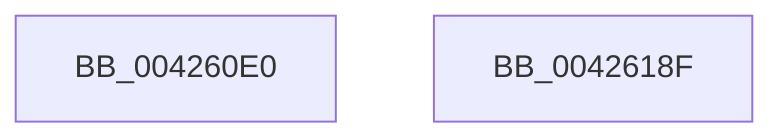

# tlgWriteTransfer_EtwWriteTransfer

- RVA: `0x004260E0`–`0x00426190` (길이 `176` bytes)
- VA: `0x00000001404260E0`
- 실행 섹션: `.text`
- PDB 이름 있음: `예`; PDB Function 태그: `아니요`
- unwind 정보 RVA: `0x0006C2A4`
- 디코드: `40`개 명령, `176/176` bytes 표시
- 미해석 바이트: `0` (있으면 어셈블리에 `.byte`로 보존)

> 이 문서는 커널 이미지의 기계어와 PDB 기호를 분석해 생성했습니다. 4번과 5번은 함수 원형과 자료형을 바이너리 사용 방식에서 추정한 C 해석이며 원본 소스 복구 결과는 아닙니다.

## 1. Dependencies

- 직접 호출 지점: **1**; 고유 호출 대상: **1**
- 직접 호출자로 확인된 함수: **411**
- RIP 상대 이미지 참조: **2**

### Outgoing calls
- `0x00426185` → [EtwWriteEx](../25/EtwWriteEx_function_0025F0D0.md) (function, `0x0025F0D0`)

### Direct callers
- [_tlgWriteTemplate&lt;long __cdecl(_tlgProvider_t const * __ptr64,void const * __ptr64,_GUID const * __ptr64,_GUID const * __ptr64,unsigned int,_EVENT_DATA_DESCRIPTOR * __ptr64),&amp;_tlgWriteTransfer_EtwWriteTransfer,_GUID const * __ptr64,_GUID const * __ptr64&gt;::Write&lt;_tlgWrapperByVal&lt;8&gt;,_tlgWrapperByVal&lt;4&gt;,_tlgWrapperByVal&lt;4&gt;,_tlgWrapperByVal&lt;1&gt;,_tlgWrapperByRef&lt;16&gt;,_tlgWrapperBinary,_tlgWrapperByVal&lt;8&gt;,_tlgWrapperByVal&lt;1&gt;,_tlgWrapperBinary,_tlgWrapperByVal&lt;8&gt;,_tlgWrapperByVal&lt;1&gt;,_tlgWrapperBinary,_tlgWrapperByVal&lt;8&gt;,_tlgWrapperByVal&lt;1&gt;,_tlgWrapperBinary,_tlgWrapperByVal&lt;8&gt;,_tlgWrapperByVal&lt;1&gt;,_tlgWrapperBinary,_tlgWrapperByVal&lt;8&gt;,_tlgWrapperByVal&lt;1&gt;,_tlgWrapperBinary,_tlgWrapperByVal&lt;8&gt;,_tlgWrapperByVal&lt;1&gt;,_tlgWrapperBinary,_tlgWrapperByVal&lt;8&gt;,_tlgWrapperByVal&lt;1&gt;,_tlgWrapperBinary,_tlgWrapperByVal&lt;8&gt;,_tlgWrapperByVal&lt;1&gt;,_tlgWrapperBinary,_tlgWrapperByVal&lt;4&gt;,_tlgWrapperByVal&lt;1&gt; &gt;](../20/_tlgWriteTemplate_long___cdecl__tlgProvider_t_const___ptr64_void_const___ptr64__GUID_const___ptr64___function_00200008.md) at `0x00200417`
- [PpmUpdatePerformanceFeedback](../2D/PpmUpdatePerformanceFeedback_function_002DE580.md) at `0x002DED2C`
- [FsRtlpAcknowledgeOplockBreakByCacheFlags](../3F/FsRtlpAcknowledgeOplockBreakByCacheFlags_function_003F1988.md) at `0x003F1ACB`
- [FsRtlpAcknowledgeOplockBreakByCacheFlags](../3F/FsRtlpAcknowledgeOplockBreakByCacheFlags_function_003F1988.md) at `0x003F2002`
- [FsRtlpAcknowledgeOplockBreakByCacheFlags](../3F/FsRtlpAcknowledgeOplockBreakByCacheFlags_function_003F1988.md) at `0x003F2380`
- [FsRtlpAcknowledgeOplockBreakByCacheFlags](../3F/FsRtlpAcknowledgeOplockBreakByCacheFlags_function_003F1988.md) at `0x003F2663`
- [FsRtlCheckOplockEx2](../3F/FsRtlCheckOplockEx2_function_003F2BC0.md) at `0x003F31ED`
- [CcPostVolumeTelemetry](CcPostVolumeTelemetry_function_00420FF8.md) at `0x00421692`
- [CcPostVolumeTelemetry](CcPostVolumeTelemetry_function_00420FF8.md) at `0x00423047`
- [EtwpFileModeCompress](EtwpFileModeCompress_function_004241B8.md) at `0x004242A2`
- [Pdcv2EventWrite_ACTIVATION_CLIENT_DEACTIVATE](Pdcv2EventWrite_ACTIVATION_CLIENT_DEACTIVATE_function_00424588.md) at `0x004247C7`
- [FsRtlpOplockCleanup](FsRtlpOplockCleanup_function_00425030.md) at `0x0042521C`
- [FsRtlpOplockCleanup](FsRtlpOplockCleanup_function_00425030.md) at `0x004252F0`
- [FsRtlpOplockCleanup](FsRtlpOplockCleanup_function_00425030.md) at `0x0042542A`
- [FsRtlpComputeShareableOplockState](FsRtlpComputeShareableOplockState_function_004256EC.md) at `0x00425814`
- [FsRtlpComputeShareableOplockState](FsRtlpComputeShareableOplockState_function_004256EC.md) at `0x004258A7`
- [FsRtlpRemoveAndCompleteRHIrp](FsRtlpRemoveAndCompleteRHIrp_function_00425964.md) at `0x00425B90`
- [FsRtlpRemoveAndCompleteRHIrp](FsRtlpRemoveAndCompleteRHIrp_function_00425964.md) at `0x00425C07`
- [FsRtlpRemoveAndCompleteWaitingIrp](FsRtlpRemoveAndCompleteWaitingIrp_function_00425FC0.md) at `0x00426029`
- [PopDiagTraceFxDeviceAccounting](PopDiagTraceFxDeviceAccounting_function_00426614.md) at `0x00426938`
- [KiTraceLogHeteroRundown](KiTraceLogHeteroRundown_function_004269B4.md) at `0x00426BA1`
- [KiTraceLogHeteroRundown](KiTraceLogHeteroRundown_function_004269B4.md) at `0x00426D4B`
- [PopTraceThermalRequestPassiveHistogram](PopTraceThermalRequestPassiveHistogram_function_0042FFB4.md) at `0x004301D5`
- [PopDiagTraceDripsHistogram](../43/PopDiagTraceDripsHistogram_function_0043B430.md) at `0x0043B64A`
- [PpmHvSnapPerformanceAccumulation](../44/PpmHvSnapPerformanceAccumulation_function_0044FA34.md) at `0x0044FE2B`
- [FsRtlpCancelOplockRHIrp](../4A/FsRtlpCancelOplockRHIrp_function_004A55F0.md) at `0x004A56D7`
- [FsRtlpCancelOplockRHIrp](../4A/FsRtlpCancelOplockRHIrp_function_004A55F0.md) at `0x004A584E`
- [MiLogContinueTrim](../4C/MiLogContinueTrim_function_004C3D34.md) at `0x004C3E29`
- [KeEstimateClockTickDuration](../4C/KeEstimateClockTickDuration_function_004C7CCC.md) at `0x004C7FE5`
- [PopTracePowerReconfig](../4D/PopTracePowerReconfig_function_004D09AC.md) at `0x004D0AF8`
- [SepLogUnmatchedSessionFlagImpersonationAttempt](../4D/SepLogUnmatchedSessionFlagImpersonationAttempt_function_004D8574.md) at `0x004D86C2`
- [PopTraceThermalZonePassiveHistogram](../4D/PopTraceThermalZonePassiveHistogram_function_004DDD10.md) at `0x004DDE5A`
- [PopDiagTraceRtcWakeInfo](../4D/PopDiagTraceRtcWakeInfo_function_004DEA14.md) at `0x004DECCB`
- [IoCaptureLiveDump](../4E/IoCaptureLiveDump_function_004E085C.md) at `0x004E0C2D`
- [IoCaptureLiveDump](../4E/IoCaptureLiveDump_function_004E085C.md) at `0x004E0E8E`
- [IoCaptureLiveDump](../4E/IoCaptureLiveDump_function_004E085C.md) at `0x004E1093`
- [IopDumpTraceLoadCrashDumpDriverFailure](../4E/IopDumpTraceLoadCrashDumpDriverFailure_function_004E2C18.md) at `0x004E2D05`
- [PopTraceEsSetting](../4E/PopTraceEsSetting_function_004E3A64.md) at `0x004E3B2D`
- [ExLogTimeZoneInformation](../4E/ExLogTimeZoneInformation_function_004E3B50.md) at `0x004E3CE2`
- [PopPlUnregisterDevice](../4E/PopPlUnregisterDevice_function_004E3FF4.md) at `0x004E414D`
- [FsRtlpCancelWaitingIrp](../4E/FsRtlpCancelWaitingIrp_function_004E4698.md) at `0x004E4794`
- [FsRtlpCancelWaitingIrp](../4E/FsRtlpCancelWaitingIrp_function_004E4698.md) at `0x004E4886`
- [FsRtlpCancelWaitingIrp](../4E/FsRtlpCancelWaitingIrp_function_004E4698.md) at `0x004E4946`
- [FsRtlpOplockBreakByCacheFlags](../4E/FsRtlpOplockBreakByCacheFlags_function_004E4990.md) at `0x004E4B10`
- [FsRtlpOplockBreakByCacheFlags](../4E/FsRtlpOplockBreakByCacheFlags_function_004E4990.md) at `0x004E4C5E`
- [FsRtlpOplockBreakByCacheFlags](../4E/FsRtlpOplockBreakByCacheFlags_function_004E4990.md) at `0x004E4E80`
- [FsRtlpOplockBreakByCacheFlags](../4E/FsRtlpOplockBreakByCacheFlags_function_004E4990.md) at `0x004E4FC1`
- [FsRtlpOplockBreakByCacheFlags](../4E/FsRtlpOplockBreakByCacheFlags_function_004E4990.md) at `0x004E529F`
- [FsRtlpOplockBreakByCacheFlags](../4E/FsRtlpOplockBreakByCacheFlags_function_004E4990.md) at `0x004E560F`
- [FsRtlpOplockBreakByCacheFlags](../4E/FsRtlpOplockBreakByCacheFlags_function_004E4990.md) at `0x004E58B3`
- [FsRtlpOplockBreakByCacheFlags](../4E/FsRtlpOplockBreakByCacheFlags_function_004E4990.md) at `0x004E5B00`
- [FsRtlpOplockBreakByCacheFlags](../4E/FsRtlpOplockBreakByCacheFlags_function_004E4990.md) at `0x004E5C8C`
- [FsRtlpOplockBreakByCacheFlags](../4E/FsRtlpOplockBreakByCacheFlags_function_004E4990.md) at `0x004E62C6`
- [FsRtlpOplockBreakByCacheFlags](../4E/FsRtlpOplockBreakByCacheFlags_function_004E4990.md) at `0x004E640C`
- [FsRtlpOplockBreakByCacheFlags](../4E/FsRtlpOplockBreakByCacheFlags_function_004E4990.md) at `0x004E64ED`
- [FsRtlpOplockBreakByCacheFlags](../4E/FsRtlpOplockBreakByCacheFlags_function_004E4990.md) at `0x004E65BB`
- [FsRtlpOplockBreakByCacheFlags](../4E/FsRtlpOplockBreakByCacheFlags_function_004E4990.md) at `0x004E66D5`
- [FsRtlpOplockBreakByCacheFlags](../4E/FsRtlpOplockBreakByCacheFlags_function_004E4990.md) at `0x004E67A3`
- [FsRtlpOplockBreakByCacheFlags](../4E/FsRtlpOplockBreakByCacheFlags_function_004E4990.md) at `0x004E6A06`
- [FsRtlpOplockBreakByCacheFlags](../4E/FsRtlpOplockBreakByCacheFlags_function_004E4990.md) at `0x004E6B4E`
- [FsRtlpOplockBreakByCacheFlags](../4E/FsRtlpOplockBreakByCacheFlags_function_004E4990.md) at `0x004E6CA1`
- [FsRtlpOplockBreakByCacheFlags](../4E/FsRtlpOplockBreakByCacheFlags_function_004E4990.md) at `0x004E6E8D`
- [FsRtlpRequestShareableOplock](../4E/FsRtlpRequestShareableOplock_function_004E6EC8.md) at `0x004E766B`
- [FsRtlpWaitOnIrp](../4E/FsRtlpWaitOnIrp_function_004E7998.md) at `0x004E7A9E`
- [FsRtlpWaitOnIrp](../4E/FsRtlpWaitOnIrp_function_004E7998.md) at `0x004E7EB9`
- [FsRtlpWaitOnIrp](../4E/FsRtlpWaitOnIrp_function_004E7998.md) at `0x004E7F5F`
- [PopTraceThermalRequestActiveActivity](../4E/PopTraceThermalRequestActiveActivity_function_004E9104.md) at `0x004E9372`
- [HalpCheckSratMemoryRanges](../55/HalpCheckSratMemoryRanges_function_00558CD0.md) at `0x00558E49`
- [HalpNumaAddRangeProximity](../55/HalpNumaAddRangeProximity_function_00558EC0.md) at `0x00558F5A`
- [HalpNumaAddRangeProximity](../55/HalpNumaAddRangeProximity_function_00558EC0.md) at `0x00559083`
- [HalpNumaGetHmatConfigSize](../55/HalpNumaGetHmatConfigSize_function_00559230.md) at `0x005594F1`
- [FsRtlpGrantAnyOplockFromExclusive](../58/FsRtlpGrantAnyOplockFromExclusive_function_00582540.md) at `0x005826DE`
- [IopDumpTraceCrashDumpDisabled](../59/IopDumpTraceCrashDumpDisabled_function_00594C8C.md) at `0x00594D44`
- [IopDumpTraceCrashDumpReconfiguration](../59/IopDumpTraceCrashDumpReconfiguration_function_00594D68.md) at `0x00594E55`
- [IopDumpTraceDisableCrashDumpFailure](../59/IopDumpTraceDisableCrashDumpFailure_function_00594E78.md) at `0x00594F65`
- [IopDumpTraceFreeDumpStackFailure](../59/IopDumpTraceFreeDumpStackFailure_function_00594F88.md) at `0x00595075`
- [IopDumpTraceInitializeCrashDumpFailure](../59/IopDumpTraceInitializeCrashDumpFailure_function_00595098.md) at `0x00595185`
- [IopDumpTraceInitializeDumpStackFailure](../59/IopDumpTraceInitializeDumpStackFailure_function_005951A8.md) at `0x00595295`
- [IopDumpTraceLoadDumpStackFailure](../59/IopDumpTraceLoadDumpStackFailure_function_005952B8.md) at `0x005953A5`
- [IoWriteDeferredLiveDumpData](../59/IoWriteDeferredLiveDumpData_function_00598CD0.md) at `0x00598E2C`
- [IopLiveDumpAllocAndInitResources](../59/IopLiveDumpAllocAndInitResources_function_005993B0.md) at `0x00599A46`
- [IopLiveDumpAllocateExtraBuffers](../59/IopLiveDumpAllocateExtraBuffers_function_00599A9C.md) at `0x00599C92`
- [IopLiveDumpAllocateFromVMMemoryPartition](../59/IopLiveDumpAllocateFromVMMemoryPartition_function_0059A2D8.md) at `0x0059A481`
- [IopLiveDumpCaptureMemoryPages](../59/IopLiveDumpCaptureMemoryPages_function_0059B0A0.md) at `0x0059B2F1`
- [IopLiveDumpEstimateMemoryPages](../59/IopLiveDumpEstimateMemoryPages_function_0059BA80.md) at `0x0059BCAA`
- [IopLiveDumpEstimateMemoryPages](../59/IopLiveDumpEstimateMemoryPages_function_0059BA80.md) at `0x0059BEAD`
- [IopLiveDumpOpenVMMemoryPartition](../59/IopLiveDumpOpenVMMemoryPartition_function_0059D508.md) at `0x0059D6AB`
- [IopLiveDumpPolicyChangeWnfCallback](../59/IopLiveDumpPolicyChangeWnfCallback_function_0059D6E0.md) at `0x0059D8CE`
- [IopLiveDumpPolicyChangeWnfCallback](../59/IopLiveDumpPolicyChangeWnfCallback_function_0059D6E0.md) at `0x0059D97E`
- [IopLiveDumpRegisterWnfNotificationCallback](../59/IopLiveDumpRegisterWnfNotificationCallback_function_0059DE08.md) at `0x0059DEF1`
- [IopLiveDumpTraceCaptureGenerateIptSecondaryDataDuration](../59/IopLiveDumpTraceCaptureGenerateIptSecondaryDataDuration_function_0059E50C.md) at `0x0059E60E`
- [IopLiveDumpTraceCaptureProcessorContextDuration](../59/IopLiveDumpTraceCaptureProcessorContextDuration_function_0059E718.md) at `0x0059E82A`
- [IopLiveDumpTraceCorralProcessorsDuration](../59/IopLiveDumpTraceCorralProcessorsDuration_function_0059E854.md) at `0x0059E9EA`
- [IopLiveDumpTraceDumpDisabledOnBoot](../59/IopLiveDumpTraceDumpDisabledOnBoot_function_0059EA10.md) at `0x0059EADF`
- [IopLiveDumpTraceMarkImportantDumpDataDuration](../59/IopLiveDumpTraceMarkImportantDumpDataDuration_function_0059EE44.md) at `0x0059EF56`
- [IopLiveDumpTraceMarkRequiredDumpDataDuration](../59/IopLiveDumpTraceMarkRequiredDumpDataDuration_function_0059EF80.md) at `0x0059F092`
- [IopLiveDumpTracePopulateBitmapForDumpDuration](../59/IopLiveDumpTracePopulateBitmapForDumpDuration_function_0059F158.md) at `0x0059F289`
- [IopLiveDumpTraceUncorralProcessorsDuration](../59/IopLiveDumpTraceUncorralProcessorsDuration_function_0059F324.md) at `0x0059F4BA`
- [PnpTraceWatchdogViolation](../5A/PnpTraceWatchdogViolation_function_005AA2FC.md) at `0x005AA419`
- [KeGetNextClockTickDuration](../5B/KeGetNextClockTickDuration_function_005BA350.md) at `0x005BA467`
- [KePrepareClockTimerForIdle](../5B/KePrepareClockTimerForIdle_function_005BA49C.md) at `0x005BA7DD`
- [KePrepareClockTimerForPlatformIdle](../5B/KePrepareClockTimerForPlatformIdle_function_005BA820.md) at `0x005BABF0`
- [KeResumeClockTimerFromIdle](../5B/KeResumeClockTimerFromIdle_function_005BACC4.md) at `0x005BB1D8`
- [KiGetNextClockOwner](../5B/KiGetNextClockOwner_function_005BB5D4.md) at `0x005BB814`
- [KeSetUserCetAppcompatOptions](../5C/KeSetUserCetAppcompatOptions_function_005C7F50.md) at `0x005C8003`
- [PfpPartitionCreate](../5C/PfpPartitionCreate_function_005CDE8C.md) at `0x005CDF1E`
- [PfpPartitionCreate](../5C/PfpPartitionCreate_function_005CDE8C.md) at `0x005CE00D`
- [PoTraceForceIdleReset](../5D/PoTraceForceIdleReset_function_005D5C5C.md) at `0x005D5CF8`
- [PopTraceBootError](../5D/PopTraceBootError_function_005D775C.md) at `0x005D783E`
- [PopTraceCr3Mitigated](../5D/PopTraceCr3Mitigated_function_005D7860.md) at `0x005D78DB`
- [PopTraceCr3Tripped](../5D/PopTraceCr3Tripped_function_005D78FC.md) at `0x005D7977`
- [PopTraceEsState](../5D/PopTraceEsState_function_005D7998.md) at `0x005D7AEC`
- [PopTracePowerLimitHistogram](../5D/PopTracePowerLimitHistogram_function_005D7B10.md) at `0x005D7D20`
- [PopTraceSmbiosChange](../5D/PopTraceSmbiosChange_function_005D7D88.md) at `0x005D7E52`
- [PopTraceThermalStandbyComplete](../5D/PopTraceThermalStandbyComplete_function_005D7E74.md) at `0x005D7F21`
- [PopTraceThermalStandbyInitiated](../5D/PopTraceThermalStandbyInitiated_function_005D7F44.md) at `0x005D7FC0`
- [PopTraceThermalZoneActiveActivity](../5D/PopTraceThermalZoneActiveActivity_function_005D7FE0.md) at `0x005D8174`
- [PopTraceZoneCr3Mitigated](../5D/PopTraceZoneCr3Mitigated_function_005D81B4.md) at `0x005D829B`
- [PopTraceZoneCr3Tripped](../5D/PopTraceZoneCr3Tripped_function_005D82DC.md) at `0x005D8454`
- [PpmCheckTimerCallback](../5D/PpmCheckTimerCallback_function_005D85B0.md) at `0x005D85F2`
- [PopAdaptiveStandbyActivatorCallback](../5D/PopAdaptiveStandbyActivatorCallback_function_005DC590.md) at `0x005DC64F`
- [PopAdaptiveStandbyActivatorCallback](../5D/PopAdaptiveStandbyActivatorCallback_function_005DC590.md) at `0x005DC73C`
- [PopAdaptiveStandbyActivatorCallback](../5D/PopAdaptiveStandbyActivatorCallback_function_005DC590.md) at `0x005DC77D`
- [PopPlUnregisterComponent](../5D/PopPlUnregisterComponent_function_005DE2E4.md) at `0x005DE361`
- [PspProcessQosChangeNotificationInsertList](../5E/PspProcessQosChangeNotificationInsertList_function_005E2FD4.md) at `0x005E30AC`
- [Pdcv2EventWrite_ACTIVATION_CLIENT_CALLBACK](../60/Pdcv2EventWrite_ACTIVATION_CLIENT_CALLBACK_function_00605D7C.md) at `0x00605FDF`
- [CarEtwCrashEvent](../61/CarEtwCrashEvent_function_00617800.md) at `0x006179B1`
- [CarEtwRegister](../61/CarEtwRegister_function_006179D4.md) at `0x00617B36`
- [CarEtwWriteBugCheckEvent](../61/CarEtwWriteBugCheckEvent_function_00617B68.md) at `0x00617C7F`
- [CarEtwWriteLiveDumpEvent](../61/CarEtwWriteLiveDumpEvent_function_00617CD8.md) at `0x00617DE2`
- [CarLoadImageHandler](../61/CarLoadImageHandler_function_00618128.md) at `0x0061828F`
- [CarTipLogDriverLoad](../61/CarTipLogDriverLoad_function_006182C0.md) at `0x006183C7`
- [EtwTimLogControlProtectionKernelModeReturnMismatch](../65/EtwTimLogControlProtectionKernelModeReturnMismatch_function_00651E84.md) at `0x00652353`
- [PrpWriteTraceLoggingEvent](../66/PrpWriteTraceLoggingEvent_function_0066774C.md) at `0x006678E4`
- [UcpFindOrCreateTelemetryRecord](../69/UcpFindOrCreateTelemetryRecord_function_0069B164.md) at `0x0069B251`
- [UcpLogUnexpectedCodePathEvent](../69/UcpLogUnexpectedCodePathEvent_function_0069B388.md) at `0x0069B463`
- [FsRtlpAcknowledgeOplockBreakByCacheFlags$fin$0](../6D/FsRtlpAcknowledgeOplockBreakByCacheFlags_fin_0_function_006D2D80.md) at `0x006D2E46`
- [FsRtlpCancelOplockRHIrp$fin$0](../6D/FsRtlpCancelOplockRHIrp_fin_0_function_006D4423.md) at `0x006D4508`
- [FsRtlpCancelWaitingIrp$fin$0](../6D/FsRtlpCancelWaitingIrp_fin_0_function_006D5210.md) at `0x006D52AF`
- [FsRtlpWaitOnIrp$fin$0](../6D/FsRtlpWaitOnIrp_fin_0_function_006D5320.md) at `0x006D53F8`
- [FsRtlpWaitOnIrp$fin$0](../6D/FsRtlpWaitOnIrp_fin_0_function_006D5320.md) at `0x006D54B3`
- [sub_006D75C8](../6D/Unknown_function_006D75C8.md) at `0x006D7724`
- [sub_006D7730](../6D/Unknown_function_006D7730.md) at `0x006D780F`
- [sub_006D9F1A](../6D/Unknown_function_006D9F1A.md) at `0x006DA046`
- [sub_006DD630](../6D/Unknown_function_006DD630.md) at `0x006DD7C7`
- [sub_006E57E2](../6E/Unknown_function_006E57E2.md) at `0x006E5892`
- [sub_006E57E2](../6E/Unknown_function_006E57E2.md) at `0x006E597A`
- [sub_006E5A5E](../6E/Unknown_function_006E5A5E.md) at `0x006E5B44`
- [sub_006E5BD0](../6E/Unknown_function_006E5BD0.md) at `0x006E5CDA`
- [sub_006E5CE6](../6E/Unknown_function_006E5CE6.md) at `0x006E5DC4`
- [sub_006E5CE6](../6E/Unknown_function_006E5CE6.md) at `0x006E5E23`
- [sub_006E5F9E](../6E/Unknown_function_006E5F9E.md) at `0x006E6078`
- [sub_006E6084](../6E/Unknown_function_006E6084.md) at `0x006E616B`
- [sub_006EDC8E](../6E/Unknown_function_006EDC8E.md) at `0x006EDD27`
- [sub_006EE864](../6E/Unknown_function_006EE864.md) at `0x006EE8E7`
- [sub_006F23BA](../6F/Unknown_function_006F23BA.md) at `0x006F259C`
- [sub_006F418E](../6F/Unknown_function_006F418E.md) at `0x006F41DC`
- [sub_006F7B82](../6F/Unknown_function_006F7B82.md) at `0x006F7C5D`
- [sub_006F7B82](../6F/Unknown_function_006F7B82.md) at `0x006F7CFA`
- [sub_006FB7DC](../6F/Unknown_function_006FB7DC.md) at `0x006FB82F`
- [sub_006FB9B4](../6F/Unknown_function_006FB9B4.md) at `0x006FBA2D`
- [sub_006FB9B4](../6F/Unknown_function_006FB9B4.md) at `0x006FBAAB`
- [PopAdaptiveStandbyHandleBatteryUpdate](../../page/6F/PopAdaptiveStandbyHandleBatteryUpdate_function_006FD39C.md) at `0x006FD4C6`
- [PopAdaptiveStandbyHandleBatteryUpdate](../../page/6F/PopAdaptiveStandbyHandleBatteryUpdate_function_006FD39C.md) at `0x006FD74E`
- [PopAdaptiveStandbyHandleBatteryUpdate](../../page/6F/PopAdaptiveStandbyHandleBatteryUpdate_function_006FD39C.md) at `0x006FD7CE`
- [FsRtlpOplockPerfSendData](../../page/6F/FsRtlpOplockPerfSendData_function_006FDB80.md) at `0x006FDED5`
- [KiTraceLogControlCallback](../../page/6F/KiTraceLogControlCallback_function_006FF9C0.md) at `0x006FFB95`
- [KiTraceLogControlCallback](../../page/6F/KiTraceLogControlCallback_function_006FF9C0.md) at `0x006FFC5D`
- [PnpTraceDeviceConfig](../../page/70/PnpTraceDeviceConfig_function_00700CC0.md) at `0x007010AE`
- [PopDiagTraceSleepReliabilityDiagConfigUpdate](../../page/70/PopDiagTraceSleepReliabilityDiagConfigUpdate_function_007025D8.md) at `0x0070267D`
- [HalpTimerTraceTimingHardware](../../page/70/HalpTimerTraceTimingHardware_function_00706350.md) at `0x0070654B`
- [HalpTscReportSyncStatus](../../page/70/HalpTscReportSyncStatus_function_00707E44.md) at `0x00707F36`
- [FsRtlCheckUpperOplock](../../page/71/FsRtlCheckUpperOplock_function_007145F0.md) at `0x00714A19`
- [IopCrashDumpPolicyChangeWnfCallback](../../page/71/IopCrashDumpPolicyChangeWnfCallback_function_00719E40.md) at `0x0071A048`
- [IopCrashDumpPolicyChangeWnfCallback](../../page/71/IopCrashDumpPolicyChangeWnfCallback_function_00719E40.md) at `0x0071A106`
- [IopDumpTraceForceDumpDisabled](../../page/71/IopDumpTraceForceDumpDisabled_function_0071A138.md) at `0x0071A217`
- [IopInitializeDumpPolicySettings](../../page/71/IopInitializeDumpPolicySettings_function_0071A444.md) at `0x0071A702`
- [IopTraceCrashDumpDisabledOnBoot](../../page/71/IopTraceCrashDumpDisabledOnBoot_function_0071A81C.md) at `0x0071A8FB`
- [IoQueryEnvironmentVariableInfoEx](../../page/72/IoQueryEnvironmentVariableInfoEx_function_00721CA8.md) at `0x00721E03`
- [PnpTraceDeviceRemovalForResetComplete](../../page/73/PnpTraceDeviceRemovalForResetComplete_function_0073C804.md) at `0x0073C99C`
- [PnpTraceDmaGuardSystemPolicy](../../page/73/PnpTraceDmaGuardSystemPolicy_function_0073C9C0.md) at `0x0073CA64`
- [PnpTraceDockDeviceEnumeration](../../page/73/PnpTraceDockDeviceEnumeration_function_0073CA88.md) at `0x0073CB67`
- [PnpTraceDriverBlocked](../../page/73/PnpTraceDriverBlocked_function_0073CB88.md) at `0x0073CC5E`
- [PnpTraceIommuDeviceProperties](../../page/73/PnpTraceIommuDeviceProperties_function_0073CC80.md) at `0x0073CD3F`
- [PnpTraceRebalanceResult](../../page/73/PnpTraceRebalanceResult_function_0073CD60.md) at `0x0073D0CB`
- [PnpTraceRequestDeviceRemovalForReset](../../page/73/PnpTraceRequestDeviceRemovalForReset_function_0073D108.md) at `0x0073D252`
- [PfTCleanup](../../page/75/PfTCleanup_function_00751208.md) at `0x00751299`
- [PfTCleanup](../../page/75/PfTCleanup_function_00751208.md) at `0x0075148E`
- [PfTStart](../../page/75/PfTStart_function_007517AC.md) at `0x00751845`
- [PfTStart](../../page/75/PfTStart_function_007517AC.md) at `0x00751B7D`
- [PfDeletePartition](../../page/75/PfDeletePartition_function_00751EB4.md) at `0x00751F49`
- [PfDeletePartition](../../page/75/PfDeletePartition_function_00751EB4.md) at `0x00751FE0`
- [PfpPartitionFindOrCreate](../../page/75/PfpPartitionFindOrCreate_function_00752080.md) at `0x00752112`
- [PfpPartitionFindOrCreate](../../page/75/PfpPartitionFindOrCreate_function_00752080.md) at `0x007521CD`
- [PpmPerfTelemetryWorker](../../page/75/PpmPerfTelemetryWorker_function_0075AED0.md) at `0x0075B042`
- [PopThermalHandlePreviousShutdown](../../page/75/PopThermalHandlePreviousShutdown_function_0075F400.md) at `0x0075F79E`
- [PopDiagTraceAdaptiveBootOverridePrepared](../../page/76/PopDiagTraceAdaptiveBootOverridePrepared_function_00760470.md) at `0x007605CC`
- [PopDiagTraceAdaptiveOverrideClear](../../page/76/PopDiagTraceAdaptiveOverrideClear_function_007605FC.md) at `0x007606AA`
- [PopDiagTraceAdaptiveOverrideTriggered](../../page/76/PopDiagTraceAdaptiveOverrideTriggered_function_007606CC.md) at `0x007607E2`
- [PopDiagTraceBatteryAlarmStatus](../../page/76/PopDiagTraceBatteryAlarmStatus_function_00760804.md) at `0x007609ED`
- [PopDiagTraceBatteryAlarmStatus](../../page/76/PopDiagTraceBatteryAlarmStatus_function_00760804.md) at `0x00760B0A`
- [PopDiagTraceBatteryTriggerMet](../../page/76/PopDiagTraceBatteryTriggerMet_function_00760C60.md) at `0x00760FC7`
- [PopDiagTraceDirectedDripsInitialization](../../page/76/PopDiagTraceDirectedDripsInitialization_function_007610D0.md) at `0x0076115A`
- [PopDiagTraceDozeDeferralDecision](../../page/76/PopDiagTraceDozeDeferralDecision_function_007612F0.md) at `0x0076150F`
- [PopDiagTraceExternalDisplayState](../../page/76/PopDiagTraceExternalDisplayState_function_00761540.md) at `0x007615EE`
- [PopDiagTraceFxDeviceUnregistration](../../page/76/PopDiagTraceFxDeviceUnregistration_function_007616AC.md) at `0x00761811`
- [PopDiagTracePowerButtonBugcheck](../../page/76/PopDiagTracePowerButtonBugcheck_function_00761F14.md) at `0x00762316`
- [PopDiagTraceSetHiberFileFailurePoint](../../page/76/PopDiagTraceSetHiberFileFailurePoint_function_00762D50.md) at `0x00762E7E`
- [PopDiagTraceSmartSuspendPrediction](../../page/76/PopDiagTraceSmartSuspendPrediction_function_00763124.md) at `0x0076343C`
- [PopDiagTraceStateTransitionFailurePoint](../../page/76/PopDiagTraceStateTransitionFailurePoint_function_00763468.md) at `0x007635F1`
- [PopDiagTraceUmpoAlpcProcessingError](../../page/76/PopDiagTraceUmpoAlpcProcessingError_function_0076373C.md) at `0x007637B7`
- [PopTraceEsBgActivityPolicyUpdate](../../page/76/PopTraceEsBgActivityPolicyUpdate_function_007639E8.md) at `0x00763A89`
- [PopTraceHibernatePolicyUpdate](../../page/76/PopTraceHibernatePolicyUpdate_function_00763B18.md) at `0x00763BC6`
- [PopTraceMonitorOnRequestUserInput](../../page/76/PopTraceMonitorOnRequestUserInput_function_00763BE8.md) at `0x00763CB2`
- [PopTraceSleepCheckpointInitFailure](../../page/76/PopTraceSleepCheckpointInitFailure_function_00763D7C.md) at `0x00763DF7`
- [PopWnfUsb4DisplayPresenceCallback](../../page/76/PopWnfUsb4DisplayPresenceCallback_function_007656E0.md) at `0x0076591D`
- [PopPolicyDeviceHandleWakeAlarmNotification](../../page/76/PopPolicyDeviceHandleWakeAlarmNotification_function_007660A4.md) at `0x00766375`
- [PopBatteryChargeLimitSettingWnfCallback](../../page/76/PopBatteryChargeLimitSettingWnfCallback_function_00766670.md) at `0x007667CA`
- [PopBatteryInitialize](../../page/76/PopBatteryInitialize_function_00766834.md) at `0x00766B24`
- [PopBatteryPublishChargeLimitStatus](../../page/76/PopBatteryPublishChargeLimitStatus_function_00766BBC.md) at `0x00766D01`
- [PopBatteryTestExemptPolicyRegKeyAccess](../../page/76/PopBatteryTestExemptPolicyRegKeyAccess_function_00766E04.md) at `0x00766F1A`
- [PopBatteryUpdateTestExempt](../../page/76/PopBatteryUpdateTestExempt_function_00766F54.md) at `0x00767074`
- [PopBatteryUpdateTestExempt](../../page/76/PopBatteryUpdateTestExempt_function_00766F54.md) at `0x007670C5`
- [PopBatteryUpdateTestExempt](../../page/76/PopBatteryUpdateTestExempt_function_00766F54.md) at `0x00767141`
- [PopBatteryUpdateTestExempt](../../page/76/PopBatteryUpdateTestExempt_function_00766F54.md) at `0x007671E5`
- [PopCheckCachedPowerSourceStateUpdates](../../page/76/PopCheckCachedPowerSourceStateUpdates_function_0076728C.md) at `0x00767405`
- [PopPowerAdapterAdd](../../page/76/PopPowerAdapterAdd_function_00767430.md) at `0x0076760F`
- [PopPowerAdapterAdd](../../page/76/PopPowerAdapterAdd_function_00767430.md) at `0x0076781E`
- [PopPowerAdapterAdd](../../page/76/PopPowerAdapterAdd_function_00767430.md) at `0x00767996`
- [PopPowerAdapterPublishRecState](../../page/76/PopPowerAdapterPublishRecState_function_007679CC.md) at `0x00767C0C`
- [PopPowerAdapterRecOverrideWnfCallback](../../page/76/PopPowerAdapterRecOverrideWnfCallback_function_00767D30.md) at `0x00767E1A`
- [PopPowerAdapterReinitialize](../../page/76/PopPowerAdapterReinitialize_function_00767E48.md) at `0x00767FE1`
- [PopPowerAdapterReinitialize](../../page/76/PopPowerAdapterReinitialize_function_00767E48.md) at `0x0076814D`
- [PopPowerAdapterRemove](../../page/76/PopPowerAdapterRemove_function_00768180.md) at `0x0076827F`
- [PopPowerAdapterTraceFailure](../../page/76/PopPowerAdapterTraceFailure_function_007682B8.md) at `0x007683BB`
- [PopUsbErrorWNFNotificationCallback](../../page/76/PopUsbErrorWNFNotificationCallback_function_00768470.md) at `0x007685D2`
- [PopAdaptiveStandbyActionWorker](../../page/76/PopAdaptiveStandbyActionWorker_function_0076C9B0.md) at `0x0076CA25`
- [PopAdaptiveStandbyActionWorker](../../page/76/PopAdaptiveStandbyActionWorker_function_0076C9B0.md) at `0x0076CA85`
- [PopAdaptiveStandbyActionWorker](../../page/76/PopAdaptiveStandbyActionWorker_function_0076C9B0.md) at `0x0076CAF3`
- [PopAdaptiveStandbyCheckHibernateBudgetAction](../../page/76/PopAdaptiveStandbyCheckHibernateBudgetAction_function_0076CB54.md) at `0x0076D14B`
- [PopAdaptiveStandbyCheckHibernateReserveAction](../../page/76/PopAdaptiveStandbyCheckHibernateReserveAction_function_0076D180.md) at `0x0076D3C1`
- [PopAdaptiveStandbyCheckRestrictedStandbyBudgetAction](../../page/76/PopAdaptiveStandbyCheckRestrictedStandbyBudgetAction_function_0076D5C4.md) at `0x0076DB3C`
- [PopAdaptiveStandbyHandlePowerMessage](../../page/76/PopAdaptiveStandbyHandlePowerMessage_function_0076DB70.md) at `0x0076DC0D`
- [PopAdaptiveStandbyHandlePowerMessage](../../page/76/PopAdaptiveStandbyHandlePowerMessage_function_0076DB70.md) at `0x0076DCA5`
- [PopAdaptiveStandbyHandlePowerMessage](../../page/76/PopAdaptiveStandbyHandlePowerMessage_function_0076DB70.md) at `0x0076DD7E`
- [PopAdaptiveStandbyHandlePowerMessage](../../page/76/PopAdaptiveStandbyHandlePowerMessage_function_0076DB70.md) at `0x0076DDBB`
- [PopAdaptiveStandbyInitialize](../../page/76/PopAdaptiveStandbyInitialize_function_0076DDF8.md) at `0x0076DEAA`
- [PopAdaptiveStandbyInitialize](../../page/76/PopAdaptiveStandbyInitialize_function_0076DDF8.md) at `0x0076E137`
- [PopAdaptiveStandbyInitializeActivator](../../page/76/PopAdaptiveStandbyInitializeActivator_function_0076E174.md) at `0x0076E1EE`
- [PopAdaptiveStandbyInitializeActivator](../../page/76/PopAdaptiveStandbyInitializeActivator_function_0076E174.md) at `0x0076E293`
- [PopAdaptiveStandbyNotifyShellPhaseState](../../page/76/PopAdaptiveStandbyNotifyShellPhaseState_function_0076E2CC.md) at `0x0076E368`
- [PopAdaptiveStandbyNotifyShellPhaseState](../../page/76/PopAdaptiveStandbyNotifyShellPhaseState_function_0076E2CC.md) at `0x0076E3D3`
- [PopAdaptiveStandbyPolicyTimerWorker](../../page/76/PopAdaptiveStandbyPolicyTimerWorker_function_0076E410.md) at `0x0076E47F`
- [PopAdaptiveStandbyPolicyTimerWorker](../../page/76/PopAdaptiveStandbyPolicyTimerWorker_function_0076E410.md) at `0x0076E4F9`
- [PopAdaptiveStandbyPowerSettingCallback](../../page/76/PopAdaptiveStandbyPowerSettingCallback_function_0076E530.md) at `0x0076E5E6`
- [PopAdaptiveStandbyPowerSettingCallback](../../page/76/PopAdaptiveStandbyPowerSettingCallback_function_0076E530.md) at `0x0076E69C`
- [PopAdaptiveStandbyQueryReserveConfiguration](../../page/76/PopAdaptiveStandbyQueryReserveConfiguration_function_0076E6D0.md) at `0x0076E75A`
- [PopAdaptiveStandbyQueryReserveConfiguration](../../page/76/PopAdaptiveStandbyQueryReserveConfiguration_function_0076E6D0.md) at `0x0076E856`
- [PopAdaptiveStandbySessionStart](../../page/76/PopAdaptiveStandbySessionStart_function_0076E8C8.md) at `0x0076EC63`
- [PopAdaptiveStandbySessionStop](../../page/76/PopAdaptiveStandbySessionStop_function_0076EC94.md) at `0x0076EEE6`
- [PopAdaptiveStandbyWnfCallback](../../page/76/PopAdaptiveStandbyWnfCallback_function_0076F910.md) at `0x0076F9E4`
- [PopAdaptiveStandbyWnfCallback](../../page/76/PopAdaptiveStandbyWnfCallback_function_0076F910.md) at `0x0076FC39`
- [PopAdaptiveStandbyWnfCallback](../../page/76/PopAdaptiveStandbyWnfCallback_function_0076F910.md) at `0x0076FCEB`
- [PopAdaptiveStandbyWnfCallback](../../page/76/PopAdaptiveStandbyWnfCallback_function_0076F910.md) at `0x0076FE2D`
- [PopAdaptiveStandbyWnfCallback](../../page/76/PopAdaptiveStandbyWnfCallback_function_0076F910.md) at `0x0076FEA1`
- [PopSqmFanEnumeration](../../page/77/PopSqmFanEnumeration_function_007725FC.md) at `0x00772658`
- [PopSqmThermalCriticalEvent](../../page/77/PopSqmThermalCriticalEvent_function_00772678.md) at `0x00772800`
- [PopSqmThermalZoneEnumeration](../../page/77/PopSqmThermalZoneEnumeration_function_00772884.md) at `0x00772A27`
- [TtmiLogCalloutStart](../../page/77/TtmiLogCalloutStart_function_00778ED8.md) at `0x00778FE2`
- [TtmiLogCalloutStop](../../page/77/TtmiLogCalloutStop_function_00779014.md) at `0x00779218`
- [TtmiLogCalloutWatchdogCrashSkipped](../../page/77/TtmiLogCalloutWatchdogCrashSkipped_function_00779250.md) at `0x00779386`
- [TtmiLogDeviceArrivalNotified](../../page/77/TtmiLogDeviceArrivalNotified_function_007793BC.md) at `0x007794D1`
- [TtmiLogDeviceArrivedTerminalEvent](../../page/77/TtmiLogDeviceArrivedTerminalEvent_function_00779508.md) at `0x00779610`
- [TtmiLogDeviceAssignedTerminalEvent](../../page/77/TtmiLogDeviceAssignedTerminalEvent_function_00779648.md) at `0x00779708`
- [TtmiLogDeviceDepartedTerminalEvent](../../page/77/TtmiLogDeviceDepartedTerminalEvent_function_00779738.md) at `0x007797E1`
- [TtmiLogDeviceDepartureNotified](../../page/77/TtmiLogDeviceDepartureNotified_function_00779808.md) at `0x007798EF`
- [TtmiLogDeviceEnumeratedTerminalEvent](../../page/77/TtmiLogDeviceEnumeratedTerminalEvent_function_00779920.md) at `0x00779A28`
- [TtmiLogDeviceFromTerminalRemoved](../../page/77/TtmiLogDeviceFromTerminalRemoved_function_00779A60.md) at `0x00779B5D`
- [TtmiLogDeviceInputNotified](../../page/77/TtmiLogDeviceInputNotified_function_00779B94.md) at `0x00779CC8`
- [TtmiLogDeviceRundown](../../page/77/TtmiLogDeviceRundown_function_00779D00.md) at `0x00779E34`
- [TtmiLogDeviceSetInputWakeCapability](../../page/77/TtmiLogDeviceSetInputWakeCapability_function_00779E58.md) at `0x00779F35`
- [TtmiLogDeviceToTerminalAssigned](../../page/77/TtmiLogDeviceToTerminalAssigned_function_00779F68.md) at `0x0077A028`
- [TtmiLogDisplayPowerRequestSet](../../page/77/TtmiLogDisplayPowerRequestSet_function_0077A058.md) at `0x0077A150`
- [TtmiLogEnterProximity](../../page/77/TtmiLogEnterProximity_function_0077A188.md) at `0x0077A231`
- [TtmiLogExitProximity](../../page/77/TtmiLogExitProximity_function_0077A258.md) at `0x0077A339`
- [TtmiLogInactivityTimerReset](../../page/77/TtmiLogInactivityTimerReset_function_0077A36C.md) at `0x0077A415`
- [TtmiLogInactivityTimoutUpdate](../../page/77/TtmiLogInactivityTimoutUpdate_function_0077A43C.md) at `0x0077A4E5`
- [TtmiLogInitiateModernStandbyTransitionStart](../../page/77/TtmiLogInitiateModernStandbyTransitionStart_function_0077A50C.md) at `0x0077A5D2`
- [TtmiLogInitiateModernStandbyTransitionStop](../../page/77/TtmiLogInitiateModernStandbyTransitionStop_function_0077A600.md) at `0x0077A6A9`
- [TtmiLogProximityBlockedRequest](../../page/77/TtmiLogProximityBlockedRequest_function_0077A6D0.md) at `0x0077A7C0`
- [TtmiLogProximityPowerPress](../../page/77/TtmiLogProximityPowerPress_function_0077A7F0.md) at `0x0077A908`
- [TtmiLogQueueCreated](../../page/77/TtmiLogQueueCreated_function_0077A940.md) at `0x0077A9EF`
- [TtmiLogQueueDequeueEvent](../../page/77/TtmiLogQueueDequeueEvent_function_0077AA14.md) at `0x0077AAB7`
- [TtmiLogQueueDestroyed](../../page/77/TtmiLogQueueDestroyed_function_0077AAD8.md) at `0x0077AB4E`
- [TtmiLogQueueEnqueueEvent](../../page/77/TtmiLogQueueEnqueueEvent_function_0077AB6C.md) at `0x0077AC0F`
- [TtmiLogQueueHandleClosed](../../page/77/TtmiLogQueueHandleClosed_function_0077AC30.md) at `0x0077ACD1`
- [TtmiLogQueueHandleOpened](../../page/77/TtmiLogQueueHandleOpened_function_0077ACF4.md) at `0x0077AD95`
- [TtmiLogSessionActivate](../../page/77/TtmiLogSessionActivate_function_0077ADB8.md) at `0x0077AE3F`
- [TtmiLogSessionCsExitComplete](../../page/77/TtmiLogSessionCsExitComplete_function_0077AE60.md) at `0x0077AED6`
- [TtmiLogSessionDeactivate](../../page/77/TtmiLogSessionDeactivate_function_0077AEF4.md) at `0x0077AF7B`
- [TtmiLogSessionDeviceAssignmentPolicySet](../../page/77/TtmiLogSessionDeviceAssignmentPolicySet_function_0077AF9C.md) at `0x0077B049`
- [TtmiLogSessionDisplayRequiredPowerRequestUpdated](../../page/77/TtmiLogSessionDisplayRequiredPowerRequestUpdated_function_0077B070.md) at `0x0077B10D`
- [TtmiLogSessionPowerControlStart](../../page/77/TtmiLogSessionPowerControlStart_function_0077B130.md) at `0x0077B1F6`
- [TtmiLogSessionPowerControlStop](../../page/77/TtmiLogSessionPowerControlStop_function_0077B224.md) at `0x0077B2AB`
- [TtmiLogSessionPowerRequestAcknowledged](../../page/77/TtmiLogSessionPowerRequestAcknowledged_function_0077B2CC.md) at `0x0077B3FA`
- [TtmiLogSessionPowerRequestCreated](../../page/77/TtmiLogSessionPowerRequestCreated_function_0077B41C.md) at `0x0077B4B9`
- [TtmiLogSessionPowerRequestDeleted](../../page/77/TtmiLogSessionPowerRequestDeleted_function_0077B4DC.md) at `0x0077B579`
- [TtmiLogSessionPowerStateChange](../../page/77/TtmiLogSessionPowerStateChange_function_0077B59C.md) at `0x0077B649`
- [TtmiLogSessionRundown](../../page/77/TtmiLogSessionRundown_function_0077B670.md) at `0x0077B7D4`
- [TtmiLogSessionWorkerPass](../../page/77/TtmiLogSessionWorkerPass_function_0077B7F8.md) at `0x0077B899`
- [TtmiLogSessionWorkerStart](../../page/77/TtmiLogSessionWorkerStart_function_0077B8BC.md) at `0x0077B932`
- [TtmiLogSessionWorkerStop](../../page/77/TtmiLogSessionWorkerStop_function_0077B950.md) at `0x0077B9E4`
- [TtmiLogTerminalCleanup](../../page/77/TtmiLogTerminalCleanup_function_0077BA08.md) at `0x0077BAA9`
- [TtmiLogTerminalCreated](../../page/77/TtmiLogTerminalCreated_function_0077BACC.md) at `0x0077BB92`
- [TtmiLogTerminalDestroyed](../../page/77/TtmiLogTerminalDestroyed_function_0077BBC0.md) at `0x0077BC36`
- [TtmiLogTerminalDisplayStateChangedEvent](../../page/77/TtmiLogTerminalDisplayStateChangedEvent_function_0077BC54.md) at `0x0077BD31`
- [TtmiLogTerminalDisplayTimeouts](../../page/77/TtmiLogTerminalDisplayTimeouts_function_0077BD64.md) at `0x0077BE4D`
- [TtmiLogTerminalHandleClosed](../../page/77/TtmiLogTerminalHandleClosed_function_0077BE70.md) at `0x0077BF2B`
- [TtmiLogTerminalHandleOpened](../../page/77/TtmiLogTerminalHandleOpened_function_0077BF4C.md) at `0x0077C00A`
- [TtmiLogTerminalOffRequest](../../page/77/TtmiLogTerminalOffRequest_function_0077C02C.md) at `0x0077C116`
- [TtmiLogTerminalOnRequest](../../page/77/TtmiLogTerminalOnRequest_function_0077C144.md) at `0x0077C22E`
- [TtmiLogTerminalRundown](../../page/77/TtmiLogTerminalRundown_function_0077C25C.md) at `0x0077C48E`
- [TtmiLogTerminalStateMachine](../../page/77/TtmiLogTerminalStateMachine_function_0077C4B4.md) at `0x0077C6DF`
- [PspProcessQosChangeNotificationWorker](../../page/78/PspProcessQosChangeNotificationWorker_function_00781740.md) at `0x00781948`
- [EtwTraceLeapSecondDataParseFailure](../../page/7B/EtwTraceLeapSecondDataParseFailure_function_007B7F70.md) at `0x007B7FEF`
- [EtwTraceLeapSecondDataUpdate](../../page/7B/EtwTraceLeapSecondDataUpdate_function_007B8050.md) at `0x007B811F`
- [EtwTraceTimeZoneBiasChange](../../page/7B/EtwTraceTimeZoneBiasChange_function_007B8300.md) at `0x007B839C`
- [EtwTraceWin32kFreezeChangeNotifyStart](../../page/7B/EtwTraceWin32kFreezeChangeNotifyStart_function_007B8410.md) at `0x007B84A5`
- [EtwTraceWin32kFreezeChangeNotifyStop](../../page/7B/EtwTraceWin32kFreezeChangeNotifyStop_function_007B84CC.md) at `0x007B859E`
- [EtwpTraceSystemShutdown](../../page/7B/EtwpTraceSystemShutdown_function_007B8A18.md) at `0x007B8ABC`
- [EtwTimLogBlockNonCetBinaries](../../page/7B/EtwTimLogBlockNonCetBinaries_function_007BA5B8.md) at `0x007BA98E`
- [EtwTimLogControlProtectionUserModeReturnMismatch](../../page/7B/EtwTimLogControlProtectionUserModeReturnMismatch_function_007BA9D4.md) at `0x007BB18B`
- [EtwTimLogProhibitLowILImageMap](../../page/7B/EtwTimLogProhibitLowILImageMap_function_007BB1F4.md) at `0x007BB503`
- [EtwTimLogProhibitNonMicrosoftBinaries](../../page/7B/EtwTimLogProhibitNonMicrosoftBinaries_function_007BB550.md) at `0x007BB8DA`
- [EtwTimLogUserCetSetContextIpValidationFailure](../../page/7B/EtwTimLogUserCetSetContextIpValidationFailure_function_007BB920.md) at `0x007BBCE5`
- [ExpLogRefreshTimeZoneInformationCutoverFail](../../page/7C/ExpLogRefreshTimeZoneInformationCutoverFail_function_007C5BE0.md) at `0x007C5D87`
- [CmpSaveBootControlSet](../../page/7D/CmpSaveBootControlSet_function_007DC744.md) at `0x007DCC68`
- [CmSaveMergedKeys](../../page/7D/CmSaveMergedKeys_function_007DE040.md) at `0x007DE4ED`
- [NtReplaceKey](../../page/7E/NtReplaceKey_function_007E0970.md) at `0x007E0C8A`
- [CmpLogTransactionAbortedByName](../../page/7E/CmpLogTransactionAbortedByName_function_007EFF20.md) at `0x007EFFD8`
- [CmpAddRemoveRMLogContainer](../../page/7F/CmpAddRemoveRMLogContainer_function_007F01A0.md) at `0x007F02DB`
- [CmpSendUnsupportedOperationTelemetryEvent](../../page/7F/CmpSendUnsupportedOperationTelemetryEvent_function_007F180C.md) at `0x007F18BA`
- [CmFcManagerOverwriteFeatureConfigurationSection](../../page/7F/CmFcManagerOverwriteFeatureConfigurationSection_function_007F4450.md) at `0x007F453F`
- [CmFcManagerUpdateFeatureConfigurations](../../page/7F/CmFcManagerUpdateFeatureConfigurations_function_007F4CF4.md) at `0x007F50EA`
- [HvpLogIneligibleLogHeader](../../page/7F/HvpLogIneligibleLogHeader_function_007F6938.md) at `0x007F69D9`
- [CmpAddRemoveContainerToCLFSLog](../../page/7F/CmpAddRemoveContainerToCLFSLog_function_007F69FC.md) at `0x007F6C3C`
- [CmpDeleteCorruptedLogfile](../../page/7F/CmpDeleteCorruptedLogfile_function_007F6C80.md) at `0x007F6FB2`
- [VrpRegistryUnload](../../page/83/VrpRegistryUnload_function_0083B0E0.md) at `0x0083B141`
- [VrpPreRenameKey](../../page/83/VrpPreRenameKey_function_0083B9B8.md) at `0x0083BA69`
- [VhdiAutoAttachOneVhd](../../page/83/VhdiAutoAttachOneVhd_function_0083BCD4.md) at `0x0083BEA5`
- [CmpLogCheckpoint](../../page/84/CmpLogCheckpoint_function_00842F04.md) at `0x00843226`
- [CmpDoParseKey](../../page/85/CmpDoParseKey_function_0085F750.md) at `0x00861824`
- [CmLoadKey](../../page/87/CmLoadKey_function_008787CC.md) at `0x00878DB3`
- [CmpLogHiveFileInaccessible](../../page/87/CmpLogHiveFileInaccessible_function_0087AEAC.md) at `0x0087B258`
- [IopXxxControlFile](../../page/8E/IopXxxControlFile_function_008E9AD0.md) at `0x008EB03B`
- [PfGetCompletedTrace](../../page/90/PfGetCompletedTrace_function_00902950.md) at `0x00902DE7`
- [PfpPartitionFindByHandle](../../page/90/PfpPartitionFindByHandle_function_00902E48.md) at `0x00902F99`
- [PfSnEndProcessTrace](../../page/90/PfSnEndProcessTrace_function_00903E04.md) at `0x00903F6D`
- [VrpIoctlDeviceDispatch](../../page/93/VrpIoctlDeviceDispatch_function_00934C50.md) at `0x00934DFE`
- [VrpIoctlDeviceDispatch](../../page/93/VrpIoctlDeviceDispatch_function_00934C50.md) at `0x00934E71`
- [IoGetEnvironmentVariableEx](../../page/95/IoGetEnvironmentVariableEx_function_00952760.md) at `0x009528D4`
- [TtmiLogInitCurrentSessionStart](../../page/98/TtmiLogInitCurrentSessionStart_function_0098AC60.md) at `0x0098ACE7`
- [TtmiLogDispatchApiStart](../../page/98/TtmiLogDispatchApiStart_function_0098AFB4.md) at `0x0098B05D`
- [TtmiLogDispatchApiStop](../../page/98/TtmiLogDispatchApiStop_function_0098B084.md) at `0x0098B144`
- [TtmiLogSessionMonitorControl](../../page/98/TtmiLogSessionMonitorControl_function_0098B224.md) at `0x0098B2DE`
- [TtmiLogError](../../page/98/TtmiLogError_function_0098B39C.md) at `0x0098B4C1`
- [TtmiLogInitCurrentSessionStop](../../page/98/TtmiLogInitCurrentSessionStop_function_0098B598.md) at `0x0098B641`
- [AstLogDeviceSDDLUpdated](../../page/9A/AstLogDeviceSDDLUpdated_function_009A36A8.md) at `0x009A3885`
- [AstLogDeviceCreated](../../page/9A/AstLogDeviceCreated_function_009A5398.md) at `0x009A5563`
- [CmpTransMgrCommit](../../page/9A/CmpTransMgrCommit_function_009AE8AC.md) at `0x009AE9B4`
- [CmpTransMgrCommit](../../page/9A/CmpTransMgrCommit_function_009AE8AC.md) at `0x009AEA2D`
- [CmpLogUnsupportedOperation](../../page/9A/CmpLogUnsupportedOperation_function_009AEA40.md) at `0x009AEACC`
- [CmpCommitPreparedLightWeightTransaction](../../page/9B/CmpCommitPreparedLightWeightTransaction_function_009B0B88.md) at `0x009B0CB2`
- [CmpCommitPreparedLightWeightTransaction](../../page/9B/CmpCommitPreparedLightWeightTransaction_function_009B0B88.md) at `0x009B0D14`
- [CmpPrepareLightWeightTransaction](../../page/9B/CmpPrepareLightWeightTransaction_function_009B0D24.md) at `0x009B0E38`
- [CmpPrepareLightWeightTransaction](../../page/9B/CmpPrepareLightWeightTransaction_function_009B0D24.md) at `0x009B0E9B`
- [CmpAbortLightWeightTransaction](../../page/9B/CmpAbortLightWeightTransaction_function_009B11F0.md) at `0x009B12E0`
- [CmpAbortLightWeightTransaction](../../page/9B/CmpAbortLightWeightTransaction_function_009B11F0.md) at `0x009B132F`
- [HvSwapLogFiles](../../page/9B/HvSwapLogFiles_function_009B1EF8.md) at `0x009B206A`
- [HvAnalyzeLogFiles](../../page/9B/HvAnalyzeLogFiles_function_009B9A9C.md) at `0x009B9C73`
- [HvAnalyzeLogFiles](../../page/9B/HvAnalyzeLogFiles_function_009B9A9C.md) at `0x009B9E8D`
- [CmpLogFailureToGetFileSize](../../page/9B/CmpLogFailureToGetFileSize_function_009B9F5C.md) at `0x009BA007`
- [HvpLogUnreadableLog](../../page/9B/HvpLogUnreadableLog_function_009BA1E0.md) at `0x009BA26A`
- [HvpLogInvalidLogHeader](../../page/9B/HvpLogInvalidLogHeader_function_009BA3E8.md) at `0x009BA54F`
- [HvpDetermineLogFileApplicationOrder](../../page/9B/HvpDetermineLogFileApplicationOrder_function_009BA694.md) at `0x009BA79D`
- [EtwpStopLoggerInstance](../../page/9B/EtwpStopLoggerInstance_function_009BEB94.md) at `0x009BED5E`
- [PnpTraceSecureDeviceEnumeration](../../page/A2/PnpTraceSecureDeviceEnumeration_function_00A282CC.md) at `0x00A283A5`
- [EtwTimLogProhibitChildProcessCreation](../../page/A4/EtwTimLogProhibitChildProcessCreation_function_00A43694.md) at `0x00A43B11`
- [EtwTimLogProhibitChildProcessCreation](../../page/A4/EtwTimLogProhibitChildProcessCreation_function_00A43694.md) at `0x00A43BD2`
- [PspSetProcessForegroundBackgroundRequest](../../page/A4/PspSetProcessForegroundBackgroundRequest_function_00A45DCC.md) at `0x00A45E75`
- [EtwpWriteProcessStarted](../../page/A4/EtwpWriteProcessStarted_function_00A487A4.md) at `0x00A48A0E`
- [EtwpWriteAppStateChangeWithStats](../../page/A5/EtwpWriteAppStateChangeWithStats_function_00A55F7C.md) at `0x00A56118`
- [ExpLogRefreshTimeZoneInformationQueryFail](../../page/A6/ExpLogRefreshTimeZoneInformationQueryFail_function_00A6BE6C.md) at `0x00A6BF57`
- [EtwTraceTimeZoneInformationRefresh](../../page/A6/EtwTraceTimeZoneInformationRefresh_function_00A6C078.md) at `0x00A6C15D`
- [ExpLogRefreshTimeZoneInformationSuccess](../../page/A6/ExpLogRefreshTimeZoneInformationSuccess_function_00A6C204.md) at `0x00A6C3E0`
- [PopPotsLogHibernatePerformance](../../page/A7/PopPotsLogHibernatePerformance_function_00A73834.md) at `0x00A73E3B`
- [PopDirectedDripsDiagNotifySessionStop](../../page/A8/PopDirectedDripsDiagNotifySessionStop_function_00A80ACC.md) at `0x00A80D1B`
- [PopDirectedDripsDiagRundownDevices](../../page/A8/PopDirectedDripsDiagRundownDevices_function_00A80E08.md) at `0x00A81233`
- [EtwpTimLogMitigationForProcess](../../page/A8/EtwpTimLogMitigationForProcess_function_00A81E6C.md) at `0x00A820D8`
- [PopIdleWakeSendDripsWakeSourceTelemetry](../../page/A8/PopIdleWakeSendDripsWakeSourceTelemetry_function_00A83644.md) at `0x00A83A51`
- [PopSetBatteryDischargingState](../../page/A8/PopSetBatteryDischargingState_function_00A8450C.md) at `0x00A84A1B`
- [VrpPreLoadKey](../../page/A8/VrpPreLoadKey_function_00A8A43C.md) at `0x00A8A810`
- [PopFanReadFanNoiseInfo](../../page/A9/PopFanReadFanNoiseInfo_function_00A91138.md) at `0x00A912B0`
- [PopEstimateChargeTime](../../page/A9/PopEstimateChargeTime_function_00A99264.md) at `0x00A993C0`
- [PopFanWorker](../../page/A9/PopFanWorker_function_00A9B050.md) at `0x00A9B158`
- [PopFanWorker](../../page/A9/PopFanWorker_function_00A9B050.md) at `0x00A9B1BD`
- [PopFanSetupRpmBuckets](../../page/A9/PopFanSetupRpmBuckets_function_00A9B314.md) at `0x00A9B536`
- [PopFanSetupRpmBuckets](../../page/A9/PopFanSetupRpmBuckets_function_00A9B314.md) at `0x00A9B598`
- [PopDiagTracePowerSettingRegistration](../../page/AA/PopDiagTracePowerSettingRegistration_function_00AA2968.md) at `0x00AA2A89`
- [PopIdleWakeNotifyModernStandbyExitWorker](../../page/AA/PopIdleWakeNotifyModernStandbyExitWorker_function_00AA55E0.md) at `0x00AA57DB`
- [PopDiagTraceSmartSuspendValidation](../../page/AA/PopDiagTraceSmartSuspendValidation_function_00AA7254.md) at `0x00AA74EC`
- [PopFanUpdateSpeed](../../page/AA/PopFanUpdateSpeed_function_00AABF40.md) at `0x00AAC068`
- [PopFanUpdateSpeed](../../page/AA/PopFanUpdateSpeed_function_00AABF40.md) at `0x00AAC0D0`
- [PopFanUpdateSpeed](../../page/AA/PopFanUpdateSpeed_function_00AABF40.md) at `0x00AAC164`
- [PopFanUpdateSpeed](../../page/AA/PopFanUpdateSpeed_function_00AABF40.md) at `0x00AAC203`
- [PopFanUpdateStatistics](../../page/AA/PopFanUpdateStatistics_function_00AAC23C.md) at `0x00AAC34E`
- [PopPotsLogPowerTransitionReliability](../../page/AA/PopPotsLogPowerTransitionReliability_function_00AAE1C4.md) at `0x00AAE427`
- [PopDiagTraceExecutePowerAction](../../page/AB/PopDiagTraceExecutePowerAction_function_00AB173C.md) at `0x00AB1B54`
- [EtwpCoverageFlushPending](../../page/AB/EtwpCoverageFlushPending_function_00AB6700.md) at `0x00AB683E`
- [PopSqmThermalUsermodeEvent](../../page/AB/PopSqmThermalUsermodeEvent_function_00AB7FD0.md) at `0x00AB80A7`
- [EtwTimLogRedirectionTrustPolicy](../../page/AB/EtwTimLogRedirectionTrustPolicy_function_00ABA7E0.md) at `0x00ABB2CC`
- [PopTracePowerButtonSuppressionActionUpdate](../../page/AC/PopTracePowerButtonSuppressionActionUpdate_function_00AC15FC.md) at `0x00AC16F0`
- [PopDiagTraceDisplayBurstWin32kCallout](../../page/AC/PopDiagTraceDisplayBurstWin32kCallout_function_00AC1CF8.md) at `0x00AC1D88`
- [TtmiLogCleanupCurrentSessionStart](../../page/AC/TtmiLogCleanupCurrentSessionStart_function_00AC55D4.md) at `0x00AC565B`
- [TtmiLogCleanupCurrentSessionStop](../../page/AC/TtmiLogCleanupCurrentSessionStop_function_00AC567C.md) at `0x00AC5703`
- [PopDiagTraceCsExitReason](../../page/AC/PopDiagTraceCsExitReason_function_00ACFB24.md) at `0x00AD0686`
- [PopDiagTraceCsResiliencyStats](../../page/AD/PopDiagTraceCsResiliencyStats_function_00AD07DC.md) at `0x00AD0B07`
- [VrpPreFlushKey](../../page/AD/VrpPreFlushKey_function_00AD6154.md) at `0x00AD61BB`
- [VrpPreFlushKey](../../page/AD/VrpPreFlushKey_function_00AD6154.md) at `0x00AD61F8`
- [PopBatteryTracePercentageRemaining](../../page/AD/PopBatteryTracePercentageRemaining_function_00AD8B24.md) at `0x00AD8CD8`
- [PopTraceStandbyConnectivityUpdate](../../page/AD/PopTraceStandbyConnectivityUpdate_function_00AD901C.md) at `0x00AD90DA`
- [TtmiLogSessionDisplayRequiredDereference](../../page/AD/TtmiLogSessionDisplayRequiredDereference_function_00ADAED8.md) at `0x00ADAF79`
- [TtmiLogConsoleUserPresent](../../page/AD/TtmiLogConsoleUserPresent_function_00ADAF9C.md) at `0x00ADB03D`
- [TtmiLogSessionDisplayRequiredReference](../../page/AD/TtmiLogSessionDisplayRequiredReference_function_00ADB060.md) at `0x00ADB101`
- [PopTraceInputSuppressionActionUpdate](../../page/AD/PopTraceInputSuppressionActionUpdate_function_00ADFB0C.md) at `0x00ADFC84`
- [PopAccountBatteryEnergyChange](../../page/AD/PopAccountBatteryEnergyChange_function_00ADFE50.md) at `0x00AE0641`
- [PopAccountCbEnergyChange](../../page/AE/PopAccountCbEnergyChange_function_00AE0680.md) at `0x00AE0C96`
- [PopBatteryApplyCompositeState](../../page/AE/PopBatteryApplyCompositeState_function_00AE0CD0.md) at `0x00AE1343`
- [PopBatteryApplyCompositeState](../../page/AE/PopBatteryApplyCompositeState_function_00AE0CD0.md) at `0x00AE13C6`
- [PopBatteryWorker](../../page/AE/PopBatteryWorker_function_00AE1650.md) at `0x00AE2258`
- [PopBatteryWorker](../../page/AE/PopBatteryWorker_function_00AE1650.md) at `0x00AE2552`
- [PopBatteryWorker](../../page/AE/PopBatteryWorker_function_00AE1650.md) at `0x00AE2C0B`
- [PopBatteryWorker](../../page/AE/PopBatteryWorker_function_00AE1650.md) at `0x00AE2CD6`
- [PopEvaluateWeakChargerState](../../page/AE/PopEvaluateWeakChargerState_function_00AE2DA0.md) at `0x00AE2FD5`
- [NtSetInformationProcess](../../page/AE/NtSetInformationProcess_function_00AE5370.md) at `0x00AE5A75`
- [NtSetInformationProcess](../../page/AE/NtSetInformationProcess_function_00AE5370.md) at `0x00AE5BE9`
- [NtSetInformationProcess](../../page/AE/NtSetInformationProcess_function_00AE5370.md) at `0x00AE5D48`
- [sub_00B15EDA](../../page/B1/Unknown_function_00B15EDA.md) at `0x00B15F51`
- [sub_00B15EDA](../../page/B1/Unknown_function_00B15EDA.md) at `0x00B15FF7`
- [sub_00B179DA](../../page/B1/Unknown_function_00B179DA.md) at `0x00B17CCC`
- [sub_00B17D20](../../page/B1/Unknown_function_00B17D20.md) at `0x00B17DA5`
- [sub_00B1802A](../../page/B1/Unknown_function_00B1802A.md) at `0x00B182EB`
- [sub_00B1845C](../../page/B1/Unknown_function_00B1845C.md) at `0x00B186AA`
- [sub_00B1845C](../../page/B1/Unknown_function_00B1845C.md) at `0x00B187B6`
- [sub_00B1845C](../../page/B1/Unknown_function_00B1845C.md) at `0x00B188D3`
- [sub_00B1845C](../../page/B1/Unknown_function_00B1845C.md) at `0x00B189F8`
- [sub_00B1A590](../../page/B1/Unknown_function_00B1A590.md) at `0x00B1A62D`
- [sub_00B1A590](../../page/B1/Unknown_function_00B1A590.md) at `0x00B1A69A`
- [sub_00B1A802](../../page/B1/Unknown_function_00B1A802.md) at `0x00B1A8C6`
- [sub_00B1B106](../../page/B1/Unknown_function_00B1B106.md) at `0x00B1B1B2`
- [sub_00B205EA](../../page/B2/Unknown_function_00B205EA.md) at `0x00B206EB`
- [sub_00B20874](../../page/B2/Unknown_function_00B20874.md) at `0x00B208ED`
- [sub_00B208F8](../../page/B2/Unknown_function_00B208F8.md) at `0x00B20951`
- [sub_00B20B3E](../../page/B2/Unknown_function_00B20B3E.md) at `0x00B20C38`
- [sub_00B217B6](../../page/B2/Unknown_function_00B217B6.md) at `0x00B218D5`
- [sub_00B244E6](../../page/B2/Unknown_function_00B244E6.md) at `0x00B24520`
- [sub_00B2452C](../../page/B2/Unknown_function_00B2452C.md) at `0x00B24573`
- [sub_00B2452C](../../page/B2/Unknown_function_00B2452C.md) at `0x00B245E2`
- [sub_00B246DA](../../page/B2/Unknown_function_00B246DA.md) at `0x00B24741`
- [sub_00B24A66](../../page/B2/Unknown_function_00B24A66.md) at `0x00B24ABE`
- [sub_00B24A66](../../page/B2/Unknown_function_00B24A66.md) at `0x00B24B14`
- [sub_00B24D7E](../../page/B2/Unknown_function_00B24D7E.md) at `0x00B24DF5`
- [sub_00B24D7E](../../page/B2/Unknown_function_00B24D7E.md) at `0x00B24E95`
- [sub_00B25D1A](../../page/B2/Unknown_function_00B25D1A.md) at `0x00B25E2B`
- [sub_00B27D04](../../page/B2/Unknown_function_00B27D04.md) at `0x00B27DEC`
- [sub_00B2A746](../../page/B2/Unknown_function_00B2A746.md) at `0x00B2A81F`
- [sub_00B2A746](../../page/B2/Unknown_function_00B2A746.md) at `0x00B2A90B`
- [sub_00B2DF7A](../../page/B2/Unknown_function_00B2DF7A.md) at `0x00B2DFF6`
- [sub_00B2DF7A](../../page/B2/Unknown_function_00B2DF7A.md) at `0x00B2E095`
- [sub_00B2E3D0](../../page/B2/Unknown_function_00B2E3D0.md) at `0x00B2E533`
- [sub_00B36FD6](../../page/B3/Unknown_function_00B36FD6.md) at `0x00B37037`
- [sub_00B36FD6](../../page/B3/Unknown_function_00B36FD6.md) at `0x00B370B9`
- [sub_00B37D48](../../page/B3/Unknown_function_00B37D48.md) at `0x00B37DE3`
- [sub_00B3943E](../../page/B3/Unknown_function_00B3943E.md) at `0x00B39561`
- [sub_00B39AFE](../../page/B3/Unknown_function_00B39AFE.md) at `0x00B39B5A`
- [sub_00B3A22E](../../page/B3/Unknown_function_00B3A22E.md) at `0x00B3A28F`
- [sub_00B3AEBA](../../page/B3/Unknown_function_00B3AEBA.md) at `0x00B3AFA2`
- [sub_00B3D632](../../page/B3/Unknown_function_00B3D632.md) at `0x00B3D6AB`
- [sub_00B3D7D8](../../page/B3/Unknown_function_00B3D7D8.md) at `0x00B3D86A`
- [sub_00B41088](../../page/B4/Unknown_function_00B41088.md) at `0x00B4128A`
- [sub_00B4173C](../../page/B4/Unknown_function_00B4173C.md) at `0x00B4186B`
- [sub_00B4322A](../../page/B4/Unknown_function_00B4322A.md) at `0x00B43362`
- [sub_00B4322A](../../page/B4/Unknown_function_00B4322A.md) at `0x00B4348A`
- [sub_00B44136](../../page/B4/Unknown_function_00B44136.md) at `0x00B441E5`
- [sub_00B451A2](../../page/B4/Unknown_function_00B451A2.md) at `0x00B452C6`
- [sub_00B4588A](../../page/B4/Unknown_function_00B4588A.md) at `0x00B458F8`
- [sub_00B4588A](../../page/B4/Unknown_function_00B4588A.md) at `0x00B4603C`
- [sub_00B46E44](../../page/B4/Unknown_function_00B46E44.md) at `0x00B46EC3`
- [sub_00B48194](../../page/B4/Unknown_function_00B48194.md) at `0x00B481F8`
- [sub_00B48194](../../page/B4/Unknown_function_00B48194.md) at `0x00B48265`
- [sub_00B48194](../../page/B4/Unknown_function_00B48194.md) at `0x00B48303`
- [sub_00B48194](../../page/B4/Unknown_function_00B48194.md) at `0x00B48368`
- [sub_00B48194](../../page/B4/Unknown_function_00B48194.md) at `0x00B483E2`
- [sub_00B48194](../../page/B4/Unknown_function_00B48194.md) at `0x00B4844D`
- [sub_00B48A28](../../page/B4/Unknown_function_00B48A28.md) at `0x00B48AF3`
- [sub_00B48B0A](../../page/B4/Unknown_function_00B48B0A.md) at `0x00B48F2A`
- [sub_00B49976](../../page/B4/Unknown_function_00B49976.md) at `0x00B49A39`
- [sub_00B49D08](../../page/B4/Unknown_function_00B49D08.md) at `0x00B49DEA`
- [sub_00B4A29A](../../page/B4/Unknown_function_00B4A29A.md) at `0x00B4A45C`
- [BapdRecordFirmwareBootStats](../../pagelk/B7/BapdRecordFirmwareBootStats_function_00B72474.md) at `0x00B72738`
- [BapdRecordFirmwareBootStats](../../pagelk/B7/BapdRecordFirmwareBootStats_function_00B72474.md) at `0x00B72870`
- [EtwTraceSystemTimeChange](../../pagelk/B7/EtwTraceSystemTimeChange_function_00B7C93C.md) at `0x00B7CB7D`
- [VslpIumInitializeTelemetry](../../init/C2/VslpIumInitializeTelemetry_function_00C29EA0.md) at `0x00C29F82`
- [VslpIumInitializeTelemetry](../../init/C2/VslpIumInitializeTelemetry_function_00C29EA0.md) at `0x00C2A054`
- [PopCheckShutdownMarker](../../init/C3/PopCheckShutdownMarker_function_00C3DAD4.md) at `0x00C3DD90`
- [PopDiagInitialize](../../init/C3/PopDiagInitialize_function_00C3F2C0.md) at `0x00C3F547`
- [PopDiagTraceAdaptiveBootOverride](../../init/C3/PopDiagTraceAdaptiveBootOverride_function_00C3F580.md) at `0x00C3F6C6`
- [PopDiagTraceDirtyTransition](../../init/C3/PopDiagTraceDirtyTransition_function_00C3F6F0.md) at `0x00C40259`
- [PopDiagTraceInvalidBootStat](../../init/C4/PopDiagTraceInvalidBootStat_function_00C40294.md) at `0x00C40399`
- [PopTracePowerButtonSuppressionOptedIn](../../init/C4/PopTracePowerButtonSuppressionOptedIn_function_00C403C4.md) at `0x00C404B3`
- [PopPotsLogDirtyPowerTransition](../../init/C4/PopPotsLogDirtyPowerTransition_function_00C43EE8.md) at `0x00C4400D`
- [EtwpTraceBootSystemTime](../../init/C4/EtwpTraceBootSystemTime_function_00C4E4C8.md) at `0x00C4E624`
- [EtwpTraceSystemInitialization](../../init/C4/EtwpTraceSystemInitialization_function_00C4E720.md) at `0x00C4E926`
- [EtwpTraceSystemInitialization](../../init/C4/EtwpTraceSystemInitialization_function_00C4E720.md) at `0x00C4E9E0`
- [CmFcInitSystem3](../../init/C6/CmFcInitSystem3_function_00C6FAF0.md) at `0x00C6FC61`
- [KeInitSystem](../../init/C7/KeInitSystem_function_00C71660.md) at `0x00C71AEC`
- [KeInitSystem](../../init/C7/KeInitSystem_function_00C71660.md) at `0x00C71BD5`

### Static image references
- `0x00426128` → RVA `0x00043590` (`.rdata`; read)
- `0x00426147` → RVA `0x0005BCFD` (`.rdata`; read)

## 2. Other-region calls and transfers

- 다른 실행 섹션으로 향하는 call: **0**
- 별도 외부 분기/꼬리 이동을 확인하지 못했습니다.

## 3. Assembly (complete function range)

```asm
004260E0  48 83 EC 58                     sub rsp, 0x58
004260E4  0F B6 02                        movzx eax, byte ptr [rdx]
004260E7  4D 8B D8                        mov r11, r8
004260EA  4C 8B 84 24 88 00 00 00         mov r8, qword ptr [rsp + 0x88]
004260F2  4C 8B D1                        mov r10, rcx
004260F5  C1 E0 18                        shl eax, 0x18
004260F8  89 44 24 40                     mov dword ptr [rsp + 0x40], eax
004260FC  0F B7 42 01                     movzx eax, word ptr [rdx + 1]
00426100  89 44 24 44                     mov dword ptr [rsp + 0x44], eax
00426104  48 8B 42 03                     mov rax, qword ptr [rdx + 3]
00426108  48 83 C2 0B                     add rdx, 0xb
0042610C  48 89 44 24 48                  mov qword ptr [rsp + 0x48], rax
00426111  48 8B 41 08                     mov rax, qword ptr [rcx + 8]
00426115  49 89 00                        mov qword ptr [r8], rax
00426118  48 8B 41 08                     mov rax, qword ptr [rcx + 8]
0042611C  4C 89 44 24 38                  mov qword ptr [rsp + 0x38], r8
00426121  0F B7 08                        movzx ecx, word ptr [rax]
00426124  41 89 48 08                     mov dword ptr [r8 + 8], ecx
00426128  48 8D 0D 61 D4 C1 FF            lea rcx, [rip - 0x3e2b9f]
0042612F  49 89 50 10                     mov qword ptr [r8 + 0x10], rdx
00426133  41 C7 40 0C 02 00 00 00         mov dword ptr [r8 + 0xc], 2
0042613B  0F B7 02                        movzx eax, word ptr [rdx]
0042613E  48 8D 54 24 40                  lea rdx, [rsp + 0x40]
00426143  41 89 40 18                     mov dword ptr [r8 + 0x18], eax
00426147  48 8D 05 AF 5B C3 FF            lea rax, [rip - 0x3ca451]
0042614E  2B C1                           sub eax, ecx
00426150  41 C7 40 1C 01 00 00 00         mov dword ptr [r8 + 0x1c], 1
00426158  89 84 24 88 00 00 00            mov dword ptr [rsp + 0x88], eax
0042615F  45 33 C0                        xor r8d, r8d
00426162  8B 84 24 88 00 00 00            mov eax, dword ptr [rsp + 0x88]
00426169  8B 84 24 80 00 00 00            mov eax, dword ptr [rsp + 0x80]
00426170  49 8B 4A 20                     mov rcx, qword ptr [r10 + 0x20]
00426174  89 44 24 30                     mov dword ptr [rsp + 0x30], eax
00426178  4C 89 4C 24 28                  mov qword ptr [rsp + 0x28], r9
0042617D  45 33 C9                        xor r9d, r9d
00426180  4C 89 5C 24 20                  mov qword ptr [rsp + 0x20], r11
00426185  E8 46 8F E3 FF                  call 0x14025f0d0
0042618A  48 83 C4 58                     add rsp, 0x58
0042618E  C3                              ret
0042618F  CC                              int3
```

## 4. C-style interpretation (structured pseudocode)

```c
__int64 __fastcall tlgWriteTransfer_EtwWriteTransfer(__int64 a1, __int64 a2, __int64 a3, __int64 a4, unsigned int a5, unsigned int a6)
{
    __int64 result;
    __int64 v_rsp;
    unsigned __int64 v_stack_m10;
    unsigned int v_stack_m14;
    unsigned int v_stack_m18;
    unsigned __int64 v_stack_m20;
    unsigned int v_stack_m28;
    unsigned __int64 v_stack_m30;
    unsigned __int64 v_stack_m38;
    unsigned int v_stack_p30;

    v_rsp = (v_rsp) - (88);
    result = (unsigned int)((*(unsigned __int8 *)(a2)) << (24));
    v_stack_m18 = (unsigned int)(result);
    v_stack_m14 = (unsigned int)(*(unsigned __int16 *)(a2 + 1));
    a2 = (a2) + (11);
    v_stack_m10 = *(unsigned __int64 *)(a2 + 3);
    *(unsigned __int64 *)(a6) = *(unsigned __int64 *)(a1 + 8);
    v_stack_m20 = a6;
    *(unsigned int *)(a6 + 8) = (unsigned int)(*(unsigned __int16 *)(*(unsigned __int64 *)(a1 + 8)));
    *(unsigned __int64 *)(a6 + 16) = a2;
    *(unsigned int *)(a6 + 12) = 2;
    *(unsigned int *)(a6 + 24) = (unsigned int)(*(unsigned __int16 *)(a2));
    result = (unsigned int)((v_rip - 3974225) - ((unsigned int)(v_rip - 4074399)));
    *(unsigned int *)(a6 + 28) = 1;
    v_stack_p30 = (unsigned int)(result);
    a3 = 0;
    v_stack_m28 = (unsigned int)((unsigned int)(a5));
    v_stack_m30 = a4;
    a4 = 0;
    v_stack_m38 = 0;
    result = EtwWriteEx(*(unsigned __int64 *)(a1 + 32), v_stack_m18, a3, a4);
    v_rsp = (v_rsp) + (88);
    return result;
}
```

## 5. (Beta) C Style

```c
int64_t tlgWriteTransfer_EtwWriteTransfer(void *Arg1, void *Arg2, int64_t Arg3, int64_t Arg4, uint32_t Arg5, void *Arg6)
{
    uint8_t *arg1 = (uint8_t *)Arg1;
    uint8_t *arg2 = (uint8_t *)Arg2;
    uint8_t *arg6 = (uint8_t *)Arg6;

    int64_t result;
    int64_t local_rsp;
    uint64_t v_stack_m10;
    uint32_t v_stack_m14;
    uint32_t v_stack_m18;
    uint64_t v_stack_m20;
    uint32_t v_stack_m28;
    uint64_t v_stack_m30;
    uint64_t v_stack_m38;
    uint32_t v_stack_p30;

    local_rsp = (local_rsp) - (88);
    result = (uint32_t)((*(uint8_t *)(arg2)) << (24));
    v_stack_m18 = (uint32_t)(result);
    v_stack_m14 = (uint32_t)(*(uint16_t *)(arg2 + 0x1));
    Arg2 = (Arg2) + (11);
    v_stack_m10 = *(uint64_t *)(arg2 + 0x3);
    *(uint64_t *)(arg6) = *(uint64_t *)(arg1 + 0x8);
    v_stack_m20 = Arg6;
    *(uint32_t *)(arg6 + 0x8) = (uint32_t)(*(uint16_t *)(*(uint64_t *)(arg1 + 0x8)));
    *(void **)(arg6 + 0x10) = Arg2;
    *(uint32_t *)(arg6 + 0xC) = 2;
    *(uint32_t *)(arg6 + 0x18) = (uint32_t)(*(uint16_t *)(arg2));
    result = (uint32_t)((v_rip - 3974225) - ((uint32_t)(v_rip - 4074399)));
    *(uint32_t *)(arg6 + 0x1C) = 1;
    v_stack_p30 = (uint32_t)(result);
    Arg3 = 0;
    v_stack_m28 = (uint32_t)((uint32_t)(Arg5));
    v_stack_m30 = Arg4;
    Arg4 = 0;
    v_stack_m38 = 0;
    result = EtwWriteEx(*(uint64_t *)(arg1 + 0x20), v_stack_m18, Arg3, Arg4);
    local_rsp = (local_rsp) + (88);
    return result;
}
```

### 관측된 메모리 오프셋

구조체 형식이 확인되지 않은 접근은 인자 기준의 오프셋으로만 기록했습니다.

| 기준 인자 | 오프셋 표현 | 폭 (bit) | 접근 |
|---|---:|---:|---|
| `Arg1` | `+ 0x8` | `64` | `R` |
| `Arg1` | `+ 0x20` | `64` | `R` |
| `Arg2` | `+ 0x0` | `8` | `R` |
| `Arg2` | `+ 0x0` | `16` | `R` |
| `Arg2` | `+ 0x1` | `16` | `R` |
| `Arg2` | `+ 0x3` | `64` | `R` |
| `Arg6` | `+ 0x0` | `64` | `W` |
| `Arg6` | `+ 0x8` | `32` | `W` |
| `Arg6` | `+ 0xC` | `32` | `W` |
| `Arg6` | `+ 0x10` | `64` | `W` |
| `Arg6` | `+ 0x18` | `32` | `W` |
| `Arg6` | `+ 0x1C` | `32` | `W` |

## 6. Execution-region graph

[열기: 2D/3D 그래프와 함수 탐색 컨트롤 패널](../../../control-panel.html?section=text&rva=0x004260E0&view=graph)

- 2D 그래프는 위에서 아래로 흐르고, 3D 그래프는 빈 공간을 드래그해 회전합니다. Shift+드래그는 이동, 휠은 확대·축소, 함수 노드 선택은 대상 보고서 이동입니다.

### Static fallback


