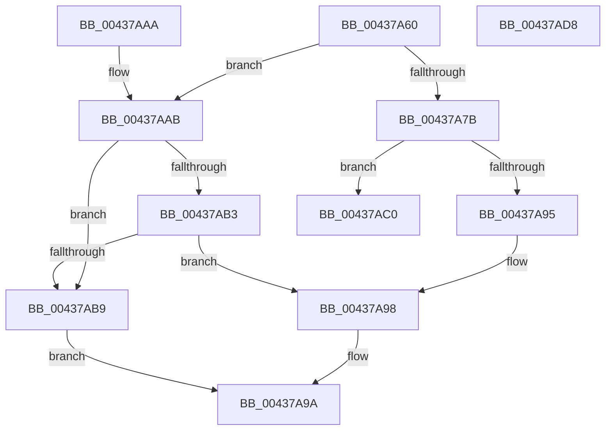

# AllocateOrValidateUnicodeStringBuffer

- RVA: `0x00437A60`–`0x00437AD9` (길이 `121` bytes)
- VA: `0x0000000140437A60`
- 실행 섹션: `.text`
- PDB 이름 있음: `예`; PDB Function 태그: `아니요`
- unwind 정보 RVA: `0x000A3218`
- 디코드: `39`개 명령, `121/121` bytes 표시
- 미해석 바이트: `0` (있으면 어셈블리에 `.byte`로 보존)

> 이 문서는 커널 이미지의 기계어와 PDB 기호를 분석해 생성했습니다. 4번과 5번은 함수 원형과 자료형을 바이너리 사용 방식에서 추정한 C 해석이며 원본 소스 복구 결과는 아닙니다.

## 1. Dependencies

- 직접 호출 지점: **1**; 고유 호출 대상: **1**
- 직접 호출자로 확인된 함수: **5**
- RIP 상대 이미지 참조: **0**

### Outgoing calls
- `0x00437A88` → [ExAllocatePool2](../../poolcode/B8/ExAllocatePool2_function_00B820F0.md) (function, `0x00B820F0`)

### Direct callers
- [RtlAnsiStringToUnicodeString](../../page/90/RtlAnsiStringToUnicodeString_function_0090BEA0.md) at `0x0090BF2F`
- [RtlOemStringToCountedUnicodeString](../../page/90/RtlOemStringToCountedUnicodeString_function_0090F3D0.md) at `0x0090F431`
- [RtlOemStringToUnicodeString](../../page/90/RtlOemStringToUnicodeString_function_0090F6C0.md) at `0x0090F720`
- [RtlUpcaseUnicodeString](../../page/96/RtlUpcaseUnicodeString_function_00960780.md) at `0x009607CB`
- [RtlDowncaseUnicodeString](../../page/9C/RtlDowncaseUnicodeString_function_009C4190.md) at `0x009C41DB`

### Static image references
- 디코드된 RIP-relative 메모리 참조가 없습니다.

## 2. Other-region calls and transfers

- 다른 실행 섹션으로 향하는 call: **1**
  - `0x00437A88` → [ExAllocatePool2](../../poolcode/B8/ExAllocatePool2_function_00B820F0.md) (`.text` → `POOLCODE`)
- 별도 외부 분기/꼬리 이동을 확인하지 못했습니다.

## 3. Assembly (complete function range)

```asm
00437A60  48 89 5C 24 08                  mov qword ptr [rsp + 8], rbx
00437A65  48 89 74 24 10                  mov qword ptr [rsp + 0x10], rsi
00437A6A  57                              push rdi
00437A6B  48 83 EC 20                     sub rsp, 0x20
00437A6F  8B FA                           mov edi, edx
00437A71  49 8B D9                        mov rbx, r9
00437A74  49 8B F0                        mov rsi, r8
00437A77  84 C9                           test cl, cl
00437A79  74 30                           je 0x140437aab
00437A7B  8B D7                           mov edx, edi
00437A7D  B9 00 01 00 00                  mov ecx, 0x100
00437A82  41 B8 53 74 72 67               mov r8d, 0x67727453
00437A88  E8 63 A6 74 00                  call 0x140b820f0
00437A8D  48 89 06                        mov qword ptr [rsi], rax
00437A90  48 85 C0                        test rax, rax
00437A93  74 2B                           je 0x140437ac0
00437A95  66 89 3B                        mov word ptr [rbx], di
00437A98  33 C0                           xor eax, eax
00437A9A  48 8B 5C 24 30                  mov rbx, qword ptr [rsp + 0x30]
00437A9F  48 8B 74 24 38                  mov rsi, qword ptr [rsp + 0x38]
00437AA4  48 83 C4 20                     add rsp, 0x20
00437AA8  5F                              pop rdi
00437AA9  C3                              ret
00437AAA  CC                              int3
00437AAB  41 0F B7 01                     movzx eax, word ptr [r9]
00437AAF  3B F8                           cmp edi, eax
00437AB1  77 06                           ja 0x140437ab9
00437AB3  49 83 38 00                     cmp qword ptr [r8], 0
00437AB7  75 DF                           jne 0x140437a98
00437AB9  B8 05 00 00 80                  mov eax, 0x80000005
00437ABE  EB DA                           jmp 0x140437a9a
00437AC0  48 8B 74 24 38                  mov rsi, qword ptr [rsp + 0x38]
00437AC5  66 89 03                        mov word ptr [rbx], ax
00437AC8  B8 17 00 00 C0                  mov eax, 0xc0000017
00437ACD  48 8B 5C 24 30                  mov rbx, qword ptr [rsp + 0x30]
00437AD2  48 83 C4 20                     add rsp, 0x20
00437AD6  5F                              pop rdi
00437AD7  C3                              ret
00437AD8  CC                              int3
```

## 4. C-style interpretation (structured pseudocode)

```c
__int64 __fastcall AllocateOrValidateUnicodeStringBuffer(unsigned __int8 a1, int a2, __int64 a3, __int64 a4)
{
    __int64 result;
    __int64 v_rsp;
    unsigned __int64 v_stack_p10;
    unsigned __int64 v_stack_p30;
    unsigned __int64 v_stack_p38;
    unsigned __int64 v_stack_p8;

    v_stack_p8 = v_rbx;
    v_stack_p10 = v_rsi;
    v_rsp = (v_rsp) - (32);
    if (a1 == 0) goto loc_00437AAB;
    result = ExAllocatePool2(256, (unsigned int)((unsigned int)((unsigned int)(a2))), (unsigned int)(0x67727453ULL), a4);
    *(unsigned __int64 *)(a3) = result;
    if (result == 0) goto loc_00437AC0;
    *(unsigned __int16 *)(a4) = (unsigned __int16)((unsigned int)(a2));
loc_00437A98:
    result = 0;
loc_00437A9A:
    v_rsp = (v_rsp) + (32);
    return result;
loc_00437AAB:
    if (((unsigned int)((unsigned int)(a2))) > ((unsigned int)(*(unsigned __int16 *)(a4)))) goto loc_00437AB9;
    if ((*(unsigned __int64 *)((unsigned int)(0x67727453ULL))) != 0) goto loc_00437A98;
loc_00437AB9:
    goto loc_00437A9A;
loc_00437AC0:
    *(unsigned __int16 *)(v_stack_p8) = (unsigned __int16)((unsigned int)(0x80000005ULL));
    v_rsp = (v_rsp) + (32);
    return (unsigned int)(0xC0000017ULL);
}
```

## 5. (Beta) C Style

```c
int64_t AllocateOrValidateUnicodeStringBuffer(uint8_t Arg1, int32_t Arg2, void *Arg3, void *Arg4)
{
    uint8_t *arg3 = (uint8_t *)Arg3;
    uint8_t *arg4 = (uint8_t *)Arg4;

    int64_t result;
    int64_t local_rsp;
    uint64_t v_stack_p10;
    uint64_t v_stack_p30;
    uint64_t v_stack_p38;
    uint64_t v_stack_p8;

    v_stack_p8 = local_rbx;
    v_stack_p10 = local_rsi;
    local_rsp = (local_rsp) - (32);
    if (Arg1 == 0) goto loc_00437AAB;
    result = ExAllocatePool2(256, (uint32_t)((uint32_t)((uint32_t)(Arg2))), (uint32_t)(0x67727453ULL), Arg4);
    *(uint64_t *)(arg3) = result;
    if (result == 0) goto loc_00437AC0;
    *(uint16_t *)(arg4) = (uint16_t)((uint32_t)(Arg2));
loc_00437A98:
    result = 0;
loc_00437A9A:
    local_rsp = (local_rsp) + (32);
    return result;
loc_00437AAB:
    if (((uint32_t)((uint32_t)(Arg2))) > ((uint32_t)(*(uint16_t *)(arg4)))) goto loc_00437AB9;
    if ((*(uint64_t *)((uint32_t)(0x67727453ULL))) != 0) goto loc_00437A98;
loc_00437AB9:
    goto loc_00437A9A;
loc_00437AC0:
    *(uint16_t *)(v_stack_p8) = (uint16_t)((uint32_t)(0x80000005ULL));
    local_rsp = (local_rsp) + (32);
    return (uint32_t)(0xC0000017ULL);
}
```

### 관측된 메모리 오프셋

구조체 형식이 확인되지 않은 접근은 인자 기준의 오프셋으로만 기록했습니다.

| 기준 인자 | 오프셋 표현 | 폭 (bit) | 접근 |
|---|---:|---:|---|
| `Arg3` | `+ 0x0` | `64` | `R` |
| `Arg3` | `+ 0x0` | `64` | `W` |
| `Arg4` | `+ 0x0` | `16` | `R` |
| `Arg4` | `+ 0x0` | `16` | `W` |

## 6. Execution-region graph

[열기: 2D/3D 그래프와 함수 탐색 컨트롤 패널](../../../control-panel.html?section=text&rva=0x00437A60&view=graph)

- 2D 그래프는 위에서 아래로 흐르고, 3D 그래프는 빈 공간을 드래그해 회전합니다. Shift+드래그는 이동, 휠은 확대·축소, 함수 노드 선택은 대상 보고서 이동입니다.

### Static fallback


