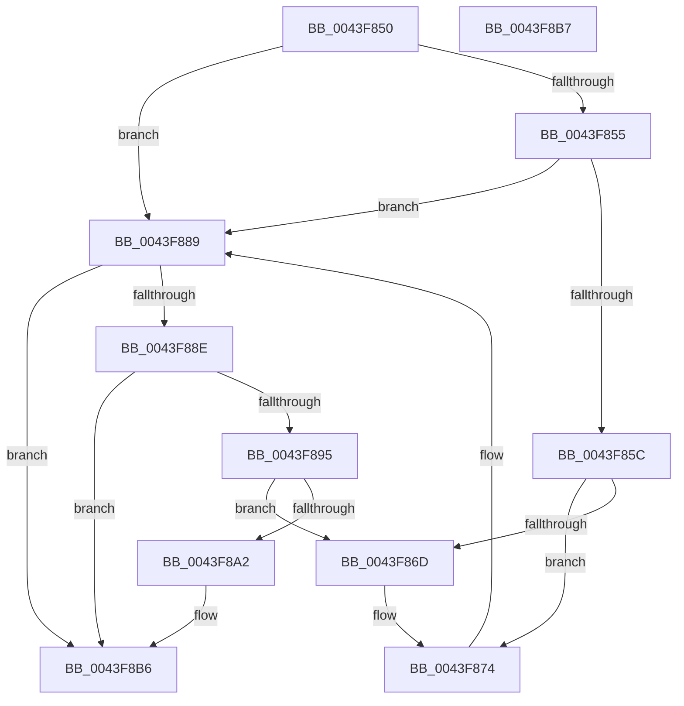

# AuthzBasepAddSecurityAttributeToLists

- RVA: `0x0043F850`–`0x0043F8B8` (길이 `104` bytes)
- VA: `0x000000014043F850`
- 실행 섹션: `.text`
- PDB 이름 있음: `예`; PDB Function 태그: `아니요`
- unwind 정보 RVA: `0x000DB714`
- 디코드: `35`개 명령, `104/104` bytes 표시
- 미해석 바이트: `0` (있으면 어셈블리에 `.byte`로 보존)

> 이 문서는 커널 이미지의 기계어와 PDB 기호를 분석해 생성했습니다. 4번과 5번은 함수 원형과 자료형을 바이너리 사용 방식에서 추정한 C 해석이며 원본 소스 복구 결과는 아닙니다.

## 1. Dependencies

- 직접 호출 지점: **0**; 고유 호출 대상: **0**
- 직접 호출자로 확인된 함수: **1**
- RIP 상대 이미지 참조: **0**

### Outgoing calls
- 직접 디코드된 call 명령이 없습니다.

### Direct callers
- [AuthzBasepDeleteAllSecurityAttributes](../69/AuthzBasepDeleteAllSecurityAttributes_function_0069D568.md) at `0x0069D593`

### Static image references
- 디코드된 RIP-relative 메모리 참조가 없습니다.

## 2. Other-region calls and transfers

- 다른 실행 섹션으로 향하는 call: **0**
- 별도 외부 분기/꼬리 이동을 확인하지 못했습니다.

## 3. Assembly (complete function range)

```asm
0043F850  45 84 C9                        test r9b, r9b
0043F853  74 34                           je 0x14043f889
0043F855  8B 42 38                        mov eax, dword ptr [rdx + 0x38]
0043F858  A8 02                           test al, 2
0043F85A  75 2D                           jne 0x14043f889
0043F85C  4C 8B 49 28                     mov r9, qword ptr [rcx + 0x28]
0043F860  48 8D 41 20                     lea rax, [rcx + 0x20]
0043F864  4C 8D 52 10                     lea r10, [rdx + 0x10]
0043F868  49 39 01                        cmp qword ptr [r9], rax
0043F86B  74 07                           je 0x14043f874
0043F86D  B9 03 00 00 00                  mov ecx, 3
0043F872  CD 29                           int 0x29
0043F874  49 89 02                        mov qword ptr [r10], rax
0043F877  4D 89 4A 08                     mov qword ptr [r10 + 8], r9
0043F87B  4D 89 11                        mov qword ptr [r9], r10
0043F87E  4C 89 50 08                     mov qword ptr [rax + 8], r10
0043F882  83 4A 38 02                     or dword ptr [rdx + 0x38], 2
0043F886  FF 41 18                        inc dword ptr [rcx + 0x18]
0043F889  45 84 C0                        test r8b, r8b
0043F88C  74 28                           je 0x14043f8b6
0043F88E  8B 42 38                        mov eax, dword ptr [rdx + 0x38]
0043F891  A8 01                           test al, 1
0043F893  75 21                           jne 0x14043f8b6
0043F895  4C 8B 41 10                     mov r8, qword ptr [rcx + 0x10]
0043F899  48 8D 41 08                     lea rax, [rcx + 8]
0043F89D  49 39 00                        cmp qword ptr [r8], rax
0043F8A0  75 CB                           jne 0x14043f86d
0043F8A2  48 89 02                        mov qword ptr [rdx], rax
0043F8A5  4C 89 42 08                     mov qword ptr [rdx + 8], r8
0043F8A9  49 89 10                        mov qword ptr [r8], rdx
0043F8AC  48 89 50 08                     mov qword ptr [rax + 8], rdx
0043F8B0  83 4A 38 01                     or dword ptr [rdx + 0x38], 1
0043F8B4  FF 01                           inc dword ptr [rcx]
0043F8B6  C3                              ret
0043F8B7  CC                              int3
```

## 4. C-style interpretation (structured pseudocode)

```c
__int64 __fastcall AuthzBasepAddSecurityAttributeToLists(__int64 a1, __int64 a2, unsigned __int8 a3, unsigned __int8 a4)
{
    if (a4 == 0) goto loc_0043F889;
    if ((((unsigned __int8)((unsigned int)(*(unsigned int *)(a2 + 56)))) & (2)) != 0) goto loc_0043F889;
    if ((*(unsigned __int64 *)(*(unsigned __int64 *)(a1 + 40))) != (a1 + 32)) {
        a1 = 3;
    }
    *(unsigned __int64 *)(a2 + 16) = a1 + 32;
    *(unsigned __int64 *)(a2 + 16 + 8) = *(unsigned __int64 *)(a1 + 40);
    *(unsigned __int64 *)(*(unsigned __int64 *)(a1 + 40)) = a2 + 16;
    *(unsigned __int64 *)(a1 + 32 + 8) = a2 + 16;
loc_0043F889:
    if (a3 == 0) goto loc_0043F8B6;
    if ((((unsigned __int8)((unsigned int)(*(unsigned int *)(a2 + 56)))) & (1)) != 0) goto loc_0043F8B6;
    if ((*(unsigned __int64 *)(*(unsigned __int64 *)(a1 + 16))) != (a1 + 8)) goto loc_0043F86D;
    *(unsigned __int64 *)(a2) = a1 + 8;
    *(unsigned __int64 *)(a2 + 8) = *(unsigned __int64 *)(a1 + 16);
    *(unsigned __int64 *)(*(unsigned __int64 *)(a1 + 16)) = a2;
    *(unsigned __int64 *)(a1 + 8 + 8) = a2;
loc_0043F8B6:
    return a1 + 8;
}
```

## 5. (Beta) C Style

```c
void *AuthzBasepAddSecurityAttributeToLists(void *Arg1, void *Arg2, uint8_t Arg3, uint8_t Arg4)
{
    uint8_t *arg1 = (uint8_t *)Arg1;
    uint8_t *arg2 = (uint8_t *)Arg2;

    if (Arg4 == 0) goto loc_0043F889;
    if ((((uint8_t)((uint32_t)(*(uint32_t *)(arg2 + 0x38)))) & (2)) != 0) goto loc_0043F889;
    if ((*(uint64_t *)(*(uint64_t *)(arg1 + 0x28))) != (Arg1 + 32)) {
        Arg1 = 3;
    }
    *(void **)(arg2 + 0x10) = Arg1 + 32;
    *(uint64_t *)(arg2 + 0x10 + 0x8) = *(uint64_t *)(arg1 + 0x28);
    *(void **)(*(uint64_t *)(arg1 + 0x28)) = Arg2 + 16;
    *(void **)(arg1 + 0x20 + 0x8) = Arg2 + 16;
loc_0043F889:
    if (Arg3 == 0) goto loc_0043F8B6;
    if ((((uint8_t)((uint32_t)(*(uint32_t *)(arg2 + 0x38)))) & (1)) != 0) goto loc_0043F8B6;
    if ((*(uint64_t *)(*(uint64_t *)(arg1 + 0x10))) != (Arg1 + 8)) goto loc_0043F86D;
    *(void **)(arg2) = Arg1 + 8;
    *(uint64_t *)(arg2 + 0x8) = *(uint64_t *)(arg1 + 0x10);
    *(void **)(*(uint64_t *)(arg1 + 0x10)) = Arg2;
    *(void **)(arg1 + 0x8 + 0x8) = Arg2;
loc_0043F8B6:
    return Arg1 + 8;
}
```

### 관측된 메모리 오프셋

구조체 형식이 확인되지 않은 접근은 인자 기준의 오프셋으로만 기록했습니다.

| 기준 인자 | 오프셋 표현 | 폭 (bit) | 접근 |
|---|---:|---:|---|
| `Arg1` | `+ 0x20` | `64` | `R` |
| `Arg1` | `+ 0x28` | `64` | `R` |
| `Arg2` | `+ 0x0` | `64` | `W` |
| `Arg2` | `+ 0x8` | `64` | `W` |
| `Arg2` | `+ 0x10` | `64` | `R` |
| `Arg2` | `+ 0x38` | `32` | `R` |
| `Arg2` | `+ 0x38` | `32` | `R/W` |

## 6. Execution-region graph

[열기: 2D/3D 그래프와 함수 탐색 컨트롤 패널](../../../control-panel.html?section=text&rva=0x0043F850&view=graph)

- 2D 그래프는 위에서 아래로 흐르고, 3D 그래프는 빈 공간을 드래그해 회전합니다. Shift+드래그는 이동, 휠은 확대·축소, 함수 노드 선택은 대상 보고서 이동입니다.

### Static fallback


