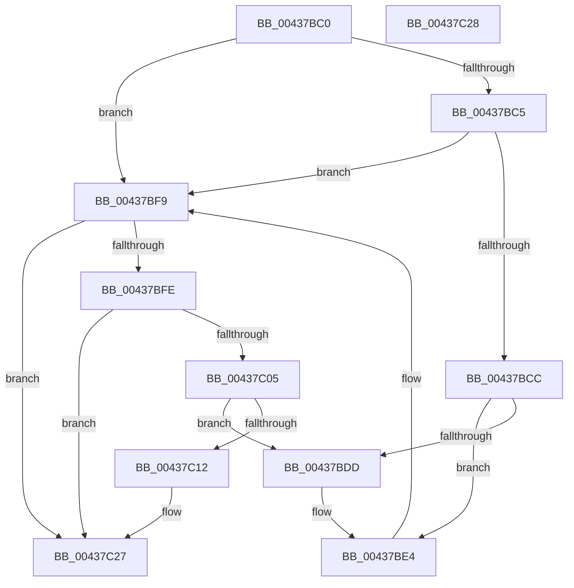

# AuthzBasepAddSecurityAttributeValueToLists

- RVA: `0x00437BC0`–`0x00437C29` (길이 `105` bytes)
- VA: `0x0000000140437BC0`
- 실행 섹션: `.text`
- PDB 이름 있음: `예`; PDB Function 태그: `아니요`
- unwind 정보 RVA: `0x000DB714`
- 디코드: `35`개 명령, `105/105` bytes 표시
- 미해석 바이트: `0` (있으면 어셈블리에 `.byte`로 보존)

> 이 문서는 커널 이미지의 기계어와 PDB 기호를 분석해 생성했습니다. 4번과 5번은 함수 원형과 자료형을 바이너리 사용 방식에서 추정한 C 해석이며 원본 소스 복구 결과는 아닙니다.

## 1. Dependencies

- 직접 호출 지점: **0**; 고유 호출 대상: **0**
- 직접 호출자로 확인된 함수: **1**
- RIP 상대 이미지 참조: **0**

### Outgoing calls
- 직접 디코드된 call 명령이 없습니다.

### Direct callers
- [AuthzBasepDeleteSecurityAttributeValues](../4F/AuthzBasepDeleteSecurityAttributeValues_function_004F9B00.md) at `0x004F9BD9`

### Static image references
- 디코드된 RIP-relative 메모리 참조가 없습니다.

## 2. Other-region calls and transfers

- 다른 실행 섹션으로 향하는 call: **0**
- 별도 외부 분기/꼬리 이동을 확인하지 못했습니다.

## 3. Assembly (complete function range)

```asm
00437BC0  45 84 C9                        test r9b, r9b
00437BC3  74 34                           je 0x140437bf9
00437BC5  8B 42 20                        mov eax, dword ptr [rdx + 0x20]
00437BC8  A8 02                           test al, 2
00437BCA  75 2D                           jne 0x140437bf9
00437BCC  4C 8B 49 68                     mov r9, qword ptr [rcx + 0x68]
00437BD0  48 8D 41 60                     lea rax, [rcx + 0x60]
00437BD4  4C 8D 52 10                     lea r10, [rdx + 0x10]
00437BD8  49 39 01                        cmp qword ptr [r9], rax
00437BDB  74 07                           je 0x140437be4
00437BDD  B9 03 00 00 00                  mov ecx, 3
00437BE2  CD 29                           int 0x29
00437BE4  49 89 02                        mov qword ptr [r10], rax
00437BE7  4D 89 4A 08                     mov qword ptr [r10 + 8], r9
00437BEB  4D 89 11                        mov qword ptr [r9], r10
00437BEE  4C 89 50 08                     mov qword ptr [rax + 8], r10
00437BF2  83 4A 20 02                     or dword ptr [rdx + 0x20], 2
00437BF6  FF 41 58                        inc dword ptr [rcx + 0x58]
00437BF9  45 84 C0                        test r8b, r8b
00437BFC  74 29                           je 0x140437c27
00437BFE  8B 42 20                        mov eax, dword ptr [rdx + 0x20]
00437C01  A8 01                           test al, 1
00437C03  75 22                           jne 0x140437c27
00437C05  4C 8B 41 50                     mov r8, qword ptr [rcx + 0x50]
00437C09  48 8D 41 48                     lea rax, [rcx + 0x48]
00437C0D  49 39 00                        cmp qword ptr [r8], rax
00437C10  75 CB                           jne 0x140437bdd
00437C12  48 89 02                        mov qword ptr [rdx], rax
00437C15  4C 89 42 08                     mov qword ptr [rdx + 8], r8
00437C19  49 89 10                        mov qword ptr [r8], rdx
00437C1C  48 89 50 08                     mov qword ptr [rax + 8], rdx
00437C20  83 4A 20 01                     or dword ptr [rdx + 0x20], 1
00437C24  FF 41 3C                        inc dword ptr [rcx + 0x3c]
00437C27  C3                              ret
00437C28  CC                              int3
```

## 4. C-style interpretation (structured pseudocode)

```c
__int64 __fastcall AuthzBasepAddSecurityAttributeValueToLists(__int64 a1, __int64 a2, unsigned __int8 a3, unsigned __int8 a4)
{
    if (a4 == 0) goto loc_00437BF9;
    if ((((unsigned __int8)((unsigned int)(*(unsigned int *)(a2 + 32)))) & (2)) != 0) goto loc_00437BF9;
    if ((*(unsigned __int64 *)(*(unsigned __int64 *)(a1 + 104))) != (a1 + 96)) {
        a1 = 3;
    }
    *(unsigned __int64 *)(a2 + 16) = a1 + 96;
    *(unsigned __int64 *)(a2 + 16 + 8) = *(unsigned __int64 *)(a1 + 104);
    *(unsigned __int64 *)(*(unsigned __int64 *)(a1 + 104)) = a2 + 16;
    *(unsigned __int64 *)(a1 + 96 + 8) = a2 + 16;
loc_00437BF9:
    if (a3 == 0) goto loc_00437C27;
    if ((((unsigned __int8)((unsigned int)(*(unsigned int *)(a2 + 32)))) & (1)) != 0) goto loc_00437C27;
    if ((*(unsigned __int64 *)(*(unsigned __int64 *)(a1 + 80))) != (a1 + 72)) goto loc_00437BDD;
    *(unsigned __int64 *)(a2) = a1 + 72;
    *(unsigned __int64 *)(a2 + 8) = *(unsigned __int64 *)(a1 + 80);
    *(unsigned __int64 *)(*(unsigned __int64 *)(a1 + 80)) = a2;
    *(unsigned __int64 *)(a1 + 72 + 8) = a2;
loc_00437C27:
    return a1 + 72;
}
```

## 5. (Beta) C Style

```c
void *AuthzBasepAddSecurityAttributeValueToLists(void *Arg1, void *Arg2, uint8_t Arg3, uint8_t Arg4)
{
    uint8_t *arg1 = (uint8_t *)Arg1;
    uint8_t *arg2 = (uint8_t *)Arg2;

    if (Arg4 == 0) goto loc_00437BF9;
    if ((((uint8_t)((uint32_t)(*(uint32_t *)(arg2 + 0x20)))) & (2)) != 0) goto loc_00437BF9;
    if ((*(uint64_t *)(*(uint64_t *)(arg1 + 0x68))) != (Arg1 + 96)) {
        Arg1 = 3;
    }
    *(void **)(arg2 + 0x10) = Arg1 + 96;
    *(uint64_t *)(arg2 + 0x10 + 0x8) = *(uint64_t *)(arg1 + 0x68);
    *(void **)(*(uint64_t *)(arg1 + 0x68)) = Arg2 + 16;
    *(void **)(arg1 + 0x60 + 0x8) = Arg2 + 16;
loc_00437BF9:
    if (Arg3 == 0) goto loc_00437C27;
    if ((((uint8_t)((uint32_t)(*(uint32_t *)(arg2 + 0x20)))) & (1)) != 0) goto loc_00437C27;
    if ((*(uint64_t *)(*(uint64_t *)(arg1 + 0x50))) != (Arg1 + 72)) goto loc_00437BDD;
    *(void **)(arg2) = Arg1 + 72;
    *(uint64_t *)(arg2 + 0x8) = *(uint64_t *)(arg1 + 0x50);
    *(void **)(*(uint64_t *)(arg1 + 0x50)) = Arg2;
    *(void **)(arg1 + 0x48 + 0x8) = Arg2;
loc_00437C27:
    return Arg1 + 72;
}
```

### 관측된 메모리 오프셋

구조체 형식이 확인되지 않은 접근은 인자 기준의 오프셋으로만 기록했습니다.

| 기준 인자 | 오프셋 표현 | 폭 (bit) | 접근 |
|---|---:|---:|---|
| `Arg1` | `+ 0x60` | `64` | `R` |
| `Arg1` | `+ 0x68` | `64` | `R` |
| `Arg2` | `+ 0x0` | `64` | `W` |
| `Arg2` | `+ 0x8` | `64` | `W` |
| `Arg2` | `+ 0x10` | `64` | `R` |
| `Arg2` | `+ 0x20` | `32` | `R` |
| `Arg2` | `+ 0x20` | `32` | `R/W` |

## 6. Execution-region graph

[열기: 2D/3D 그래프와 함수 탐색 컨트롤 패널](../../../control-panel.html?section=text&rva=0x00437BC0&view=graph)

- 2D 그래프는 위에서 아래로 흐르고, 3D 그래프는 빈 공간을 드래그해 회전합니다. Shift+드래그는 이동, 휠은 확대·축소, 함수 노드 선택은 대상 보고서 이동입니다.

### Static fallback


