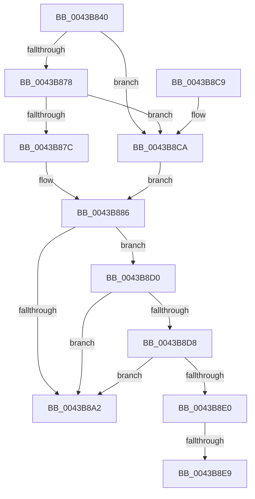

# B_TREE&lt;unsigned long,ST_STORE&lt;SM_TRAITS&gt;::_ST_HASH_ENTRY,4096,NP_CONTEXT,ST_STORE&lt;SM_TRAITS&gt;::ST_HASH_ENTRY_COMPARATOR&gt;::BTreeIteratorFromSearchResult

- RVA: `0x0043B840`–`0x0043B909` (길이 `201` bytes)
- VA: `0x000000014043B840`
- 실행 섹션: `.text`
- PDB 이름 있음: `예`; PDB Function 태그: `예`
- unwind 정보 RVA: `0x000A2724`
- 디코드: `59`개 명령, `201/201` bytes 표시
- 미해석 바이트: `0` (있으면 어셈블리에 `.byte`로 보존)

> 이 문서는 커널 이미지의 기계어와 PDB 기호를 분석해 생성했습니다. 4번과 5번은 함수 원형과 자료형을 바이너리 사용 방식에서 추정한 C 해석이며 원본 소스 복구 결과는 아닙니다.

## 1. Dependencies

- 직접 호출 지점: **1**; 고유 호출 대상: **1**
- 직접 호출자로 확인된 함수: **1**
- RIP 상대 이미지 참조: **1**

### Outgoing calls
- `0x0043B8AE` → [_security_check_cookie](../6A/_security_check_cookie_function_006AC640.md) (function, `0x006AC640`)

### Direct callers
- [ST_STORE&lt;SM_TRAITS&gt;::StDmCombineBufferAddEntry](../4E/ST_STORE_SM_TRAITS_StDmCombineBufferAddEntry_function_004EB420.md) at `0x004EB5CA`

### Static image references
- `0x0043B85B` → RVA `0x00E0A740` (`.data`; read)

## 2. Other-region calls and transfers

- 다른 실행 섹션으로 향하는 call: **0**
- call이 아닌 외부 분기/꼬리 이동: **2**
  - `0x0043B8E3` → [sub_006EF588](../6E/Unknown_function_006EF588.md) (`tail-transfer`)
  - `0x0043B904` → [sub_006EF588 + 0x94](../6E/Unknown_function_006EF588.md) (`tail-transfer`)

## 3. Assembly (complete function range)

```asm
0043B840  40 55                           push rbp
0043B842  48 83 EC 50                     sub rsp, 0x50
0043B846  48 8D 6C 24 20                  lea rbp, [rsp + 0x20]
0043B84B  48 89 5D 40                     mov qword ptr [rbp + 0x40], rbx
0043B84F  48 89 75 48                     mov qword ptr [rbp + 0x48], rsi
0043B853  48 89 7D 50                     mov qword ptr [rbp + 0x50], rdi
0043B857  4C 89 75 58                     mov qword ptr [rbp + 0x58], r14
0043B85B  48 8B 05 DE EE 9C 00            mov rax, qword ptr [rip + 0x9ceede]
0043B862  48 33 C5                        xor rax, rbp
0043B865  48 89 45 28                     mov qword ptr [rbp + 0x28], rax
0043B869  48 8B F2                        mov rsi, rdx
0043B86C  4C 8B F1                        mov r14, rcx
0043B86F  41 8B 50 18                     mov edx, dword ptr [r8 + 0x18]
0043B873  83 FA FF                        cmp edx, -1
0043B876  74 52                           je 0x14043b8ca
0043B878  85 D2                           test edx, edx
0043B87A  74 4E                           je 0x14043b8ca
0043B87C  8D 42 FF                        lea eax, [rdx - 1]
0043B87F  48 C1 E0 04                     shl rax, 4
0043B883  49 03 00                        add rax, qword ptr [r8]
0043B886  0F 10 00                        movups xmm0, xmmword ptr [rax]
0043B889  48 83 C1 10                     add rcx, 0x10
0043B88D  45 33 C9                        xor r9d, r9d
0043B890  4D 85 F6                        test r14, r14
0043B893  0F 11 06                        movups xmmword ptr [rsi], xmm0
0043B896  49 0F 44 C9                     cmove rcx, r9
0043B89A  48 8B 09                        mov rcx, qword ptr [rcx]
0043B89D  83 39 FF                        cmp dword ptr [rcx], -1
0043B8A0  75 2E                           jne 0x14043b8d0
0043B8A2  48 83 46 08 FC                  add qword ptr [rsi + 8], -4
0043B8A7  48 8B 4D 28                     mov rcx, qword ptr [rbp + 0x28]
0043B8AB  48 33 CD                        xor rcx, rbp
0043B8AE  E8 8D 0D 27 00                  call 0x1406ac640
0043B8B3  48 8B 5D 40                     mov rbx, qword ptr [rbp + 0x40]
0043B8B7  48 8B 75 48                     mov rsi, qword ptr [rbp + 0x48]
0043B8BB  48 8B 7D 50                     mov rdi, qword ptr [rbp + 0x50]
0043B8BF  4C 8B 75 58                     mov r14, qword ptr [rbp + 0x58]
0043B8C3  48 8D 65 30                     lea rsp, [rbp + 0x30]
0043B8C7  5D                              pop rbp
0043B8C8  C3                              ret
0043B8C9  CC                              int3
0043B8CA  49 8D 40 08                     lea rax, [r8 + 8]
0043B8CE  EB B6                           jmp 0x14043b886
0043B8D0  4C 8B 06                        mov r8, qword ptr [rsi]
0043B8D3  4D 85 C0                        test r8, r8
0043B8D6  74 CA                           je 0x14043b8a2
0043B8D8  49 8B 0E                        mov rcx, qword ptr [r14]
0043B8DB  4C 3B C1                        cmp r8, rcx
0043B8DE  74 C2                           je 0x14043b8a2
0043B8E0  83 FA FF                        cmp edx, -1
0043B8E3  0F 84 9F 3C 2B 00               je 0x1406ef588
0043B8E9  48 8B 50 F8                     mov rdx, qword ptr [rax - 8]
0043B8ED  48 8B 48 F0                     mov rcx, qword ptr [rax - 0x10]
0043B8F1  4C 8D 4A F8                     lea r9, [rdx - 8]
0043B8F5  48 8D 41 10                     lea rax, [rcx + 0x10]
0043B8F9  48 83 C1 08                     add rcx, 8
0043B8FD  48 3B D0                        cmp rdx, rax
0043B900  4C 0F 46 C9                     cmovbe r9, rcx
0043B904  E9 13 3D 2B 00                  jmp 0x1406ef61c
```

## 4. C-style interpretation (structured pseudocode)

```c
__int64 __fastcall B_TREE_unsigned_long_ST_STORE_SM_TRAITS____ST_HASH_ENTRY_4096_NP_CONTEXT_ST_STORE_SM_TRAITS___ST_HAS(__int64 a1, __int64 a2, __int64 a3, int a4)
{
    __int64 result;
    __int64 v_rsp;
    unsigned __int64 v_stack_m10;
    unsigned __int64 v_stack_m38;
    unsigned __int64 v_stack_m8;
    unsigned __int64 v_stack_p10;
    unsigned __int64 v_stack_p18;
    unsigned __int64 v_stack_p20;
    unsigned __int64 v_stack_p8;

    v_rsp = (v_rsp) - (80);
    v_stack_p8 = v_rbx;
    v_stack_p10 = v_rsi;
    v_stack_p18 = v_rdi;
    v_stack_p20 = v_r14;
    result = (*(unsigned __int64 *)(v_rip + 10284766)) ^ (v_stack_m38);
    v_stack_m10 = result;
    if (((unsigned int)((unsigned int)(*(unsigned int *)(a3 + 24)))) == -1) goto loc_0043B8CA;
    if ((unsigned int)((unsigned int)(*(unsigned int *)(a3 + 24))) == 0) goto loc_0043B8CA;
    result = ((unsigned int)(*(unsigned int *)(a3 + 24)) - 1) << (4);
    result = (result) + (*(unsigned __int64 *)(a3));
loc_0043B886:
    a1 = (a1) + (16);
    a4 = 0;
    *(unsigned __int64 *)(a2) = v_xmm0;
    if (a1 == 0) { a1 = 0; }
    if ((*(unsigned int *)(*(unsigned __int64 *)(a1))) != -1) goto loc_0043B8D0;
loc_0043B8A2:
    a1 = (v_stack_m10) ^ (v_stack_m38);
    result = _security_check_cookie(a1, (unsigned int)(*(unsigned int *)(a3 + 24)), a3, a4);
    return result;
loc_0043B8CA:
    goto loc_0043B886;
loc_0043B8D0:
    if (*(unsigned __int64 *)(v_stack_p10) == 0) goto loc_0043B8A2;
    if ((*(unsigned __int64 *)(v_stack_p10)) == (*(unsigned __int64 *)(v_stack_p20))) goto loc_0043B8A2;
    a1 = (*(unsigned __int64 *)(a3 + 8 - 16)) + (8);
    a4 = *(unsigned __int64 *)(a3 + 8 - 8) - 8;
    if ((*(unsigned __int64 *)(a3 + 8 - 8)) <= (*(unsigned __int64 *)(a3 + 8 - 16) + 16)) { a4 = a1; }
}
```

## 5. (Beta) C Style

```c
int64_t B_TREE_unsigned_long_ST_STORE_SM_TRAITS____ST_HASH_ENTRY_4096_NP_CONTEXT_ST_STORE_SM_TRAITS___ST_HAS(int64_t Arg1, void *Arg2, void *Arg3, int32_t Arg4)
{
    uint8_t *arg2 = (uint8_t *)Arg2;
    uint8_t *arg3 = (uint8_t *)Arg3;

    int64_t result;
    int64_t local_rsp;
    uint64_t v_stack_m10;
    uint64_t v_stack_m38;
    uint64_t v_stack_m8;
    uint64_t v_stack_p10;
    uint64_t v_stack_p18;
    uint64_t v_stack_p20;
    uint64_t v_stack_p8;

    local_rsp = (local_rsp) - (80);
    v_stack_p8 = local_rbx;
    v_stack_p10 = local_rsi;
    v_stack_p18 = local_rdi;
    v_stack_p20 = local_r14;
    result = (*(uint64_t *)(v_rip + 0x9CEEDE)) ^ (v_stack_m38);
    v_stack_m10 = result;
    if (((uint32_t)((uint32_t)(*(uint32_t *)(arg3 + 0x18)))) == -1) goto loc_0043B8CA;
    if ((uint32_t)((uint32_t)(*(uint32_t *)(arg3 + 0x18))) == 0) goto loc_0043B8CA;
    result = ((uint32_t)(*(uint32_t *)(arg3 + 0x18)) - 1) << (4);
    result = (result) + (*(uint64_t *)(arg3));
loc_0043B886:
    Arg1 = (Arg1) + (16);
    Arg4 = 0;
    *(uint64_t *)(arg2) = v_xmm0;
    if (Arg1 == 0) { Arg1 = 0; }
    if ((*(uint32_t *)(*(uint64_t *)(Arg1))) != -1) goto loc_0043B8D0;
loc_0043B8A2:
    Arg1 = (v_stack_m10) ^ (v_stack_m38);
    result = _security_check_cookie(Arg1, (uint32_t)(*(uint32_t *)(arg3 + 0x18)), Arg3, Arg4);
    return result;
loc_0043B8CA:
    goto loc_0043B886;
loc_0043B8D0:
    if (*(uint64_t *)(v_stack_p10) == 0) goto loc_0043B8A2;
    if ((*(uint64_t *)(v_stack_p10)) == (*(uint64_t *)(v_stack_p20))) goto loc_0043B8A2;
    Arg1 = (*(uint64_t *)(arg3 + 0x8 - 0x10)) + (8);
    Arg4 = *(uint64_t *)(arg3 + 0x8 - 0x8) - 8;
    if ((*(uint64_t *)(arg3 + 0x8 - 0x8)) <= (*(uint64_t *)(arg3 + 0x8 - 0x10) + 16)) { Arg4 = Arg1; }
}
```

### 관측된 메모리 오프셋

구조체 형식이 확인되지 않은 접근은 인자 기준의 오프셋으로만 기록했습니다.

| 기준 인자 | 오프셋 표현 | 폭 (bit) | 접근 |
|---|---:|---:|---|
| `Arg2` | `+ 0x0` | `64` | `R` |
| `Arg2` | `+ 0x0` | `128` | `R` |
| `Arg2` | `+ 0x8` | `64` | `R/W` |
| `Arg3` | `+ 0x0` | `64` | `R` |
| `Arg3` | `+ 0x8` | `64` | `R` |
| `Arg3` | `+ 0x18` | `32` | `R` |

## 6. Execution-region graph

[열기: 2D/3D 그래프와 함수 탐색 컨트롤 패널](../../../control-panel.html?section=text&rva=0x0043B840&view=graph)

- 2D 그래프는 위에서 아래로 흐르고, 3D 그래프는 빈 공간을 드래그해 회전합니다. Shift+드래그는 이동, 휠은 확대·축소, 함수 노드 선택은 대상 보고서 이동입니다.

### Static fallback


