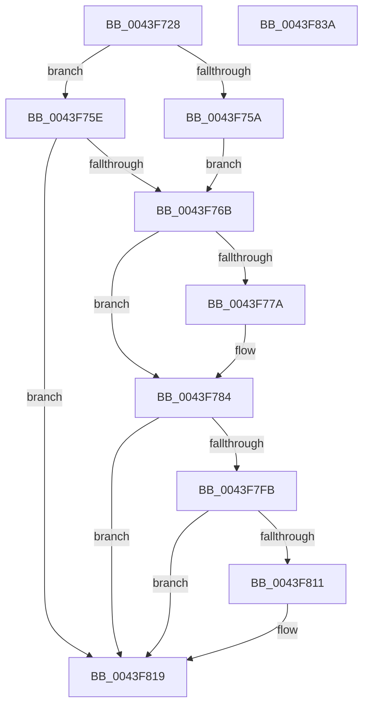

# B_TREE&lt;unsigned long,ST_STORE&lt;SM_TRAITS&gt;::_ST_HASH_ENTRY,4096,NP_CONTEXT,ST_STORE&lt;SM_TRAITS&gt;::ST_HASH_ENTRY_COMPARATOR&gt;::BTreeFindLeafSibling

- RVA: `0x0043F728`–`0x0043F83B` (길이 `275` bytes)
- VA: `0x000000014043F728`
- 실행 섹션: `.text`
- PDB 이름 있음: `예`; PDB Function 태그: `아니요`
- unwind 정보 RVA: `0x0009BD88`
- 디코드: `76`개 명령, `275/275` bytes 표시
- 미해석 바이트: `0` (있으면 어셈블리에 `.byte`로 보존)

> 이 문서는 커널 이미지의 기계어와 PDB 기호를 분석해 생성했습니다. 4번과 5번은 함수 원형과 자료형을 바이너리 사용 방식에서 추정한 C 해석이며 원본 소스 복구 결과는 아닙니다.

## 1. Dependencies

- 직접 호출 지점: **5**; 고유 호출 대상: **5**
- 직접 호출자로 확인된 함수: **1**
- RIP 상대 이미지 참조: **1**

### Outgoing calls
- `0x0043F78B` → [_chkstk](../6B/_chkstk_function_006BA960.md) (function, `0x006BA960`)
- `0x0043F7C0` → [B_TREE<unsigned long,ST_STORE<SM_TRAITS>::_ST_HASH_ENTRY,4096,NP_CONTEXT,ST_STORE<SM_TRAITS>::ST_HASH_ENTRY_COMPARATOR>::BTreeSearchKey](../3A/B_TREE_unsigned_long_ST_STORE_SM_TRAITS__ST_HASH_ENTRY_4096_NP_CONTEXT_ST_STORE_SM_TRAITS_ST_HASH_EN_function_003ADDB0.md) (function, `0x003ADDB0`)
- `0x0043F7EE` → [B_TREE<unsigned long,ST_STORE<SM_TRAITS>::_ST_HASH_ENTRY,4096,NP_CONTEXT,ST_STORE<SM_TRAITS>::ST_HASH_ENTRY_COMPARATOR>::BTreeFindLeafSiblingEx](../60/B_TREE_unsigned_long_ST_STORE_SM_TRAITS__ST_HASH_ENTRY_4096_NP_CONTEXT_ST_STORE_SM_TRAITS_ST_HASH_EN_function_0060BB90.md) (function, `0x0060BB90`)
- `0x0043F814` → [NP_CONTEXT::NpLeafDerefInternal](../3A/NP_CONTEXT_NpLeafDerefInternal_function_003A9A70.md) (function, `0x003A9A70`)
- `0x0043F823` → [_security_check_cookie](../6A/_security_check_cookie_function_006AC640.md) (function, `0x006AC640`)

### Direct callers
- [ST_STORE&lt;SM_TRAITS&gt;::StDmCombineBufferAddEntry](../4E/ST_STORE_SM_TRAITS_StDmCombineBufferAddEntry_function_004EB420.md) at `0x004EB641`

### Static image references
- `0x0043F73F` → RVA `0x00E0A740` (`.data`; read)

## 2. Other-region calls and transfers

- 다른 실행 섹션으로 향하는 call: **0**
- 별도 외부 분기/꼬리 이동을 확인하지 못했습니다.

## 3. Assembly (complete function range)

```asm
0043F728  40 55                           push rbp
0043F72A  48 83 EC 50                     sub rsp, 0x50
0043F72E  48 8D 6C 24 20                  lea rbp, [rsp + 0x20]
0043F733  48 89 5D 40                     mov qword ptr [rbp + 0x40], rbx
0043F737  48 89 75 48                     mov qword ptr [rbp + 0x48], rsi
0043F73B  48 89 7D 50                     mov qword ptr [rbp + 0x50], rdi
0043F73F  48 8B 05 FA AF 9C 00            mov rax, qword ptr [rip + 0x9caffa]
0043F746  48 33 C5                        xor rax, rbp
0043F749  48 89 45 28                     mov qword ptr [rbp + 0x28], rax
0043F74D  48 8B 01                        mov rax, qword ptr [rcx]
0043F750  33 DB                           xor ebx, ebx
0043F752  48 8B F9                        mov rdi, rcx
0043F755  48 85 C0                        test rax, rax
0043F758  75 04                           jne 0x14043f75e
0043F75A  33 F6                           xor esi, esi
0043F75C  EB 0D                           jmp 0x14043f76b
0043F75E  0F B6 70 02                     movzx esi, byte ptr [rax + 2]
0043F762  83 FE 01                        cmp esi, 1
0043F765  0F 84 AE 00 00 00               je 0x14043f819
0043F76B  8B C6                           mov eax, esi
0043F76D  48 C1 E0 04                     shl rax, 4
0043F771  48 8D 48 0F                     lea rcx, [rax + 0xf]
0043F775  48 3B C8                        cmp rcx, rax
0043F778  77 0A                           ja 0x14043f784
0043F77A  48 B9 F0 FF FF FF FF FF FF 0F   movabs rcx, 0xffffffffffffff0
0043F784  48 83 E1 F0                     and rcx, 0xfffffffffffffff0
0043F788  48 8B C1                        mov rax, rcx
0043F78B  E8 D0 B1 27 00                  call 0x1406ba960
0043F790  8B 52 10                        mov edx, dword ptr [rdx + 0x10]
0043F793  4C 8D 45 00                     lea r8, [rbp]
0043F797  83 65 24 00                     and dword ptr [rbp + 0x24], 0
0043F79B  48 2B E1                        sub rsp, rcx
0043F79E  83 65 18 00                     and dword ptr [rbp + 0x18], 0
0043F7A2  0F 57 C0                        xorps xmm0, xmm0
0043F7A5  48 8B CF                        mov rcx, rdi
0043F7A8  C7 45 20 01 00 00 00            mov dword ptr [rbp + 0x20], 1
0043F7AF  F3 0F 7F 45 08                  movdqu xmmword ptr [rbp + 8], xmm0
0043F7B4  48 8D 5C 24 20                  lea rbx, [rsp + 0x20]
0043F7B9  89 75 1C                        mov dword ptr [rbp + 0x1c], esi
0043F7BC  48 89 5D 00                     mov qword ptr [rbp], rbx
0043F7C0  E8 EB E5 F6 FF                  call 0x1403addb0
0043F7C5  8D 4E FE                        lea ecx, [rsi - 2]
0043F7C8  48 03 C9                        add rcx, rcx
0043F7CB  48 8B 54 CB 08                  mov rdx, qword ptr [rbx + rcx*8 + 8]
0043F7D0  48 8B 04 CB                     mov rax, qword ptr [rbx + rcx*8]
0043F7D4  48 8D 72 F8                     lea rsi, [rdx - 8]
0043F7D8  48 8D 48 10                     lea rcx, [rax + 0x10]
0043F7DC  48 83 C0 08                     add rax, 8
0043F7E0  48 3B D1                        cmp rdx, rcx
0043F7E3  48 8D 55 00                     lea rdx, [rbp]
0043F7E7  48 8B CF                        mov rcx, rdi
0043F7EA  48 0F 46 F0                     cmovbe rsi, rax
0043F7EE  E8 9D C3 1C 00                  call 0x14060bb90
0043F7F3  48 8B D8                        mov rbx, rax
0043F7F6  48 85 F6                        test rsi, rsi
0043F7F9  74 1E                           je 0x14043f819
0043F7FB  4C 8D 47 10                     lea r8, [rdi + 0x10]
0043F7FF  48 F7 DF                        neg rdi
0043F802  48 1B C9                        sbb rcx, rcx
0043F805  49 23 C8                        and rcx, r8
0043F808  4C 8B 01                        mov r8, qword ptr [rcx]
0043F80B  41 83 38 FF                     cmp dword ptr [r8], -1
0043F80F  74 08                           je 0x14043f819
0043F811  48 8B D6                        mov rdx, rsi
0043F814  E8 57 A2 F6 FF                  call 0x1403a9a70
0043F819  48 8B C3                        mov rax, rbx
0043F81C  48 8B 4D 28                     mov rcx, qword ptr [rbp + 0x28]
0043F820  48 33 CD                        xor rcx, rbp
0043F823  E8 18 CE 26 00                  call 0x1406ac640
0043F828  48 8B 5D 40                     mov rbx, qword ptr [rbp + 0x40]
0043F82C  48 8B 75 48                     mov rsi, qword ptr [rbp + 0x48]
0043F830  48 8B 7D 50                     mov rdi, qword ptr [rbp + 0x50]
0043F834  48 8D 65 30                     lea rsp, [rbp + 0x30]
0043F838  5D                              pop rbp
0043F839  C3                              ret
0043F83A  CC                              int3
```

## 4. C-style interpretation (structured pseudocode)

```c
__int64 __fastcall B_TREE_unsigned_long_ST_STORE_SM_TRAITS____ST_HASH_ENTRY_4096_NP_CONTEXT_ST_STORE_SM_TRAITS___ST_HAS(__int64 a1, __int64 a2)
{
    __int64 result;
    __int64 v_rbx;
    __int64 v_rdi;
    __int64 v_rsi;
    __int64 v_rsp;
    unsigned __int64 v_stack_m10;
    unsigned int v_stack_m14;
    unsigned int v_stack_m18;
    unsigned int v_stack_m1C;
    unsigned int v_stack_m20;
    unsigned __int64 v_stack_m30;
    unsigned __int64 v_stack_m38;
    unsigned __int64 v_stack_m8;
    unsigned __int64 v_stack_p10;
    unsigned __int64 v_stack_p18;
    unsigned __int64 v_stack_p8;

    v_rsp = (v_rsp) - (80);
    v_stack_p8 = v_rbx;
    v_stack_p10 = v_rsi;
    v_stack_p18 = v_rdi;
    result = (*(unsigned __int64 *)(v_rip + 10268666)) ^ (v_stack_m38);
    v_stack_m10 = result;
    v_rbx = 0;
    if (*(unsigned __int64 *)(a1) != 0) goto loc_0043F75E;
    v_rsi = 0;
    goto loc_0043F76B;
loc_0043F75E:
    if (((unsigned int)(*(unsigned __int8 *)(*(unsigned __int64 *)(a1) + 2))) == 1) goto loc_0043F819;
loc_0043F76B:
    result = ((unsigned int)((unsigned int)(*(unsigned __int8 *)(*(unsigned __int64 *)(a1) + 2)))) << (4);
    if ((result + 15) <= result) {
    }
    a1 = (result + 15) & (-16);
    result = _chkstk(a1, a2, a3, a4);
    v_rsp = (v_rsp) - (a1);
    v_stack_m18 = 1;
    v_stack_m30 = v_xmm0;
    v_stack_m1C = (unsigned int)(*(unsigned __int8 *)(*(unsigned __int64 *)(a1) + 2));
    v_stack_m38 = v_stack_m38;
    result = B_TREE_unsigned_long_ST_STORE_SM_TRAITS____ST_HASH_ENTRY_4096_NP_CONTEXT_ST_STORE_SM_TRAITS___ST_HAS(a1, (unsigned int)(*(unsigned int *)(a2 + 16)), v_stack_m38, a4);
    a1 = (*(unsigned __int8 *)(*(unsigned __int64 *)(a1) + 2) - 2) + (*(unsigned __int8 *)(*(unsigned __int64 *)(a1) + 2) - 2);
    result = (*(unsigned __int64 *)(v_stack_m38 + a1 * 8)) + (8);
    v_rsi = *(unsigned __int64 *)(v_stack_m38 + a1 * 8 + 8) - 8;
    if ((*(unsigned __int64 *)(v_stack_m38 + a1 * 8 + 8)) <= (*(unsigned __int64 *)(v_stack_m38 + a1 * 8) + 16)) { v_rsi = result; }
    result = B_TREE_unsigned_long_ST_STORE_SM_TRAITS____ST_HASH_ENTRY_4096_NP_CONTEXT_ST_STORE_SM_TRAITS___ST_HAS(a1, v_stack_m38, v_stack_m38, a4);
    if (v_rsi == 0) goto loc_0043F819;
    v_rdi = -(a1);
    a1 = (a1) & (a1 + 16);
    if ((*(unsigned int *)(*(unsigned __int64 *)(a1))) != -1) {
        a2 = v_rsi;
        result = NP_CONTEXT__NpLeafDerefInternal(a1, a2, *(unsigned __int64 *)(a1), a4);
    }
    a1 = (v_stack_m10) ^ (v_stack_m38);
    result = _security_check_cookie(a1, a2, *(unsigned __int64 *)(a1), a4);
    return result;
}
```

## 5. (Beta) C Style

```c
int64_t B_TREE_unsigned_long_ST_STORE_SM_TRAITS____ST_HASH_ENTRY_4096_NP_CONTEXT_ST_STORE_SM_TRAITS___ST_HAS(void *Arg1, int64_t Arg2)
{
    uint8_t *arg1 = (uint8_t *)Arg1;

    int64_t result;
    int64_t local_rbx;
    int64_t local_rdi;
    int64_t local_rsi;
    int64_t local_rsp;
    uint64_t v_stack_m10;
    uint32_t v_stack_m14;
    uint32_t v_stack_m18;
    uint32_t v_stack_m1C;
    uint32_t v_stack_m20;
    uint64_t v_stack_m30;
    uint64_t v_stack_m38;
    uint64_t v_stack_m8;
    uint64_t v_stack_p10;
    uint64_t v_stack_p18;
    uint64_t v_stack_p8;

    local_rsp = (local_rsp) - (80);
    v_stack_p8 = local_rbx;
    v_stack_p10 = local_rsi;
    v_stack_p18 = local_rdi;
    result = (*(uint64_t *)(v_rip + 0x9CAFFA)) ^ (v_stack_m38);
    v_stack_m10 = result;
    local_rbx = 0;
    if (*(uint64_t *)(arg1) != 0) goto loc_0043F75E;
    local_rsi = 0;
    goto loc_0043F76B;
loc_0043F75E:
    if (((uint32_t)(*(uint8_t *)(*(uint64_t *)(arg1) + 0x2))) == 1) goto loc_0043F819;
loc_0043F76B:
    result = ((uint32_t)((uint32_t)(*(uint8_t *)(*(uint64_t *)(arg1) + 0x2)))) << (4);
    if ((result + 15) <= result) {
    }
    Arg1 = (result + 15) & (-16);
    result = _chkstk(Arg1, Arg2, a3, a4);
    local_rsp = (local_rsp) - (Arg1);
    v_stack_m18 = 1;
    v_stack_m30 = v_xmm0;
    v_stack_m1C = (uint32_t)(*(uint8_t *)(*(uint64_t *)(arg1) + 0x2));
    v_stack_m38 = v_stack_m38;
    result = B_TREE_unsigned_long_ST_STORE_SM_TRAITS____ST_HASH_ENTRY_4096_NP_CONTEXT_ST_STORE_SM_TRAITS___ST_HAS(Arg1, (uint32_t)(*(uint32_t *)(Arg2 + 0x10)), v_stack_m38, a4);
    Arg1 = (*(uint8_t *)(*(uint64_t *)(arg1) + 0x2) - 2) + (*(uint8_t *)(*(uint64_t *)(arg1) + 0x2) - 2);
    result = (*(uint64_t *)(v_stack_m38 + arg1 * 8)) + (8);
    local_rsi = *(uint64_t *)(v_stack_m38 + arg1 * 8 + 0x8) - 8;
    if ((*(uint64_t *)(v_stack_m38 + arg1 * 8 + 0x8)) <= (*(uint64_t *)(v_stack_m38 + arg1 * 8) + 16)) { local_rsi = result; }
    result = B_TREE_unsigned_long_ST_STORE_SM_TRAITS____ST_HASH_ENTRY_4096_NP_CONTEXT_ST_STORE_SM_TRAITS___ST_HAS(Arg1, v_stack_m38, v_stack_m38, a4);
    if (local_rsi == 0) goto loc_0043F819;
    local_rdi = -(Arg1);
    Arg1 = (Arg1) & (Arg1 + 16);
    if ((*(uint32_t *)(*(uint64_t *)(arg1))) != -1) {
        Arg2 = local_rsi;
        result = NP_CONTEXT__NpLeafDerefInternal(Arg1, Arg2, *(uint64_t *)(arg1), a4);
    }
    Arg1 = (v_stack_m10) ^ (v_stack_m38);
    result = _security_check_cookie(Arg1, Arg2, *(uint64_t *)(arg1), a4);
    return result;
}
```

### 관측된 메모리 오프셋

구조체 형식이 확인되지 않은 접근은 인자 기준의 오프셋으로만 기록했습니다.

| 기준 인자 | 오프셋 표현 | 폭 (bit) | 접근 |
|---|---:|---:|---|
| `Arg1` | `+ 0x0` | `64` | `R` |
| `Arg1` | `+ 0x10` | `64` | `R` |

## 6. Execution-region graph

[열기: 2D/3D 그래프와 함수 탐색 컨트롤 패널](../../../control-panel.html?section=text&rva=0x0043F728&view=graph)

- 2D 그래프는 위에서 아래로 흐르고, 3D 그래프는 빈 공간을 드래그해 회전합니다. Shift+드래그는 이동, 휠은 확대·축소, 함수 노드 선택은 대상 보고서 이동입니다.

### Static fallback


