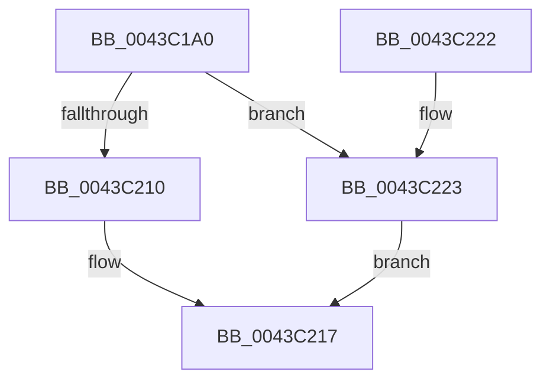

# EtwpCovSampCaptureBufferGet

- RVA: `0x0043C1A0`–`0x0043C22C` (길이 `140` bytes)
- VA: `0x000000014043C1A0`
- 실행 섹션: `.text`
- PDB 이름 있음: `예`; PDB Function 태그: `아니요`
- unwind 정보 RVA: `0x000A44F0`
- 디코드: `37`개 명령, `140/140` bytes 표시
- 미해석 바이트: `0` (있으면 어셈블리에 `.byte`로 보존)

> 이 문서는 커널 이미지의 기계어와 PDB 기호를 분석해 생성했습니다. 4번과 5번은 함수 원형과 자료형을 바이너리 사용 방식에서 추정한 C 해석이며 원본 소스 복구 결과는 아닙니다.

## 1. Dependencies

- 직접 호출 지점: **1**; 고유 호출 대상: **1**
- 직접 호출자로 확인된 함수: **2**
- RIP 상대 이미지 참조: **0**

### Outgoing calls
- `0x0043C206` → [EtwpCovSampLookasidePop](EtwpCovSampLookasidePop_function_0043C528.md) (function, `0x0043C528`)

### Direct callers
- [EtwpCovSampCaptureSample](../65/EtwpCovSampCaptureSample_function_00653F24.md) at `0x00653FC9`
- [EtwpCovSampCaptureUserAddresses](../../page/8D/EtwpCovSampCaptureUserAddresses_function_008D73BC.md) at `0x008D73D6`

### Static image references
- 디코드된 RIP-relative 메모리 참조가 없습니다.

## 2. Other-region calls and transfers

- 다른 실행 섹션으로 향하는 call: **0**
- 별도 외부 분기/꼬리 이동을 확인하지 못했습니다.

## 3. Assembly (complete function range)

```asm
0043C1A0  48 89 5C 24 10                  mov qword ptr [rsp + 0x10], rbx
0043C1A5  57                              push rdi
0043C1A6  48 83 EC 20                     sub rsp, 0x20
0043C1AA  48 8B 41 08                     mov rax, qword ptr [rcx + 8]
0043C1AE  4C 8B D1                        mov r10, rcx
0043C1B1  65 4C 8B 04 25 20 00 00 00      mov r8, qword ptr gs:[0x20]
0043C1BA  44 8B C8                        mov r9d, eax
0043C1BD  C1 E8 0D                        shr eax, 0xd
0043C1C0  33 FF                           xor edi, edi
0043C1C2  25 FF FF 03 00                  and eax, 0x3ffff
0043C1C7  49 C1 E9 04                     shr r9, 4
0043C1CB  0F BD C8                        bsr ecx, eax
0043C1CE  8D 57 01                        lea edx, [rdi + 1]
0043C1D1  41 81 E1 FF 01 00 00            and r9d, 0x1ff
0043C1D8  D3 E2                           shl edx, cl
0043C1DA  33 D0                           xor edx, eax
0043C1DC  89 4C 24 30                     mov dword ptr [rsp + 0x30], ecx
0043C1E0  49 8B 80 B0 8B 00 00            mov rax, qword ptr [r8 + 0x8bb0]
0043C1E7  83 C1 FE                        add ecx, -2
0043C1EA  4A 8D 1C CD 0F 00 00 00         lea rbx, [r9*8 + 0xf]
0043C1F2  48 8B 04 C8                     mov rax, qword ptr [rax + rcx*8]
0043C1F6  49 8B CA                        mov rcx, r10
0043C1F9  48 03 5C D0 08                  add rbx, qword ptr [rax + rdx*8 + 8]
0043C1FE  48 83 E3 F0                     and rbx, 0xfffffffffffffff0
0043C202  48 8D 53 50                     lea rdx, [rbx + 0x50]
0043C206  E8 1D 03 00 00                  call 0x14043c528
0043C20B  48 85 C0                        test rax, rax
0043C20E  75 13                           jne 0x14043c223
0043C210  F0 FF 83 38 01 00 00            lock inc dword ptr [rbx + 0x138]
0043C217  48 8B 5C 24 38                  mov rbx, qword ptr [rsp + 0x38]
0043C21C  48 83 C4 20                     add rsp, 0x20
0043C220  5F                              pop rdi
0043C221  C3                              ret
0043C222  CC                              int3
0043C223  66 89 78 3E                     mov word ptr [rax + 0x3e], di
0043C227  89 78 38                        mov dword ptr [rax + 0x38], edi
0043C22A  EB EB                           jmp 0x14043c217
```

## 4. C-style interpretation (structured pseudocode)

```c
__int64 __fastcall EtwpCovSampCaptureBufferGet(__int64 a1)
{
    __int64 result;
    __int64 v_rbx;
    __int64 v_rdi;
    __int64 v_rsp;
    unsigned __int64 v_stack_p10;
    unsigned int v_stack_p8;

    v_stack_p10 = v_rbx;
    v_rsp = (v_rsp) - (32);
    result = (unsigned int)((*(unsigned __int64 *)(a1 + 8)) >> (13));
    v_rdi = 0;
    result = (unsigned int)((result) & (0x3FFFFULL));
    a4 = ((unsigned int)((unsigned int)(*(unsigned __int64 *)(a1 + 8)))) >> (4);
    a4 = (unsigned int)((a4) & (511));
    a2 = (unsigned int)((v_rdi + 1) << ((unsigned __int8)(a1)));
    a2 = (unsigned int)((a2) ^ ((unsigned int)(result)));
    v_stack_p8 = (unsigned int)(a1);
    a1 = (unsigned int)((a1) + (-2));
    v_rbx = (a4 * 8 + 15) + (*(unsigned __int64 *)(*(unsigned __int64 *)(*(unsigned __int64 *)(*(unsigned __int64 *)(gs_base + (0 + 32)) + 35760) + a1 * 8) + a2 * 8 + 8));
    v_rbx = (v_rbx) & (-16);
    result = EtwpCovSampLookasidePop(a1, v_rbx + 80, *(unsigned __int64 *)(gs_base + (0 + 32)), a4);
    if (result != 0) goto loc_0043C223;
loc_0043C217:
    v_rsp = (v_rsp) + (32);
    return result;
loc_0043C223:
    *(unsigned __int16 *)(result + 62) = 0;
    *(unsigned int *)(result + 56) = 0;
    goto loc_0043C217;
}
```

## 5. (Beta) C Style

```c
int64_t EtwpCovSampCaptureBufferGet(void *Arg1)
{
    uint8_t *arg1 = (uint8_t *)Arg1;

    int64_t result;
    int64_t local_rbx;
    int64_t local_rdi;
    int64_t local_rsp;
    uint64_t v_stack_p10;
    uint32_t v_stack_p8;

    v_stack_p10 = local_rbx;
    local_rsp = (local_rsp) - (32);
    result = (uint32_t)((*(uint64_t *)(arg1 + 0x8)) >> (13));
    local_rdi = 0;
    result = (uint32_t)((result) & (0x3FFFFULL));
    a4 = ((uint32_t)((uint32_t)(*(uint64_t *)(arg1 + 0x8)))) >> (4);
    a4 = (uint32_t)((a4) & (511));
    a2 = (uint32_t)((local_rdi + 1) << ((uint8_t)(Arg1)));
    a2 = (uint32_t)((a2) ^ ((uint32_t)(result)));
    v_stack_p8 = (uint32_t)(Arg1);
    Arg1 = (uint32_t)((Arg1) + (-2));
    local_rbx = (a4 * 8 + 15) + (*(uint64_t *)(*(uint64_t *)(*(uint64_t *)(*(uint64_t *)(gs_base + (0 + 0x20)) + 0x8BB0) + arg1 * 8) + a2 * 8 + 0x8));
    local_rbx = (local_rbx) & (-16);
    result = EtwpCovSampLookasidePop(Arg1, local_rbx + 80, *(uint64_t *)(gs_base + (0 + 0x20)), a4);
    if (result != 0) goto loc_0043C223;
loc_0043C217:
    local_rsp = (local_rsp) + (32);
    return result;
loc_0043C223:
    *(uint16_t *)(result + 0x3E) = 0;
    *(uint32_t *)(result + 0x38) = 0;
    goto loc_0043C217;
}
```

### 관측된 메모리 오프셋

구조체 형식이 확인되지 않은 접근은 인자 기준의 오프셋으로만 기록했습니다.

| 기준 인자 | 오프셋 표현 | 폭 (bit) | 접근 |
|---|---:|---:|---|
| `Arg1` | `+ 0x8` | `64` | `R` |

## 6. Execution-region graph

[열기: 2D/3D 그래프와 함수 탐색 컨트롤 패널](../../../control-panel.html?section=text&rva=0x0043C1A0&view=graph)

- 2D 그래프는 위에서 아래로 흐르고, 3D 그래프는 빈 공간을 드래그해 회전합니다. Shift+드래그는 이동, 휠은 확대·축소, 함수 노드 선택은 대상 보고서 이동입니다.

### Static fallback


