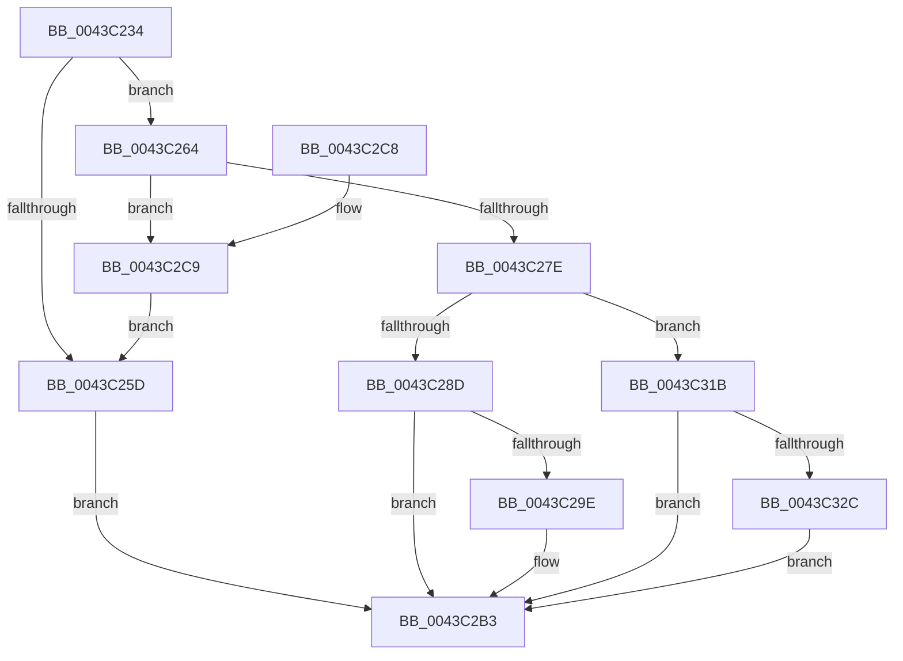

# EtwpCovSampCaptureBufferQueue

- RVA: `0x0043C234`–`0x0043C342` (길이 `270` bytes)
- VA: `0x000000014043C234`
- 실행 섹션: `.text`
- PDB 이름 있음: `예`; PDB Function 태그: `아니요`
- unwind 정보 RVA: `0x000A4500`
- 디코드: `74`개 명령, `270/270` bytes 표시
- 미해석 바이트: `0` (있으면 어셈블리에 `.byte`로 보존)

> 이 문서는 커널 이미지의 기계어와 PDB 기호를 분석해 생성했습니다. 4번과 5번은 함수 원형과 자료형을 바이너리 사용 방식에서 추정한 C 해석이며 원본 소스 복구 결과는 아닙니다.

## 1. Dependencies

- 직접 호출 지점: **8**; 고유 호출 대상: **7**
- 직접 호출자로 확인된 함수: **2**
- RIP 상대 이미지 참조: **0**

### Outgoing calls
- `0x0043C25D` → [EtwpCovSampCaptureBufferRelease](EtwpCovSampCaptureBufferRelease_function_0043C4B4.md) (function, `0x0043C4B4`)
- `0x0043C271` → [EtwpCovSampSampleBufferReserve](EtwpCovSampSampleBufferReserve_function_0043C348.md) (function, `0x0043C348`)
- `0x0043C294` → [ExpInterlockedPushEntrySList](../6B/ExpInterlockedPushEntrySList_function_006BA5B0.md) (function, `0x006BA5B0`)
- `0x0043C2AE` → [KeSetEvent](../33/KeSetEvent_function_0033F310.md) (function, `0x0033F310`)
- `0x0043C2FE` → [memcpy](../6C/memcpy_function_006C6840.md) (function, `0x006C6840`)
- `0x0043C30B` → [EtwpCovSampSampleBufferDecRef](../65/EtwpCovSampSampleBufferDecRef_function_006543B4.md) (function, `0x006543B4`)
- `0x0043C322` → [ExpInterlockedPushEntrySList](../6B/ExpInterlockedPushEntrySList_function_006BA5B0.md) (function, `0x006BA5B0`)
- `0x0043C338` → [KeInsertQueueDpc](../20/KeInsertQueueDpc_function_00207C50.md) (function, `0x00207C50`)

### Direct callers
- [EtwpCovSampCaptureSample](../65/EtwpCovSampCaptureSample_function_00653F24.md) at `0x00653FF8`
- [EtwpCovSampCaptureBufferMapAddressesAndQueue](../../page/8D/EtwpCovSampCaptureBufferMapAddressesAndQueue_function_008D7430.md) at `0x008D7615`

### Static image references
- 디코드된 RIP-relative 메모리 참조가 없습니다.

## 2. Other-region calls and transfers

- 다른 실행 섹션으로 향하는 call: **0**
- 별도 외부 분기/꼬리 이동을 확인하지 못했습니다.

## 3. Assembly (complete function range)

```asm
0043C234  48 8B C4                        mov rax, rsp
0043C237  48 89 58 08                     mov qword ptr [rax + 8], rbx
0043C23B  48 89 68 18                     mov qword ptr [rax + 0x18], rbp
0043C23F  48 89 70 20                     mov qword ptr [rax + 0x20], rsi
0043C243  57                              push rdi
0043C244  48 83 EC 20                     sub rsp, 0x20
0043C248  33 ED                           xor ebp, ebp
0043C24A  48 8B FA                        mov rdi, rdx
0043C24D  48 89 68 10                     mov qword ptr [rax + 0x10], rbp
0043C251  48 8B D9                        mov rbx, rcx
0043C254  0F B7 42 3E                     movzx eax, word ptr [rdx + 0x3e]
0043C258  66 85 C0                        test ax, ax
0043C25B  75 07                           jne 0x14043c264
0043C25D  E8 52 02 00 00                  call 0x14043c4b4
0043C262  EB 4F                           jmp 0x14043c2b3
0043C264  8B F0                           mov esi, eax
0043C266  4C 8D 44 24 38                  lea r8, [rsp + 0x38]
0043C26B  C1 E6 03                        shl esi, 3
0043C26E  0F B7 D6                        movzx edx, si
0043C271  E8 D2 00 00 00                  call 0x14043c348
0043C276  4C 8B C8                        mov r9, rax
0043C279  48 85 C0                        test rax, rax
0043C27C  75 4B                           jne 0x14043c2c9
0043C27E  44 0F 20 C0                     mov rax, cr8
0043C282  48 8B D7                        mov rdx, rdi
0043C285  3C 02                           cmp al, 2
0043C287  0F 87 8E 00 00 00               ja 0x14043c31b
0043C28D  48 8D 8B 40 04 00 00            lea rcx, [rbx + 0x440]
0043C294  E8 17 E3 27 00                  call 0x1406ba5b0
0043C299  48 85 C0                        test rax, rax
0043C29C  75 15                           jne 0x14043c2b3
0043C29E  8B 93 18 05 00 00               mov edx, dword ptr [rbx + 0x518]
0043C2A4  48 8D 8B 50 04 00 00            lea rcx, [rbx + 0x450]
0043C2AB  45 33 C0                        xor r8d, r8d
0043C2AE  E8 5D 30 F0 FF                  call 0x14033f310
0043C2B3  48 8B 5C 24 30                  mov rbx, qword ptr [rsp + 0x30]
0043C2B8  48 8B 6C 24 40                  mov rbp, qword ptr [rsp + 0x40]
0043C2BD  48 8B 74 24 48                  mov rsi, qword ptr [rsp + 0x48]
0043C2C2  48 83 C4 20                     add rsp, 0x20
0043C2C6  5F                              pop rdi
0043C2C7  C3                              ret
0043C2C8  CC                              int3
0043C2C9  8B 48 04                        mov ecx, dword ptr [rax + 4]
0043C2CC  0F B7 57 3E                     movzx edx, word ptr [rdi + 0x3e]
0043C2D0  C1 E2 10                        shl edx, 0x10
0043C2D3  33 D1                           xor edx, ecx
0043C2D5  44 8B C6                        mov r8d, esi
0043C2D8  81 E2 00 00 FF 7F               and edx, 0x7fff0000
0043C2DE  33 D1                           xor edx, ecx
0043C2E0  49 8D 49 08                     lea rcx, [r9 + 8]
0043C2E4  89 50 04                        mov dword ptr [rax + 4], edx
0043C2E7  0F BA F2 1F                     btr edx, 0x1f
0043C2EB  8B 47 38                        mov eax, dword ptr [rdi + 0x38]
0043C2EE  83 E0 FC                        and eax, 0xfffffffc
0043C2F1  C1 E0 1D                        shl eax, 0x1d
0043C2F4  0B C2                           or eax, edx
0043C2F6  48 8D 57 40                     lea rdx, [rdi + 0x40]
0043C2FA  41 89 41 04                     mov dword ptr [r9 + 4], eax
0043C2FE  E8 3D A5 28 00                  call 0x1406c6840
0043C303  48 8B 54 24 38                  mov rdx, qword ptr [rsp + 0x38]
0043C308  48 8B CB                        mov rcx, rbx
0043C30B  E8 A4 80 21 00                  call 0x1406543b4
0043C310  48 8B D7                        mov rdx, rdi
0043C313  48 8B CB                        mov rcx, rbx
0043C316  E9 42 FF FF FF                  jmp 0x14043c25d
0043C31B  48 8D 8B 30 04 00 00            lea rcx, [rbx + 0x430]
0043C322  E8 89 E2 27 00                  call 0x1406ba5b0
0043C327  48 85 C0                        test rax, rax
0043C32A  75 87                           jne 0x14043c2b3
0043C32C  48 8D 8B 68 04 00 00            lea rcx, [rbx + 0x468]
0043C333  45 33 C0                        xor r8d, r8d
0043C336  33 D2                           xor edx, edx
0043C338  E8 13 B9 DC FF                  call 0x140207c50
0043C33D  E9 71 FF FF FF                  jmp 0x14043c2b3
```

## 4. C-style interpretation (structured pseudocode)

```c
__int64 __fastcall EtwpCovSampCaptureBufferQueue(__int64 a1, __int64 a2)
{
    __int64 result;
    __int64 v_rbp;
    __int64 v_rsi;
    __int64 v_rsp;
    unsigned __int64 v_stack_p10;
    unsigned __int64 v_stack_p18;
    unsigned __int64 v_stack_p20;
    unsigned __int64 v_stack_p38;
    unsigned __int64 v_stack_p8;

    *(unsigned __int64 *)(v_rsp + 8) = v_rbx;
    *(unsigned __int64 *)(v_rsp + 24) = v_rbp;
    *(unsigned __int64 *)(v_rsp + 32) = v_rsi;
    v_rsp = (v_rsp) - (32);
    v_rbp = 0;
    *(unsigned __int64 *)(v_rsp + 16) = 0;
    if ((unsigned __int16)(*(unsigned __int16 *)(a2 + 62)) != 0) goto loc_0043C264;
loc_0043C25D:
    result = EtwpCovSampCaptureBufferRelease(a1, a2, a3, a4);
    goto loc_0043C2B3;
loc_0043C264:
    v_rsi = (unsigned int)(((unsigned int)((unsigned int)(result))) << (3));
    result = EtwpCovSampSampleBufferReserve(a1, (unsigned __int16)(v_rsi), v_stack_p10, a4);
    if (result != 0) goto loc_0043C2C9;
    if (((unsigned __int8)(v_cr8)) > 2) goto loc_0043C31B;
    result = ExpInterlockedPushEntrySList(a1 + 1088, a2, v_stack_p10, result);
    if (result == 0) {
        a2 = *(unsigned int *)(a1 + 1304);
        a1 = a1 + 1104;
        a3 = 0;
        result = KeSetEvent(a1, a2, a3, result);
    }
    v_rsp = (v_rsp) + (32);
    return result;
loc_0043C2C9:
    a2 = (unsigned int)((*(unsigned __int16 *)(a2 + 62)) << (16));
    a2 = (unsigned int)((a2) ^ ((unsigned int)((unsigned int)(*(unsigned int *)(result + 4)))));
    a2 = (unsigned int)((a2) & (0x7FFF0000ULL));
    a2 = (unsigned int)((a2) ^ ((unsigned int)((unsigned int)(*(unsigned int *)(result + 4)))));
    *(unsigned int *)(result + 4) = (unsigned int)(a2);
    result = (unsigned int)(((unsigned int)(*(unsigned int *)(a2 + 56))) & (0xFFFFFFFCULL));
    result = (unsigned int)((result) << (29));
    result = (unsigned int)((result) | ((unsigned int)(a2)));
    *(unsigned int *)(result + 4) = (unsigned int)(result);
    result = memcpy(result + 8, a2 + 64, (unsigned int)((unsigned int)(v_stack_p20)), result);
    result = EtwpCovSampSampleBufferDecRef(v_stack_p8, v_stack_p38, (unsigned int)((unsigned int)(v_stack_p20)), result);
    goto loc_0043C25D;
loc_0043C31B:
    result = ExpInterlockedPushEntrySList(v_stack_p8 + 1072, a2, (unsigned int)((unsigned int)(v_stack_p20)), result);
    if (result != 0) goto loc_0043C2B3;
    a3 = 0;
    a2 = 0;
    result = KeInsertQueueDpc(v_stack_p8 + 1128, a2, a3, result);
    goto loc_0043C2B3;
}
```

## 5. (Beta) C Style

```c
int64_t EtwpCovSampCaptureBufferQueue(void *Arg1, void *Arg2)
{
    uint8_t *arg1 = (uint8_t *)Arg1;
    uint8_t *arg2 = (uint8_t *)Arg2;

    int64_t result;
    int64_t local_rbp;
    int64_t local_rsi;
    int64_t local_rsp;
    uint64_t v_stack_p10;
    uint64_t v_stack_p18;
    uint64_t v_stack_p20;
    uint64_t v_stack_p38;
    uint64_t v_stack_p8;

    *(uint64_t *)(local_rsp + 0x8) = local_rbx;
    *(uint64_t *)(local_rsp + 0x18) = local_rbp;
    *(uint64_t *)(local_rsp + 0x20) = local_rsi;
    local_rsp = (local_rsp) - (32);
    local_rbp = 0;
    *(uint64_t *)(local_rsp + 0x10) = 0;
    if ((uint16_t)(*(uint16_t *)(arg2 + 0x3E)) != 0) goto loc_0043C264;
loc_0043C25D:
    result = EtwpCovSampCaptureBufferRelease(Arg1, Arg2, a3, a4);
    goto loc_0043C2B3;
loc_0043C264:
    local_rsi = (uint32_t)(((uint32_t)((uint32_t)(result))) << (3));
    result = EtwpCovSampSampleBufferReserve(Arg1, (uint16_t)(local_rsi), v_stack_p10, a4);
    if (result != 0) goto loc_0043C2C9;
    if (((uint8_t)(v_cr8)) > 2) goto loc_0043C31B;
    result = ExpInterlockedPushEntrySList(Arg1 + 1088, Arg2, v_stack_p10, result);
    if (result == 0) {
        Arg2 = *(uint32_t *)(arg1 + 0x518);
        Arg1 = Arg1 + 1104;
        a3 = 0;
        result = KeSetEvent(Arg1, Arg2, a3, result);
    }
    local_rsp = (local_rsp) + (32);
    return result;
loc_0043C2C9:
    Arg2 = (uint32_t)((*(uint16_t *)(arg2 + 0x3E)) << (16));
    Arg2 = (uint32_t)((Arg2) ^ ((uint32_t)((uint32_t)(*(uint32_t *)(result + 0x4)))));
    Arg2 = (uint32_t)((Arg2) & (0x7FFF0000ULL));
    Arg2 = (uint32_t)((Arg2) ^ ((uint32_t)((uint32_t)(*(uint32_t *)(result + 0x4)))));
    *(uint32_t *)(result + 0x4) = (uint32_t)(Arg2);
    result = (uint32_t)(((uint32_t)(*(uint32_t *)(arg2 + 0x38))) & (0xFFFFFFFCULL));
    result = (uint32_t)((result) << (29));
    result = (uint32_t)((result) | ((uint32_t)(Arg2)));
    *(uint32_t *)(result + 0x4) = (uint32_t)(result);
    result = memcpy(result + 8, Arg2 + 64, (uint32_t)((uint32_t)(v_stack_p20)), result);
    result = EtwpCovSampSampleBufferDecRef(v_stack_p8, v_stack_p38, (uint32_t)((uint32_t)(v_stack_p20)), result);
    goto loc_0043C25D;
loc_0043C31B:
    result = ExpInterlockedPushEntrySList(v_stack_p8 + 1072, Arg2, (uint32_t)((uint32_t)(v_stack_p20)), result);
    if (result != 0) goto loc_0043C2B3;
    a3 = 0;
    Arg2 = 0;
    result = KeInsertQueueDpc(v_stack_p8 + 1128, Arg2, a3, result);
    goto loc_0043C2B3;
}
```

### 관측된 메모리 오프셋

구조체 형식이 확인되지 않은 접근은 인자 기준의 오프셋으로만 기록했습니다.

| 기준 인자 | 오프셋 표현 | 폭 (bit) | 접근 |
|---|---:|---:|---|
| `Arg1` | `+ 0x430` | `64` | `R` |
| `Arg1` | `+ 0x440` | `64` | `R` |
| `Arg1` | `+ 0x450` | `64` | `R` |
| `Arg1` | `+ 0x468` | `64` | `R` |
| `Arg1` | `+ 0x518` | `32` | `R` |
| `Arg2` | `+ 0x38` | `32` | `R` |
| `Arg2` | `+ 0x3E` | `16` | `R` |
| `Arg2` | `+ 0x40` | `64` | `R` |

## 6. Execution-region graph

[열기: 2D/3D 그래프와 함수 탐색 컨트롤 패널](../../../control-panel.html?section=text&rva=0x0043C234&view=graph)

- 2D 그래프는 위에서 아래로 흐르고, 3D 그래프는 빈 공간을 드래그해 회전합니다. Shift+드래그는 이동, 휠은 확대·축소, 함수 노드 선택은 대상 보고서 이동입니다.

### Static fallback


