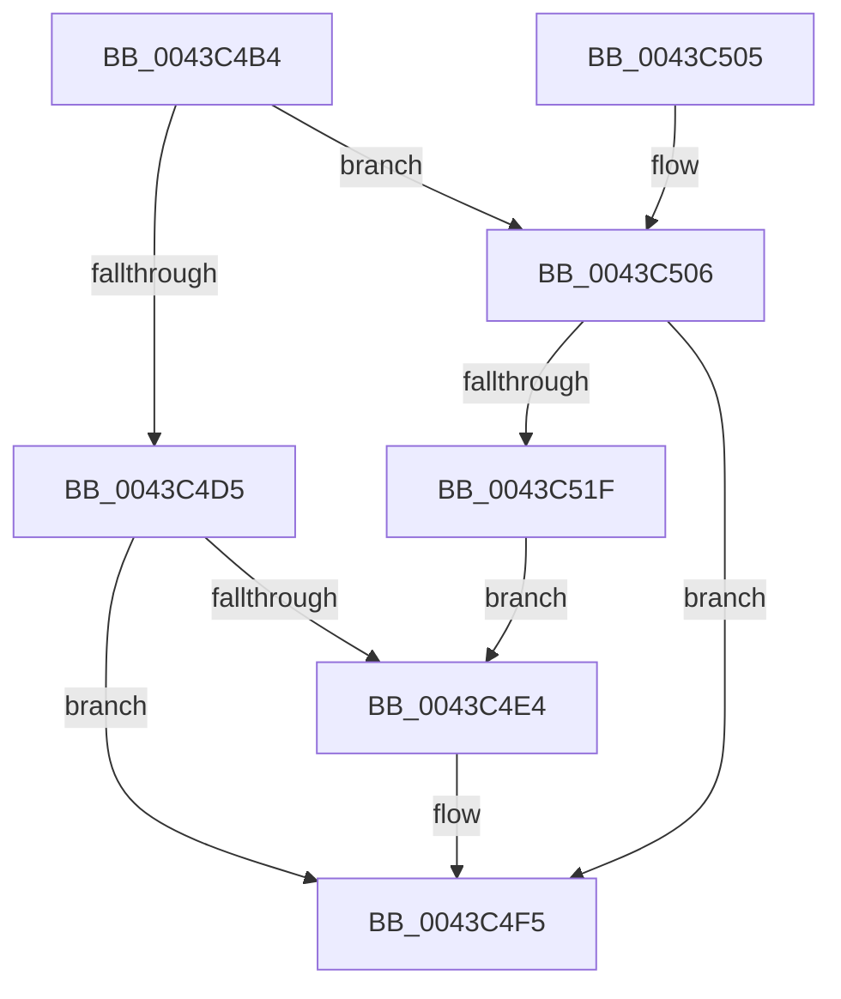

# EtwpCovSampCaptureBufferRelease

- RVA: `0x0043C4B4`–`0x0043C521` (길이 `109` bytes)
- VA: `0x000000014043C4B4`
- 실행 섹션: `.text`
- PDB 이름 있음: `예`; PDB Function 태그: `아니요`
- unwind 정보 RVA: `0x00063C10`
- 디코드: `33`개 명령, `109/109` bytes 표시
- 미해석 바이트: `0` (있으면 어셈블리에 `.byte`로 보존)

> 이 문서는 커널 이미지의 기계어와 PDB 기호를 분석해 생성했습니다. 4번과 5번은 함수 원형과 자료형을 바이너리 사용 방식에서 추정한 C 해석이며 원본 소스 복구 결과는 아닙니다.

## 1. Dependencies

- 직접 호출 지점: **3**; 고유 호출 대상: **2**
- 직접 호출자로 확인된 함수: **4**
- RIP 상대 이미지 참조: **0**

### Outgoing calls
- `0x0043C4D8` → [ExpInterlockedPushEntrySList](../6B/ExpInterlockedPushEntrySList_function_006BA5B0.md) (function, `0x006BA5B0`)
- `0x0043C4F0` → [KeInsertQueueDpc](../20/KeInsertQueueDpc_function_00207C50.md) (function, `0x00207C50`)
- `0x0043C509` → [ExpInterlockedPushEntrySList](../6B/ExpInterlockedPushEntrySList_function_006BA5B0.md) (function, `0x006BA5B0`)

### Direct callers
- [EtwpCovSampCaptureBufferQueue](EtwpCovSampCaptureBufferQueue_function_0043C234.md) at `0x0043C25D`
- [EtwpCovSampCaptureSample](../65/EtwpCovSampCaptureSample_function_00653F24.md) at `0x0065409D`
- [EtwpCovSampCaptureWorkerThread](../../page/7C/EtwpCovSampCaptureWorkerThread_function_007C19B0.md) at `0x007C1A94`
- [EtwpCovSampCaptureBufferMapAddressesAndQueue](../../page/8D/EtwpCovSampCaptureBufferMapAddressesAndQueue_function_008D7430.md) at `0x008D77A1`

### Static image references
- 디코드된 RIP-relative 메모리 참조가 없습니다.

## 2. Other-region calls and transfers

- 다른 실행 섹션으로 향하는 call: **0**
- 별도 외부 분기/꼬리 이동을 확인하지 못했습니다.

## 3. Assembly (complete function range)

```asm
0043C4B4  48 89 5C 24 08                  mov qword ptr [rsp + 8], rbx
0043C4B9  48 89 74 24 10                  mov qword ptr [rsp + 0x10], rsi
0043C4BE  57                              push rdi
0043C4BF  48 83 EC 20                     sub rsp, 0x20
0043C4C3  48 8B 7A 30                     mov rdi, qword ptr [rdx + 0x30]
0043C4C7  48 8B F1                        mov rsi, rcx
0043C4CA  8B 47 28                        mov eax, dword ptr [rdi + 0x28]
0043C4CD  48 8B 5F 20                     mov rbx, qword ptr [rdi + 0x20]
0043C4D1  85 C0                           test eax, eax
0043C4D3  74 31                           je 0x14043c506
0043C4D5  48 8B CF                        mov rcx, rdi
0043C4D8  E8 D3 E0 27 00                  call 0x1406ba5b0
0043C4DD  8B 47 28                        mov eax, dword ptr [rdi + 0x28]
0043C4E0  85 C0                           test eax, eax
0043C4E2  75 11                           jne 0x14043c4f5
0043C4E4  45 33 C0                        xor r8d, r8d
0043C4E7  48 8D 8E A8 04 00 00            lea rcx, [rsi + 0x4a8]
0043C4EE  33 D2                           xor edx, edx
0043C4F0  E8 5B B7 DC FF                  call 0x140207c50
0043C4F5  48 8B 5C 24 30                  mov rbx, qword ptr [rsp + 0x30]
0043C4FA  48 8B 74 24 38                  mov rsi, qword ptr [rsp + 0x38]
0043C4FF  48 83 C4 20                     add rsp, 0x20
0043C503  5F                              pop rdi
0043C504  C3                              ret
0043C505  CC                              int3
0043C506  48 8B CB                        mov rcx, rbx
0043C509  E8 A2 E0 27 00                  call 0x1406ba5b0
0043C50E  B8 01 00 00 00                  mov eax, 1
0043C513  F0 0F C1 43 4C                  lock xadd dword ptr [rbx + 0x4c], eax
0043C518  FF C0                           inc eax
0043C51A  3B 43 48                        cmp eax, dword ptr [rbx + 0x48]
0043C51D  72 D6                           jb 0x14043c4f5
0043C51F  EB C3                           jmp 0x14043c4e4
```

## 4. C-style interpretation (structured pseudocode)

```c
__int64 __fastcall EtwpCovSampCaptureBufferRelease(__int64 a1, __int64 a2, int a3)
{
    __int64 result;
    __int64 v_rsp;
    unsigned __int64 v_stack_p10;
    unsigned __int64 v_stack_p8;

    v_stack_p8 = v_rbx;
    v_stack_p10 = v_rsi;
    v_rsp = (v_rsp) - (32);
    if ((unsigned int)((unsigned int)(*(unsigned int *)(*(unsigned __int64 *)(a2 + 48) + 40))) == 0) goto loc_0043C506;
    result = ExpInterlockedPushEntrySList(*(unsigned __int64 *)(a2 + 48), a2, a3, a4);
    result = (unsigned int)(*(unsigned int *)(*(unsigned __int64 *)(a2 + 48) + 40));
    if ((unsigned int)((unsigned int)(*(unsigned int *)(*(unsigned __int64 *)(a2 + 48) + 40))) == 0) {
        a3 = 0;
        a1 = a1 + 1192;
        a2 = 0;
        result = KeInsertQueueDpc(a1, a2, a3, a4);
    }
    v_rsp = (v_rsp) + (32);
    return result;
loc_0043C506:
    result = ExpInterlockedPushEntrySList(v_stack_p8, a2, a3, a4);
    result = (unsigned int)((1) + 1);
    if (((unsigned int)(result)) < (*(unsigned int *)(v_stack_p8 + 72))) goto loc_0043C4F5;
    goto loc_0043C4E4;
}
```

## 5. (Beta) C Style

```c
int64_t EtwpCovSampCaptureBufferRelease(void *Arg1, void *Arg2, int32_t Arg3)
{
    uint8_t *arg1 = (uint8_t *)Arg1;
    uint8_t *arg2 = (uint8_t *)Arg2;

    int64_t result;
    int64_t local_rsp;
    uint64_t v_stack_p10;
    uint64_t v_stack_p8;

    v_stack_p8 = local_rbx;
    v_stack_p10 = local_rsi;
    local_rsp = (local_rsp) - (32);
    if ((uint32_t)((uint32_t)(*(uint32_t *)(*(uint64_t *)(arg2 + 0x30) + 0x28))) == 0) goto loc_0043C506;
    result = ExpInterlockedPushEntrySList(*(uint64_t *)(arg2 + 0x30), Arg2, Arg3, a4);
    result = (uint32_t)(*(uint32_t *)(*(uint64_t *)(arg2 + 0x30) + 0x28));
    if ((uint32_t)((uint32_t)(*(uint32_t *)(*(uint64_t *)(arg2 + 0x30) + 0x28))) == 0) {
        Arg3 = 0;
        Arg1 = Arg1 + 1192;
        Arg2 = 0;
        result = KeInsertQueueDpc(Arg1, Arg2, Arg3, a4);
    }
    local_rsp = (local_rsp) + (32);
    return result;
loc_0043C506:
    result = ExpInterlockedPushEntrySList(v_stack_p8, Arg2, Arg3, a4);
    result = (uint32_t)((1) + 1);
    if (((uint32_t)(result)) < (*(uint32_t *)(v_stack_p8 + 0x48))) goto loc_0043C4F5;
    goto loc_0043C4E4;
}
```

### 관측된 메모리 오프셋

구조체 형식이 확인되지 않은 접근은 인자 기준의 오프셋으로만 기록했습니다.

| 기준 인자 | 오프셋 표현 | 폭 (bit) | 접근 |
|---|---:|---:|---|
| `Arg1` | `+ 0x4A8` | `64` | `R` |
| `Arg2` | `+ 0x30` | `64` | `R` |

## 6. Execution-region graph

[열기: 2D/3D 그래프와 함수 탐색 컨트롤 패널](../../../control-panel.html?section=text&rva=0x0043C4B4&view=graph)

- 2D 그래프는 위에서 아래로 흐르고, 3D 그래프는 빈 공간을 드래그해 회전합니다. Shift+드래그는 이동, 휠은 확대·축소, 함수 노드 선택은 대상 보고서 이동입니다.

### Static fallback


