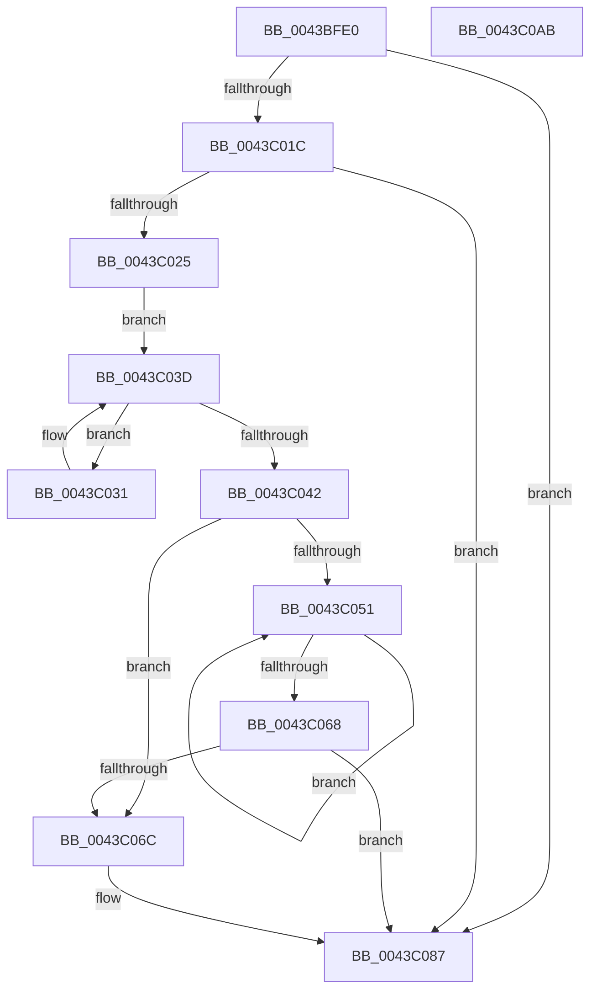

# EtwpCovSampCaptureCleanupLookasides

- RVA: `0x0043BFE0`–`0x0043C0AC` (길이 `204` bytes)
- VA: `0x000000014043BFE0`
- 실행 섹션: `.text`
- PDB 이름 있음: `예`; PDB Function 태그: `아니요`
- unwind 정보 RVA: `0x00060300`
- 디코드: `56`개 명령, `204/204` bytes 표시
- 미해석 바이트: `0` (있으면 어셈블리에 `.byte`로 보존)

> 이 문서는 커널 이미지의 기계어와 PDB 기호를 분석해 생성했습니다. 4번과 5번은 함수 원형과 자료형을 바이너리 사용 방식에서 추정한 C 해석이며 원본 소스 복구 결과는 아닙니다.

## 1. Dependencies

- 직접 호출 지점: **4**; 고유 호출 대상: **4**
- 직접 호출자로 확인된 함수: **2**
- RIP 상대 이미지 참조: **0**

### Outgoing calls
- `0x0043C00B` → [KeAcquireSpinLockRaiseToDpc](../20/KeAcquireSpinLockRaiseToDpc_function_00208470.md) (function, `0x00208470`)
- `0x0043C035` → [EtwpCovSampLookasideFlushFreeListToCleanupList](../65/EtwpCovSampLookasideFlushFreeListToCleanupList_function_006540BC.md) (function, `0x006540BC`)
- `0x0043C082` → [KeSetEvent](../33/KeSetEvent_function_0033F310.md) (function, `0x0033F310`)
- `0x0043C08D` → [KeReleaseSpinLock](../39/KeReleaseSpinLock_function_00392BA0.md) (function, `0x00392BA0`)

### Direct callers
- [EtwpCovSampCaptureContextStop](EtwpCovSampCaptureContextStop_function_0043BE5C.md) at `0x0043BEF5`
- [EtwpCovSampCaptureCleanupDpc](../65/EtwpCovSampCaptureCleanupDpc_function_00653C10.md) at `0x00653C17`

### Static image references
- 디코드된 RIP-relative 메모리 참조가 없습니다.

## 2. Other-region calls and transfers

- 다른 실행 섹션으로 향하는 call: **0**
- 별도 외부 분기/꼬리 이동을 확인하지 못했습니다.

## 3. Assembly (complete function range)

```asm
0043BFE0  48 89 5C 24 08                  mov qword ptr [rsp + 8], rbx
0043BFE5  48 89 6C 24 10                  mov qword ptr [rsp + 0x10], rbp
0043BFEA  48 89 74 24 18                  mov qword ptr [rsp + 0x18], rsi
0043BFEF  57                              push rdi
0043BFF0  41 56                           push r14
0043BFF2  41 57                           push r15
0043BFF4  48 83 EC 20                     sub rsp, 0x20
0043BFF8  48 8D A9 78 02 00 00            lea rbp, [rcx + 0x278]
0043BFFF  48 8B D9                        mov rbx, rcx
0043C002  48 8B CD                        mov rcx, rbp
0043C005  41 BE 01 00 00 00               mov r14d, 1
0043C00B  E8 60 C4 DC FF                  call 0x140208470
0043C010  83 BB 00 05 00 00 00            cmp dword ptr [rbx + 0x500], 0
0043C017  44 8A F8                        mov r15b, al
0043C01A  75 6B                           jne 0x14043c087
0043C01C  83 BB 08 05 00 00 00            cmp dword ptr [rbx + 0x508], 0
0043C023  75 62                           jne 0x14043c087
0043C025  48 8D B3 B0 03 00 00            lea rsi, [rbx + 0x3b0]
0043C02C  48 8B 3E                        mov rdi, qword ptr [rsi]
0043C02F  EB 0C                           jmp 0x14043c03d
0043C031  48 8D 4F F0                     lea rcx, [rdi - 0x10]
0043C035  E8 82 80 21 00                  call 0x1406540bc
0043C03A  48 8B 3F                        mov rdi, qword ptr [rdi]
0043C03D  48 3B FE                        cmp rdi, rsi
0043C040  75 EF                           jne 0x14043c031
0043C042  4C 8D 83 C0 03 00 00            lea r8, [rbx + 0x3c0]
0043C049  49 8B 10                        mov rdx, qword ptr [r8]
0043C04C  49 3B D0                        cmp rdx, r8
0043C04F  74 1B                           je 0x14043c06c
0043C051  8B 42 3C                        mov eax, dword ptr [rdx + 0x3c]
0043C054  33 C9                           xor ecx, ecx
0043C056  3B 42 38                        cmp eax, dword ptr [rdx + 0x38]
0043C059  48 8B 12                        mov rdx, qword ptr [rdx]
0043C05C  41 0F 43 CE                     cmovae ecx, r14d
0043C060  44 8B F1                        mov r14d, ecx
0043C063  49 3B D0                        cmp rdx, r8
0043C066  75 E9                           jne 0x14043c051
0043C068  85 C9                           test ecx, ecx
0043C06A  74 1B                           je 0x14043c087
0043C06C  48 8D 8B E8 04 00 00            lea rcx, [rbx + 0x4e8]
0043C073  C7 83 08 05 00 00 01 00 00 00   mov dword ptr [rbx + 0x508], 1
0043C07D  45 33 C0                        xor r8d, r8d
0043C080  33 D2                           xor edx, edx
0043C082  E8 89 32 F0 FF                  call 0x14033f310
0043C087  41 8A D7                        mov dl, r15b
0043C08A  48 8B CD                        mov rcx, rbp
0043C08D  E8 0E 6B F5 FF                  call 0x140392ba0
0043C092  48 8B 5C 24 40                  mov rbx, qword ptr [rsp + 0x40]
0043C097  48 8B 6C 24 48                  mov rbp, qword ptr [rsp + 0x48]
0043C09C  48 8B 74 24 50                  mov rsi, qword ptr [rsp + 0x50]
0043C0A1  48 83 C4 20                     add rsp, 0x20
0043C0A5  41 5F                           pop r15
0043C0A7  41 5E                           pop r14
0043C0A9  5F                              pop rdi
0043C0AA  C3                              ret
0043C0AB  CC                              int3
```

## 4. C-style interpretation (structured pseudocode)

```c
__int64 __fastcall EtwpCovSampCaptureCleanupLookasides(__int64 a1)
{
    __int64 result;
    __int64 v_rsp;
    unsigned __int64 v_stack_p10;
    unsigned __int64 v_stack_p18;
    unsigned __int64 v_stack_p8;

    v_stack_p8 = v_rbx;
    v_stack_p10 = v_rbp;
    v_stack_p18 = v_rsi;
    v_rsp = (v_rsp) - (32);
    result = KeAcquireSpinLockRaiseToDpc(a1 + 632, a2, a3, a4);
    if ((*(unsigned int *)(a1 + 1280)) != 0) goto loc_0043C087;
    if ((*(unsigned int *)(a1 + 1288)) != 0) goto loc_0043C087;
    goto loc_0043C03D;
loc_0043C031:
    result = EtwpCovSampLookasideFlushFreeListToCleanupList(*(unsigned __int64 *)(a1 + 944) - 16, a2, a3, a4);
loc_0043C03D:
    if ((*(unsigned __int64 *)(*(unsigned __int64 *)(a1 + 944))) != (a1 + 944)) goto loc_0043C031;
    if ((*(unsigned __int64 *)(a1 + 960)) == (a1 + 960)) goto loc_0043C06C;
loc_0043C051:
    a1 = 0;
    if (((unsigned int)((unsigned int)(*(unsigned int *)(*(unsigned __int64 *)(a1 + 960) + 60)))) >= (*(unsigned int *)(*(unsigned __int64 *)(a1 + 960) + 56))) { a1 = 1; }
    if ((*(unsigned __int64 *)(*(unsigned __int64 *)(a1 + 960))) != (a1 + 960)) goto loc_0043C051;
    result = (unsigned int)(*(unsigned int *)(*(unsigned __int64 *)(a1 + 960) + 60));
    if ((unsigned int)(a1) != 0) {
        a1 = a1 + 1256;
        *(unsigned int *)(a1 + 1288) = 1;
        a3 = 0;
        a2 = 0;
        result = KeSetEvent(a1, a2, a3, a4);
    }
    result = KeReleaseSpinLock(a1 + 632, (unsigned __int8)((unsigned __int8)(result)), a3, a4);
    v_rsp = (v_rsp) + (32);
    return result;
}
```

## 5. (Beta) C Style

```c
int64_t EtwpCovSampCaptureCleanupLookasides(void *Arg1)
{
    uint8_t *arg1 = (uint8_t *)Arg1;

    int64_t result;
    int64_t local_rsp;
    uint64_t v_stack_p10;
    uint64_t v_stack_p18;
    uint64_t v_stack_p8;

    v_stack_p8 = local_rbx;
    v_stack_p10 = local_rbp;
    v_stack_p18 = local_rsi;
    local_rsp = (local_rsp) - (32);
    result = KeAcquireSpinLockRaiseToDpc(Arg1 + 632, a2, a3, a4);
    if ((*(uint32_t *)(arg1 + 0x500)) != 0) goto loc_0043C087;
    if ((*(uint32_t *)(arg1 + 0x508)) != 0) goto loc_0043C087;
    goto loc_0043C03D;
loc_0043C031:
    result = EtwpCovSampLookasideFlushFreeListToCleanupList(*(uint64_t *)(arg1 + 0x3B0) - 16, a2, a3, a4);
loc_0043C03D:
    if ((*(uint64_t *)(*(uint64_t *)(arg1 + 0x3B0))) != (Arg1 + 944)) goto loc_0043C031;
    if ((*(uint64_t *)(arg1 + 0x3C0)) == (Arg1 + 960)) goto loc_0043C06C;
loc_0043C051:
    Arg1 = 0;
    if (((uint32_t)((uint32_t)(*(uint32_t *)(*(uint64_t *)(arg1 + 0x3C0) + 0x3C)))) >= (*(uint32_t *)(*(uint64_t *)(arg1 + 0x3C0) + 0x38))) { Arg1 = 1; }
    if ((*(uint64_t *)(*(uint64_t *)(arg1 + 0x3C0))) != (Arg1 + 960)) goto loc_0043C051;
    result = (uint32_t)(*(uint32_t *)(*(uint64_t *)(arg1 + 0x3C0) + 0x3C));
    if ((uint32_t)(Arg1) != 0) {
        Arg1 = Arg1 + 1256;
        *(uint32_t *)(arg1 + 0x508) = 1;
        a3 = 0;
        a2 = 0;
        result = KeSetEvent(Arg1, a2, a3, a4);
    }
    result = KeReleaseSpinLock(Arg1 + 632, (uint8_t)((uint8_t)(result)), a3, a4);
    local_rsp = (local_rsp) + (32);
    return result;
}
```

### 관측된 메모리 오프셋

구조체 형식이 확인되지 않은 접근은 인자 기준의 오프셋으로만 기록했습니다.

| 기준 인자 | 오프셋 표현 | 폭 (bit) | 접근 |
|---|---:|---:|---|
| `Arg1` | `+ 0x0` | `64` | `R` |
| `Arg1` | `+ 0x278` | `64` | `R` |
| `Arg1` | `+ 0x3B0` | `64` | `R` |
| `Arg1` | `+ 0x3C0` | `64` | `R` |
| `Arg1` | `+ 0x4E8` | `64` | `R` |
| `Arg1` | `+ 0x500` | `32` | `R` |
| `Arg1` | `+ 0x508` | `32` | `R` |
| `Arg1` | `+ 0x508` | `32` | `W` |

## 6. Execution-region graph

[열기: 2D/3D 그래프와 함수 탐색 컨트롤 패널](../../../control-panel.html?section=text&rva=0x0043BFE0&view=graph)

- 2D 그래프는 위에서 아래로 흐르고, 3D 그래프는 빈 공간을 드래그해 회전합니다. Shift+드래그는 이동, 휠은 확대·축소, 함수 노드 선택은 대상 보고서 이동입니다.

### Static fallback


