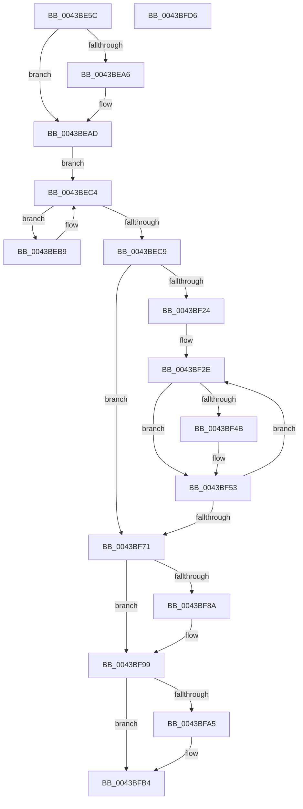

# EtwpCovSampCaptureContextStop

- RVA: `0x0043BE5C`–`0x0043BFD7` (길이 `379` bytes)
- VA: `0x000000014043BE5C`
- 실행 섹션: `.text`
- PDB 이름 있음: `예`; PDB Function 태그: `아니요`
- unwind 정보 RVA: `0x000A118C`
- 디코드: `91`개 명령, `379/379` bytes 표시
- 미해석 바이트: `0` (있으면 어셈블리에 `.byte`로 보존)

> 이 문서는 커널 이미지의 기계어와 PDB 기호를 분석해 생성했습니다. 4번과 5번은 함수 원형과 자료형을 바이너리 사용 방식에서 추정한 C 해석이며 원본 소스 복구 결과는 아닙니다.

## 1. Dependencies

- 직접 호출 지점: **13**; 고유 호출 대상: **10**
- 직접 호출자로 확인된 함수: **1**
- RIP 상대 이미지 참조: **0**

### Outgoing calls
- `0x0043BE8E` → [KeAcquireSpinLockRaiseToDpc](../20/KeAcquireSpinLockRaiseToDpc_function_00208470.md) (function, `0x00208470`)
- `0x0043BED3` → [KeResetEvent](../24/KeResetEvent_function_00248350.md) (function, `0x00248350`)
- `0x0043BEE5` → [KeReleaseSpinLock](../39/KeReleaseSpinLock_function_00392BA0.md) (function, `0x00392BA0`)
- `0x0043BEED` → [EtwpCovSampCaptureFlushSampleBuffers](EtwpCovSampCaptureFlushSampleBuffers_function_0043C0B4.md) (function, `0x0043C0B4`)
- `0x0043BEF5` → [EtwpCovSampCaptureCleanupLookasides](EtwpCovSampCaptureCleanupLookasides_function_0043BFE0.md) (function, `0x0043BFE0`)
- `0x0043BF1B` → [KeWaitForSingleObject](../20/KeWaitForSingleObject_function_0020E6B0.md) (function, `0x0020E6B0`)
- `0x0043BF31` → [EtwpCovSampCaptureCancelApcs](../65/EtwpCovSampCaptureCancelApcs_function_00653B44.md) (function, `0x00653B44`)
- `0x0043BF39` → [EtwpCovSampCaptureFlushSampleBuffers](EtwpCovSampCaptureFlushSampleBuffers_function_0043C0B4.md) (function, `0x0043C0B4`)
- `0x0043BF68` → [KeWaitForSingleObject](../20/KeWaitForSingleObject_function_0020E6B0.md) (function, `0x0020E6B0`)
- `0x0043BF74` → [EtwpCovSampCaptureFreeLookasides](../../page/AC/EtwpCovSampCaptureFreeLookasides_function_00ACEDF0.md) (function, `0x00ACEDF0`)
- `0x0043BF8C` → [ExFreePoolWithTag](../../poolcode/B8/ExFreePoolWithTag_function_00B82870.md) (function, `0x00B82870`)
- `0x0043BFA7` → [ExFreePoolWithTag](../../poolcode/B8/ExFreePoolWithTag_function_00B82870.md) (function, `0x00B82870`)
- `0x0043BFBC` → [KeLeaveCriticalRegion](../25/KeLeaveCriticalRegion_function_0025D8B0.md) (function, `0x0025D8B0`)

### Direct callers
- [EtwpCoverageSamplerStop](../../page/7C/EtwpCoverageSamplerStop_function_007C2564.md) at `0x007C27EB`

### Static image references
- 디코드된 RIP-relative 메모리 참조가 없습니다.

## 2. Other-region calls and transfers

- 다른 실행 섹션으로 향하는 call: **3**
  - `0x0043BF74` → [EtwpCovSampCaptureFreeLookasides](../../page/AC/EtwpCovSampCaptureFreeLookasides_function_00ACEDF0.md) (`.text` → `PAGE`)
  - `0x0043BF8C` → [ExFreePoolWithTag](../../poolcode/B8/ExFreePoolWithTag_function_00B82870.md) (`.text` → `POOLCODE`)
  - `0x0043BFA7` → [ExFreePoolWithTag](../../poolcode/B8/ExFreePoolWithTag_function_00B82870.md) (`.text` → `POOLCODE`)
- 별도 외부 분기/꼬리 이동을 확인하지 못했습니다.

## 3. Assembly (complete function range)

```asm
0043BE5C  48 89 5C 24 10                  mov qword ptr [rsp + 0x10], rbx
0043BE61  48 89 6C 24 18                  mov qword ptr [rsp + 0x18], rbp
0043BE66  48 89 74 24 20                  mov qword ptr [rsp + 0x20], rsi
0043BE6B  57                              push rdi
0043BE6C  48 83 EC 30                     sub rsp, 0x30
0043BE70  65 48 8B 04 25 88 01 00 00      mov rax, qword ptr gs:[0x188]
0043BE79  48 8D B9 78 02 00 00            lea rdi, [rcx + 0x278]
0043BE80  48 8B D9                        mov rbx, rcx
0043BE83  48 8B CF                        mov rcx, rdi
0043BE86  66 FF 88 E4 01 00 00            dec word ptr [rax + 0x1e4]
0043BE8D  90                              nop
0043BE8E  E8 DD C5 DC FF                  call 0x140208470
0043BE93  83 A3 00 05 00 00 00            and dword ptr [rbx + 0x500], 0
0043BE9A  40 8A E8                        mov bpl, al
0043BE9D  83 BB 04 05 00 00 00            cmp dword ptr [rbx + 0x504], 0
0043BEA4  74 07                           je 0x14043bead
0043BEA6  83 A3 04 05 00 00 00            and dword ptr [rbx + 0x504], 0
0043BEAD  4C 8D 83 B0 03 00 00            lea r8, [rbx + 0x3b0]
0043BEB4  49 8B 10                        mov rdx, qword ptr [r8]
0043BEB7  EB 0B                           jmp 0x14043bec4
0043BEB9  83 62 18 00                     and dword ptr [rdx + 0x18], 0
0043BEBD  83 62 1C 00                     and dword ptr [rdx + 0x1c], 0
0043BEC1  48 8B 12                        mov rdx, qword ptr [rdx]
0043BEC4  49 3B D0                        cmp rdx, r8
0043BEC7  75 F0                           jne 0x14043beb9
0043BEC9  48 8D B3 E8 04 00 00            lea rsi, [rbx + 0x4e8]
0043BED0  48 8B CE                        mov rcx, rsi
0043BED3  E8 78 C4 E0 FF                  call 0x140248350
0043BED8  83 A3 08 05 00 00 00            and dword ptr [rbx + 0x508], 0
0043BEDF  40 8A D5                        mov dl, bpl
0043BEE2  48 8B CF                        mov rcx, rdi
0043BEE5  E8 B6 6C F5 FF                  call 0x140392ba0
0043BEEA  48 8B CB                        mov rcx, rbx
0043BEED  E8 C2 01 00 00                  call 0x14043c0b4
0043BEF2  48 8B CB                        mov rcx, rbx
0043BEF5  E8 E6 00 00 00                  call 0x14043bfe0
0043BEFA  48 8D 44 24 40                  lea rax, [rsp + 0x40]
0043BEFF  48 C7 C7 60 DA D9 FF            mov rdi, 0xffffffffffd9da60
0043BF06  45 33 C9                        xor r9d, r9d
0043BF09  48 89 44 24 20                  mov qword ptr [rsp + 0x20], rax
0043BF0E  45 33 C0                        xor r8d, r8d
0043BF11  48 89 7C 24 40                  mov qword ptr [rsp + 0x40], rdi
0043BF16  33 D2                           xor edx, edx
0043BF18  48 8B CE                        mov rcx, rsi
0043BF1B  E8 90 27 DD FF                  call 0x14020e6b0
0043BF20  85 C0                           test eax, eax
0043BF22  74 4D                           je 0x14043bf71
0043BF24  48 BD 00 A0 CB C3 FD FF FF FF   movabs rbp, 0xfffffffdc3cba000
0043BF2E  48 8B CB                        mov rcx, rbx
0043BF31  E8 0E 7C 21 00                  call 0x140653b44
0043BF36  48 8B CB                        mov rcx, rbx
0043BF39  E8 76 01 00 00                  call 0x14043c0b4
0043BF3E  48 03 FF                        add rdi, rdi
0043BF41  48 89 7C 24 40                  mov qword ptr [rsp + 0x40], rdi
0043BF46  48 3B FD                        cmp rdi, rbp
0043BF49  7D 08                           jge 0x14043bf53
0043BF4B  48 89 6C 24 40                  mov qword ptr [rsp + 0x40], rbp
0043BF50  48 8B FD                        mov rdi, rbp
0043BF53  48 8D 44 24 40                  lea rax, [rsp + 0x40]
0043BF58  45 33 C9                        xor r9d, r9d
0043BF5B  45 33 C0                        xor r8d, r8d
0043BF5E  48 89 44 24 20                  mov qword ptr [rsp + 0x20], rax
0043BF63  33 D2                           xor edx, edx
0043BF65  48 8B CE                        mov rcx, rsi
0043BF68  E8 43 27 DD FF                  call 0x14020e6b0
0043BF6D  85 C0                           test eax, eax
0043BF6F  75 BD                           jne 0x14043bf2e
0043BF71  48 8B CB                        mov rcx, rbx
0043BF74  E8 77 2E 69 00                  call 0x140acedf0
0043BF79  48 8B 8B 28 05 00 00            mov rcx, qword ptr [rbx + 0x528]
0043BF80  BF 45 74 77 56                  mov edi, 0x56777445
0043BF85  48 85 C9                        test rcx, rcx
0043BF88  74 0F                           je 0x14043bf99
0043BF8A  8B D7                           mov edx, edi
0043BF8C  E8 DF 68 74 00                  call 0x140b82870
0043BF91  48 83 A3 28 05 00 00 00         and qword ptr [rbx + 0x528], 0
0043BF99  48 8B 8B 30 05 00 00            mov rcx, qword ptr [rbx + 0x530]
0043BFA0  48 85 C9                        test rcx, rcx
0043BFA3  74 0F                           je 0x14043bfb4
0043BFA5  8B D7                           mov edx, edi
0043BFA7  E8 C4 68 74 00                  call 0x140b82870
0043BFAC  48 83 A3 30 05 00 00 00         and qword ptr [rbx + 0x530], 0
0043BFB4  48 83 A3 20 05 00 00 00         and qword ptr [rbx + 0x520], 0
0043BFBC  E8 EF 18 E2 FF                  call 0x14025d8b0
0043BFC1  48 8B 5C 24 48                  mov rbx, qword ptr [rsp + 0x48]
0043BFC6  48 8B 6C 24 50                  mov rbp, qword ptr [rsp + 0x50]
0043BFCB  48 8B 74 24 58                  mov rsi, qword ptr [rsp + 0x58]
0043BFD0  48 83 C4 30                     add rsp, 0x30
0043BFD4  5F                              pop rdi
0043BFD5  C3                              ret
0043BFD6  CC                              int3
```

## 4. C-style interpretation (structured pseudocode)

```c
__int64 __fastcall EtwpCovSampCaptureContextStop(__int64 a1, __int64 a2, __int64 a3, int a4)
{
    __int64 result;
    __int64 v_rdi;
    __int64 v_rsp;
    unsigned __int64 v_stack_m18;
    unsigned __int64 v_stack_p10;
    unsigned __int64 v_stack_p18;
    unsigned __int64 v_stack_p20;
    unsigned __int64 v_stack_p8;

    v_stack_p10 = v_rbx;
    v_stack_p18 = v_rbp;
    v_stack_p20 = v_rsi;
    v_rsp = (v_rsp) - (48);
    result = KeAcquireSpinLockRaiseToDpc(a1 + 632, a2, a3, a4);
    if ((*(unsigned int *)(a1 + 1284)) != 0) {
    }
    goto loc_0043BEC4;
loc_0043BEB9:
loc_0043BEC4:
    if ((*(unsigned __int64 *)(*(unsigned __int64 *)(a1 + 944))) != (a1 + 944)) goto loc_0043BEB9;
    result = KeResetEvent(a1 + 1256, *(unsigned __int64 *)(*(unsigned __int64 *)(a1 + 944)), a1 + 944, a4);
    result = KeReleaseSpinLock(a1 + 632, (unsigned __int8)((unsigned __int8)(result)), a1 + 944, a4);
    result = EtwpCovSampCaptureFlushSampleBuffers(a1, (unsigned __int8)((unsigned __int8)(result)), a1 + 944, a4);
    result = EtwpCovSampCaptureCleanupLookasides(a1, (unsigned __int8)((unsigned __int8)(result)), a1 + 944, a4);
    a4 = 0;
    v_stack_m18 = v_stack_p8;
    a3 = 0;
    v_stack_p8 = 0xFFFFFFFFFFD9DA60ULL;
    a2 = 0;
    result = KeWaitForSingleObject(a1 + 1256, a2, a3, a4);
    if ((unsigned int)(result) == 0) goto loc_0043BF71;
loc_0043BF2E:
    result = EtwpCovSampCaptureCancelApcs(a1, a2, a3, a4);
    result = EtwpCovSampCaptureFlushSampleBuffers(a1, a2, a3, a4);
    v_rdi = (0xFFFFFFFFFFD9DA60ULL) + (0xFFFFFFFFFFD9DA60ULL);
    v_stack_p8 = v_rdi;
    if (v_rdi < ((unsigned __int8)(result))) {
        v_stack_p8 = (unsigned __int8)(result);
        v_rdi = (unsigned __int8)(result);
    }
    a4 = 0;
    a3 = 0;
    v_stack_m18 = v_stack_p8;
    a2 = 0;
    result = KeWaitForSingleObject(a1 + 1256, a2, a3, a4);
    if ((unsigned int)(result) != 0) goto loc_0043BF2E;
loc_0043BF71:
    result = EtwpCovSampCaptureFreeLookasides(a1, a2, a3, a4);
    if (*(unsigned __int64 *)(a1 + 1320) != 0) {
        a2 = (unsigned int)((unsigned int)(0x56777445ULL));
        result = ExFreePoolWithTag(*(unsigned __int64 *)(a1 + 1320), a2, a3, a4);
    }
    if (*(unsigned __int64 *)(a1 + 1328) != 0) {
        a2 = (unsigned int)((unsigned int)(0x56777445ULL));
        result = ExFreePoolWithTag(*(unsigned __int64 *)(a1 + 1328), a2, a3, a4);
    }
    result = KeLeaveCriticalRegion(*(unsigned __int64 *)(a1 + 1328), a2, a3, a4);
    v_rsp = (v_rsp) + (48);
    return result;
}
```

## 5. (Beta) C Style

```c
int64_t EtwpCovSampCaptureContextStop(void *Arg1, int64_t Arg2, int64_t Arg3, int32_t Arg4)
{
    uint8_t *arg1 = (uint8_t *)Arg1;

    int64_t result;
    int64_t local_rdi;
    int64_t local_rsp;
    uint64_t v_stack_m18;
    uint64_t v_stack_p10;
    uint64_t v_stack_p18;
    uint64_t v_stack_p20;
    uint64_t v_stack_p8;

    v_stack_p10 = local_rbx;
    v_stack_p18 = local_rbp;
    v_stack_p20 = local_rsi;
    local_rsp = (local_rsp) - (48);
    result = KeAcquireSpinLockRaiseToDpc(Arg1 + 632, Arg2, Arg3, Arg4);
    if ((*(uint32_t *)(arg1 + 0x504)) != 0) {
    }
    goto loc_0043BEC4;
loc_0043BEB9:
loc_0043BEC4:
    if ((*(uint64_t *)(*(uint64_t *)(arg1 + 0x3B0))) != (Arg1 + 944)) goto loc_0043BEB9;
    result = KeResetEvent(Arg1 + 1256, *(uint64_t *)(*(uint64_t *)(arg1 + 0x3B0)), Arg1 + 944, Arg4);
    result = KeReleaseSpinLock(Arg1 + 632, (uint8_t)((uint8_t)(result)), Arg1 + 944, Arg4);
    result = EtwpCovSampCaptureFlushSampleBuffers(Arg1, (uint8_t)((uint8_t)(result)), Arg1 + 944, Arg4);
    result = EtwpCovSampCaptureCleanupLookasides(Arg1, (uint8_t)((uint8_t)(result)), Arg1 + 944, Arg4);
    Arg4 = 0;
    v_stack_m18 = v_stack_p8;
    Arg3 = 0;
    v_stack_p8 = 0xFFFFFFFFFFD9DA60ULL;
    Arg2 = 0;
    result = KeWaitForSingleObject(Arg1 + 1256, Arg2, Arg3, Arg4);
    if ((uint32_t)(result) == 0) goto loc_0043BF71;
loc_0043BF2E:
    result = EtwpCovSampCaptureCancelApcs(Arg1, Arg2, Arg3, Arg4);
    result = EtwpCovSampCaptureFlushSampleBuffers(Arg1, Arg2, Arg3, Arg4);
    local_rdi = (0xFFFFFFFFFFD9DA60ULL) + (0xFFFFFFFFFFD9DA60ULL);
    v_stack_p8 = local_rdi;
    if (local_rdi < ((uint8_t)(result))) {
        v_stack_p8 = (uint8_t)(result);
        local_rdi = (uint8_t)(result);
    }
    Arg4 = 0;
    Arg3 = 0;
    v_stack_m18 = v_stack_p8;
    Arg2 = 0;
    result = KeWaitForSingleObject(Arg1 + 1256, Arg2, Arg3, Arg4);
    if ((uint32_t)(result) != 0) goto loc_0043BF2E;
loc_0043BF71:
    result = EtwpCovSampCaptureFreeLookasides(Arg1, Arg2, Arg3, Arg4);
    if (*(uint64_t *)(arg1 + 0x528) != 0) {
        Arg2 = (uint32_t)((uint32_t)(0x56777445ULL));
        result = ExFreePoolWithTag(*(uint64_t *)(arg1 + 0x528), Arg2, Arg3, Arg4);
    }
    if (*(uint64_t *)(arg1 + 0x530) != 0) {
        Arg2 = (uint32_t)((uint32_t)(0x56777445ULL));
        result = ExFreePoolWithTag(*(uint64_t *)(arg1 + 0x530), Arg2, Arg3, Arg4);
    }
    result = KeLeaveCriticalRegion(*(uint64_t *)(arg1 + 0x530), Arg2, Arg3, Arg4);
    local_rsp = (local_rsp) + (48);
    return result;
}
```

### 관측된 메모리 오프셋

구조체 형식이 확인되지 않은 접근은 인자 기준의 오프셋으로만 기록했습니다.

| 기준 인자 | 오프셋 표현 | 폭 (bit) | 접근 |
|---|---:|---:|---|
| `Arg1` | `+ 0x0` | `64` | `R` |
| `Arg1` | `+ 0x278` | `64` | `R` |
| `Arg1` | `+ 0x3B0` | `64` | `R` |
| `Arg1` | `+ 0x4E8` | `64` | `R` |
| `Arg1` | `+ 0x500` | `32` | `R/W` |
| `Arg1` | `+ 0x504` | `32` | `R` |
| `Arg1` | `+ 0x504` | `32` | `R/W` |
| `Arg1` | `+ 0x508` | `32` | `R/W` |
| `Arg1` | `+ 0x520` | `64` | `R/W` |
| `Arg1` | `+ 0x528` | `64` | `R` |
| `Arg1` | `+ 0x528` | `64` | `R/W` |
| `Arg1` | `+ 0x530` | `64` | `R` |
| `Arg1` | `+ 0x530` | `64` | `R/W` |

## 6. Execution-region graph

[열기: 2D/3D 그래프와 함수 탐색 컨트롤 패널](../../../control-panel.html?section=text&rva=0x0043BE5C&view=graph)

- 2D 그래프는 위에서 아래로 흐르고, 3D 그래프는 빈 공간을 드래그해 회전합니다. Shift+드래그는 이동, 휠은 확대·축소, 함수 노드 선택은 대상 보고서 이동입니다.

### Static fallback


