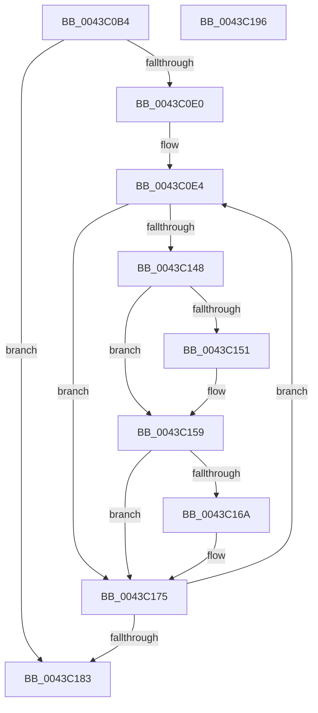

# EtwpCovSampCaptureFlushSampleBuffers

- RVA: `0x0043C0B4`–`0x0043C197` (길이 `227` bytes)
- VA: `0x000000014043C0B4`
- 실행 섹션: `.text`
- PDB 이름 있음: `예`; PDB Function 태그: `아니요`
- unwind 정보 RVA: `0x000A44D8`
- 디코드: `62`개 명령, `227/227` bytes 표시
- 미해석 바이트: `0` (있으면 어셈블리에 `.byte`로 보존)

> 이 문서는 커널 이미지의 기계어와 PDB 기호를 분석해 생성했습니다. 4번과 5번은 함수 원형과 자료형을 바이너리 사용 방식에서 추정한 C 해석이며 원본 소스 복구 결과는 아닙니다.

## 1. Dependencies

- 직접 호출 지점: **4**; 고유 호출 대상: **4**
- 직접 호출자로 확인된 함수: **2**
- RIP 상대 이미지 참조: **1**

### Outgoing calls
- `0x0043C0D3` → [KeQueryMaximumProcessorCountEx](../26/KeQueryMaximumProcessorCountEx_function_00264D60.md) (function, `0x00264D60`)
- `0x0043C13F` → [EtwpCovSampTryAcquireBufferLock](EtwpCovSampTryAcquireBufferLock_function_0043C5CC.md) (function, `0x0043C5CC`)
- `0x0043C160` → [KeReleaseSpinLock](../39/KeReleaseSpinLock_function_00392BA0.md) (function, `0x00392BA0`)
- `0x0043C170` → [EtwpCovSampSampleBufferDecRef](../65/EtwpCovSampSampleBufferDecRef_function_006543B4.md) (function, `0x006543B4`)

### Direct callers
- [EtwpCovSampCaptureContextStop](EtwpCovSampCaptureContextStop_function_0043BE5C.md) at `0x0043BEED`
- [EtwpCovSampCaptureContextStop](EtwpCovSampCaptureContextStop_function_0043BE5C.md) at `0x0043BF39`
- [EtwpCoverageSamplerQuery](../../page/95/EtwpCoverageSamplerQuery_function_0095C4A0.md) at `0x0095C56A`

### Static image references
- `0x0043C0EA` → RVA `0x00EFA278` (`.data`; read)

## 2. Other-region calls and transfers

- 다른 실행 섹션으로 향하는 call: **0**
- 별도 외부 분기/꼬리 이동을 확인하지 못했습니다.

## 3. Assembly (complete function range)

```asm
0043C0B4  48 89 5C 24 18                  mov qword ptr [rsp + 0x18], rbx
0043C0B9  48 89 6C 24 20                  mov qword ptr [rsp + 0x20], rbp
0043C0BE  56                              push rsi
0043C0BF  57                              push rdi
0043C0C0  41 56                           push r14
0043C0C2  48 83 EC 20                     sub rsp, 0x20
0043C0C6  4C 8B F1                        mov r14, rcx
0043C0C9  C6 44 24 40 00                  mov byte ptr [rsp + 0x40], 0
0043C0CE  B9 FF FF 00 00                  mov ecx, 0xffff
0043C0D3  E8 88 8C E2 FF                  call 0x140264d60
0043C0D8  85 C0                           test eax, eax
0043C0DA  0F 84 A3 00 00 00               je 0x14043c183
0043C0E0  33 FF                           xor edi, edi
0043C0E2  8B E8                           mov ebp, eax
0043C0E4  49 8B 46 08                     mov rax, qword ptr [r14 + 8]
0043C0E8  33 F6                           xor esi, esi
0043C0EA  48 8B 15 87 E1 AB 00            mov rdx, qword ptr [rip + 0xabe187]
0043C0F1  44 8B D8                        mov r11d, eax
0043C0F4  21 74 24 48                     and dword ptr [rsp + 0x48], esi
0043C0F8  41 C1 EB 0D                     shr r11d, 0xd
0043C0FC  41 81 E3 FF FF 03 00            and r11d, 0x3ffff
0043C103  48 C1 E8 04                     shr rax, 4
0043C107  4C 8B 04 17                     mov r8, qword ptr [rdi + rdx]
0043C10B  44 8D 4E 01                     lea r9d, [rsi + 1]
0043C10F  41 0F BD CB                     bsr ecx, r11d
0043C113  25 FF 01 00 00                  and eax, 0x1ff
0043C118  48 8D 54 24 40                  lea rdx, [rsp + 0x40]
0043C11D  41 D3 E1                        shl r9d, cl
0043C120  4D 33 CB                        xor r9, r11
0043C123  44 8D 51 FE                     lea r10d, [rcx - 2]
0043C127  4B 8B 0C D0                     mov rcx, qword ptr [r8 + r10*8]
0043C12B  48 8D 1C C5 0F 00 00 00         lea rbx, [rax*8 + 0xf]
0043C133  4A 03 5C C9 08                  add rbx, qword ptr [rcx + r9*8 + 8]
0043C138  48 83 E3 F0                     and rbx, 0xfffffffffffffff0
0043C13C  48 8B CB                        mov rcx, rbx
0043C13F  E8 88 04 00 00                  call 0x14043c5cc
0043C144  85 C0                           test eax, eax
0043C146  74 2D                           je 0x14043c175
0043C148  48 8B 43 08                     mov rax, qword ptr [rbx + 8]
0043C14C  48 85 C0                        test rax, rax
0043C14F  74 08                           je 0x14043c159
0043C151  48 83 63 08 00                  and qword ptr [rbx + 8], 0
0043C156  48 8B F0                        mov rsi, rax
0043C159  8A 54 24 40                     mov dl, byte ptr [rsp + 0x40]
0043C15D  48 8B CB                        mov rcx, rbx
0043C160  E8 3B 6A F5 FF                  call 0x140392ba0
0043C165  48 85 F6                        test rsi, rsi
0043C168  74 0B                           je 0x14043c175
0043C16A  48 8B D6                        mov rdx, rsi
0043C16D  49 8B CE                        mov rcx, r14
0043C170  E8 3F 82 21 00                  call 0x1406543b4
0043C175  48 83 C7 08                     add rdi, 8
0043C179  48 83 ED 01                     sub rbp, 1
0043C17D  0F 85 61 FF FF FF               jne 0x14043c0e4
0043C183  48 8B 5C 24 50                  mov rbx, qword ptr [rsp + 0x50]
0043C188  48 8B 6C 24 58                  mov rbp, qword ptr [rsp + 0x58]
0043C18D  48 83 C4 20                     add rsp, 0x20
0043C191  41 5E                           pop r14
0043C193  5F                              pop rdi
0043C194  5E                              pop rsi
0043C195  C3                              ret
0043C196  CC                              int3
```

## 4. C-style interpretation (structured pseudocode)

```c
__int64 __fastcall EtwpCovSampCaptureFlushSampleBuffers(__int64 a1)
{
    __int64 result;
    __int64 v_r11;
    __int64 v_rbp;
    __int64 v_rbx;
    __int64 v_rdi;
    __int64 v_rsi;
    __int64 v_rsp;
    unsigned int v_stack_p10;
    unsigned __int64 v_stack_p18;
    unsigned __int64 v_stack_p20;
    unsigned __int8 v_stack_p8;

    v_stack_p18 = v_rbx;
    v_stack_p20 = v_rbp;
    v_rsp = (v_rsp) - (32);
    v_stack_p8 = 0;
    result = KeQueryMaximumProcessorCountEx((unsigned int)(0xFFFFULL), a2, a3, a4);
    if ((unsigned int)(result) == 0) goto loc_0043C183;
    v_rdi = 0;
loc_0043C0E4:
    v_rsi = 0;
    v_r11 = (unsigned int)(((unsigned int)((unsigned int)(*(unsigned __int64 *)(a1 + 8)))) >> (13));
    v_r11 = (unsigned int)((v_r11) & (0x3FFFFULL));
    result = (*(unsigned __int64 *)(a1 + 8)) >> (4);
    result = (unsigned int)((result) & (511));
    a4 = (unsigned int)((v_rsi + 1) << ((unsigned __int8)((unsigned int)(0xFFFFULL))));
    a4 = (a4) ^ (v_r11);
    v_rbx = (result * 8 + 15) + (*(unsigned __int64 *)(*(unsigned __int64 *)(*(unsigned __int64 *)(v_rdi + *(unsigned __int64 *)(v_rip + 11264391) * 1) + (unsigned int)(0xFFFFULL) - 2 * 8) + a4 * 8 + 8));
    v_rbx = (v_rbx) & (-16);
    result = EtwpCovSampTryAcquireBufferLock(v_rbx, v_stack_p8, *(unsigned __int64 *)(v_rdi + *(unsigned __int64 *)(v_rip + 11264391) * 1), a4);
    if ((unsigned int)(result) == 0) goto loc_0043C175;
    if (*(unsigned __int64 *)(v_rbx + 8) != 0) {
        v_rsi = *(unsigned __int64 *)(v_rbx + 8);
    }
    result = KeReleaseSpinLock(v_rbx, v_stack_p8, *(unsigned __int64 *)(v_rdi + *(unsigned __int64 *)(v_rip + 11264391) * 1), a4);
    if (v_rsi != 0) {
        a2 = v_rsi;
        a1 = a1;
        result = EtwpCovSampSampleBufferDecRef(a1, a2, *(unsigned __int64 *)(v_rdi + *(unsigned __int64 *)(v_rip + 11264391) * 1), a4);
    }
    v_rdi = (v_rdi) + (8);
    v_rbp = ((unsigned int)((unsigned int)(result))) - (1);
    if (condition_is_not_equal) goto loc_0043C0E4;
loc_0043C183:
    v_rsp = (v_rsp) + (32);
    return result;
}
```

## 5. (Beta) C Style

```c
int64_t EtwpCovSampCaptureFlushSampleBuffers(void *Arg1)
{
    uint8_t *arg1 = (uint8_t *)Arg1;

    int64_t result;
    int64_t local_r11;
    int64_t local_rbp;
    int64_t local_rbx;
    int64_t local_rdi;
    int64_t local_rsi;
    int64_t local_rsp;
    uint32_t v_stack_p10;
    uint64_t v_stack_p18;
    uint64_t v_stack_p20;
    uint8_t v_stack_p8;

    v_stack_p18 = local_rbx;
    v_stack_p20 = local_rbp;
    local_rsp = (local_rsp) - (32);
    v_stack_p8 = 0;
    result = KeQueryMaximumProcessorCountEx((uint32_t)(0xFFFFULL), a2, a3, a4);
    if ((uint32_t)(result) == 0) goto loc_0043C183;
    local_rdi = 0;
loc_0043C0E4:
    local_rsi = 0;
    local_r11 = (uint32_t)(((uint32_t)((uint32_t)(*(uint64_t *)(arg1 + 0x8)))) >> (13));
    local_r11 = (uint32_t)((local_r11) & (0x3FFFFULL));
    result = (*(uint64_t *)(arg1 + 0x8)) >> (4);
    result = (uint32_t)((result) & (511));
    a4 = (uint32_t)((local_rsi + 1) << ((uint8_t)((uint32_t)(0xFFFFULL))));
    a4 = (a4) ^ (local_r11);
    local_rbx = (result * 8 + 15) + (*(uint64_t *)(*(uint64_t *)(*(uint64_t *)(local_rdi + *(uint64_t *)(v_rip + 0xABE187) * 1) + (uint32_t)(0xFFFFULL) - 0x2 * 8) + a4 * 8 + 0x8));
    local_rbx = (local_rbx) & (-16);
    result = EtwpCovSampTryAcquireBufferLock(local_rbx, v_stack_p8, *(uint64_t *)(local_rdi + *(uint64_t *)(v_rip + 0xABE187) * 1), a4);
    if ((uint32_t)(result) == 0) goto loc_0043C175;
    if (*(uint64_t *)(local_rbx + 0x8) != 0) {
        local_rsi = *(uint64_t *)(local_rbx + 0x8);
    }
    result = KeReleaseSpinLock(local_rbx, v_stack_p8, *(uint64_t *)(local_rdi + *(uint64_t *)(v_rip + 0xABE187) * 1), a4);
    if (local_rsi != 0) {
        a2 = local_rsi;
        Arg1 = Arg1;
        result = EtwpCovSampSampleBufferDecRef(Arg1, a2, *(uint64_t *)(local_rdi + *(uint64_t *)(v_rip + 0xABE187) * 1), a4);
    }
    local_rdi = (local_rdi) + (8);
    local_rbp = ((uint32_t)((uint32_t)(result))) - (1);
    if (condition_is_not_equal) goto loc_0043C0E4;
loc_0043C183:
    local_rsp = (local_rsp) + (32);
    return result;
}
```

### 관측된 메모리 오프셋

구조체 형식이 확인되지 않은 접근은 인자 기준의 오프셋으로만 기록했습니다.

| 기준 인자 | 오프셋 표현 | 폭 (bit) | 접근 |
|---|---:|---:|---|
| `Arg1` | `+ 0x8` | `64` | `R` |

## 6. Execution-region graph

[열기: 2D/3D 그래프와 함수 탐색 컨트롤 패널](../../../control-panel.html?section=text&rva=0x0043C0B4&view=graph)

- 2D 그래프는 위에서 아래로 흐르고, 3D 그래프는 빈 공간을 드래그해 회전합니다. Shift+드래그는 이동, 휠은 확대·축소, 함수 노드 선택은 대상 보고서 이동입니다.

### Static fallback


