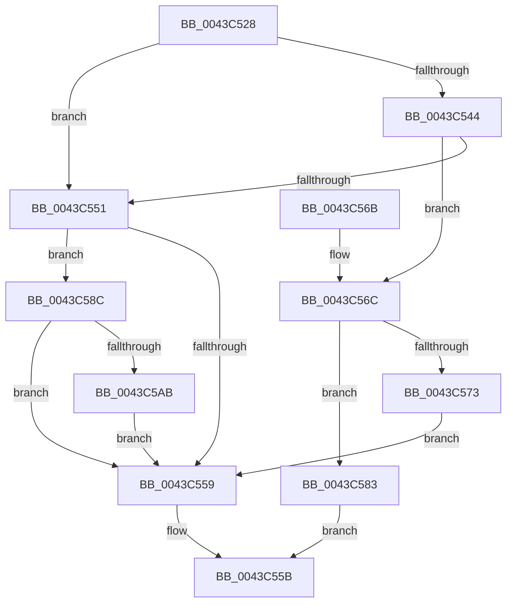

# EtwpCovSampLookasidePop

- RVA: `0x0043C528`–`0x0043C5C4` (길이 `156` bytes)
- VA: `0x000000014043C528`
- 실행 섹션: `.text`
- PDB 이름 있음: `예`; PDB Function 태그: `아니요`
- unwind 정보 RVA: `0x000A4544`
- 디코드: `47`개 명령, `156/156` bytes 표시
- 미해석 바이트: `0` (있으면 어셈블리에 `.byte`로 보존)

> 이 문서는 커널 이미지의 기계어와 PDB 기호를 분석해 생성했습니다. 4번과 5번은 함수 원형과 자료형을 바이너리 사용 방식에서 추정한 C 해석이며 원본 소스 복구 결과는 아닙니다.

## 1. Dependencies

- 직접 호출 지점: **3**; 고유 호출 대상: **3**
- 직접 호출자로 확인된 함수: **3**
- RIP 상대 이미지 참조: **0**

### Outgoing calls
- `0x0043C547` → [ExpInterlockedPopEntrySList](../6B/ExpInterlockedPopEntrySList_function_006BA570.md) (function, `0x006BA570`)
- `0x0043C57C` → [EtwpCovSampCaptureReleaseToLookaside](EtwpCovSampCaptureReleaseToLookaside_function_0043C630.md) (function, `0x0043C630`)
- `0x0043C5BD` → [KeInsertQueueDpc](../20/KeInsertQueueDpc_function_00207C50.md) (function, `0x00207C50`)

### Direct callers
- [EtwpCovSampCaptureBufferGet](EtwpCovSampCaptureBufferGet_function_0043C1A0.md) at `0x0043C206`
- [EtwpCovSampSampleBufferReserve](EtwpCovSampSampleBufferReserve_function_0043C348.md) at `0x0043C41A`
- [EtwpCovSampCaptureQueueApc](../65/EtwpCovSampCaptureQueueApc_function_00653CF0.md) at `0x00653DCC`

### Static image references
- 디코드된 RIP-relative 메모리 참조가 없습니다.

## 2. Other-region calls and transfers

- 다른 실행 섹션으로 향하는 call: **0**
- 별도 외부 분기/꼬리 이동을 확인하지 못했습니다.

## 3. Assembly (complete function range)

```asm
0043C528  48 89 5C 24 08                  mov qword ptr [rsp + 8], rbx
0043C52D  48 89 74 24 10                  mov qword ptr [rsp + 0x10], rsi
0043C532  57                              push rdi
0043C533  48 83 EC 20                     sub rsp, 0x20
0043C537  33 F6                           xor esi, esi
0043C539  48 8B DA                        mov rbx, rdx
0043C53C  48 8B F9                        mov rdi, rcx
0043C53F  66 39 32                        cmp word ptr [rdx], si
0043C542  74 0D                           je 0x14043c551
0043C544  48 8B CA                        mov rcx, rdx
0043C547  E8 24 E0 27 00                  call 0x1406ba570
0043C54C  48 85 C0                        test rax, rax
0043C54F  75 1B                           jne 0x14043c56c
0043C551  8B 43 34                        mov eax, dword ptr [rbx + 0x34]
0043C554  3B 43 38                        cmp eax, dword ptr [rbx + 0x38]
0043C557  72 33                           jb 0x14043c58c
0043C559  33 C0                           xor eax, eax
0043C55B  48 8B 5C 24 30                  mov rbx, qword ptr [rsp + 0x30]
0043C560  48 8B 74 24 38                  mov rsi, qword ptr [rsp + 0x38]
0043C565  48 83 C4 20                     add rsp, 0x20
0043C569  5F                              pop rdi
0043C56A  C3                              ret
0043C56B  CC                              int3
0043C56C  8B 53 28                        mov edx, dword ptr [rbx + 0x28]
0043C56F  85 D2                           test edx, edx
0043C571  75 10                           jne 0x14043c583
0043C573  4C 8B C0                        mov r8, rax
0043C576  48 8B D3                        mov rdx, rbx
0043C579  48 8B CF                        mov rcx, rdi
0043C57C  E8 AF 00 00 00                  call 0x14043c630
0043C581  EB D6                           jmp 0x14043c559
0043C583  48 C7 00 1D 1B 00 00            mov qword ptr [rax], 0x1b1d
0043C58A  EB CF                           jmp 0x14043c55b
0043C58C  F0 FF 43 30                     lock inc dword ptr [rbx + 0x30]
0043C590  48 BA 20 03 00 00 80 F7 FF FF   movabs rdx, 0xfffff78000000320
0043C59A  8B 12                           mov edx, dword ptr [rdx]
0043C59C  8B CA                           mov ecx, edx
0043C59E  8B 87 2C 04 00 00               mov eax, dword ptr [rdi + 0x42c]
0043C5A4  2B C8                           sub ecx, eax
0043C5A6  83 F9 40                        cmp ecx, 0x40
0043C5A9  72 AE                           jb 0x14043c559
0043C5AB  89 97 2C 04 00 00               mov dword ptr [rdi + 0x42c], edx
0043C5B1  48 8D 8F D0 03 00 00            lea rcx, [rdi + 0x3d0]
0043C5B8  33 D2                           xor edx, edx
0043C5BA  45 33 C0                        xor r8d, r8d
0043C5BD  E8 8E B6 DC FF                  call 0x140207c50
0043C5C2  EB 95                           jmp 0x14043c559
```

## 4. C-style interpretation (structured pseudocode)

```c
__int64 __fastcall EtwpCovSampLookasidePop(__int64 a1, __int64 a2)
{
    __int64 result;
    __int64 v_rsi;
    __int64 v_rsp;
    unsigned __int64 v_stack_p10;
    unsigned __int64 v_stack_p8;

    v_stack_p8 = v_rbx;
    v_stack_p10 = v_rsi;
    v_rsp = (v_rsp) - (32);
    v_rsi = 0;
    if ((*(unsigned __int16 *)(a2)) == 0) goto loc_0043C551;
    result = ExpInterlockedPopEntrySList(a2, a2, a3, a4);
    if (result != 0) goto loc_0043C56C;
loc_0043C551:
    if (((unsigned int)((unsigned int)(*(unsigned int *)(a2 + 52)))) < (*(unsigned int *)(a2 + 56))) goto loc_0043C58C;
loc_0043C559:
    result = 0;
loc_0043C55B:
    v_rsp = (v_rsp) + (32);
    return result;
loc_0043C56C:
    if ((unsigned int)((unsigned int)(*(unsigned int *)(v_stack_p8 + 40))) != 0) goto loc_0043C583;
    result = EtwpCovSampCaptureReleaseToLookaside(a1, v_stack_p8, 0, a4);
    goto loc_0043C559;
loc_0043C583:
    *(unsigned __int64 *)(result) = 0x1B1DULL;
    goto loc_0043C55B;
loc_0043C58C:
    a1 = (unsigned int)(((unsigned int)((unsigned int)((unsigned int)(*(unsigned int *)(v_stack_p8))))) - ((unsigned int)((unsigned int)(*(unsigned int *)(a1 + 1068)))));
    if (((unsigned int)(a1)) < 64) goto loc_0043C559;
    *(unsigned int *)(a1 + 1068) = (unsigned int)((unsigned int)(*(unsigned int *)(v_stack_p8)));
    a2 = 0;
    a3 = 0;
    result = KeInsertQueueDpc(a1 + 976, a2, a3, a4);
    goto loc_0043C559;
}
```

## 5. (Beta) C Style

```c
int64_t EtwpCovSampLookasidePop(void *Arg1, void *Arg2)
{
    uint8_t *arg1 = (uint8_t *)Arg1;
    uint8_t *arg2 = (uint8_t *)Arg2;

    int64_t result;
    int64_t local_rsi;
    int64_t local_rsp;
    uint64_t v_stack_p10;
    uint64_t v_stack_p8;

    v_stack_p8 = local_rbx;
    v_stack_p10 = local_rsi;
    local_rsp = (local_rsp) - (32);
    local_rsi = 0;
    if ((*(uint16_t *)(arg2)) == 0) goto loc_0043C551;
    result = ExpInterlockedPopEntrySList(Arg2, Arg2, a3, a4);
    if (result != 0) goto loc_0043C56C;
loc_0043C551:
    if (((uint32_t)((uint32_t)(*(uint32_t *)(arg2 + 0x34)))) < (*(uint32_t *)(arg2 + 0x38))) goto loc_0043C58C;
loc_0043C559:
    result = 0;
loc_0043C55B:
    local_rsp = (local_rsp) + (32);
    return result;
loc_0043C56C:
    if ((uint32_t)((uint32_t)(*(uint32_t *)(v_stack_p8 + 0x28))) != 0) goto loc_0043C583;
    result = EtwpCovSampCaptureReleaseToLookaside(Arg1, v_stack_p8, 0, a4);
    goto loc_0043C559;
loc_0043C583:
    *(uint64_t *)(result) = 0x1B1DULL;
    goto loc_0043C55B;
loc_0043C58C:
    Arg1 = (uint32_t)(((uint32_t)((uint32_t)((uint32_t)(*(uint32_t *)(v_stack_p8))))) - ((uint32_t)((uint32_t)(*(uint32_t *)(arg1 + 0x42C)))));
    if (((uint32_t)(Arg1)) < 64) goto loc_0043C559;
    *(uint32_t *)(arg1 + 0x42C) = (uint32_t)((uint32_t)(*(uint32_t *)(v_stack_p8)));
    Arg2 = 0;
    a3 = 0;
    result = KeInsertQueueDpc(Arg1 + 976, Arg2, a3, a4);
    goto loc_0043C559;
}
```

### 관측된 메모리 오프셋

구조체 형식이 확인되지 않은 접근은 인자 기준의 오프셋으로만 기록했습니다.

| 기준 인자 | 오프셋 표현 | 폭 (bit) | 접근 |
|---|---:|---:|---|
| `Arg1` | `+ 0x3D0` | `64` | `R` |
| `Arg1` | `+ 0x42C` | `32` | `R` |
| `Arg1` | `+ 0x42C` | `32` | `W` |
| `Arg2` | `+ 0x0` | `16` | `R` |
| `Arg2` | `+ 0x28` | `32` | `R` |
| `Arg2` | `+ 0x30` | `32` | `R/W` |
| `Arg2` | `+ 0x34` | `32` | `R` |
| `Arg2` | `+ 0x38` | `32` | `R` |

## 6. Execution-region graph

[열기: 2D/3D 그래프와 함수 탐색 컨트롤 패널](../../../control-panel.html?section=text&rva=0x0043C528&view=graph)

- 2D 그래프는 위에서 아래로 흐르고, 3D 그래프는 빈 공간을 드래그해 회전합니다. Shift+드래그는 이동, 휠은 확대·축소, 함수 노드 선택은 대상 보고서 이동입니다.

### Static fallback


