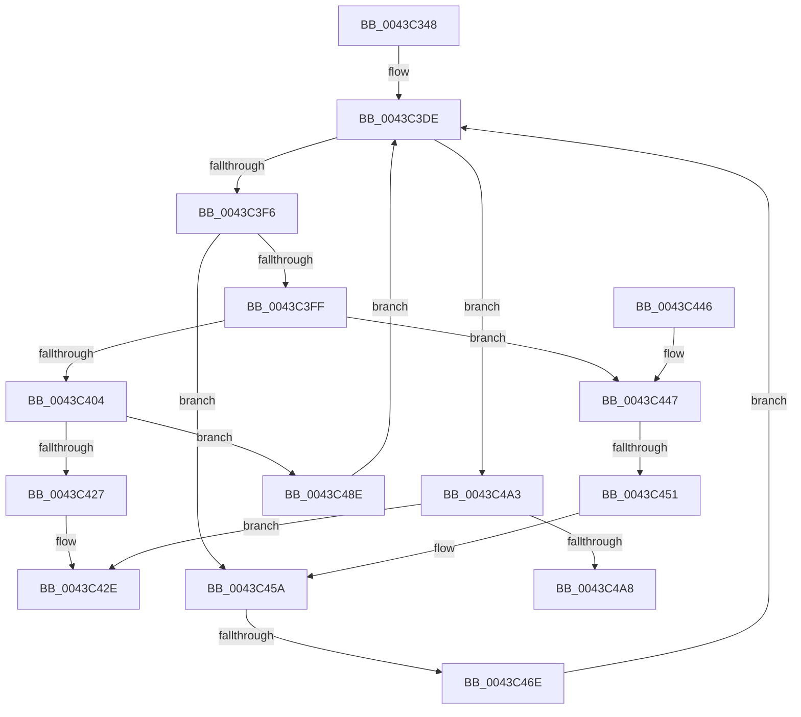

# EtwpCovSampSampleBufferReserve

- RVA: `0x0043C348`–`0x0043C4AD` (길이 `357` bytes)
- VA: `0x000000014043C348`
- 실행 섹션: `.text`
- PDB 이름 있음: `예`; PDB Function 태그: `예`
- unwind 정보 RVA: `0x000A4518`
- 디코드: `99`개 명령, `357/357` bytes 표시
- 미해석 바이트: `0` (있으면 어셈블리에 `.byte`로 보존)

> 이 문서는 커널 이미지의 기계어와 PDB 기호를 분석해 생성했습니다. 4번과 5번은 함수 원형과 자료형을 바이너리 사용 방식에서 추정한 C 해석이며 원본 소스 복구 결과는 아닙니다.

## 1. Dependencies

- 직접 호출 지점: **5**; 고유 호출 대상: **4**
- 직접 호출자로 확인된 함수: **1**
- RIP 상대 이미지 참조: **0**

### Outgoing calls
- `0x0043C3E9` → [EtwpCovSampTryAcquireBufferLock](EtwpCovSampTryAcquireBufferLock_function_0043C5CC.md) (function, `0x0043C5CC`)
- `0x0043C40B` → [KeReleaseSpinLock](../39/KeReleaseSpinLock_function_00392BA0.md) (function, `0x00392BA0`)
- `0x0043C41A` → [EtwpCovSampLookasidePop](EtwpCovSampLookasidePop_function_0043C528.md) (function, `0x0043C528`)
- `0x0043C479` → [KeReleaseSpinLock](../39/KeReleaseSpinLock_function_00392BA0.md) (function, `0x00392BA0`)
- `0x0043C484` → [EtwpCovSampSampleBufferDecRef](../65/EtwpCovSampSampleBufferDecRef_function_006543B4.md) (function, `0x006543B4`)

### Direct callers
- [EtwpCovSampCaptureBufferQueue](EtwpCovSampCaptureBufferQueue_function_0043C234.md) at `0x0043C271`

### Static image references
- 디코드된 RIP-relative 메모리 참조가 없습니다.

## 2. Other-region calls and transfers

- 다른 실행 섹션으로 향하는 call: **0**
- call이 아닌 외부 분기/꼬리 이동: **3**
  - `0x0043C44B` → [sub_006EF6EE](../6E/Unknown_function_006EF6EE.md) (`tail-transfer`)
  - `0x0043C468` → [sub_006EF6EE + 0x1D](../6E/Unknown_function_006EF6EE.md) (`tail-transfer`)
  - `0x0043C4A8` → [sub_006EF6EE + 0xC](../6E/Unknown_function_006EF6EE.md) (`tail-transfer`)

## 3. Assembly (complete function range)

```asm
0043C348  48 89 5C 24 18                  mov qword ptr [rsp + 0x18], rbx
0043C34D  55                              push rbp
0043C34E  56                              push rsi
0043C34F  57                              push rdi
0043C350  41 54                           push r12
0043C352  41 55                           push r13
0043C354  41 56                           push r14
0043C356  41 57                           push r15
0043C358  48 83 EC 20                     sub rsp, 0x20
0043C35C  48 8B 41 08                     mov rax, qword ptr [rcx + 8]
0043C360  48 8B E9                        mov rbp, rcx
0043C363  65 4C 8B 0C 25 20 00 00 00      mov r9, qword ptr gs:[0x20]
0043C36C  44 8B D0                        mov r10d, eax
0043C36F  C1 E8 0D                        shr eax, 0xd
0043C372  44 0F B7 E2                     movzx r12d, dx
0043C376  25 FF FF 03 00                  and eax, 0x3ffff
0043C37B  49 C1 EA 04                     shr r10, 4
0043C37F  0F BD C8                        bsr ecx, eax
0043C382  45 33 F6                        xor r14d, r14d
0043C385  41 81 E2 FF 01 00 00            and r10d, 0x1ff
0043C38C  89 4C 24 60                     mov dword ptr [rsp + 0x60], ecx
0043C390  33 F6                           xor esi, esi
0043C392  66 41 83 C4 08                  add r12w, 8
0043C397  44 88 74 24 68                  mov byte ptr [rsp + 0x68], r14b
0043C39C  4D 8B E8                        mov r13, r8
0043C39F  45 8D 46 01                     lea r8d, [r14 + 1]
0043C3A3  41 8B D0                        mov edx, r8d
0043C3A6  4A 8D 3C D5 0F 00 00 00         lea rdi, [r10*8 + 0xf]
0043C3AE  D3 E2                           shl edx, cl
0043C3B0  83 C1 FE                        add ecx, -2
0043C3B3  33 D0                           xor edx, eax
0043C3B5  49 8B 81 B0 8B 00 00            mov rax, qword ptr [r9 + 0x8bb0]
0043C3BC  48 8B 04 C8                     mov rax, qword ptr [rax + rcx*8]
0043C3C0  41 0F B7 CC                     movzx ecx, r12w
0043C3C4  66 41 2B C8                     sub cx, r8w
0043C3C8  48 03 7C D0 08                  add rdi, qword ptr [rax + rdx*8 + 8]
0043C3CD  8D 46 07                        lea eax, [rsi + 7]
0043C3D0  66 23 C8                        and cx, ax
0043C3D3  48 83 E7 F0                     and rdi, 0xfffffffffffffff0
0043C3D7  66 2B C1                        sub ax, cx
0043C3DA  66 44 03 E0                     add r12w, ax
0043C3DE  48 8D 54 24 68                  lea rdx, [rsp + 0x68]
0043C3E3  48 8B CF                        mov rcx, rdi
0043C3E6  4C 8B FE                        mov r15, rsi
0043C3E9  E8 DE 01 00 00                  call 0x14043c5cc
0043C3EE  85 C0                           test eax, eax
0043C3F0  0F 84 AD 00 00 00               je 0x14043c4a3
0043C3F6  48 8B 5F 08                     mov rbx, qword ptr [rdi + 8]
0043C3FA  48 85 DB                        test rbx, rbx
0043C3FD  75 5B                           jne 0x14043c45a
0043C3FF  48 85 F6                        test rsi, rsi
0043C402  75 43                           jne 0x14043c447
0043C404  8A 54 24 68                     mov dl, byte ptr [rsp + 0x68]
0043C408  48 8B CF                        mov rcx, rdi
0043C40B  E8 90 67 F5 FF                  call 0x140392ba0
0043C410  48 8D 95 70 03 00 00            lea rdx, [rbp + 0x370]
0043C417  48 8B CD                        mov rcx, rbp
0043C41A  E8 09 01 00 00                  call 0x14043c528
0043C41F  48 8B F0                        mov rsi, rax
0043C422  48 85 C0                        test rax, rax
0043C425  75 67                           jne 0x14043c48e
0043C427  F0 FF 87 3C 01 00 00            lock inc dword ptr [rdi + 0x13c]
0043C42E  48 8B 5C 24 70                  mov rbx, qword ptr [rsp + 0x70]
0043C433  49 8B C6                        mov rax, r14
0043C436  48 83 C4 20                     add rsp, 0x20
0043C43A  41 5F                           pop r15
0043C43C  41 5E                           pop r14
0043C43E  41 5D                           pop r13
0043C440  41 5C                           pop r12
0043C442  5F                              pop rdi
0043C443  5E                              pop rsi
0043C444  5D                              pop rbp
0043C445  C3                              ret
0043C446  CC                              int3
0043C447  44 39 77 78                     cmp dword ptr [rdi + 0x78], r14d
0043C44B  0F 84 9D 32 2B 00               je 0x1406ef6ee
0043C451  48 89 77 08                     mov qword ptr [rdi + 8], rsi
0043C455  49 8B DF                        mov rbx, r15
0043C458  33 F6                           xor esi, esi
0043C45A  4C 63 7B 3C                     movsxd r15, dword ptr [rbx + 0x3c]
0043C45E  41 0F B7 C4                     movzx eax, r12w
0043C462  41 03 C7                        add eax, r15d
0043C465  3B 43 40                        cmp eax, dword ptr [rbx + 0x40]
0043C468  0F 8E 9D 32 2B 00               jle 0x1406ef70b
0043C46E  8A 54 24 68                     mov dl, byte ptr [rsp + 0x68]
0043C472  48 8B CF                        mov rcx, rdi
0043C475  4C 21 77 08                     and qword ptr [rdi + 8], r14
0043C479  E8 22 67 F5 FF                  call 0x140392ba0
0043C47E  48 8B D3                        mov rdx, rbx
0043C481  48 8B CD                        mov rcx, rbp
0043C484  E8 2B 7F 21 00                  call 0x1406543b4
0043C489  E9 50 FF FF FF                  jmp 0x14043c3de
0043C48E  44 21 70 3C                     and dword ptr [rax + 0x3c], r14d
0043C492  44 21 70 38                     and dword ptr [rax + 0x38], r14d
0043C496  48 C7 40 30 01 00 00 00         mov qword ptr [rax + 0x30], 1
0043C49E  E9 3B FF FF FF                  jmp 0x14043c3de
0043C4A3  48 85 F6                        test rsi, rsi
0043C4A6  74 86                           je 0x14043c42e
0043C4A8  E9 4D 32 2B 00                  jmp 0x1406ef6fa
```

## 4. C-style interpretation (structured pseudocode)

```c
__int64 __fastcall EtwpCovSampSampleBufferReserve(__int64 a1, unsigned __int16 a2, __int64 a3)
{
    __int64 result;
    __int64 v_r10;
    __int64 v_r12;
    __int64 v_r14;
    __int64 v_rdi;
    __int64 v_rsi;
    __int64 v_rsp;
    unsigned __int8 v_stack_p10;
    unsigned __int64 v_stack_p18;
    unsigned __int8 v_stack_p68;
    unsigned int v_stack_p8;

    v_stack_p18 = v_rbx;
    v_rsp = (v_rsp) - (32);
    result = (unsigned int)((*(unsigned __int64 *)(a1 + 8)) >> (13));
    result = (unsigned int)((result) & (0x3FFFFULL));
    v_r10 = ((unsigned int)((unsigned int)(*(unsigned __int64 *)(a1 + 8)))) >> (4);
    v_r14 = 0;
    v_r10 = (unsigned int)((v_r10) & (511));
    v_stack_p8 = (unsigned int)(a1);
    v_rsi = 0;
    v_r12 = (unsigned __int16)((a2) + (8));
    v_stack_p10 = 0;
    a2 = (unsigned int)(((unsigned int)((unsigned int)(v_r14 + 1))) << ((unsigned __int8)(a1)));
    a1 = (unsigned int)((a1) + (-2));
    a2 = (unsigned int)((a2) ^ ((unsigned int)(result)));
    a1 = (unsigned __int16)(((unsigned __int16)(v_r12)) - ((unsigned __int16)(v_r14 + 1)));
    v_rdi = (v_r10 * 8 + 15) + (*(unsigned __int64 *)(*(unsigned __int64 *)(*(unsigned __int64 *)(*(unsigned __int64 *)(gs_base + (0 + 32)) + 35760) + a1 * 8) + a2 * 8 + 8));
    a1 = (unsigned __int16)((a1) & ((unsigned __int16)(v_rsi + 7)));
    v_rdi = (v_rdi) & (-16);
    result = (unsigned __int16)((v_rsi + 7) - ((unsigned __int16)(a1)));
    v_r12 = (unsigned __int16)((v_r12) + ((unsigned __int16)(result)));
loc_0043C3DE:
    result = EtwpCovSampTryAcquireBufferLock(v_rdi, v_stack_p10, v_r14 + 1, *(unsigned __int64 *)(gs_base + (0 + 32)));
    if ((unsigned int)(result) == 0) goto loc_0043C4A3;
    if (*(unsigned __int64 *)(v_rdi + 8) != 0) goto loc_0043C45A;
    if (0 != 0) goto loc_0043C447;
    result = KeReleaseSpinLock(v_rdi, v_stack_p10, v_r14 + 1, *(unsigned __int64 *)(gs_base + (0 + 32)));
    result = EtwpCovSampLookasidePop(a1, a1 + 880, v_r14 + 1, *(unsigned __int64 *)(gs_base + (0 + 32)));
    if (result != 0) goto loc_0043C48E;
loc_0043C42E:
    v_rsp = (v_rsp) + (32);
    return 0;
loc_0043C447:
    *(unsigned __int64 *)(v_rdi + 8) = result;
    v_rsi = 0;
loc_0043C45A:
    result = (unsigned int)(((unsigned __int16)(v_r12)) + ((unsigned int)((int)(*(unsigned int *)(0 + 60)))));
    result = KeReleaseSpinLock(v_rdi, v_stack_p68, v_r14 + 1, *(unsigned __int64 *)(gs_base + (0 + 32)));
    result = EtwpCovSampSampleBufferDecRef(a1, 0, v_r14 + 1, *(unsigned __int64 *)(gs_base + (0 + 32)));
    goto loc_0043C3DE;
loc_0043C48E:
    *(unsigned __int64 *)(result + 48) = 1;
    goto loc_0043C3DE;
loc_0043C4A3:
    if (0 == 0) goto loc_0043C42E;
}
```

## 5. (Beta) C Style

```c
int64_t EtwpCovSampSampleBufferReserve(void *Arg1, uint16_t Arg2, int64_t Arg3)
{
    uint8_t *arg1 = (uint8_t *)Arg1;

    int64_t result;
    int64_t local_r10;
    int64_t local_r12;
    int64_t local_r14;
    int64_t local_rdi;
    int64_t local_rsi;
    int64_t local_rsp;
    uint8_t v_stack_p10;
    uint64_t v_stack_p18;
    uint8_t v_stack_p68;
    uint32_t v_stack_p8;

    v_stack_p18 = local_rbx;
    local_rsp = (local_rsp) - (32);
    result = (uint32_t)((*(uint64_t *)(arg1 + 0x8)) >> (13));
    result = (uint32_t)((result) & (0x3FFFFULL));
    local_r10 = ((uint32_t)((uint32_t)(*(uint64_t *)(arg1 + 0x8)))) >> (4);
    local_r14 = 0;
    local_r10 = (uint32_t)((local_r10) & (511));
    v_stack_p8 = (uint32_t)(Arg1);
    local_rsi = 0;
    local_r12 = (uint16_t)((Arg2) + (8));
    v_stack_p10 = 0;
    Arg2 = (uint32_t)(((uint32_t)((uint32_t)(local_r14 + 1))) << ((uint8_t)(Arg1)));
    Arg1 = (uint32_t)((Arg1) + (-2));
    Arg2 = (uint32_t)((Arg2) ^ ((uint32_t)(result)));
    Arg1 = (uint16_t)(((uint16_t)(local_r12)) - ((uint16_t)(local_r14 + 1)));
    local_rdi = (local_r10 * 8 + 15) + (*(uint64_t *)(*(uint64_t *)(*(uint64_t *)(*(uint64_t *)(gs_base + (0 + 0x20)) + 0x8BB0) + arg1 * 8) + Arg2 * 8 + 0x8));
    Arg1 = (uint16_t)((Arg1) & ((uint16_t)(local_rsi + 7)));
    local_rdi = (local_rdi) & (-16);
    result = (uint16_t)((local_rsi + 7) - ((uint16_t)(Arg1)));
    local_r12 = (uint16_t)((local_r12) + ((uint16_t)(result)));
loc_0043C3DE:
    result = EtwpCovSampTryAcquireBufferLock(local_rdi, v_stack_p10, local_r14 + 1, *(uint64_t *)(gs_base + (0 + 0x20)));
    if ((uint32_t)(result) == 0) goto loc_0043C4A3;
    if (*(uint64_t *)(local_rdi + 0x8) != 0) goto loc_0043C45A;
    if (0 != 0) goto loc_0043C447;
    result = KeReleaseSpinLock(local_rdi, v_stack_p10, local_r14 + 1, *(uint64_t *)(gs_base + (0 + 0x20)));
    result = EtwpCovSampLookasidePop(Arg1, Arg1 + 880, local_r14 + 1, *(uint64_t *)(gs_base + (0 + 0x20)));
    if (result != 0) goto loc_0043C48E;
loc_0043C42E:
    local_rsp = (local_rsp) + (32);
    return 0;
loc_0043C447:
    *(uint64_t *)(local_rdi + 0x8) = result;
    local_rsi = 0;
loc_0043C45A:
    result = (uint32_t)(((uint16_t)(local_r12)) + ((uint32_t)((int32_t)(*(uint32_t *)(0 + 0x3C)))));
    result = KeReleaseSpinLock(local_rdi, v_stack_p68, local_r14 + 1, *(uint64_t *)(gs_base + (0 + 0x20)));
    result = EtwpCovSampSampleBufferDecRef(Arg1, 0, local_r14 + 1, *(uint64_t *)(gs_base + (0 + 0x20)));
    goto loc_0043C3DE;
loc_0043C48E:
    *(uint64_t *)(result + 0x30) = 1;
    goto loc_0043C3DE;
loc_0043C4A3:
    if (0 == 0) goto loc_0043C42E;
}
```

### 관측된 메모리 오프셋

구조체 형식이 확인되지 않은 접근은 인자 기준의 오프셋으로만 기록했습니다.

| 기준 인자 | 오프셋 표현 | 폭 (bit) | 접근 |
|---|---:|---:|---|
| `Arg1` | `+ 0x8` | `64` | `R` |
| `Arg1` | `+ 0x370` | `64` | `R` |

## 6. Execution-region graph

[열기: 2D/3D 그래프와 함수 탐색 컨트롤 패널](../../../control-panel.html?section=text&rva=0x0043C348&view=graph)

- 2D 그래프는 위에서 아래로 흐르고, 3D 그래프는 빈 공간을 드래그해 회전합니다. Shift+드래그는 이동, 휠은 확대·축소, 함수 노드 선택은 대상 보고서 이동입니다.

### Static fallback


