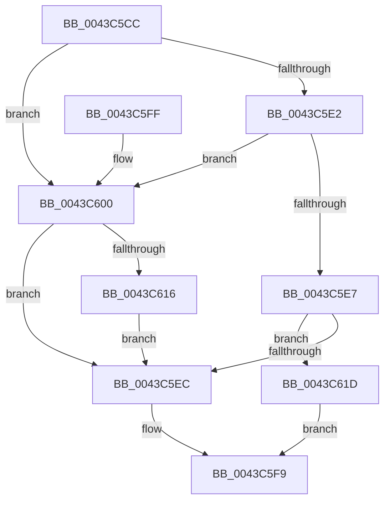

# EtwpCovSampTryAcquireBufferLock

- RVA: `0x0043C5CC`–`0x0043C627` (길이 `91` bytes)
- VA: `0x000000014043C5CC`
- 실행 섹션: `.text`
- PDB 이름 있음: `예`; PDB Function 태그: `아니요`
- unwind 정보 RVA: `0x00094E68`
- 디코드: `29`개 명령, `91/91` bytes 표시
- 미해석 바이트: `0` (있으면 어셈블리에 `.byte`로 보존)

> 이 문서는 커널 이미지의 기계어와 PDB 기호를 분석해 생성했습니다. 4번과 5번은 함수 원형과 자료형을 바이너리 사용 방식에서 추정한 C 해석이며 원본 소스 복구 결과는 아닙니다.

## 1. Dependencies

- 직접 호출 지점: **3**; 고유 호출 대상: **3**
- 직접 호출자로 확인된 함수: **2**
- RIP 상대 이미지 참조: **1**

### Outgoing calls
- `0x0043C5EF` → [KeAcquireSpinLockAtDpcLevel](../20/KeAcquireSpinLockAtDpcLevel_function_00208430.md) (function, `0x00208430`)
- `0x0043C616` → [KiRaiseIrqlProcessIrqlFlags](../4F/KiRaiseIrqlProcessIrqlFlags_function_004F56FC.md) (function, `0x004F56FC`)
- `0x0043C61D` → [KxTryToAcquireSpinLock](../46/KxTryToAcquireSpinLock_function_0046BE18.md) (function, `0x0046BE18`)

### Direct callers
- [EtwpCovSampCaptureFlushSampleBuffers](EtwpCovSampCaptureFlushSampleBuffers_function_0043C0B4.md) at `0x0043C13F`
- [EtwpCovSampSampleBufferReserve](EtwpCovSampSampleBufferReserve_function_0043C348.md) at `0x0043C3E9`

### Static image references
- `0x0043C60D` → RVA `0x00FC6D20` (`ALMOSTRO`; read)

## 2. Other-region calls and transfers

- 다른 실행 섹션으로 향하는 call: **0**
- 별도 외부 분기/꼬리 이동을 확인하지 못했습니다.

## 3. Assembly (complete function range)

```asm
0043C5CC  40 53                           push rbx
0043C5CE  48 83 EC 20                     sub rsp, 0x20
0043C5D2  48 8B D9                        mov rbx, rcx
0043C5D5  44 0F 20 C0                     mov rax, cr8
0043C5D9  88 02                           mov byte ptr [rdx], al
0043C5DB  0F B6 D0                        movzx edx, al
0043C5DE  84 C0                           test al, al
0043C5E0  74 1E                           je 0x14043c600
0043C5E2  83 EA 01                        sub edx, 1
0043C5E5  74 19                           je 0x14043c600
0043C5E7  83 FA 01                        cmp edx, 1
0043C5EA  75 31                           jne 0x14043c61d
0043C5EC  48 8B CB                        mov rcx, rbx
0043C5EF  E8 3C BE DC FF                  call 0x140208430
0043C5F4  B8 01 00 00 00                  mov eax, 1
0043C5F9  48 83 C4 20                     add rsp, 0x20
0043C5FD  5B                              pop rbx
0043C5FE  C3                              ret
0043C5FF  CC                              int3
0043C600  44 0F 20 C1                     mov rcx, cr8
0043C604  BA 02 00 00 00                  mov edx, 2
0043C609  44 0F 22 C2                     mov cr8, rdx
0043C60D  83 3D 0C A7 B8 00 00            cmp dword ptr [rip + 0xb8a70c], 0
0043C614  74 D6                           je 0x14043c5ec
0043C616  E8 E1 90 0B 00                  call 0x1404f56fc
0043C61B  EB CF                           jmp 0x14043c5ec
0043C61D  E8 F6 F7 02 00                  call 0x14046be18
0043C622  0F B6 C0                        movzx eax, al
0043C625  EB D2                           jmp 0x14043c5f9
```

## 4. C-style interpretation (structured pseudocode)

```c
__int64 __fastcall EtwpCovSampTryAcquireBufferLock(__int64 a1, __int64 a2)
{
    __int64 result;
    __int64 v_rsp;

    v_rsp = (v_rsp) - (32);
    *(unsigned __int8 *)(a2) = (unsigned __int8)(v_cr8);
    if ((unsigned __int8)(v_cr8) == 0) goto loc_0043C600;
    a2 = (unsigned int)(((unsigned __int8)(v_cr8)) - (1));
    if (condition_is_equal) goto loc_0043C600;
    if (((unsigned int)(a2)) != 1) goto loc_0043C61D;
loc_0043C5EC:
    result = KeAcquireSpinLockAtDpcLevel(a1, a2, a3, a4);
loc_0043C5F9:
    v_rsp = (v_rsp) + (32);
    return 1;
loc_0043C600:
    if ((*(unsigned int *)(v_rip + 12101388)) == 0) goto loc_0043C5EC;
    result = KiRaiseIrqlProcessIrqlFlags(v_cr8, 2, a3, a4);
    goto loc_0043C5EC;
loc_0043C61D:
    result = KxTryToAcquireSpinLock(v_cr8, 2, a3, a4);
    goto loc_0043C5F9;
}
```

## 5. (Beta) C Style

```c
int64_t EtwpCovSampTryAcquireBufferLock(int64_t Arg1, void *Arg2)
{
    uint8_t *arg2 = (uint8_t *)Arg2;

    int64_t result;
    int64_t local_rsp;

    local_rsp = (local_rsp) - (32);
    *(uint8_t *)(arg2) = (uint8_t)(v_cr8);
    if ((uint8_t)(v_cr8) == 0) goto loc_0043C600;
    Arg2 = (uint32_t)(((uint8_t)(v_cr8)) - (1));
    if (condition_is_equal) goto loc_0043C600;
    if (((uint32_t)(Arg2)) != 1) goto loc_0043C61D;
loc_0043C5EC:
    result = KeAcquireSpinLockAtDpcLevel(Arg1, Arg2, a3, a4);
loc_0043C5F9:
    local_rsp = (local_rsp) + (32);
    return 1;
loc_0043C600:
    if ((*(uint32_t *)(v_rip + 0xB8A70C)) == 0) goto loc_0043C5EC;
    result = KiRaiseIrqlProcessIrqlFlags(v_cr8, 2, a3, a4);
    goto loc_0043C5EC;
loc_0043C61D:
    result = KxTryToAcquireSpinLock(v_cr8, 2, a3, a4);
    goto loc_0043C5F9;
}
```

### 관측된 메모리 오프셋

구조체 형식이 확인되지 않은 접근은 인자 기준의 오프셋으로만 기록했습니다.

| 기준 인자 | 오프셋 표현 | 폭 (bit) | 접근 |
|---|---:|---:|---|
| `Arg2` | `+ 0x0` | `8` | `W` |

## 6. Execution-region graph

[열기: 2D/3D 그래프와 함수 탐색 컨트롤 패널](../../../control-panel.html?section=text&rva=0x0043C5CC&view=graph)

- 2D 그래프는 위에서 아래로 흐르고, 3D 그래프는 빈 공간을 드래그해 회전합니다. Shift+드래그는 이동, 휠은 확대·축소, 함수 노드 선택은 대상 보고서 이동입니다.

### Static fallback


