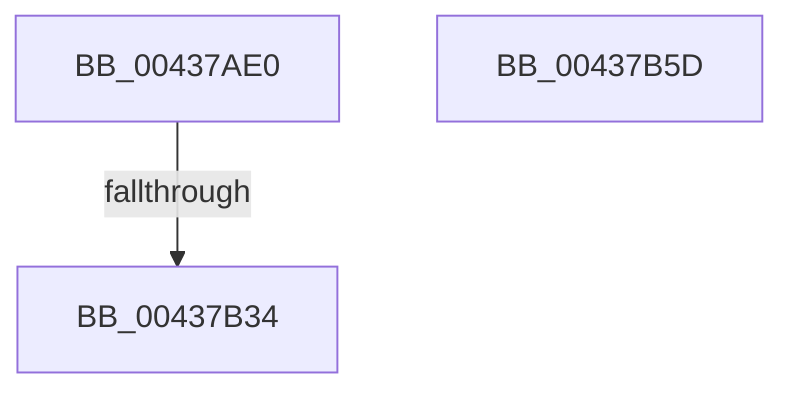

# EtwpEnableMetaProviderGuid

- RVA: `0x00437AE0`–`0x00437B5E` (길이 `126` bytes)
- VA: `0x0000000140437AE0`
- 실행 섹션: `.text`
- PDB 이름 있음: `예`; PDB Function 태그: `예`
- unwind 정보 RVA: `0x000A3230`
- 디코드: `35`개 명령, `126/126` bytes 표시
- 미해석 바이트: `0` (있으면 어셈블리에 `.byte`로 보존)

> 이 문서는 커널 이미지의 기계어와 PDB 기호를 분석해 생성했습니다. 4번과 5번은 함수 원형과 자료형을 바이너리 사용 방식에서 추정한 C 해석이며 원본 소스 복구 결과는 아닙니다.

## 1. Dependencies

- 직접 호출 지점: **2**; 고유 호출 대상: **2**
- 직접 호출자로 확인된 함수: **1**
- RIP 상대 이미지 참조: **1**

### Outgoing calls
- `0x00437B23` → [EtwpGetMetaProviderContext](EtwpGetMetaProviderContext_function_00437B70.md) (function, `0x00437B70`)
- `0x00437B41` → [_security_check_cookie](../6A/_security_check_cookie_function_006AC640.md) (function, `0x006AC640`)

### Direct callers
- [EtwpEnableGuid](../../page/A5/EtwpEnableGuid_function_00A5CD28.md) at `0x00A5CF2C`

### Static image references
- `0x00437AF3` → RVA `0x00E0A740` (`.data`; read)

## 2. Other-region calls and transfers

- 다른 실행 섹션으로 향하는 call: **0**
- call이 아닌 외부 분기/꼬리 이동: **1**
  - `0x00437B2E` → [sub_006EF0FC](../6E/Unknown_function_006EF0FC.md) (`tail-transfer`)

## 3. Assembly (complete function range)

```asm
00437AE0  48 89 5C 24 18                  mov qword ptr [rsp + 0x18], rbx
00437AE5  55                              push rbp
00437AE6  56                              push rsi
00437AE7  57                              push rdi
00437AE8  41 56                           push r14
00437AEA  41 57                           push r15
00437AEC  48 81 EC 80 00 00 00            sub rsp, 0x80
00437AF3  48 8B 05 46 2C 9D 00            mov rax, qword ptr [rip + 0x9d2c46]
00437AFA  48 33 C4                        xor rax, rsp
00437AFD  48 89 44 24 70                  mov qword ptr [rsp + 0x70], rax
00437B02  48 8B 9C 24 D0 00 00 00         mov rbx, qword ptr [rsp + 0xd0]
00437B0A  0F 57 C0                        xorps xmm0, xmm0
00437B0D  48 8B F1                        mov rsi, rcx
00437B10  49 8B E9                        mov rbp, r9
00437B13  48 8B CA                        mov rcx, rdx
00437B16  45 8B F0                        mov r14d, r8d
00437B19  0F 11 44 24 30                  movups xmmword ptr [rsp + 0x30], xmm0
00437B1E  0F 11 44 24 40                  movups xmmword ptr [rsp + 0x40], xmm0
00437B23  E8 48 00 00 00                  call 0x140437b70
00437B28  48 8B F8                        mov rdi, rax
00437B2B  48 85 C0                        test rax, rax
00437B2E  0F 85 C8 75 2B 00               jne 0x1406ef0fc
00437B34  B8 95 02 00 C0                  mov eax, 0xc0000295
00437B39  48 8B 4C 24 70                  mov rcx, qword ptr [rsp + 0x70]
00437B3E  48 33 CC                        xor rcx, rsp
00437B41  E8 FA 4A 27 00                  call 0x1406ac640
00437B46  48 8B 9C 24 C0 00 00 00         mov rbx, qword ptr [rsp + 0xc0]
00437B4E  48 81 C4 80 00 00 00            add rsp, 0x80
00437B55  41 5F                           pop r15
00437B57  41 5E                           pop r14
00437B59  5F                              pop rdi
00437B5A  5E                              pop rsi
00437B5B  5D                              pop rbp
00437B5C  C3                              ret
00437B5D  CC                              int3
```

## 4. C-style interpretation (structured pseudocode)

```c
__int64 __fastcall EtwpEnableMetaProviderGuid(__int64 a1, __int64 a2, int a3, __int64 a4, __int64 a5)
{
    __int64 result;
    __int64 v_rsp;
    unsigned __int64 v_stack_m38;
    unsigned __int64 v_stack_m68;
    unsigned __int64 v_stack_m78;
    unsigned __int64 v_stack_p18;

    v_stack_p18 = v_rbx;
    v_rsp = (v_rsp) - (128);
    result = (*(unsigned __int64 *)(v_rip + 10300486)) ^ (v_rsp);
    v_stack_m38 = result;
    v_stack_m78 = v_xmm0;
    v_stack_m68 = v_xmm0;
    result = EtwpGetMetaProviderContext(a2, a2, a3, a4);
    a1 = (v_stack_m38) ^ (v_rsp);
    result = _security_check_cookie(a1, a2, a3, a4);
    v_rsp = (v_rsp) + (128);
    return result;
}
```

## 5. (Beta) C Style

```c
int64_t EtwpEnableMetaProviderGuid(int64_t Arg1, int64_t Arg2, int32_t Arg3, int64_t Arg4, int64_t Arg5)
{
    int64_t result;
    int64_t local_rsp;
    uint64_t v_stack_m38;
    uint64_t v_stack_m68;
    uint64_t v_stack_m78;
    uint64_t v_stack_p18;

    v_stack_p18 = local_rbx;
    local_rsp = (local_rsp) - (128);
    result = (*(uint64_t *)(v_rip + 0x9D2C46)) ^ (local_rsp);
    v_stack_m38 = result;
    v_stack_m78 = v_xmm0;
    v_stack_m68 = v_xmm0;
    result = EtwpGetMetaProviderContext(Arg2, Arg2, Arg3, Arg4);
    Arg1 = (v_stack_m38) ^ (local_rsp);
    result = _security_check_cookie(Arg1, Arg2, Arg3, Arg4);
    local_rsp = (local_rsp) + (128);
    return result;
}
```

## 6. Execution-region graph

[열기: 2D/3D 그래프와 함수 탐색 컨트롤 패널](../../../control-panel.html?section=text&rva=0x00437AE0&view=graph)

- 2D 그래프는 위에서 아래로 흐르고, 3D 그래프는 빈 공간을 드래그해 회전합니다. Shift+드래그는 이동, 휠은 확대·축소, 함수 노드 선택은 대상 보고서 이동입니다.

### Static fallback


