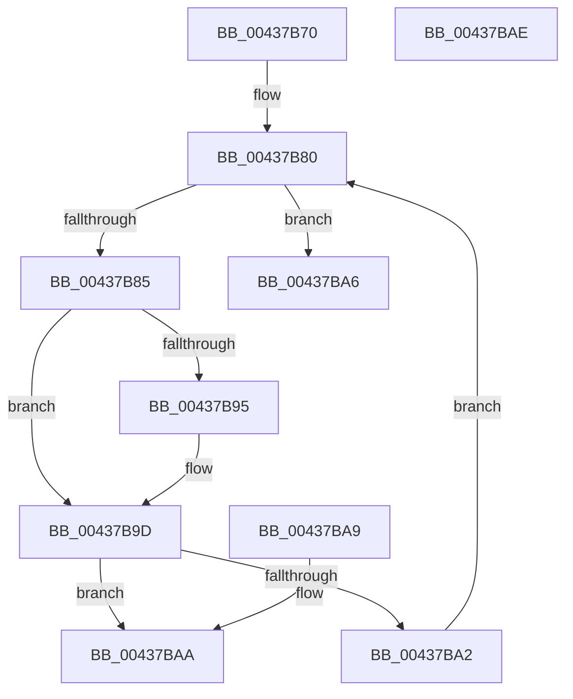

# EtwpGetMetaProviderContext

- RVA: `0x00437B70`–`0x00437BAF` (길이 `63` bytes)
- VA: `0x0000000140437B70`
- 실행 섹션: `.text`
- PDB 이름 있음: `예`; PDB Function 태그: `아니요`
- unwind 정보 RVA: `0x000DB714`
- 디코드: `22`개 명령, `63/63` bytes 표시
- 미해석 바이트: `0` (있으면 어셈블리에 `.byte`로 보존)

> 이 문서는 커널 이미지의 기계어와 PDB 기호를 분석해 생성했습니다. 4번과 5번은 함수 원형과 자료형을 바이너리 사용 방식에서 추정한 C 해석이며 원본 소스 복구 결과는 아닙니다.

## 1. Dependencies

- 직접 호출 지점: **0**; 고유 호출 대상: **0**
- 직접 호출자로 확인된 함수: **2**
- RIP 상대 이미지 참조: **1**

### Outgoing calls
- 직접 디코드된 call 명령이 없습니다.

### Direct callers
- [EtwpEnableMetaProviderGuid](EtwpEnableMetaProviderGuid_function_00437AE0.md) at `0x00437B23`
- [sub_009E8C24](../../page/9E/Unknown_function_009E8C24.md) at `0x009E8CBC`

### Static image references
- `0x00437B72` → RVA `0x0000B8D0` (`.rdata`; read)

## 2. Other-region calls and transfers

- 다른 실행 섹션으로 향하는 call: **0**
- 별도 외부 분기/꼬리 이동을 확인하지 못했습니다.

## 3. Assembly (complete function range)

```asm
00437B70  33 D2                           xor edx, edx
00437B72  4C 8D 1D 57 3D BD FF            lea r11, [rip - 0x42c2a9]
00437B79  0F 1F 80 00 00 00 00            nop dword ptr [rax]
00437B80  83 FA 11                        cmp edx, 0x11
00437B83  73 21                           jae 0x140437ba6
00437B85  4D 8B 14 D3                     mov r10, qword ptr [r11 + rdx*8]
00437B89  48 8B 01                        mov rax, qword ptr [rcx]
00437B8C  4D 8B 42 10                     mov r8, qword ptr [r10 + 0x10]
00437B90  49 2B 00                        sub rax, qword ptr [r8]
00437B93  75 08                           jne 0x140437b9d
00437B95  48 8B 41 08                     mov rax, qword ptr [rcx + 8]
00437B99  49 2B 40 08                     sub rax, qword ptr [r8 + 8]
00437B9D  48 85 C0                        test rax, rax
00437BA0  74 08                           je 0x140437baa
00437BA2  FF C2                           inc edx
00437BA4  EB DA                           jmp 0x140437b80
00437BA6  33 C0                           xor eax, eax
00437BA8  C3                              ret
00437BA9  CC                              int3
00437BAA  49 8B C2                        mov rax, r10
00437BAD  C3                              ret
00437BAE  CC                              int3
```

## 4. C-style interpretation (structured pseudocode)

```c
__int64 __fastcall EtwpGetMetaProviderContext(__int64 a1, int a2)
{
    __int64 result;

    a2 = 0;
loc_00437B80:
    if (0 >= 17) goto loc_00437BA6;
    result = (*(unsigned __int64 *)(a1)) - (*(unsigned __int64 *)(*(unsigned __int64 *)(*(unsigned __int64 *)(v_rip - 4375209 + a2 * 8) + 16)));
    if (!(condition_is_not_equal)) {
        result = *(unsigned __int64 *)(a1 + 8);
        result = (result) - (*(unsigned __int64 *)(*(unsigned __int64 *)(*(unsigned __int64 *)(v_rip - 4375209 + a2 * 8) + 16) + 8));
    }
    if (result == 0) goto loc_00437BAA;
    a2 = (unsigned int)((a2) + 1);
    goto loc_00437B80;
loc_00437BA6:
    result = 0;
    return result;
loc_00437BAA:
    return *(unsigned __int64 *)(v_rip - 4375209 + a2 * 8);
}
```

## 5. (Beta) C Style

```c
int64_t EtwpGetMetaProviderContext(void *Arg1, int32_t Arg2)
{
    uint8_t *arg1 = (uint8_t *)Arg1;

    int64_t result;

    Arg2 = 0;
loc_00437B80:
    if (0 >= 17) goto loc_00437BA6;
    result = (*(uint64_t *)(arg1)) - (*(uint64_t *)(*(uint64_t *)(*(uint64_t *)(v_rip - 0x42C2A9 + Arg2 * 8) + 0x10)));
    if (!(condition_is_not_equal)) {
        result = *(uint64_t *)(arg1 + 0x8);
        result = (result) - (*(uint64_t *)(*(uint64_t *)(*(uint64_t *)(v_rip - 0x42C2A9 + Arg2 * 8) + 0x10) + 0x8));
    }
    if (result == 0) goto loc_00437BAA;
    Arg2 = (uint32_t)((Arg2) + 1);
    goto loc_00437B80;
loc_00437BA6:
    result = 0;
    return result;
loc_00437BAA:
    return *(uint64_t *)(v_rip - 0x42C2A9 + Arg2 * 8);
}
```

### 관측된 메모리 오프셋

구조체 형식이 확인되지 않은 접근은 인자 기준의 오프셋으로만 기록했습니다.

| 기준 인자 | 오프셋 표현 | 폭 (bit) | 접근 |
|---|---:|---:|---|
| `Arg1` | `+ 0x0` | `64` | `R` |
| `Arg1` | `+ 0x8` | `64` | `R` |

## 6. Execution-region graph

[열기: 2D/3D 그래프와 함수 탐색 컨트롤 패널](../../../control-panel.html?section=text&rva=0x00437B70&view=graph)

- 2D 그래프는 위에서 아래로 흐르고, 3D 그래프는 빈 공간을 드래그해 회전합니다. Shift+드래그는 이동, 휠은 확대·축소, 함수 노드 선택은 대상 보고서 이동입니다.

### Static fallback


