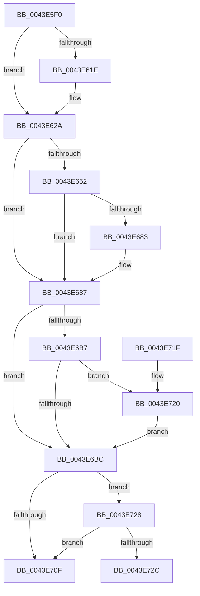

# ExAllocatePoolWithTagPriority

- RVA: `0x0043E5F0`–`0x0043E744` (길이 `340` bytes)
- VA: `0x000000014043E5F0`
- 실행 섹션: `.text`
- PDB 이름 있음: `예`; PDB Function 태그: `아니요`
- unwind 정보 RVA: `0x000A4B3C`
- 디코드: `95`개 명령, `340/340` bytes 표시
- 미해석 바이트: `0` (있으면 어셈블리에 `.byte`로 보존)

> 이 문서는 커널 이미지의 기계어와 PDB 기호를 분석해 생성했습니다. 4번과 5번은 함수 원형과 자료형을 바이너리 사용 방식에서 추정한 C 해석이며 원본 소스 복구 결과는 아닙니다.

## 1. Dependencies

- 직접 호출 지점: **2**; 고유 호출 대상: **2**
- 직접 호출자로 확인된 함수: **3**
- RIP 상대 이미지 참조: **0**

### Outgoing calls
- `0x0043E705` → [ExAllocatePool3](../../poolcode/B8/ExAllocatePool3_function_00B84270.md) (function, `0x00B84270`)
- `0x0043E73E` → [KeBugCheckEx](../4F/KeBugCheckEx_function_004FD660.md) (function, `0x004FD660`)

### Direct callers
- [VerifierExAllocatePoolWithTagPriority](../../pagevrfy/BA/VerifierExAllocatePoolWithTagPriority_function_00BA16D0.md) at `0x00BA17D7`
- [VerifierPortExAllocatePoolWithTagPriority](../../pagevrfy/BA/VerifierPortExAllocatePoolWithTagPriority_function_00BABFA0.md) at `0x00BABFBD`
- [VfHandlePoolAlloc](../../pagevrfy/BB/VfHandlePoolAlloc_function_00BB8A90.md) at `0x00BB8B57`
- [VfHandlePoolAlloc](../../pagevrfy/BB/VfHandlePoolAlloc_function_00BB8A90.md) at `0x00BB8CF1`

### Static image references
- 디코드된 RIP-relative 메모리 참조가 없습니다.

## 2. Other-region calls and transfers

- 다른 실행 섹션으로 향하는 call: **1**
  - `0x0043E705` → [ExAllocatePool3](../../poolcode/B8/ExAllocatePool3_function_00B84270.md) (`.text` → `POOLCODE`)
- 별도 외부 분기/꼬리 이동을 확인하지 못했습니다.

## 3. Assembly (complete function range)

```asm
0043E5F0  48 89 5C 24 08                  mov qword ptr [rsp + 8], rbx
0043E5F5  48 89 74 24 10                  mov qword ptr [rsp + 0x10], rsi
0043E5FA  57                              push rdi
0043E5FB  48 83 EC 40                     sub rsp, 0x40
0043E5FF  8B D9                           mov ebx, ecx
0043E601  0F 57 C0                        xorps xmm0, xmm0
0043E604  45 8B D8                        mov r11d, r8d
0043E607  48 8B FA                        mov rdi, rdx
0043E60A  B9 00 01 00 00                  mov ecx, 0x100
0043E60F  B8 40 00 00 00                  mov eax, 0x40
0043E614  0F 11 44 24 30                  movups xmmword ptr [rsp + 0x30], xmm0
0043E619  F6 C3 01                        test bl, 1
0043E61C  75 0C                           jne 0x14043e62a
0043E61E  0F BA E3 09                     bt ebx, 9
0043E622  B9 80 00 00 00                  mov ecx, 0x80
0043E627  0F 42 C8                        cmovb ecx, eax
0043E62A  85 DB                           test ebx, ebx
0043E62C  48 0F 48 C8                     cmovs rcx, rax
0043E630  48 8B D1                        mov rdx, rcx
0043E633  48 83 CA 04                     or rdx, 4
0043E637  F6 C3 20                        test bl, 0x20
0043E63A  48 0F 44 D1                     cmove rdx, rcx
0043E63E  48 8B C2                        mov rax, rdx
0043E641  48 83 C8 02                     or rax, 2
0043E645  0F BA E3 0A                     bt ebx, 0xa
0043E649  48 0F 42 C2                     cmovb rax, rdx
0043E64D  F6 C3 DE                        test bl, 0xde
0043E650  74 35                           je 0x14043e687
0043E652  48 8B D0                        mov rdx, rax
0043E655  48 83 CA 08                     or rdx, 8
0043E659  F6 C3 04                        test bl, 4
0043E65C  48 0F 44 D0                     cmove rdx, rax
0043E660  4C 8B C2                        mov r8, rdx
0043E663  49 0F BA E8 09                  bts r8, 9
0043E668  F6 C3 80                        test bl, 0x80
0043E66B  4C 0F 44 C2                     cmove r8, rdx
0043E66F  49 8B C0                        mov rax, r8
0043E672  48 0F BA E8 0A                  bts rax, 0xa
0043E677  F6 C3 40                        test bl, 0x40
0043E67A  49 0F 44 C0                     cmove rax, r8
0043E67E  F6 C3 10                        test bl, 0x10
0043E681  74 04                           je 0x14043e687
0043E683  48 83 C8 20                     or rax, 0x20
0043E687  41 8B D1                        mov edx, r9d
0043E68A  49 B8 00 00 00 00 01 00 00 00   movabs r8, 0x100000000
0043E694  83 E2 F6                        and edx, 0xfffffff6
0043E697  4C 8B D0                        mov r10, rax
0043E69A  41 0F BA E1 03                  bt r9d, 3
0043E69F  41 0F 43 D1                     cmovae edx, r9d
0043E6A3  4D 0B D0                        or r10, r8
0043E6A6  41 0F BA E1 03                  bt r9d, 3
0043E6AB  8B CA                           mov ecx, edx
0043E6AD  4C 0F 43 D0                     cmovae r10, rax
0043E6B1  33 F6                           xor esi, esi
0043E6B3  85 D2                           test edx, edx
0043E6B5  74 05                           je 0x14043e6bc
0043E6B7  83 FA 10                        cmp edx, 0x10
0043E6BA  75 64                           jne 0x14043e720
0043E6BC  B8 20 00 00 00                  mov eax, 0x20
0043E6C1  C7 44 24 20 01 00 00 00         mov dword ptr [rsp + 0x20], 1
0043E6C9  83 E3 02                        and ebx, 2
0043E6CC  4C 8D 4C 24 30                  lea r9, [rsp + 0x30]
0043E6D1  48 8B D7                        mov rdx, rdi
0043E6D4  0F 45 C8                        cmovne ecx, eax
0043E6D7  41 81 E3 FF FF FF 7F            and r11d, 0x7fffffff
0043E6DE  B8 42 61 64 30                  mov eax, 0x30646142
0043E6E3  89 4C 24 38                     mov dword ptr [rsp + 0x38], ecx
0043E6E7  44 0F 44 D8                     cmove r11d, eax
0043E6EB  49 8B CA                        mov rcx, r10
0043E6EE  48 8B 44 24 30                  mov rax, qword ptr [rsp + 0x30]
0043E6F3  45 8B C3                        mov r8d, r11d
0043E6F6  48 25 01 FF FF FF               and rax, 0xffffffffffffff01
0043E6FC  48 83 C8 01                     or rax, 1
0043E700  48 89 44 24 30                  mov qword ptr [rsp + 0x30], rax
0043E705  E8 66 5B 74 00                  call 0x140b84270
0043E70A  48 85 C0                        test rax, rax
0043E70D  74 19                           je 0x14043e728
0043E70F  48 8B 5C 24 50                  mov rbx, qword ptr [rsp + 0x50]
0043E714  48 8B 74 24 58                  mov rsi, qword ptr [rsp + 0x58]
0043E719  48 83 C4 40                     add rsp, 0x40
0043E71D  5F                              pop rdi
0043E71E  C3                              ret
0043E71F  CC                              int3
0043E720  83 FA 20                        cmp edx, 0x20
0043E723  0F 45 CE                        cmovne ecx, esi
0043E726  EB 94                           jmp 0x14043e6bc
0043E728  85 DB                           test ebx, ebx
0043E72A  74 E3                           je 0x14043e70f
0043E72C  45 33 C9                        xor r9d, r9d
0043E72F  48 89 74 24 20                  mov qword ptr [rsp + 0x20], rsi
0043E734  45 33 C0                        xor r8d, r8d
0043E737  48 8B D7                        mov rdx, rdi
0043E73A  41 8D 49 41                     lea ecx, [r9 + 0x41]
0043E73E  E8 1D EF 0B 00                  call 0x1404fd660
0043E743  CC                              int3
```

## 4. C-style interpretation (structured pseudocode)

```c
__int64 __fastcall ExAllocatePoolWithTagPriority(int a1, __int64 a2, int a3, int a4)
{
    __int64 result;
    __int64 v_r10;
    __int64 v_r11;
    __int64 v_rbx;
    __int64 v_rsi;
    __int64 v_rsp;
    unsigned int v_stack_m10;
    unsigned __int64 v_stack_m18;
    unsigned int v_stack_m28;
    unsigned __int64 v_stack_p10;
    unsigned __int64 v_stack_p20;
    unsigned __int64 v_stack_p8;

    v_stack_p8 = v_rbx;
    v_stack_p10 = v_rsi;
    v_rsp = (v_rsp) - (64);
    v_stack_m18 = v_xmm0;
    if ((((unsigned __int8)((unsigned int)(a1))) & (1)) == 0) {
        a1 = 128;
        if (condition_is_below) { a1 = 64; }
    }
    if (sign_flag) { a1 = 64; }
    a2 = (a1) | (4);
    if ((((unsigned __int8)((unsigned int)(a1))) & (32)) == 0) { a2 = a1; }
    result = (a2) | (2);
    if (condition_is_below) { result = a2; }
    if ((((unsigned __int8)((unsigned int)(a1))) & (222)) == 0) goto loc_0043E687;
    a2 = (result) | (8);
    if ((((unsigned __int8)((unsigned int)(a1))) & (4)) == 0) { a2 = result; }
    if ((((unsigned __int8)((unsigned int)(a1))) & (128)) == 0) { a2 = a2; }
    if ((((unsigned __int8)((unsigned int)(a1))) & (64)) == 0) { a2 = a2; }
    result = a2;
    if ((((unsigned __int8)((unsigned int)(a1))) & (16)) != 0) {
        result = (a2) | (32);
    }
    a2 = (unsigned int)(((unsigned int)(a4)) & (0xFFFFFFF6ULL));
    if (condition_is_above_or_equal) { a2 = a4; }
    v_r10 = (result) | (a2);
    if (condition_is_above_or_equal) { v_r10 = result; }
    v_rsi = 0;
    if ((unsigned int)(a2) == 0) goto loc_0043E6BC;
    if (((unsigned int)(a2)) != 16) goto loc_0043E720;
loc_0043E6BC:
    v_stack_m28 = 1;
    v_rbx = (unsigned int)(((unsigned int)(a1)) & (2));
    a1 = (unsigned int)((unsigned int)(a2));
    if (condition_is_not_equal) { a1 = 32; }
    v_r11 = (unsigned int)(((unsigned int)(a3)) & (0x7FFFFFFFULL));
    v_stack_m10 = a1;
    if (condition_is_equal) { v_r11 = (unsigned int)((unsigned int)(0x30646142ULL)); }
    result = (v_stack_m18) & (-255);
    result = (result) | (1);
    v_stack_m18 = result;
    result = ExAllocatePool3(v_r10, a2, (unsigned int)((unsigned int)(v_r11)), v_stack_m18);
    if (result == 0) goto loc_0043E728;
loc_0043E70F:
    v_rsp = (v_rsp) + (64);
    return result;
loc_0043E720:
    a1 = v_r10;
    if (((unsigned int)(a2)) != 32) { a1 = (unsigned int)(v_stack_p10); }
    goto loc_0043E6BC;
loc_0043E728:
    if ((unsigned int)(v_stack_p8) == 0) goto loc_0043E70F;
    a4 = 0;
    v_stack_p20 = v_stack_p10;
    a3 = 0;
    result = KeBugCheckEx(a4 + 65, a2, a3, a4);
    return result;
}
```

## 5. (Beta) C Style

```c
int64_t ExAllocatePoolWithTagPriority(int32_t PoolType, int64_t NumberOfBytes, int32_t Tag, int32_t Priority)
{
    int64_t result;
    int64_t local_r10;
    int64_t local_r11;
    int64_t local_rbx;
    int64_t local_rsi;
    int64_t local_rsp;
    uint32_t v_stack_m10;
    uint64_t v_stack_m18;
    uint32_t v_stack_m28;
    uint64_t v_stack_p10;
    uint64_t v_stack_p20;
    uint64_t v_stack_p8;

    v_stack_p8 = local_rbx;
    v_stack_p10 = local_rsi;
    local_rsp = (local_rsp) - (64);
    v_stack_m18 = v_xmm0;
    if ((((uint8_t)((uint32_t)(PoolType))) & (1)) == 0) {
        PoolType = 128;
        if (condition_is_below) { PoolType = 64; }
    }
    if (sign_flag) { PoolType = 64; }
    NumberOfBytes = (PoolType) | (4);
    if ((((uint8_t)((uint32_t)(PoolType))) & (32)) == 0) { NumberOfBytes = PoolType; }
    result = (NumberOfBytes) | (2);
    if (condition_is_below) { result = NumberOfBytes; }
    if ((((uint8_t)((uint32_t)(PoolType))) & (222)) == 0) goto loc_0043E687;
    NumberOfBytes = (result) | (8);
    if ((((uint8_t)((uint32_t)(PoolType))) & (4)) == 0) { NumberOfBytes = result; }
    if ((((uint8_t)((uint32_t)(PoolType))) & (128)) == 0) { NumberOfBytes = NumberOfBytes; }
    if ((((uint8_t)((uint32_t)(PoolType))) & (64)) == 0) { NumberOfBytes = NumberOfBytes; }
    result = NumberOfBytes;
    if ((((uint8_t)((uint32_t)(PoolType))) & (16)) != 0) {
        result = (NumberOfBytes) | (32);
    }
    NumberOfBytes = (uint32_t)(((uint32_t)(Priority)) & (0xFFFFFFF6ULL));
    if (condition_is_above_or_equal) { NumberOfBytes = Priority; }
    local_r10 = (result) | (NumberOfBytes);
    if (condition_is_above_or_equal) { local_r10 = result; }
    local_rsi = 0;
    if ((uint32_t)(NumberOfBytes) == 0) goto loc_0043E6BC;
    if (((uint32_t)(NumberOfBytes)) != 16) goto loc_0043E720;
loc_0043E6BC:
    v_stack_m28 = 1;
    local_rbx = (uint32_t)(((uint32_t)(PoolType)) & (2));
    PoolType = (uint32_t)((uint32_t)(NumberOfBytes));
    if (condition_is_not_equal) { PoolType = 32; }
    local_r11 = (uint32_t)(((uint32_t)(Tag)) & (0x7FFFFFFFULL));
    v_stack_m10 = PoolType;
    if (condition_is_equal) { local_r11 = (uint32_t)((uint32_t)(0x30646142ULL)); }
    result = (v_stack_m18) & (-255);
    result = (result) | (1);
    v_stack_m18 = result;
    result = ExAllocatePool3(local_r10, NumberOfBytes, (uint32_t)((uint32_t)(local_r11)), v_stack_m18);
    if (result == 0) goto loc_0043E728;
loc_0043E70F:
    local_rsp = (local_rsp) + (64);
    return result;
loc_0043E720:
    PoolType = local_r10;
    if (((uint32_t)(NumberOfBytes)) != 32) { PoolType = (uint32_t)(v_stack_p10); }
    goto loc_0043E6BC;
loc_0043E728:
    if ((uint32_t)(v_stack_p8) == 0) goto loc_0043E70F;
    Priority = 0;
    v_stack_p20 = v_stack_p10;
    Tag = 0;
    result = KeBugCheckEx(Priority + 65, NumberOfBytes, Tag, Priority);
    return result;
}
```

## 6. Execution-region graph

[열기: 2D/3D 그래프와 함수 탐색 컨트롤 패널](../../../control-panel.html?section=text&rva=0x0043E5F0&view=graph)

- 2D 그래프는 위에서 아래로 흐르고, 3D 그래프는 빈 공간을 드래그해 회전합니다. Shift+드래그는 이동, 휠은 확대·축소, 함수 노드 선택은 대상 보고서 이동입니다.

### Static fallback


