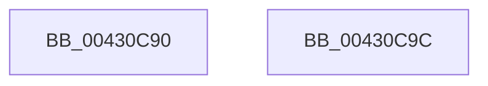

# ExGetHandlePointer

- RVA: `0x00430C90`–`0x00430C9D` (길이 `13` bytes)
- VA: `0x0000000140430C90`
- 실행 섹션: `.text`
- PDB 이름 있음: `예`; PDB Function 태그: `아니요`
- unwind 정보 RVA: `0x000DB714`
- 디코드: `5`개 명령, `13/13` bytes 표시
- 미해석 바이트: `0` (있으면 어셈블리에 `.byte`로 보존)

> 이 문서는 커널 이미지의 기계어와 PDB 기호를 분석해 생성했습니다. 4번과 5번은 함수 원형과 자료형을 바이너리 사용 방식에서 추정한 C 해석이며 원본 소스 복구 결과는 아닙니다.

## 1. Dependencies

- 직접 호출 지점: **0**; 고유 호출 대상: **0**
- 직접 호출자로 확인된 함수: **35**
- RIP 상대 이미지 참조: **0**

### Outgoing calls
- 직접 디코드된 call 명령이 없습니다.

### Direct callers
- [ObpShutdownCloseHandleProcedure](../../page/74/ObpShutdownCloseHandleProcedure_function_0074E7C0.md) at `0x0074E7E8`
- [EtwpObjectHandleEnumCallback](../../page/7C/EtwpObjectHandleEnumCallback_function_007C0240.md) at `0x007C0295`
- [sub_00868310](../../page/86/Unknown_function_00868310.md) at `0x008683F0`
- [sub_00868496](../../page/86/Unknown_function_00868496.md) at `0x008684C3`
- [ObWaitForMultipleObjects](../../page/86/ObWaitForMultipleObjects_function_00868DF0.md) at `0x00868F95`
- [ObWaitForMultipleObjects](../../page/86/ObWaitForMultipleObjects_function_00868DF0.md) at `0x008691E0`
- [ObWaitForMultipleObjects](../../page/86/ObWaitForMultipleObjects_function_00868DF0.md) at `0x008694D5`
- [ObpReferenceObjectByHandleWithTag](../../page/86/ObpReferenceObjectByHandleWithTag_function_00869650.md) at `0x008697CA`
- [ObpReferenceObjectByHandleWithTag](../../page/86/ObpReferenceObjectByHandleWithTag_function_00869650.md) at `0x0086996D`
- [ObpReferenceObjectByHandleWithTag](../../page/86/ObpReferenceObjectByHandleWithTag_function_00869650.md) at `0x00869C96`
- [ObCloseHandleTableEntry](../../page/86/ObCloseHandleTableEntry_function_00869E20.md) at `0x00869E6A`
- [AlpcpSendMessage](../../page/88/AlpcpSendMessage_function_0088BD40.md) at `0x0088C0DA`
- [ObpReferenceProcessObjectByHandle](../../page/89/ObpReferenceProcessObjectByHandle_function_00893C00.md) at `0x00893C91`
- [AlpcpLookupMessage](../../page/89/AlpcpLookupMessage_function_00895A40.md) at `0x00895AE1`
- [NtAlpcImpersonateClientOfPort](../../page/89/NtAlpcImpersonateClientOfPort_function_008961A0.md) at `0x008963BA`
- [ExpSnapShotHandleTables](../../page/8A/ExpSnapShotHandleTables_function_008A25C0.md) at `0x008A27A8`
- [ExpSnapShotHandleTables](../../page/8A/ExpSnapShotHandleTables_function_008A25C0.md) at `0x008A28B4`
- [sub_008A2AAB](../../page/8A/Unknown_function_008A2AAB.md) at `0x008A2B98`
- [sub_008A2C2F](../../page/8A/Unknown_function_008A2C2F.md) at `0x008A2C59`
- [ObDuplicateObject](../../page/8C/ObDuplicateObject_function_008C4FA0.md) at `0x008C5131`
- [sub_008CB9B9](../../page/8C/Unknown_function_008CB9B9.md) at `0x008CBAAB`
- [sub_008CBB8C](../../page/8C/Unknown_function_008CBB8C.md) at `0x008CBBB7`
- [NtWriteFile](../../page/8E/NtWriteFile_function_008E92D0.md) at `0x008E9424`
- [NtWriteFile](../../page/8E/NtWriteFile_function_008E92D0.md) at `0x008E95CD`
- [NtWriteFile](../../page/8E/NtWriteFile_function_008E92D0.md) at `0x008E96F2`
- [IopIsFileOpenOrSection](../../page/91/IopIsFileOpenOrSection_function_0091DC80.md) at `0x0091DCA6`
- [ObpEnumFindHandleProcedure](../../page/91/ObpEnumFindHandleProcedure_function_0091DD70.md) at `0x0091DD8B`
- [PnpHandleProcessWalkWorker](../../page/91/PnpHandleProcessWalkWorker_function_0091DE30.md) at `0x0091DE57`
- [sub_0094BE3F](../../page/94/Unknown_function_0094BE3F.md) at `0x0094BEF9`
- [sub_0094C011](../../page/94/Unknown_function_0094C011.md) at `0x0094C02E`
- [sub_0094C011](../../page/94/Unknown_function_0094C011.md) at `0x0094C12D`
- [ObpAuditObjectAccess](../../page/94/ObpAuditObjectAccess_function_0094C270.md) at `0x0094C2DC`
- [ExQueryProcessHandleInformation](../../page/94/ExQueryProcessHandleInformation_function_0094C3D8.md) at `0x0094C465`
- [ObInheritObjectHandle](../../page/94/ObInheritObjectHandle_function_0094D1C4.md) at `0x0094D1EB`
- [RtlLookupAtomInAtomTable](../../page/99/RtlLookupAtomInAtomTable_function_00992DF0.md) at `0x009930B3`
- [RtlLookupAtomInAtomTable](../../page/99/RtlLookupAtomInAtomTable_function_00992DF0.md) at `0x009931F9`
- [RtlpHashStringToAtom](../../page/99/RtlpHashStringToAtom_function_0099E760.md) at `0x0099E8E1`
- [sub_009A7748](../../page/9A/Unknown_function_009A7748.md) at `0x009A782D`
- [sub_009A7932](../../page/9A/Unknown_function_009A7932.md) at `0x009A795D`
- [RtlQueryAtomInAtomTable](../../page/9C/RtlQueryAtomInAtomTable_function_009C4690.md) at `0x009C47B3`
- [RtlpAtomMapAtomToHandleEntry](../../page/9C/RtlpAtomMapAtomToHandleEntry_function_009C4AD0.md) at `0x009C4B4D`
- [ObpCaptureHandleInformation](../../page/9C/ObpCaptureHandleInformation_function_009C4CE0.md) at `0x009C4D26`
- [ObpCaptureHandleInformationEx](../../page/9D/ObpCaptureHandleInformationEx_function_009D80F0.md) at `0x009D8136`
- [ObSetHandleAttributes](../../page/A0/ObSetHandleAttributes_function_00A03730.md) at `0x00A03803`

### Static image references
- 디코드된 RIP-relative 메모리 참조가 없습니다.

## 2. Other-region calls and transfers

- 다른 실행 섹션으로 향하는 call: **0**
- 별도 외부 분기/꼬리 이동을 확인하지 못했습니다.

## 3. Assembly (complete function range)

```asm
00430C90  48 8B 01                        mov rax, qword ptr [rcx]
00430C93  48 C1 F8 10                     sar rax, 0x10
00430C97  48 83 E0 F0                     and rax, 0xfffffffffffffff0
00430C9B  C3                              ret
00430C9C  CC                              int3
```

## 4. C-style interpretation (structured pseudocode)

```c
__int64 __fastcall ExGetHandlePointer(__int64 a1)
{
    __int64 result;

    result = (*(unsigned __int64 *)(a1)) >> (16);
    result = (result) & (-16);
    return result;
}
```

## 5. (Beta) C Style

```c
int64_t ExGetHandlePointer(void *Arg1)
{
    uint8_t *arg1 = (uint8_t *)Arg1;

    int64_t result;

    result = (*(uint64_t *)(arg1)) >> (16);
    result = (result) & (-16);
    return result;
}
```

### 관측된 메모리 오프셋

구조체 형식이 확인되지 않은 접근은 인자 기준의 오프셋으로만 기록했습니다.

| 기준 인자 | 오프셋 표현 | 폭 (bit) | 접근 |
|---|---:|---:|---|
| `Arg1` | `+ 0x0` | `64` | `R` |

## 6. Execution-region graph

[열기: 2D/3D 그래프와 함수 탐색 컨트롤 패널](../../../control-panel.html?section=text&rva=0x00430C90&view=graph)

- 2D 그래프는 위에서 아래로 흐르고, 3D 그래프는 빈 공간을 드래그해 회전합니다. Shift+드래그는 이동, 휠은 확대·축소, 함수 노드 선택은 대상 보고서 이동입니다.

### Static fallback


