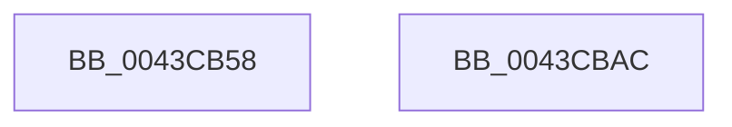

# ExQueueWorkItemExFromIo

- RVA: `0x0043CB58`–`0x0043CBAD` (길이 `85` bytes)
- VA: `0x000000014043CB58`
- 실행 섹션: `.text`
- PDB 이름 있음: `예`; PDB Function 태그: `아니요`
- unwind 정보 RVA: `0x000794E0`
- 디코드: `23`개 명령, `85/85` bytes 표시
- 미해석 바이트: `0` (있으면 어셈블리에 `.byte`로 보존)

> 이 문서는 커널 이미지의 기계어와 PDB 기호를 분석해 생성했습니다. 4번과 5번은 함수 원형과 자료형을 바이너리 사용 방식에서 추정한 C 해석이며 원본 소스 복구 결과는 아닙니다.

## 1. Dependencies

- 직접 호출 지점: **3**; 고유 호출 대상: **3**
- 직접 호출자로 확인된 함수: **1**
- RIP 상대 이미지 참조: **1**

### Outgoing calls
- `0x0043CB6F` → [ExpValidateWorkItem](../35/ExpValidateWorkItem_function_00358680.md) (function, `0x00358680`)
- `0x0043CB76` → [ExpTypeToPriority](../35/ExpTypeToPriority_function_00358660.md) (function, `0x00358660`)
- `0x0043CB97` → [ExpQueueWorkItem](../35/ExpQueueWorkItem_function_00358400.md) (function, `0x00358400`)

### Direct callers
- [IoQueueWorkItemToNode](IoQueueWorkItemToNode_function_0043C960.md) at `0x0043C984`

### Static image references
- `0x0043CB7B` → RVA `0x00FC6EA0` (`ALMOSTRO`; read)

## 2. Other-region calls and transfers

- 다른 실행 섹션으로 향하는 call: **0**
- 별도 외부 분기/꼬리 이동을 확인하지 못했습니다.

## 3. Assembly (complete function range)

```asm
0043CB58  48 89 5C 24 08                  mov qword ptr [rsp + 8], rbx
0043CB5D  48 89 74 24 10                  mov qword ptr [rsp + 0x10], rsi
0043CB62  57                              push rdi
0043CB63  48 83 EC 30                     sub rsp, 0x30
0043CB67  41 8B F8                        mov edi, r8d
0043CB6A  8B DA                           mov ebx, edx
0043CB6C  48 8B F1                        mov rsi, rcx
0043CB6F  E8 0C BB F1 FF                  call 0x140358680
0043CB74  8B CB                           mov ecx, ebx
0043CB76  E8 E5 BA F1 FF                  call 0x140358660
0043CB7B  48 8B 0D 1E A3 B8 00            mov rcx, qword ptr [rip + 0xb8a31e]
0043CB82  44 8B CF                        mov r9d, edi
0043CB85  44 8B C0                        mov r8d, eax
0043CB88  C7 44 24 20 01 00 00 00         mov dword ptr [rsp + 0x20], 1
0043CB90  48 8B D6                        mov rdx, rsi
0043CB93  48 8B 49 10                     mov rcx, qword ptr [rcx + 0x10]
0043CB97  E8 64 B8 F1 FF                  call 0x140358400
0043CB9C  48 8B 5C 24 40                  mov rbx, qword ptr [rsp + 0x40]
0043CBA1  48 8B 74 24 48                  mov rsi, qword ptr [rsp + 0x48]
0043CBA6  48 83 C4 30                     add rsp, 0x30
0043CBAA  5F                              pop rdi
0043CBAB  C3                              ret
0043CBAC  CC                              int3
```

## 4. C-style interpretation (structured pseudocode)

```c
__int64 __fastcall ExQueueWorkItemExFromIo(__int64 a1, int a2, int a3)
{
    __int64 result;
    __int64 v_rsp;
    unsigned int v_stack_m18;
    unsigned __int64 v_stack_p10;
    unsigned __int64 v_stack_p8;

    v_stack_p8 = v_rbx;
    v_stack_p10 = v_rsi;
    v_rsp = (v_rsp) - (48);
    result = ExpValidateWorkItem(a1, a2, a3, a4);
    result = ExpTypeToPriority((unsigned int)((unsigned int)((unsigned int)(a2))), a2, a3, a4);
    v_stack_m18 = 1;
    result = ExpQueueWorkItem(*(unsigned __int64 *)(*(unsigned __int64 *)(v_rip + 12100382) + 16), a1, (unsigned int)((unsigned int)(result)), (unsigned int)((unsigned int)((unsigned int)(a3))));
    v_rsp = (v_rsp) + (48);
    return result;
}
```

## 5. (Beta) C Style

```c
int64_t ExQueueWorkItemExFromIo(int64_t Arg1, int32_t Arg2, int32_t Arg3)
{
    int64_t result;
    int64_t local_rsp;
    uint32_t v_stack_m18;
    uint64_t v_stack_p10;
    uint64_t v_stack_p8;

    v_stack_p8 = local_rbx;
    v_stack_p10 = local_rsi;
    local_rsp = (local_rsp) - (48);
    result = ExpValidateWorkItem(Arg1, Arg2, Arg3, a4);
    result = ExpTypeToPriority((uint32_t)((uint32_t)((uint32_t)(Arg2))), Arg2, Arg3, a4);
    v_stack_m18 = 1;
    result = ExpQueueWorkItem(*(uint64_t *)(*(uint64_t *)(v_rip + 0xB8A31E) + 0x10), Arg1, (uint32_t)((uint32_t)(result)), (uint32_t)((uint32_t)((uint32_t)(Arg3))));
    local_rsp = (local_rsp) + (48);
    return result;
}
```

## 6. Execution-region graph

[열기: 2D/3D 그래프와 함수 탐색 컨트롤 패널](../../../control-panel.html?section=text&rva=0x0043CB58&view=graph)

- 2D 그래프는 위에서 아래로 흐르고, 3D 그래프는 빈 공간을 드래그해 회전합니다. Shift+드래그는 이동, 휠은 확대·축소, 함수 노드 선택은 대상 보고서 이동입니다.

### Static fallback


