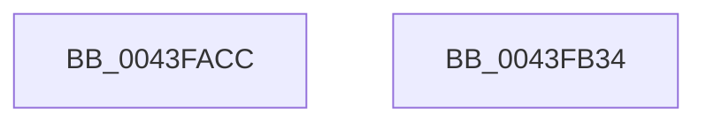

# ExSaFree

- RVA: `0x0043FACC`–`0x0043FB35` (길이 `105` bytes)
- VA: `0x000000014043FACC`
- 실행 섹션: `.text`
- PDB 이름 있음: `예`; PDB Function 태그: `아니요`
- unwind 정보 RVA: `0x0005C788`
- 디코드: `26`개 명령, `105/105` bytes 표시
- 미해석 바이트: `0` (있으면 어셈블리에 `.byte`로 보존)

> 이 문서는 커널 이미지의 기계어와 PDB 기호를 분석해 생성했습니다. 4번과 5번은 함수 원형과 자료형을 바이너리 사용 방식에서 추정한 C 해석이며 원본 소스 복구 결과는 아닙니다.

## 1. Dependencies

- 직접 호출 지점: **2**; 고유 호출 대상: **2**
- 직접 호출자로 확인된 함수: **3**
- RIP 상대 이미지 참조: **1**

### Outgoing calls
- `0x0043FB25` → [ExpSaAllocatorFree](../2E/ExpSaAllocatorFree_function_002E2E00.md) (function, `0x002E2E00`)
- `0x0043FB2A` → [KeLeaveGuardedRegion](../2E/KeLeaveGuardedRegion_function_002E2C40.md) (function, `0x002E2C40`)

### Direct callers
- [ExCleanupAutoExpandPushLock](ExCleanupAutoExpandPushLock_function_0043FAA0.md) at `0x0043FAB8`
- [RtlpHpHeapDestroy](../60/RtlpHpHeapDestroy_function_006033AC.md) at `0x00603470`
- [PspProcessDelete](../../page/90/PspProcessDelete_function_00907B90.md) at `0x00907FA1`

### Static image references
- `0x0043FAD0` → RVA `0x00EFA280` (`.data`; read)

## 2. Other-region calls and transfers

- 다른 실행 섹션으로 향하는 call: **0**
- 별도 외부 분기/꼬리 이동을 확인하지 못했습니다.

## 3. Assembly (complete function range)

```asm
0043FACC  48 83 EC 28                     sub rsp, 0x28
0043FAD0  48 8B 05 A9 A7 AB 00            mov rax, qword ptr [rip + 0xaba7a9]
0043FAD7  44 8B C1                        mov r8d, ecx
0043FADA  4C 8B D1                        mov r10, rcx
0043FADD  44 8B CA                        mov r9d, edx
0043FAE0  41 C1 E8 0D                     shr r8d, 0xd
0043FAE4  BA 01 00 00 00                  mov edx, 1
0043FAE9  41 81 E0 FF FF 03 00            and r8d, 0x3ffff
0043FAF0  49 83 C1 07                     add r9, 7
0043FAF4  41 0F BD C8                     bsr ecx, r8d
0043FAF8  49 C1 E9 03                     shr r9, 3
0043FAFC  D3 E2                           shl edx, cl
0043FAFE  83 C1 FE                        add ecx, -2
0043FB01  49 33 D0                        xor rdx, r8
0043FB04  4D 8B C2                        mov r8, r10
0043FB07  48 8B 0C C8                     mov rcx, qword ptr [rax + rcx*8]
0043FB0B  65 48 8B 04 25 88 01 00 00      mov rax, qword ptr gs:[0x188]
0043FB14  48 8B 54 D1 08                  mov rdx, qword ptr [rcx + rdx*8 + 8]
0043FB19  48 8B 4A 10                     mov rcx, qword ptr [rdx + 0x10]
0043FB1D  66 FF 88 E6 01 00 00            dec word ptr [rax + 0x1e6]
0043FB24  90                              nop
0043FB25  E8 D6 32 EA FF                  call 0x1402e2e00
0043FB2A  E8 11 31 EA FF                  call 0x1402e2c40
0043FB2F  48 83 C4 28                     add rsp, 0x28
0043FB33  C3                              ret
0043FB34  CC                              int3
```

## 4. C-style interpretation (structured pseudocode)

```c
__int64 __fastcall ExSaFree(__int64 a1, int a2)
{
    __int64 result;
    __int64 v_rsp;

    v_rsp = (v_rsp) - (40);
    a3 = (unsigned int)(((unsigned int)((unsigned int)(a1))) >> (13));
    a3 = (unsigned int)((a3) & (0x3FFFFULL));
    a4 = ((unsigned int)(a2)) + (7);
    a4 = (a4) >> (3);
    a2 = (unsigned int)((1) << ((unsigned __int8)(a1)));
    a1 = (unsigned int)((a1) + (-2));
    a2 = (a2) ^ (a3);
    result = ExpSaAllocatorFree(*(unsigned __int64 *)(*(unsigned __int64 *)(*(unsigned __int64 *)(*(unsigned __int64 *)(v_rip + 11249577) + a1 * 8) + a2 * 8 + 8) + 16), *(unsigned __int64 *)(*(unsigned __int64 *)(*(unsigned __int64 *)(v_rip + 11249577) + a1 * 8) + a2 * 8 + 8), a1, a4);
    result = KeLeaveGuardedRegion(*(unsigned __int64 *)(*(unsigned __int64 *)(*(unsigned __int64 *)(*(unsigned __int64 *)(v_rip + 11249577) + a1 * 8) + a2 * 8 + 8) + 16), *(unsigned __int64 *)(*(unsigned __int64 *)(*(unsigned __int64 *)(v_rip + 11249577) + a1 * 8) + a2 * 8 + 8), a1, a4);
    v_rsp = (v_rsp) + (40);
    return result;
}
```

## 5. (Beta) C Style

```c
int64_t ExSaFree(int64_t Arg1, int32_t Arg2)
{
    int64_t result;
    int64_t local_rsp;

    local_rsp = (local_rsp) - (40);
    a3 = (uint32_t)(((uint32_t)((uint32_t)(Arg1))) >> (13));
    a3 = (uint32_t)((a3) & (0x3FFFFULL));
    a4 = ((uint32_t)(Arg2)) + (7);
    a4 = (a4) >> (3);
    Arg2 = (uint32_t)((1) << ((uint8_t)(Arg1)));
    Arg1 = (uint32_t)((Arg1) + (-2));
    Arg2 = (Arg2) ^ (a3);
    result = ExpSaAllocatorFree(*(uint64_t *)(*(uint64_t *)(*(uint64_t *)(*(uint64_t *)(v_rip + 0xABA7A9) + Arg1 * 8) + Arg2 * 8 + 0x8) + 0x10), *(uint64_t *)(*(uint64_t *)(*(uint64_t *)(v_rip + 0xABA7A9) + Arg1 * 8) + Arg2 * 8 + 0x8), Arg1, a4);
    result = KeLeaveGuardedRegion(*(uint64_t *)(*(uint64_t *)(*(uint64_t *)(*(uint64_t *)(v_rip + 0xABA7A9) + Arg1 * 8) + Arg2 * 8 + 0x8) + 0x10), *(uint64_t *)(*(uint64_t *)(*(uint64_t *)(v_rip + 0xABA7A9) + Arg1 * 8) + Arg2 * 8 + 0x8), Arg1, a4);
    local_rsp = (local_rsp) + (40);
    return result;
}
```

## 6. Execution-region graph

[열기: 2D/3D 그래프와 함수 탐색 컨트롤 패널](../../../control-panel.html?section=text&rva=0x0043FACC&view=graph)

- 2D 그래프는 위에서 아래로 흐르고, 3D 그래프는 빈 공간을 드래그해 회전합니다. Shift+드래그는 이동, 휠은 확대·축소, 함수 노드 선택은 대상 보고서 이동입니다.

### Static fallback


