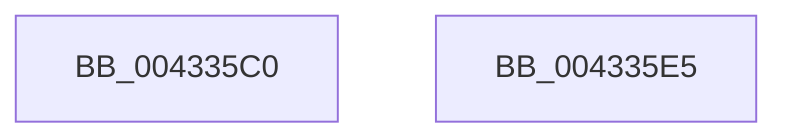

# ExpPartitionGetQueue

- RVA: `0x004335C0`–`0x004335E6` (길이 `38` bytes)
- VA: `0x00000001404335C0`
- 실행 섹션: `.text`
- PDB 이름 있음: `예`; PDB Function 태그: `아니요`
- unwind 정보 RVA: `0x000DB714`
- 디코드: `11`개 명령, `38/38` bytes 표시
- 미해석 바이트: `0` (있으면 어셈블리에 `.byte`로 보존)

> 이 문서는 커널 이미지의 기계어와 PDB 기호를 분석해 생성했습니다. 4번과 5번은 함수 원형과 자료형을 바이너리 사용 방식에서 추정한 C 해석이며 원본 소스 복구 결과는 아닙니다.

## 1. Dependencies

- 직접 호출 지점: **0**; 고유 호출 대상: **0**
- 직접 호출자로 확인된 함수: **1**
- RIP 상대 이미지 참조: **1**

### Outgoing calls
- 직접 디코드된 call 명령이 없습니다.

### Direct callers
- [ExpLegacyWorkerInitialization](../65/ExpLegacyWorkerInitialization_function_0065A5A0.md) at `0x0065A61F`
- [ExpLegacyWorkerInitialization](../65/ExpLegacyWorkerInitialization_function_0065A5A0.md) at `0x0065A64C`

### Static image references
- `0x004335CB` → RVA `0x00EFAA0C` (`.data`; read)

## 2. Other-region calls and transfers

- 다른 실행 섹션으로 향하는 call: **0**
- 별도 외부 분기/꼬리 이동을 확인하지 못했습니다.

## 3. Assembly (complete function range)

```asm
004335C0  0F B7 02                        movzx eax, word ptr [rdx]
004335C3  41 8D 14 C0                     lea edx, [r8 + rax*8]
004335C7  48 8B 41 08                     mov rax, qword ptr [rcx + 8]
004335CB  0F AF 15 3A 74 AC 00            imul edx, dword ptr [rip + 0xac743a]
004335D2  B9 00 00 00 00                  mov ecx, 0
004335D7  41 03 D1                        add edx, r9d
004335DA  48 8B 04 D0                     mov rax, qword ptr [rax + rdx*8]
004335DE  A8 01                           test al, 1
004335E0  48 0F 45 C1                     cmovne rax, rcx
004335E4  C3                              ret
004335E5  CC                              int3
```

## 4. C-style interpretation (structured pseudocode)

```c
__int64 __fastcall ExpPartitionGetQueue(__int64 a1, __int64 a2, __int64 a3, int a4)
{
    __int64 result;

    a2 = (unsigned int)((a3 + *(unsigned __int16 *)(a2) * 8) * (*(unsigned int *)(v_rip + 11301946)));
    a2 = (unsigned int)((a2) + (a4));
    result = *(unsigned __int64 *)(*(unsigned __int64 *)(a1 + 8) + a2 * 8);
    if ((((unsigned __int8)(*(unsigned __int64 *)(*(unsigned __int64 *)(a1 + 8) + a2 * 8))) & (1)) != 0) { result = 0; }
    return result;
}
```

## 5. (Beta) C Style

```c
int64_t ExpPartitionGetQueue(void *Arg1, void *Arg2, void *Arg3, int32_t Arg4)
{
    uint8_t *arg1 = (uint8_t *)Arg1;
    uint8_t *arg2 = (uint8_t *)Arg2;
    uint8_t *arg3 = (uint8_t *)Arg3;

    int64_t result;

    Arg2 = (uint32_t)((Arg3 + *(uint16_t *)(arg2) * 8) * (*(uint32_t *)(v_rip + 0xAC743A)));
    Arg2 = (uint32_t)((Arg2) + (Arg4));
    result = *(uint64_t *)(*(uint64_t *)(arg1 + 0x8) + arg2 * 8);
    if ((((uint8_t)(*(uint64_t *)(*(uint64_t *)(arg1 + 0x8) + arg2 * 8))) & (1)) != 0) { result = 0; }
    return result;
}
```

### 관측된 메모리 오프셋

구조체 형식이 확인되지 않은 접근은 인자 기준의 오프셋으로만 기록했습니다.

| 기준 인자 | 오프셋 표현 | 폭 (bit) | 접근 |
|---|---:|---:|---|
| `Arg1` | `+ 0x8` | `64` | `R` |
| `Arg2` | `+ 0x0` | `16` | `R` |
| `Arg3` | `+ 0x0 + rax*8` | `32` | `R` |

## 6. Execution-region graph

[열기: 2D/3D 그래프와 함수 탐색 컨트롤 패널](../../../control-panel.html?section=text&rva=0x004335C0&view=graph)

- 2D 그래프는 위에서 아래로 흐르고, 3D 그래프는 빈 공간을 드래그해 회전합니다. Shift+드래그는 이동, 휠은 확대·축소, 함수 노드 선택은 대상 보고서 이동입니다.

### Static fallback


