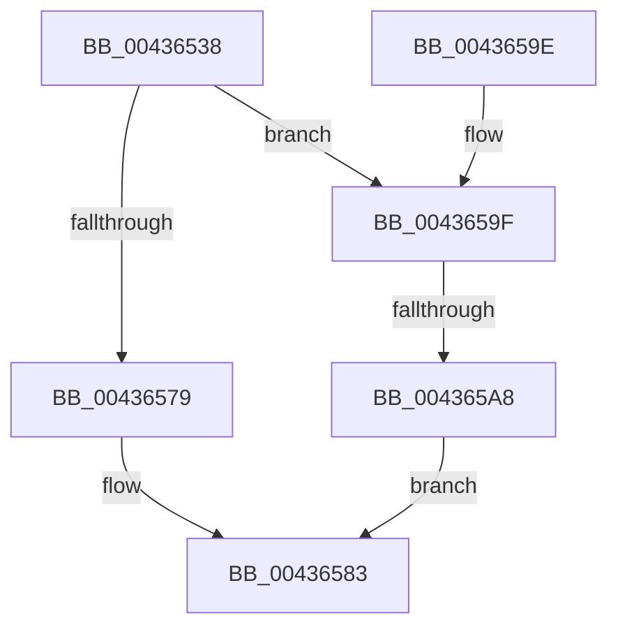

# FsFilterAllocateCompletionStack

- RVA: `0x00436538`–`0x004365AF` (길이 `119` bytes)
- VA: `0x0000000140436538`
- 실행 섹션: `.text`
- PDB 이름 있음: `예`; PDB Function 태그: `예`
- unwind 정보 RVA: `0x000A2E48`
- 디코드: `34`개 명령, `119/119` bytes 표시
- 미해석 바이트: `0` (있으면 어셈블리에 `.byte`로 보존)

> 이 문서는 커널 이미지의 기계어와 PDB 기호를 분석해 생성했습니다. 4번과 5번은 함수 원형과 자료형을 바이너리 사용 방식에서 추정한 C 해석이며 원본 소스 복구 결과는 아닙니다.

## 1. Dependencies

- 직접 호출 지점: **1**; 고유 호출 대상: **1**
- 직접 호출자로 확인된 함수: **1**
- RIP 상대 이미지 참조: **0**

### Outgoing calls
- `0x0043656C` → [ExAllocatePool2](../../poolcode/B8/ExAllocatePool2_function_00B820F0.md) (function, `0x00B820F0`)

### Direct callers
- [FsFilterCtrlInit](FsFilterCtrlInit_function_004364A0.md) at `0x0043651A`

### Static image references
- 디코드된 RIP-relative 메모리 참조가 없습니다.

## 2. Other-region calls and transfers

- 다른 실행 섹션으로 향하는 call: **1**
  - `0x0043656C` → [ExAllocatePool2](../../poolcode/B8/ExAllocatePool2_function_00B820F0.md) (`.text` → `POOLCODE`)
- call이 아닌 외부 분기/꼬리 이동: **1**
  - `0x004365A2` → [sub_006EEFB0](../6E/Unknown_function_006EEFB0.md) (`tail-transfer`)

## 3. Assembly (complete function range)

```asm
00436538  48 8B C4                        mov rax, rsp
0043653B  48 89 58 08                     mov qword ptr [rax + 8], rbx
0043653F  48 89 68 10                     mov qword ptr [rax + 0x10], rbp
00436543  48 89 70 18                     mov qword ptr [rax + 0x18], rsi
00436547  48 89 78 20                     mov qword ptr [rax + 0x20], rdi
0043654B  41 56                           push r14
0043654D  48 83 EC 30                     sub rsp, 0x30
00436551  44 8A F2                        mov r14b, dl
00436554  48 8B D9                        mov rbx, rcx
00436557  0F B7 51 48                     movzx edx, word ptr [rcx + 0x48]
0043655B  33 FF                           xor edi, edi
0043655D  48 C1 E2 05                     shl rdx, 5
00436561  41 B8 46 53 6D 67               mov r8d, 0x676d5346
00436567  33 F6                           xor esi, esi
00436569  8D 4F 40                        lea ecx, [rdi + 0x40]
0043656C  E8 7F BB 74 00                  call 0x140b820f0
00436571  48 8B E8                        mov rbp, rax
00436574  48 85 C0                        test rax, rax
00436577  74 26                           je 0x14043659f
00436579  83 4B 40 01                     or dword ptr [rbx + 0x40], 1
0043657D  33 C0                           xor eax, eax
0043657F  48 89 6B 50                     mov qword ptr [rbx + 0x50], rbp
00436583  48 8B 5C 24 40                  mov rbx, qword ptr [rsp + 0x40]
00436588  48 8B 6C 24 48                  mov rbp, qword ptr [rsp + 0x48]
0043658D  48 8B 74 24 50                  mov rsi, qword ptr [rsp + 0x50]
00436592  48 8B 7C 24 58                  mov rdi, qword ptr [rsp + 0x58]
00436597  48 83 C4 30                     add rsp, 0x30
0043659B  41 5E                           pop r14
0043659D  C3                              ret
0043659E  CC                              int3
0043659F  45 84 F6                        test r14b, r14b
004365A2  0F 84 08 8A 2B 00               je 0x1406eefb0
004365A8  B8 9A 00 00 C0                  mov eax, 0xc000009a
004365AD  EB D4                           jmp 0x140436583
```

## 4. C-style interpretation (structured pseudocode)

```c
__int64 __fastcall FsFilterAllocateCompletionStack(__int64 a1, unsigned __int8 a2)
{
    __int64 result;
    __int64 v_rdi;
    __int64 v_rsi;
    __int64 v_rsp;
    unsigned __int64 v_stack_p10;
    unsigned __int64 v_stack_p18;
    unsigned __int64 v_stack_p20;
    unsigned __int64 v_stack_p8;

    *(unsigned __int64 *)(v_rsp + 8) = v_rbx;
    *(unsigned __int64 *)(v_rsp + 16) = v_rbp;
    *(unsigned __int64 *)(v_rsp + 24) = v_rsi;
    *(unsigned __int64 *)(v_rsp + 32) = v_rdi;
    v_rsp = (v_rsp) - (48);
    v_rdi = 0;
    a2 = (*(unsigned __int16 *)(a1 + 72)) << (5);
    v_rsi = 0;
    result = ExAllocatePool2(v_rdi + 64, a2, (unsigned int)(0x676D5346ULL), a4);
    if (result == 0) goto loc_0043659F;
    result = 0;
    *(unsigned __int64 *)(a1 + 80) = 0;
loc_00436583:
    v_rsp = (v_rsp) + (48);
    return result;
loc_0043659F:
    goto loc_00436583;
}
```

## 5. (Beta) C Style

```c
int64_t FsFilterAllocateCompletionStack(void *Arg1, uint8_t Arg2)
{
    uint8_t *arg1 = (uint8_t *)Arg1;

    int64_t result;
    int64_t local_rdi;
    int64_t local_rsi;
    int64_t local_rsp;
    uint64_t v_stack_p10;
    uint64_t v_stack_p18;
    uint64_t v_stack_p20;
    uint64_t v_stack_p8;

    *(uint64_t *)(local_rsp + 0x8) = local_rbx;
    *(uint64_t *)(local_rsp + 0x10) = local_rbp;
    *(uint64_t *)(local_rsp + 0x18) = local_rsi;
    *(uint64_t *)(local_rsp + 0x20) = local_rdi;
    local_rsp = (local_rsp) - (48);
    local_rdi = 0;
    Arg2 = (*(uint16_t *)(arg1 + 0x48)) << (5);
    local_rsi = 0;
    result = ExAllocatePool2(local_rdi + 64, Arg2, (uint32_t)(0x676D5346ULL), a4);
    if (result == 0) goto loc_0043659F;
    result = 0;
    *(uint64_t *)(arg1 + 0x50) = 0;
loc_00436583:
    local_rsp = (local_rsp) + (48);
    return result;
loc_0043659F:
    goto loc_00436583;
}
```

### 관측된 메모리 오프셋

구조체 형식이 확인되지 않은 접근은 인자 기준의 오프셋으로만 기록했습니다.

| 기준 인자 | 오프셋 표현 | 폭 (bit) | 접근 |
|---|---:|---:|---|
| `Arg1` | `+ 0x40` | `32` | `R/W` |
| `Arg1` | `+ 0x48` | `16` | `R` |
| `Arg1` | `+ 0x50` | `64` | `W` |

## 6. Execution-region graph

[열기: 2D/3D 그래프와 함수 탐색 컨트롤 패널](../../../control-panel.html?section=text&rva=0x00436538&view=graph)

- 2D 그래프는 위에서 아래로 흐르고, 3D 그래프는 빈 공간을 드래그해 회전합니다. Shift+드래그는 이동, 휠은 확대·축소, 함수 노드 선택은 대상 보고서 이동입니다.

### Static fallback


