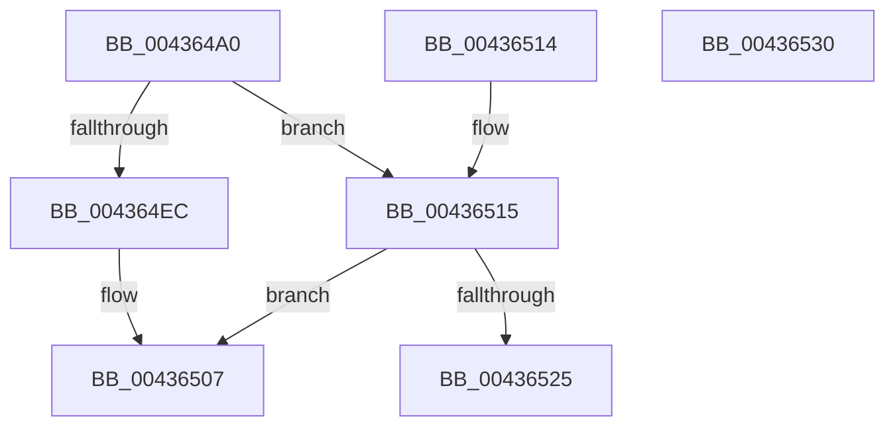

# FsFilterCtrlInit

- RVA: `0x004364A0`–`0x00436531` (길이 `145` bytes)
- VA: `0x00000001404364A0`
- 실행 섹션: `.text`
- PDB 이름 있음: `예`; PDB Function 태그: `아니요`
- unwind 정보 RVA: `0x000A2E34`
- 디코드: `43`개 명령, `145/145` bytes 표시
- 미해석 바이트: `0` (있으면 어셈블리에 `.byte`로 보존)

> 이 문서는 커널 이미지의 기계어와 PDB 기호를 분석해 생성했습니다. 4번과 5번은 함수 원형과 자료형을 바이너리 사용 방식에서 추정한 C 해석이며 원본 소스 복구 결과는 아닙니다.

## 1. Dependencies

- 직접 호출 지점: **2**; 고유 호출 대상: **2**
- 직접 호출자로 확인된 함수: **5**
- RIP 상대 이미지 참조: **0**

### Outgoing calls
- `0x004364FC` → [memset](../6C/memset_function_006C6C40.md) (function, `0x006C6C40`)
- `0x0043651A` → [FsFilterAllocateCompletionStack](FsFilterAllocateCompletionStack_function_00436538.md) (function, `0x00436538`)

### Direct callers
- [FsRtlReleaseFile](../../page/98/FsRtlReleaseFile_function_00985B70.md) at `0x00985C2E`
- [FsRtlAcquireFileForCcFlushEx](../../page/9D/FsRtlAcquireFileForCcFlushEx_function_009D72F0.md) at `0x009D73AE`
- [FsRtlReleaseFileForCcFlush](../../page/9D/FsRtlReleaseFileForCcFlush_function_009D75A0.md) at `0x009D765D`
- [FsRtlQueryOpen](../../page/9D/FsRtlQueryOpen_function_009D85A4.md) at `0x009D861A`
- [FsRtlAcquireFileExclusiveCommon](../../page/9D/FsRtlAcquireFileExclusiveCommon_function_009D8E50.md) at `0x009D8F26`

### Static image references
- 디코드된 RIP-relative 메모리 참조가 없습니다.

## 2. Other-region calls and transfers

- 다른 실행 섹션으로 향하는 call: **0**
- 별도 외부 분기/꼬리 이동을 확인하지 못했습니다.

## 3. Assembly (complete function range)

```asm
004364A0  48 89 5C 24 08                  mov qword ptr [rsp + 8], rbx
004364A5  57                              push rdi
004364A6  48 83 EC 20                     sub rsp, 0x20
004364AA  48 8B 44 24 50                  mov rax, qword ptr [rsp + 0x50]
004364AF  33 FF                           xor edi, edi
004364B1  48 89 41 10                     mov qword ptr [rcx + 0x10], rax
004364B5  0F 57 C0                        xorps xmm0, xmm0
004364B8  C7 01 40 00 00 00               mov dword ptr [rcx], 0x40
004364BE  33 C0                           xor eax, eax
004364C0  88 51 04                        mov byte ptr [rcx + 4], dl
004364C3  48 8B D9                        mov rbx, rcx
004364C6  4C 89 41 08                     mov qword ptr [rcx + 8], r8
004364CA  89 79 40                        mov dword ptr [rcx + 0x40], edi
004364CD  0F 11 41 18                     movups xmmword ptr [rcx + 0x18], xmm0
004364D1  0F 11 41 28                     movups xmmword ptr [rcx + 0x28], xmm0
004364D5  48 89 41 38                     mov qword ptr [rcx + 0x38], rax
004364D9  41 0F BE 40 4C                  movsx eax, byte ptr [r8 + 0x4c]
004364DE  66 89 41 48                     mov word ptr [rcx + 0x48], ax
004364E2  66 89 79 4A                     mov word ptr [rcx + 0x4a], di
004364E6  66 83 F8 0F                     cmp ax, 0xf
004364EA  77 29                           ja 0x140436515
004364EC  48 83 C1 58                     add rcx, 0x58
004364F0  33 D2                           xor edx, edx
004364F2  41 B8 E0 01 00 00               mov r8d, 0x1e0
004364F8  48 89 4B 50                     mov qword ptr [rbx + 0x50], rcx
004364FC  E8 3F 07 29 00                  call 0x1406c6c40
00436501  66 C7 43 48 0F 00               mov word ptr [rbx + 0x48], 0xf
00436507  8B C7                           mov eax, edi
00436509  48 8B 5C 24 30                  mov rbx, qword ptr [rsp + 0x30]
0043650E  48 83 C4 20                     add rsp, 0x20
00436512  5F                              pop rdi
00436513  C3                              ret
00436514  CC                              int3
00436515  0F B6 54 24 58                  movzx edx, byte ptr [rsp + 0x58]
0043651A  E8 19 00 00 00                  call 0x140436538
0043651F  8B F8                           mov edi, eax
00436521  85 C0                           test eax, eax
00436523  79 E2                           jns 0x140436507
00436525  48 8B 5C 24 30                  mov rbx, qword ptr [rsp + 0x30]
0043652A  48 83 C4 20                     add rsp, 0x20
0043652E  5F                              pop rdi
0043652F  C3                              ret
00436530  CC                              int3
```

## 4. C-style interpretation (structured pseudocode)

```c
__int64 __fastcall FsFilterCtrlInit(__int64 a1, int a2, __int64 a3, __int64 a4, __int64 a5, unsigned __int8 a6)
{
    __int64 result;
    __int64 v_rdi;
    __int64 v_rsp;
    unsigned __int64 v_stack_p30;
    unsigned __int64 v_stack_p8;

    v_stack_p8 = v_rbx;
    v_rsp = (v_rsp) - (32);
    v_rdi = 0;
    *(unsigned __int64 *)(a1 + 16) = a5;
    *(unsigned int *)(a1) = 64;
    result = 0;
    *(unsigned __int8 *)(a1 + 4) = (unsigned __int8)(a2);
    *(unsigned __int64 *)(a1 + 8) = a3;
    *(unsigned int *)(a1 + 64) = 0;
    *(unsigned __int64 *)(a1 + 24) = v_xmm0;
    *(unsigned __int64 *)(a1 + 40) = v_xmm0;
    *(unsigned __int64 *)(a1 + 56) = 0;
    *(unsigned __int16 *)(a1 + 72) = (unsigned __int16)((__int8)(*(unsigned __int8 *)(a3 + 76)));
    *(unsigned __int16 *)(a1 + 74) = 0;
    if (((unsigned __int16)((__int8)(*(unsigned __int8 *)(a3 + 76)))) > 15) goto loc_00436515;
    a1 = (a1) + (88);
    a2 = 0;
    *(unsigned __int64 *)(a1 + 80) = a1;
    result = memset(a1, a2, 480, a4);
    *(unsigned __int16 *)(a1 + 72) = 15;
loc_00436507:
    v_rsp = (v_rsp) + (32);
    return 0;
loc_00436515:
    result = FsFilterAllocateCompletionStack(a1, a6, 480, a4);
    if (!sign_flag) goto loc_00436507;
    v_rsp = (v_rsp) + (32);
    return result;
}
```

## 5. (Beta) C Style

```c
int64_t FsFilterCtrlInit(void *Arg1, int32_t Arg2, void *Arg3, int64_t Arg4, int64_t Arg5, uint8_t Arg6)
{
    uint8_t *arg1 = (uint8_t *)Arg1;
    uint8_t *arg3 = (uint8_t *)Arg3;

    int64_t result;
    int64_t local_rdi;
    int64_t local_rsp;
    uint64_t v_stack_p30;
    uint64_t v_stack_p8;

    v_stack_p8 = local_rbx;
    local_rsp = (local_rsp) - (32);
    local_rdi = 0;
    *(uint64_t *)(arg1 + 0x10) = Arg5;
    *(uint32_t *)(arg1) = 64;
    result = 0;
    *(uint8_t *)(arg1 + 0x4) = (uint8_t)(Arg2);
    *(void **)(arg1 + 0x8) = Arg3;
    *(uint32_t *)(arg1 + 0x40) = 0;
    *(uint64_t *)(arg1 + 0x18) = v_xmm0;
    *(uint64_t *)(arg1 + 0x28) = v_xmm0;
    *(uint64_t *)(arg1 + 0x38) = 0;
    *(uint16_t *)(arg1 + 0x48) = (uint16_t)((int8_t)(*(uint8_t *)(arg3 + 0x4C)));
    *(uint16_t *)(arg1 + 0x4A) = 0;
    if (((uint16_t)((int8_t)(*(uint8_t *)(arg3 + 0x4C)))) > 15) goto loc_00436515;
    Arg1 = (Arg1) + (88);
    Arg2 = 0;
    *(void **)(arg1 + 0x50) = Arg1;
    result = memset(Arg1, Arg2, 480, Arg4);
    *(uint16_t *)(arg1 + 0x48) = 15;
loc_00436507:
    local_rsp = (local_rsp) + (32);
    return 0;
loc_00436515:
    result = FsFilterAllocateCompletionStack(Arg1, Arg6, 480, Arg4);
    if (!sign_flag) goto loc_00436507;
    local_rsp = (local_rsp) + (32);
    return result;
}
```

### 관측된 메모리 오프셋

구조체 형식이 확인되지 않은 접근은 인자 기준의 오프셋으로만 기록했습니다.

| 기준 인자 | 오프셋 표현 | 폭 (bit) | 접근 |
|---|---:|---:|---|
| `Arg1` | `+ 0x0` | `32` | `W` |
| `Arg1` | `+ 0x4` | `8` | `W` |
| `Arg1` | `+ 0x8` | `64` | `W` |
| `Arg1` | `+ 0x10` | `64` | `W` |
| `Arg1` | `+ 0x18` | `128` | `R` |
| `Arg1` | `+ 0x28` | `128` | `R` |
| `Arg1` | `+ 0x38` | `64` | `W` |
| `Arg1` | `+ 0x40` | `32` | `W` |
| `Arg1` | `+ 0x48` | `16` | `W` |
| `Arg1` | `+ 0x4A` | `16` | `W` |
| `Arg1` | `+ 0x50` | `64` | `W` |
| `Arg3` | `+ 0x4C` | `8` | `R` |

## 6. Execution-region graph

[열기: 2D/3D 그래프와 함수 탐색 컨트롤 패널](../../../control-panel.html?section=text&rva=0x004364A0&view=graph)

- 2D 그래프는 위에서 아래로 흐르고, 3D 그래프는 빈 공간을 드래그해 회전합니다. Shift+드래그는 이동, 휠은 확대·축소, 함수 노드 선택은 대상 보고서 이동입니다.

### Static fallback


