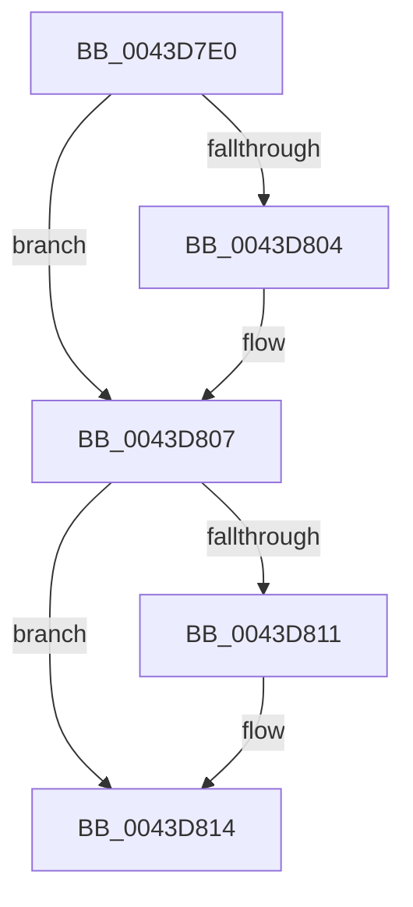

# FsRtlFindFirstOverlappingSharedNode

- RVA: `0x0043D7E0`–`0x0043D81C` (길이 `60` bytes)
- VA: `0x000000014043D7E0`
- 실행 섹션: `.text`
- PDB 이름 있음: `예`; PDB Function 태그: `아니요`
- unwind 정보 RVA: `0x000A487C`
- 디코드: `19`개 명령, `60/60` bytes 표시
- 미해석 바이트: `0` (있으면 어셈블리에 `.byte`로 보존)

> 이 문서는 커널 이미지의 기계어와 PDB 기호를 분석해 생성했습니다. 4번과 5번은 함수 원형과 자료형을 바이너리 사용 방식에서 추정한 C 해석이며 원본 소스 복구 결과는 아닙니다.

## 1. Dependencies

- 직접 호출 지점: **0**; 고유 호출 대상: **0**
- 직접 호출자로 확인된 함수: **1**
- RIP 상대 이미지 참조: **0**

### Outgoing calls
- 직접 디코드된 call 명령이 없습니다.

### Direct callers
- [FsRtlGetNextFileLock](../58/FsRtlGetNextFileLock_function_00581850.md) at `0x00581A53`

### Static image references
- 디코드된 RIP-relative 메모리 참조가 없습니다.

## 2. Other-region calls and transfers

- 다른 실행 섹션으로 향하는 call: **0**
- call이 아닌 외부 분기/꼬리 이동: **1**
  - `0x0043D81A` → [sub_0043D860](Unknown_function_0043D860.md) (`tail-transfer`)

## 3. Assembly (complete function range)

```asm
0043D7E0  48 89 5C 24 10                  mov qword ptr [rsp + 0x10], rbx
0043D7E5  48 89 6C 24 18                  mov qword ptr [rsp + 0x18], rbp
0043D7EA  48 89 74 24 20                  mov qword ptr [rsp + 0x20], rsi
0043D7EF  41 56                           push r14
0043D7F1  33 ED                           xor ebp, ebp
0043D7F3  49 8B F0                        mov rsi, r8
0043D7F6  4C 8B F2                        mov r14, rdx
0043D7F9  4C 8B D1                        mov r10, rcx
0043D7FC  44 8B DD                        mov r11d, ebp
0043D7FF  4D 85 C9                        test r9, r9
0043D802  74 03                           je 0x14043d807
0043D804  49 89 29                        mov qword ptr [r9], rbp
0043D807  48 8B 5C 24 30                  mov rbx, qword ptr [rsp + 0x30]
0043D80C  48 85 DB                        test rbx, rbx
0043D80F  74 03                           je 0x14043d814
0043D811  40 88 2B                        mov byte ptr [rbx], bpl
0043D814  48 8B C5                        mov rax, rbp
0043D817  48 85 C9                        test rcx, rcx
0043D81A  74 44                           je 0x14043d860
```

## 4. C-style interpretation (structured pseudocode)

```c
__int64 __fastcall FsRtlFindFirstOverlappingSharedNode(__int64 a1, __int64 a2, __int64 a3, __int64 a4, __int64 a5)
{
    __int64 v_rbp;
    unsigned __int64 v_stack_p10;
    unsigned __int64 v_stack_p18;
    unsigned __int64 v_stack_p20;

    v_stack_p10 = v_rbx;
    v_stack_p18 = v_rbp;
    v_stack_p20 = v_rsi;
    v_rbp = 0;
    if (a4 != 0) {
        *(unsigned __int64 *)(a4) = 0;
    }
    if (a5 != 0) {
        *(unsigned __int8 *)(a5) = 0;
    }
}
```

## 5. (Beta) C Style

```c
int64_t FsRtlFindFirstOverlappingSharedNode(int64_t Arg1, int64_t Arg2, int64_t Arg3, int64_t Arg4, int64_t Arg5)
{
    int64_t local_rbp;
    uint64_t v_stack_p10;
    uint64_t v_stack_p18;
    uint64_t v_stack_p20;

    v_stack_p10 = local_rbx;
    v_stack_p18 = local_rbp;
    v_stack_p20 = local_rsi;
    local_rbp = 0;
    if (Arg4 != 0) {
        *(uint64_t *)(Arg4) = 0;
    }
    if (Arg5 != 0) {
        *(uint8_t *)(Arg5) = 0;
    }
}
```

## 6. Execution-region graph

[열기: 2D/3D 그래프와 함수 탐색 컨트롤 패널](../../../control-panel.html?section=text&rva=0x0043D7E0&view=graph)

- 2D 그래프는 위에서 아래로 흐르고, 3D 그래프는 빈 공간을 드래그해 회전합니다. Shift+드래그는 이동, 휠은 확대·축소, 함수 노드 선택은 대상 보고서 이동입니다.

### Static fallback


