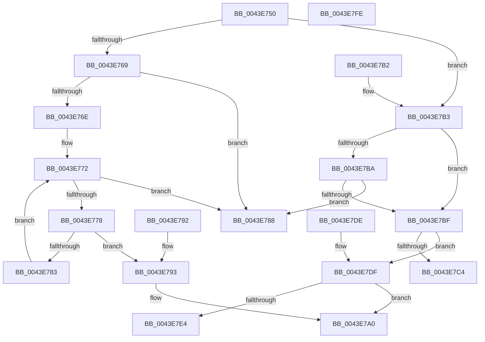

# HalRequestIpiSpecifyVector

- RVA: `0x0043E750`–`0x0043E7FF` (길이 `175` bytes)
- VA: `0x000000014043E750`
- 실행 섹션: `.text`
- PDB 이름 있음: `예`; PDB Function 태그: `아니요`
- unwind 정보 RVA: `0x000A4B50`
- 디코드: `53`개 명령, `175/175` bytes 표시
- 미해석 바이트: `0` (있으면 어셈블리에 `.byte`로 보존)

> 이 문서는 커널 이미지의 기계어와 PDB 기호를 분석해 생성했습니다. 4번과 5번은 함수 원형과 자료형을 바이너리 사용 방식에서 추정한 C 해석이며 원본 소스 복구 결과는 아닙니다.

## 1. Dependencies

- 직접 호출 지점: **3**; 고유 호출 대상: **1**
- 직접 호출자로 확인된 함수: **1**
- RIP 상대 이미지 참조: **0**

### Outgoing calls
- `0x0043E7A8` → [HalpInterruptSendIpi](../25/HalpInterruptSendIpi_function_00252310.md) (function, `0x00252310`)
- `0x0043E7D4` → [HalpInterruptSendIpi](../25/HalpInterruptSendIpi_function_00252310.md) (function, `0x00252310`)
- `0x0043E7F4` → [HalpInterruptSendIpi](../25/HalpInterruptSendIpi_function_00252310.md) (function, `0x00252310`)

### Direct callers
- [HalpReboot](../54/HalpReboot_function_00546870.md) at `0x00546917`

### Static image references
- 디코드된 RIP-relative 메모리 참조가 없습니다.

## 2. Other-region calls and transfers

- 다른 실행 섹션으로 향하는 call: **0**
- 별도 외부 분기/꼬리 이동을 확인하지 못했습니다.

## 3. Assembly (complete function range)

```asm
0043E750  48 83 EC 48                     sub rsp, 0x48
0043E754  33 C0                           xor eax, eax
0043E756  0F 57 C0                        xorps xmm0, xmm0
0043E759  89 44 24 30                     mov dword ptr [rsp + 0x30], eax
0043E75D  45 8B C8                        mov r9d, r8d
0043E760  0F 11 44 24 20                  movups xmmword ptr [rsp + 0x20], xmm0
0043E765  85 C9                           test ecx, ecx
0043E767  75 4A                           jne 0x14043e7b3
0043E769  48 85 D2                        test rdx, rdx
0043E76C  74 1A                           je 0x14043e788
0043E76E  44 0F B7 02                     movzx r8d, word ptr [rdx]
0043E772  66 41 3B C0                     cmp ax, r8w
0043E776  73 10                           jae 0x14043e788
0043E778  0F B7 C8                        movzx ecx, ax
0043E77B  48 83 7C CA 08 00               cmp qword ptr [rdx + rcx*8 + 8], 0
0043E781  75 10                           jne 0x14043e793
0043E783  66 FF C0                        inc ax
0043E786  EB EA                           jmp 0x14043e772
0043E788  B8 0D 00 00 C0                  mov eax, 0xc000000d
0043E78D  48 83 C4 48                     add rsp, 0x48
0043E791  C3                              ret
0043E792  CC                              int3
0043E793  C7 44 24 20 02 00 00 00         mov dword ptr [rsp + 0x20], 2
0043E79B  48 89 54 24 28                  mov qword ptr [rsp + 0x28], rdx
0043E7A0  41 8B D1                        mov edx, r9d
0043E7A3  48 8D 4C 24 20                  lea rcx, [rsp + 0x20]
0043E7A8  E8 63 3B E1 FF                  call 0x140252310
0043E7AD  48 83 C4 48                     add rsp, 0x48
0043E7B1  C3                              ret
0043E7B2  CC                              int3
0043E7B3  8B D1                           mov edx, ecx
0043E7B5  83 EA 01                        sub edx, 1
0043E7B8  74 05                           je 0x14043e7bf
0043E7BA  83 FA 01                        cmp edx, 1
0043E7BD  75 C9                           jne 0x14043e788
0043E7BF  83 E9 01                        sub ecx, 1
0043E7C2  75 1B                           jne 0x14043e7df
0043E7C4  41 8B D1                        mov edx, r9d
0043E7C7  C7 44 24 20 04 00 00 00         mov dword ptr [rsp + 0x20], 4
0043E7CF  48 8D 4C 24 20                  lea rcx, [rsp + 0x20]
0043E7D4  E8 37 3B E1 FF                  call 0x140252310
0043E7D9  48 83 C4 48                     add rsp, 0x48
0043E7DD  C3                              ret
0043E7DE  CC                              int3
0043E7DF  83 F9 01                        cmp ecx, 1
0043E7E2  75 BC                           jne 0x14043e7a0
0043E7E4  41 8B D1                        mov edx, r9d
0043E7E7  C7 44 24 20 03 00 00 00         mov dword ptr [rsp + 0x20], 3
0043E7EF  48 8D 4C 24 20                  lea rcx, [rsp + 0x20]
0043E7F4  E8 17 3B E1 FF                  call 0x140252310
0043E7F9  48 83 C4 48                     add rsp, 0x48
0043E7FD  C3                              ret
0043E7FE  CC                              int3
```

## 4. C-style interpretation (structured pseudocode)

```c
__int64 __fastcall HalRequestIpiSpecifyVector(int a1, __int64 a2, int a3)
{
    __int64 result;
    __int64 v_rsp;
    unsigned int v_stack_m18;
    unsigned __int64 v_stack_m28;
    unsigned int v_stack_p20;
    unsigned __int64 v_stack_p28;
    unsigned int v_stack_p68;
    unsigned int v_stack_pB0;

    v_rsp = (v_rsp) - (72);
    result = 0;
    v_stack_m18 = 0;
    v_stack_m28 = v_xmm0;
    if (a1 != 0) goto loc_0043E7B3;
    if (a2 == 0) goto loc_0043E788;
loc_0043E772:
    if (0 >= ((unsigned __int16)(*(unsigned __int16 *)(a2)))) goto loc_0043E788;
    if ((*(unsigned __int64 *)(a2 + 0 * 8 + 8)) != 0) goto loc_0043E793;
    result = (unsigned __int16)((result) + 1);
    goto loc_0043E772;
loc_0043E788:
    v_rsp = (v_rsp) + (72);
    return (unsigned int)(0xC000000DULL);
loc_0043E793:
    v_stack_p20 = 2;
    v_stack_p28 = a2;
loc_0043E7A0:
    result = HalpInterruptSendIpi(v_stack_p20, (unsigned int)((unsigned int)((unsigned int)(a3))), *(unsigned __int16 *)(a2), (unsigned int)(a3));
    v_rsp = (v_rsp) + (72);
    return result;
loc_0043E7B3:
    a2 = (unsigned int)(((unsigned int)((unsigned int)(v_stack_p20))) - (1));
    if (condition_is_equal) goto loc_0043E7BF;
    if (((unsigned int)(a2)) != 1) goto loc_0043E788;
loc_0043E7BF:
    a1 = (unsigned int)((v_stack_p20) - (1));
    if (condition_is_not_equal) goto loc_0043E7DF;
    v_stack_p68 = 4;
    result = HalpInterruptSendIpi(v_stack_p68, (unsigned int)((unsigned int)((unsigned int)(a3))), *(unsigned __int16 *)(a2), (unsigned int)(a3));
    v_rsp = (v_rsp) + (72);
    return result;
loc_0043E7DF:
    if (((unsigned int)(v_stack_p68)) != 1) goto loc_0043E7A0;
    v_stack_pB0 = 3;
    result = HalpInterruptSendIpi(v_stack_pB0, (unsigned int)((unsigned int)((unsigned int)(a3))), *(unsigned __int16 *)(a2), (unsigned int)(a3));
    v_rsp = (v_rsp) + (72);
    return result;
}
```

## 5. (Beta) C Style

```c
int64_t HalRequestIpiSpecifyVector(int32_t Arg1, int64_t Arg2, int32_t Arg3)
{
    int64_t result;
    int64_t local_rsp;
    uint32_t v_stack_m18;
    uint64_t v_stack_m28;
    uint32_t v_stack_p20;
    uint64_t v_stack_p28;
    uint32_t v_stack_p68;
    uint32_t v_stack_pB0;

    local_rsp = (local_rsp) - (72);
    result = 0;
    v_stack_m18 = 0;
    v_stack_m28 = v_xmm0;
    if (Arg1 != 0) goto loc_0043E7B3;
    if (Arg2 == 0) goto loc_0043E788;
loc_0043E772:
    if (0 >= ((uint16_t)(*(uint16_t *)(Arg2)))) goto loc_0043E788;
    if ((*(uint64_t *)(Arg2 + 0x0 * 8 + 0x8)) != 0) goto loc_0043E793;
    result = (uint16_t)((result) + 1);
    goto loc_0043E772;
loc_0043E788:
    local_rsp = (local_rsp) + (72);
    return (uint32_t)(0xC000000DULL);
loc_0043E793:
    v_stack_p20 = 2;
    v_stack_p28 = Arg2;
loc_0043E7A0:
    result = HalpInterruptSendIpi(v_stack_p20, (uint32_t)((uint32_t)((uint32_t)(Arg3))), *(uint16_t *)(Arg2), (uint32_t)(Arg3));
    local_rsp = (local_rsp) + (72);
    return result;
loc_0043E7B3:
    Arg2 = (uint32_t)(((uint32_t)((uint32_t)(v_stack_p20))) - (1));
    if (condition_is_equal) goto loc_0043E7BF;
    if (((uint32_t)(Arg2)) != 1) goto loc_0043E788;
loc_0043E7BF:
    Arg1 = (uint32_t)((v_stack_p20) - (1));
    if (condition_is_not_equal) goto loc_0043E7DF;
    v_stack_p68 = 4;
    result = HalpInterruptSendIpi(v_stack_p68, (uint32_t)((uint32_t)((uint32_t)(Arg3))), *(uint16_t *)(Arg2), (uint32_t)(Arg3));
    local_rsp = (local_rsp) + (72);
    return result;
loc_0043E7DF:
    if (((uint32_t)(v_stack_p68)) != 1) goto loc_0043E7A0;
    v_stack_pB0 = 3;
    result = HalpInterruptSendIpi(v_stack_pB0, (uint32_t)((uint32_t)((uint32_t)(Arg3))), *(uint16_t *)(Arg2), (uint32_t)(Arg3));
    local_rsp = (local_rsp) + (72);
    return result;
}
```

## 6. Execution-region graph

[열기: 2D/3D 그래프와 함수 탐색 컨트롤 패널](../../../control-panel.html?section=text&rva=0x0043E750&view=graph)

- 2D 그래프는 위에서 아래로 흐르고, 3D 그래프는 빈 공간을 드래그해 회전합니다. Shift+드래그는 이동, 휠은 확대·축소, 함수 노드 선택은 대상 보고서 이동입니다.

### Static fallback


