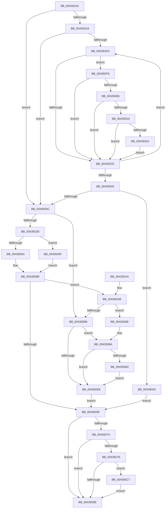

# HaliPciInterfaceReadConfig

- RVA: `0x004391A0`–`0x004393D2` (길이 `562` bytes)
- VA: `0x00000001404391A0`
- 실행 섹션: `.text`
- PDB 이름 있음: `예`; PDB Function 태그: `아니요`
- unwind 정보 RVA: `0x000A40F4`
- 디코드: `141`개 명령, `562/562` bytes 표시
- 미해석 바이트: `0` (있으면 어셈블리에 `.byte`로 보존)

> 이 문서는 커널 이미지의 기계어와 PDB 기호를 분석해 생성했습니다. 4번과 5번은 함수 원형과 자료형을 바이너리 사용 방식에서 추정한 C 해석이며 원본 소스 복구 결과는 아닙니다.

## 1. Dependencies

- 직접 호출 지점: **9**; 고유 호출 대상: **8**
- 직접 호출자로 확인된 함수: **2**
- RIP 상대 이미지 참조: **6**

### Outgoing calls
- `0x00439266` → [VslAccessPciDevice](VslAccessPciDevice_function_004393E0.md) (function, `0x004393E0`)
- `0x004392BB` → [HalpPCIAcquireConfigSpaceLock](HalpPCIAcquireConfigSpaceLock_function_004394CC.md) (function, `0x004394CC`)
- `0x004392DB` → [HalpPciAccessMmConfigSpace](../23/HalpPciAccessMmConfigSpace_function_0023683C.md) (function, `0x0023683C`)
- `0x004392EC` → [HalpPCIReleaseConfigSpaceLock](../23/HalpPCIReleaseConfigSpaceLock_function_002362D8.md) (function, `0x002362D8`)
- `0x00439355` → [memset](../6C/memset_function_006C6C40.md) (function, `0x006C6C40`)
- `0x00439364` → [guard_dispatch_icall](../6B/guard_dispatch_icall_function_006BAAD0.md) (function, `0x006BAAD0`)
- `0x00439384` → [KeBugCheckEx](../4F/KeBugCheckEx_function_004FD660.md) (function, `0x004FD660`)
- `0x004393A5` → [HalpPciAccessIoConfigSpace](../55/HalpPciAccessIoConfigSpace_function_00553948.md) (function, `0x00553948`)
- `0x004393BD` → [memset](../6C/memset_function_006C6C40.md) (function, `0x006C6C40`)

### Direct callers
- [HaliHandlePCIConfigSpaceAccess](../56/HaliHandlePCIConfigSpaceAccess_function_00563110.md) at `0x0056319D`
- [HalpKdReadPCIConfig](../56/HalpKdReadPCIConfig_function_0056E850.md) at `0x0056E86B`

### Static image references
- `0x004391C5` → RVA `0x00FC1750` (`.data`; read)
- `0x004391D4` → RVA `0x00FC1740` (`.data`; read)
- `0x0043920C` → RVA `0x00FC1D48` (`.data`; read)
- `0x00439230` → RVA `0x004393E0` (`VslAccessPciDevice`; read)
- `0x00439282` → RVA `0x00E103FC` (`.data`; read)
- `0x004393C7` → RVA `0x00E103FC` (`.data`; write)

## 2. Other-region calls and transfers

- 다른 실행 섹션으로 향하는 call: **0**
- 별도 외부 분기/꼬리 이동을 확인하지 못했습니다.

## 3. Assembly (complete function range)

```asm
004391A0  48 8B C4                        mov rax, rsp
004391A3  48 89 58 08                     mov qword ptr [rax + 8], rbx
004391A7  48 89 68 18                     mov qword ptr [rax + 0x18], rbp
004391AB  48 89 70 20                     mov qword ptr [rax + 0x20], rsi
004391AF  57                              push rdi
004391B0  41 56                           push r14
004391B2  41 57                           push r15
004391B4  48 83 EC 50                     sub rsp, 0x50
004391B8  44 8B F2                        mov r14d, edx
004391BB  41 8B E8                        mov ebp, r8d
004391BE  41 C1 EE 08                     shr r14d, 8
004391C2  49 8B F9                        mov rdi, r9
004391C5  80 3D 84 85 B8 00 00            cmp byte ptr [rip + 0xb88584], 0
004391CC  8B F2                           mov esi, edx
004391CE  C6 40 10 00                     mov byte ptr [rax + 0x10], 0
004391D2  75 38                           jne 0x14043920c
004391D4  48 8B 0D 65 85 B8 00            mov rcx, qword ptr [rip + 0xb88565]
004391DB  4C 8D 15 5E 85 B8 00            lea r10, [rip + 0xb8855e]
004391E2  45 32 C0                        xor r8b, r8b
004391E5  49 3B CA                        cmp rcx, r10
004391E8  74 22                           je 0x14043920c
004391EA  48 8D 11                        lea rdx, [rcx]
004391ED  48 8B 09                        mov rcx, qword ptr [rcx]
004391F0  8B 82 D8 01 00 00               mov eax, dword ptr [rdx + 0x1d8]
004391F6  A8 08                           test al, 8
004391F8  0F 85 F8 00 00 00               jne 0x1404392f6
004391FE  49 3B CA                        cmp rcx, r10
00439201  75 E7                           jne 0x1404391ea
00439203  45 84 C0                        test r8b, r8b
00439206  0F 85 37 01 00 00               jne 0x140439343
0043920C  4C 8B 15 35 8B B8 00            mov r10, qword ptr [rip + 0xb88b35]
00439213  8B 9C 24 98 00 00 00            mov ebx, dword ptr [rsp + 0x98]
0043921A  44 8B BC 24 90 00 00 00         mov r15d, dword ptr [rsp + 0x90]
00439222  4D 85 D2                        test r10, r10
00439225  0F 84 8B 00 00 00               je 0x1404392b6
0043922B  48 89 7C 24 38                  mov qword ptr [rsp + 0x38], rdi
00439230  48 8D 0D A9 01 00 00            lea rcx, [rip + 0x1a9]
00439237  89 5C 24 30                     mov dword ptr [rsp + 0x30], ebx
0043923B  8B C5                           mov eax, ebp
0043923D  C1 E8 05                        shr eax, 5
00439240  44 8B CD                        mov r9d, ebp
00439243  83 E0 07                        and eax, 7
00439246  44 89 7C 24 28                  mov dword ptr [rsp + 0x28], r15d
0043924B  41 83 E1 1F                     and r9d, 0x1f
0043924F  44 0F B6 C6                     movzx r8d, sil
00439253  41 0F B7 D6                     movzx edx, r14w
00439257  89 44 24 20                     mov dword ptr [rsp + 0x20], eax
0043925B  4C 3B D1                        cmp r10, rcx
0043925E  0F 85 FB 00 00 00               jne 0x14043935f
00439264  33 C9                           xor ecx, ecx
00439266  E8 75 01 00 00                  call 0x1404393e0
0043926B  85 C0                           test eax, eax
0043926D  78 3C                           js 0x1404392ab
0043926F  83 FB 02                        cmp ebx, 2
00439272  72 1A                           jb 0x14043928e
00439274  B8 FF FF 00 00                  mov eax, 0xffff
00439279  66 39 07                        cmp word ptr [rdi], ax
0043927C  74 10                           je 0x14043928e
0043927E  40 0F B6 CE                     movzx ecx, sil
00439282  3B 0D 74 71 9D 00               cmp ecx, dword ptr [rip + 0x9d7174]
00439288  0F 87 39 01 00 00               ja 0x1404393c7
0043928E  4C 8D 5C 24 50                  lea r11, [rsp + 0x50]
00439293  8B C3                           mov eax, ebx
00439295  49 8B 5B 20                     mov rbx, qword ptr [r11 + 0x20]
00439299  49 8B 6B 30                     mov rbp, qword ptr [r11 + 0x30]
0043929D  49 8B 73 38                     mov rsi, qword ptr [r11 + 0x38]
004392A1  49 8B E3                        mov rsp, r11
004392A4  41 5F                           pop r15
004392A6  41 5E                           pop r14
004392A8  5F                              pop rdi
004392A9  C3                              ret
004392AA  CC                              int3
004392AB  3D 02 00 00 C0                  cmp eax, 0xc0000002
004392B0  0F 85 B8 00 00 00               jne 0x14043936e
004392B6  48 8D 4C 24 78                  lea rcx, [rsp + 0x78]
004392BB  E8 0C 02 00 00                  call 0x1404394cc
004392C0  83 64 24 30 00                  and dword ptr [rsp + 0x30], 0
004392C5  4C 8B CF                        mov r9, rdi
004392C8  89 5C 24 28                     mov dword ptr [rsp + 0x28], ebx
004392CC  44 8B C5                        mov r8d, ebp
004392CF  40 8A D6                        mov dl, sil
004392D2  44 89 7C 24 20                  mov dword ptr [rsp + 0x20], r15d
004392D7  41 0F B7 CE                     movzx ecx, r14w
004392DB  E8 5C D5 DF FF                  call 0x14023683c
004392E0  84 C0                           test al, al
004392E2  0F 84 A2 00 00 00               je 0x14043938a
004392E8  8A 4C 24 78                     mov cl, byte ptr [rsp + 0x78]
004392EC  E8 E7 CF DF FF                  call 0x1402362d8
004392F1  E9 79 FF FF FF                  jmp 0x14043926f
004392F6  41 0F B7 C6                     movzx eax, r14w
004392FA  39 82 E0 01 00 00               cmp dword ptr [rdx + 0x1e0], eax
00439300  0F 85 F8 FE FF FF               jne 0x1404391fe
00439306  40 0F B6 C6                     movzx eax, sil
0043930A  39 82 E4 01 00 00               cmp dword ptr [rdx + 0x1e4], eax
00439310  0F 85 E8 FE FF FF               jne 0x1404391fe
00439316  44 8B 8A E8 01 00 00            mov r9d, dword ptr [rdx + 0x1e8]
0043931D  41 8B C1                        mov eax, r9d
00439320  33 C5                           xor eax, ebp
00439322  A8 1F                           test al, 0x1f
00439324  0F 85 D4 FE FF FF               jne 0x1404391fe
0043932A  44 32 CD                        xor r9b, bpl
0043932D  45 0F B6 C0                     movzx r8d, r8b
00439331  41 F6 C1 E0                     test r9b, 0xe0
00439335  B8 01 00 00 00                  mov eax, 1
0043933A  44 0F 44 C0                     cmove r8d, eax
0043933E  E9 BB FE FF FF                  jmp 0x1404391fe
00439343  8B 9C 24 98 00 00 00            mov ebx, dword ptr [rsp + 0x98]
0043934A  BA FF 00 00 00                  mov edx, 0xff
0043934F  44 8B C3                        mov r8d, ebx
00439352  48 8B CF                        mov rcx, rdi
00439355  E8 E6 D8 28 00                  call 0x1406c6c40
0043935A  E9 10 FF FF FF                  jmp 0x14043926f
0043935F  33 C9                           xor ecx, ecx
00439361  49 8B C2                        mov rax, r10
00439364  E8 67 17 28 00                  call 0x1406baad0
00439369  E9 FD FE FF FF                  jmp 0x14043926b
0043936E  48 98                           cdqe
00439370  4D 8B CF                        mov r9, r15
00439373  4C 8B C5                        mov r8, rbp
00439376  40 0F B6 D6                     movzx edx, sil
0043937A  B9 C0 00 00 00                  mov ecx, 0xc0
0043937F  48 89 44 24 20                  mov qword ptr [rsp + 0x20], rax
00439384  E8 D7 42 0C 00                  call 0x1404fd660
00439389  CC                              int3
0043938A  83 64 24 30 00                  and dword ptr [rsp + 0x30], 0
0043938F  4C 8B CF                        mov r9, rdi
00439392  89 5C 24 28                     mov dword ptr [rsp + 0x28], ebx
00439396  44 8B C5                        mov r8d, ebp
00439399  40 8A D6                        mov dl, sil
0043939C  44 89 7C 24 20                  mov dword ptr [rsp + 0x20], r15d
004393A1  41 0F B7 CE                     movzx ecx, r14w
004393A5  E8 9E A5 11 00                  call 0x140553948
004393AA  84 C0                           test al, al
004393AC  0F 85 36 FF FF FF               jne 0x1404392e8
004393B2  4C 8B C3                        mov r8, rbx
004393B5  BA FF 00 00 00                  mov edx, 0xff
004393BA  48 8B CF                        mov rcx, rdi
004393BD  E8 7E D8 28 00                  call 0x1406c6c40
004393C2  E9 21 FF FF FF                  jmp 0x1404392e8
004393C7  89 0D 2F 70 9D 00               mov dword ptr [rip + 0x9d702f], ecx
004393CD  E9 BC FE FF FF                  jmp 0x14043928e
```

## 4. C-style interpretation (structured pseudocode)

```c
__int64 __fastcall HaliPciInterfaceReadConfig(__int64 a1, int a2, int a3, __int64 a4, unsigned int a5, unsigned int a6)
{
    __int64 result;
    __int64 v_r14;
    __int64 v_rsp;
    unsigned __int64 v_stack_m18;
    unsigned int v_stack_m20;
    unsigned int v_stack_m28;
    unsigned __int64 v_stack_m30;
    unsigned int v_stack_m38;
    unsigned int v_stack_m40;
    unsigned int v_stack_m48;
    unsigned __int64 v_stack_p28;

    *(unsigned __int64 *)(v_rsp + 8) = v_rbx;
    *(unsigned __int64 *)(v_rsp + 24) = v_rbp;
    *(unsigned __int64 *)(v_rsp + 32) = v_rsi;
    v_rsp = (v_rsp) - (80);
    v_r14 = (unsigned int)(((unsigned int)(a2)) >> (8));
    *(unsigned __int8 *)(v_rsp + 16) = 0;
    if ((*(unsigned __int8 *)(v_rip + 12092804)) != 0) goto loc_0043920C;
    a3 = 0;
    if ((*(unsigned __int64 *)(v_rip + 12092773)) == (v_rip + 12092766)) goto loc_0043920C;
loc_004391EA:
    if ((((unsigned __int8)((unsigned int)(*(unsigned int *)(*(unsigned __int64 *)(v_rip + 12092773) + 472)))) & (8)) != 0) goto loc_004392F6;
loc_004391FE:
    if ((*(unsigned __int64 *)(*(unsigned __int64 *)(v_rip + 12092773))) != (v_rip + 12092766)) goto loc_004391EA;
    if (0 != 0) goto loc_00439343;
loc_0043920C:
    if (*(unsigned __int64 *)(v_rip + 12094261) == 0) goto loc_004392B6;
    v_stack_m30 = a4;
    v_stack_m38 = (unsigned int)((unsigned int)(a6));
    result = (unsigned int)(((unsigned int)((unsigned int)((unsigned int)(a3)))) >> (5));
    result = (unsigned int)((result) & (7));
    v_stack_m40 = (unsigned int)((unsigned int)(a5));
    a4 = (unsigned int)(((unsigned int)((unsigned int)((unsigned int)(a3)))) & (31));
    v_stack_m48 = (unsigned int)(result);
    if ((*(unsigned __int64 *)(v_rip + 12094261)) != (v_rip + 425)) goto loc_0043935F;
    a1 = 0;
    result = VslAccessPciDevice(a1, (unsigned __int16)(v_r14), (unsigned __int8)((unsigned int)(a2)), a4);
loc_0043926B:
    if (sign_flag) goto loc_004392AB;
loc_0043926F:
    if (((unsigned int)((unsigned int)(a6))) < 2) goto loc_0043928E;
    if ((*(unsigned __int16 *)(a4)) == ((unsigned __int16)((unsigned int)(0xFFFFULL)))) goto loc_0043928E;
    if (((unsigned int)((unsigned __int8)((unsigned int)(a2)))) > (*(unsigned int *)(v_rip + 10318196))) goto loc_004393C7;
loc_0043928E:
    return (unsigned int)((unsigned int)((unsigned int)(a6)));
loc_004392AB:
    if (((unsigned int)((unsigned int)((unsigned int)((unsigned int)(a6))))) != 0xC0000002ULL) goto loc_0043936E;
loc_004392B6:
    result = HalpPCIAcquireConfigSpaceLock(v_stack_p28, (unsigned __int16)(v_r14), (unsigned __int8)((unsigned int)(a2)), a4);
    v_stack_m28 = (unsigned int)(*(unsigned __int64 *)(v_stack_m18 + 32));
    v_stack_m30 = (unsigned int)((unsigned int)(a5));
    result = HalpPciAccessMmConfigSpace((unsigned __int16)(v_r14), (unsigned __int8)(*(unsigned __int64 *)(v_stack_m18 + 56)), (unsigned int)((unsigned int)(*(unsigned __int64 *)(v_stack_m18 + 48))), a4);
    if ((unsigned __int8)(result) == 0) goto loc_0043938A;
loc_004392E8:
    result = HalpPCIReleaseConfigSpaceLock(v_stack_p28, (unsigned __int8)(*(unsigned __int64 *)(v_stack_m18 + 56)), (unsigned int)((unsigned int)(*(unsigned __int64 *)(v_stack_m18 + 48))), a4);
    goto loc_0043926F;
loc_004392F6:
    if ((*(unsigned int *)((unsigned __int8)(*(unsigned __int64 *)(v_stack_m18 + 56)) + 480)) != ((unsigned int)((unsigned __int16)(v_r14)))) goto loc_004391FE;
    if ((*(unsigned int *)((unsigned __int8)(*(unsigned __int64 *)(v_stack_m18 + 56)) + 484)) != ((unsigned int)((unsigned __int8)(*(unsigned __int64 *)(v_stack_m18 + 56))))) goto loc_004391FE;
    result = (unsigned int)(((unsigned int)((unsigned int)((unsigned int)(*(unsigned int *)((unsigned __int8)(*(unsigned __int64 *)(v_stack_m18 + 56)) + 488))))) ^ ((unsigned int)(*(unsigned __int64 *)(v_stack_m18 + 48))));
    if ((((unsigned __int8)(result)) & (31)) != 0) goto loc_004391FE;
    a4 = (unsigned __int8)(((unsigned int)(*(unsigned int *)((unsigned __int8)(*(unsigned __int64 *)(v_stack_m18 + 56)) + 488))) ^ ((unsigned __int8)(*(unsigned __int64 *)(v_stack_m18 + 48))));
    a3 = (unsigned __int8)((unsigned int)((unsigned int)(*(unsigned __int64 *)(v_stack_m18 + 48))));
    if ((((unsigned __int8)(a4)) & (224)) == 0) { a3 = 1; }
    goto loc_004391FE;
loc_00439343:
    result = memset(a4, 255, (unsigned int)((unsigned int)((unsigned int)(a6))), a4);
    goto loc_0043926F;
loc_0043935F:
    a1 = 0;
    result = guard_dispatch_icall(a1, 255, (unsigned int)((unsigned int)((unsigned int)(a6))), a4);
    goto loc_0043926B;
loc_0043936E:
    v_stack_m30 = result;
    result = KeBugCheckEx(192, (unsigned __int8)(*(unsigned __int64 *)(v_stack_m18 + 56)), *(unsigned __int64 *)(v_stack_m18 + 48), (unsigned int)(a5));
loc_0043938A:
    v_stack_m28 = (unsigned int)((unsigned int)(a6));
    v_stack_m30 = (unsigned int)((unsigned int)(a5));
    result = HalpPciAccessIoConfigSpace((unsigned __int16)(v_r14), (unsigned __int8)(*(unsigned __int64 *)(v_stack_m18 + 56)), (unsigned int)((unsigned int)(*(unsigned __int64 *)(v_stack_m18 + 48))), a4);
    if ((unsigned __int8)(result) != 0) goto loc_004392E8;
    result = memset(a4, 255, (unsigned int)(a6), a4);
    goto loc_004392E8;
loc_004393C7:
    *(unsigned int *)(v_rip + 10317871) = (unsigned int)(a4);
    goto loc_0043928E;
}
```

## 5. (Beta) C Style

```c
int64_t HaliPciInterfaceReadConfig(int64_t Arg1, int32_t Arg2, int32_t Arg3, void *Arg4, uint32_t Arg5, uint32_t Arg6)
{
    uint8_t *arg4 = (uint8_t *)Arg4;

    int64_t result;
    int64_t local_r14;
    int64_t local_rsp;
    uint64_t v_stack_m18;
    uint32_t v_stack_m20;
    uint32_t v_stack_m28;
    uint64_t v_stack_m30;
    uint32_t v_stack_m38;
    uint32_t v_stack_m40;
    uint32_t v_stack_m48;
    uint64_t v_stack_p28;

    *(uint64_t *)(local_rsp + 0x8) = local_rbx;
    *(uint64_t *)(local_rsp + 0x18) = local_rbp;
    *(uint64_t *)(local_rsp + 0x20) = local_rsi;
    local_rsp = (local_rsp) - (80);
    local_r14 = (uint32_t)(((uint32_t)(Arg2)) >> (8));
    *(uint8_t *)(local_rsp + 0x10) = 0;
    if ((*(uint8_t *)(v_rip + 0xB88584)) != 0) goto loc_0043920C;
    Arg3 = 0;
    if ((*(uint64_t *)(v_rip + 0xB88565)) == (v_rip + 12092766)) goto loc_0043920C;
loc_004391EA:
    if ((((uint8_t)((uint32_t)(*(uint32_t *)(*(uint64_t *)(v_rip + 0xB88565) + 0x1D8)))) & (8)) != 0) goto loc_004392F6;
loc_004391FE:
    if ((*(uint64_t *)(*(uint64_t *)(v_rip + 0xB88565))) != (v_rip + 12092766)) goto loc_004391EA;
    if (0 != 0) goto loc_00439343;
loc_0043920C:
    if (*(uint64_t *)(v_rip + 0xB88B35) == 0) goto loc_004392B6;
    v_stack_m30 = Arg4;
    v_stack_m38 = (uint32_t)((uint32_t)(Arg6));
    result = (uint32_t)(((uint32_t)((uint32_t)((uint32_t)(Arg3)))) >> (5));
    result = (uint32_t)((result) & (7));
    v_stack_m40 = (uint32_t)((uint32_t)(Arg5));
    Arg4 = (uint32_t)(((uint32_t)((uint32_t)((uint32_t)(Arg3)))) & (31));
    v_stack_m48 = (uint32_t)(result);
    if ((*(uint64_t *)(v_rip + 0xB88B35)) != (v_rip + 425)) goto loc_0043935F;
    Arg1 = 0;
    result = VslAccessPciDevice(Arg1, (uint16_t)(local_r14), (uint8_t)((uint32_t)(Arg2)), Arg4);
loc_0043926B:
    if (sign_flag) goto loc_004392AB;
loc_0043926F:
    if (((uint32_t)((uint32_t)(Arg6))) < 2) goto loc_0043928E;
    if ((*(uint16_t *)(arg4)) == ((uint16_t)((uint32_t)(0xFFFFULL)))) goto loc_0043928E;
    if (((uint32_t)((uint8_t)((uint32_t)(Arg2)))) > (*(uint32_t *)(v_rip + 0x9D7174))) goto loc_004393C7;
loc_0043928E:
    return (uint32_t)((uint32_t)((uint32_t)(Arg6)));
loc_004392AB:
    if (((uint32_t)((uint32_t)((uint32_t)((uint32_t)(Arg6))))) != 0xC0000002ULL) goto loc_0043936E;
loc_004392B6:
    result = HalpPCIAcquireConfigSpaceLock(v_stack_p28, (uint16_t)(local_r14), (uint8_t)((uint32_t)(Arg2)), Arg4);
    v_stack_m28 = (uint32_t)(*(uint64_t *)(v_stack_m18 + 0x20));
    v_stack_m30 = (uint32_t)((uint32_t)(Arg5));
    result = HalpPciAccessMmConfigSpace((uint16_t)(local_r14), (uint8_t)(*(uint64_t *)(v_stack_m18 + 0x38)), (uint32_t)((uint32_t)(*(uint64_t *)(v_stack_m18 + 0x30))), Arg4);
    if ((uint8_t)(result) == 0) goto loc_0043938A;
loc_004392E8:
    result = HalpPCIReleaseConfigSpaceLock(v_stack_p28, (uint8_t)(*(uint64_t *)(v_stack_m18 + 0x38)), (uint32_t)((uint32_t)(*(uint64_t *)(v_stack_m18 + 0x30))), Arg4);
    goto loc_0043926F;
loc_004392F6:
    if ((*(uint32_t *)((uint8_t)(*(uint64_t *)(v_stack_m18 + 0x38)) + 0x1E0)) != ((uint32_t)((uint16_t)(local_r14)))) goto loc_004391FE;
    if ((*(uint32_t *)((uint8_t)(*(uint64_t *)(v_stack_m18 + 0x38)) + 0x1E4)) != ((uint32_t)((uint8_t)(*(uint64_t *)(v_stack_m18 + 0x38))))) goto loc_004391FE;
    result = (uint32_t)(((uint32_t)((uint32_t)((uint32_t)(*(uint32_t *)((uint8_t)(*(uint64_t *)(v_stack_m18 + 0x38)) + 0x1E8))))) ^ ((uint32_t)(*(uint64_t *)(v_stack_m18 + 0x30))));
    if ((((uint8_t)(result)) & (31)) != 0) goto loc_004391FE;
    Arg4 = (uint8_t)(((uint32_t)(*(uint32_t *)((uint8_t)(*(uint64_t *)(v_stack_m18 + 0x38)) + 0x1E8))) ^ ((uint8_t)(*(uint64_t *)(v_stack_m18 + 0x30))));
    Arg3 = (uint8_t)((uint32_t)((uint32_t)(*(uint64_t *)(v_stack_m18 + 0x30))));
    if ((((uint8_t)(Arg4)) & (224)) == 0) { Arg3 = 1; }
    goto loc_004391FE;
loc_00439343:
    result = memset(Arg4, 255, (uint32_t)((uint32_t)((uint32_t)(Arg6))), Arg4);
    goto loc_0043926F;
loc_0043935F:
    Arg1 = 0;
    result = guard_dispatch_icall(Arg1, 255, (uint32_t)((uint32_t)((uint32_t)(Arg6))), Arg4);
    goto loc_0043926B;
loc_0043936E:
    v_stack_m30 = result;
    result = KeBugCheckEx(192, (uint8_t)(*(uint64_t *)(v_stack_m18 + 0x38)), *(uint64_t *)(v_stack_m18 + 0x30), (uint32_t)(Arg5));
loc_0043938A:
    v_stack_m28 = (uint32_t)((uint32_t)(Arg6));
    v_stack_m30 = (uint32_t)((uint32_t)(Arg5));
    result = HalpPciAccessIoConfigSpace((uint16_t)(local_r14), (uint8_t)(*(uint64_t *)(v_stack_m18 + 0x38)), (uint32_t)((uint32_t)(*(uint64_t *)(v_stack_m18 + 0x30))), Arg4);
    if ((uint8_t)(result) != 0) goto loc_004392E8;
    result = memset(Arg4, 255, (uint32_t)(Arg6), Arg4);
    goto loc_004392E8;
loc_004393C7:
    *(uint32_t *)(v_rip + 0x9D702F) = (uint32_t)(Arg4);
    goto loc_0043928E;
}
```

### 관측된 메모리 오프셋

구조체 형식이 확인되지 않은 접근은 인자 기준의 오프셋으로만 기록했습니다.

| 기준 인자 | 오프셋 표현 | 폭 (bit) | 접근 |
|---|---:|---:|---|
| `Arg4` | `+ 0x0` | `16` | `R` |

## 6. Execution-region graph

[열기: 2D/3D 그래프와 함수 탐색 컨트롤 패널](../../../control-panel.html?section=text&rva=0x004391A0&view=graph)

- 2D 그래프는 위에서 아래로 흐르고, 3D 그래프는 빈 공간을 드래그해 회전합니다. Shift+드래그는 이동, 휠은 확대·축소, 함수 노드 선택은 대상 보고서 이동입니다.

### Static fallback


