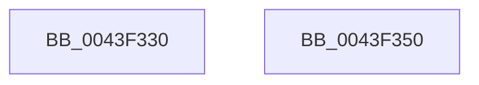

# HalpAcpiPmRegisterAvailable

- RVA: `0x0043F330`–`0x0043F351` (길이 `33` bytes)
- VA: `0x000000014043F330`
- 실행 섹션: `.text`
- PDB 이름 있음: `예`; PDB Function 태그: `아니요`
- unwind 정보 RVA: `0x000DB714`
- 디코드: `10`개 명령, `33/33` bytes 표시
- 미해석 바이트: `0` (있으면 어셈블리에 `.byte`로 보존)

> 이 문서는 커널 이미지의 기계어와 PDB 기호를 분석해 생성했습니다. 4번과 5번은 함수 원형과 자료형을 바이너리 사용 방식에서 추정한 C 해석이며 원본 소스 복구 결과는 아닙니다.

## 1. Dependencies

- 직접 호출 지점: **0**; 고유 호출 대상: **0**
- 직접 호출자로 확인된 함수: **6**
- RIP 상대 이미지 참조: **1**

### Outgoing calls
- 직접 디코드된 call 명령이 없습니다.

### Direct callers
- [HalpDpPostReplace](../../pagelk/B5/HalpDpPostReplace_function_00B5FCD0.md) at `0x00B5FD11`
- [HalpDpPostReplace](../../pagelk/B5/HalpDpPostReplace_function_00B5FCD0.md) at `0x00B5FD4D`
- [HalpDpPostReplace](../../pagelk/B5/HalpDpPostReplace_function_00B5FCD0.md) at `0x00B5FDB0`
- [HalpDpPreReplace](../../pagelk/B5/HalpDpPreReplace_function_00B5FF8C.md) at `0x00B5FFC0`
- [HalpDpPreReplace](../../pagelk/B5/HalpDpPreReplace_function_00B5FF8C.md) at `0x00B5FFF8`
- [HalpDpPreReplace](../../pagelk/B5/HalpDpPreReplace_function_00B5FF8C.md) at `0x00B60058`
- [HalpAcpiPostSleep](../../pagelk/B7/HalpAcpiPostSleep_function_00B79990.md) at `0x00B799E4`
- [HalpAcpiPostSleep](../../pagelk/B7/HalpAcpiPostSleep_function_00B79990.md) at `0x00B79A19`
- [HalpAcpiPostSleep](../../pagelk/B7/HalpAcpiPostSleep_function_00B79990.md) at `0x00B79A76`
- [HalpCheckFixedWakeSources](../../pagelk/B7/HalpCheckFixedWakeSources_function_00B7A594.md) at `0x00B7A5C5`
- [HalpCheckFixedWakeSources](../../pagelk/B7/HalpCheckFixedWakeSources_function_00B7A594.md) at `0x00B7A5EE`
- [HalpAcpiPreSleep](../../pagelk/B7/HalpAcpiPreSleep_function_00B7BFD4.md) at `0x00B7C02D`
- [sub_00B8109C](../../pagelk/B8/Unknown_function_00B8109C.md) at `0x00B810C9`
- [sub_00B8109C](../../pagelk/B8/Unknown_function_00B8109C.md) at `0x00B81143`
- [sub_00B8109C](../../pagelk/B8/Unknown_function_00B8109C.md) at `0x00B81189`
- [sub_00B8109C](../../pagelk/B8/Unknown_function_00B8109C.md) at `0x00B811C8`

### Static image references
- `0x0043F333` → RVA `0x00F8FE60` (`.data`; read)

## 2. Other-region calls and transfers

- 다른 실행 섹션으로 향하는 call: **0**
- 별도 외부 분기/꼬리 이동을 확인하지 못했습니다.

## 3. Assembly (complete function range)

```asm
0043F330  48 63 C1                        movsxd rax, ecx
0043F333  4C 8D 05 26 0B B5 00            lea r8, [rip + 0xb50b26]
0043F33A  33 D2                           xor edx, edx
0043F33C  48 8D 0C 40                     lea rcx, [rax + rax*2]
0043F340  B8 BB 00 00 C0                  mov eax, 0xc00000bb
0043F345  48 03 C9                        add rcx, rcx
0043F348  41 38 14 C8                     cmp byte ptr [r8 + rcx*8], dl
0043F34C  0F 45 C2                        cmovne eax, edx
0043F34F  C3                              ret
0043F350  CC                              int3
```

## 4. C-style interpretation (structured pseudocode)

```c
__int64 __fastcall HalpAcpiPmRegisterAvailable(int a1, int a2)
{
    __int64 result;

    a2 = 0;
    a1 = ((int)(a1) + (int)(a1) * 2) + ((int)(a1) + (int)(a1) * 2);
    result = (unsigned int)(0xC00000BBULL);
    if ((*(unsigned __int8 *)(v_rip + 11864870 + a1 * 8)) != 0) { result = 0; }
    return result;
}
```

## 5. (Beta) C Style

```c
int64_t HalpAcpiPmRegisterAvailable(void *Arg1, int32_t Arg2)
{
    uint8_t *arg1 = (uint8_t *)Arg1;

    int64_t result;

    Arg2 = 0;
    Arg1 = ((int32_t)(Arg1) + (int32_t)(Arg1) * 2) + ((int32_t)(Arg1) + (int32_t)(Arg1) * 2);
    result = (uint32_t)(0xC00000BBULL);
    if ((*(uint8_t *)(v_rip + 0xB50B26 + arg1 * 8)) != 0) { result = 0; }
    return result;
}
```

### 관측된 메모리 오프셋

구조체 형식이 확인되지 않은 접근은 인자 기준의 오프셋으로만 기록했습니다.

| 기준 인자 | 오프셋 표현 | 폭 (bit) | 접근 |
|---|---:|---:|---|
| `Arg1` | `+ 0x0 + rax*2` | `64` | `R` |

## 6. Execution-region graph

[열기: 2D/3D 그래프와 함수 탐색 컨트롤 패널](../../../control-panel.html?section=text&rva=0x0043F330&view=graph)

- 2D 그래프는 위에서 아래로 흐르고, 3D 그래프는 빈 공간을 드래그해 회전합니다. Shift+드래그는 이동, 휠은 확대·축소, 함수 노드 선택은 대상 보고서 이동입니다.

### Static fallback


