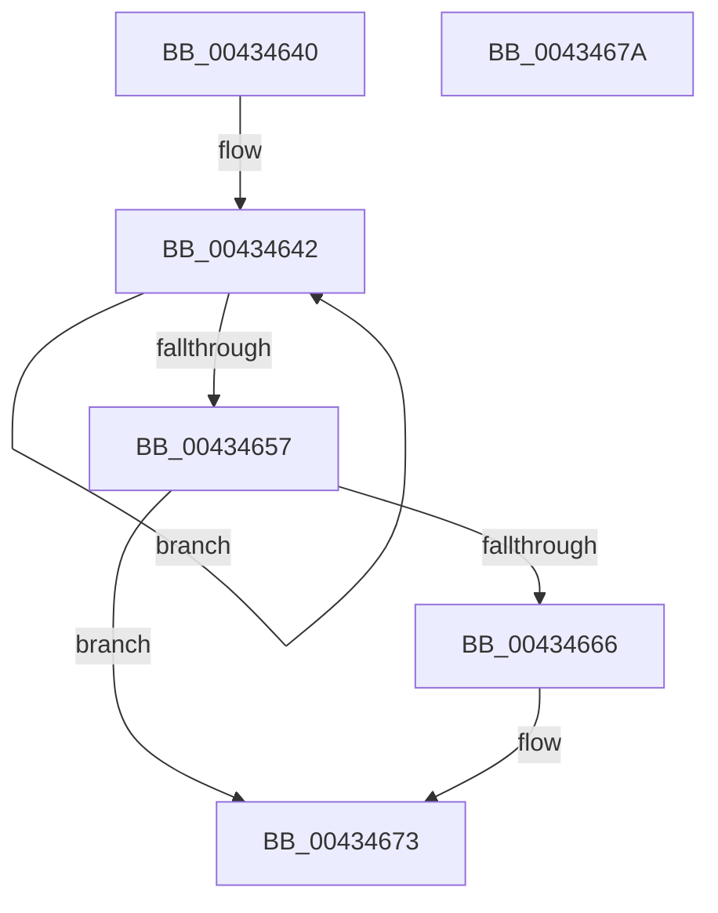

# HalpApic1WriteIcr

- RVA: `0x00434640`–`0x0043467B` (길이 `59` bytes)
- VA: `0x0000000140434640`
- 실행 섹션: `.text`
- PDB 이름 있음: `예`; PDB Function 태그: `아니요`
- unwind 정보 RVA: `0x000DB714`
- 디코드: `13`개 명령, `59/59` bytes 표시
- 미해석 바이트: `0` (있으면 어셈블리에 `.byte`로 보존)

> 이 문서는 커널 이미지의 기계어와 PDB 기호를 분석해 생성했습니다. 4번과 5번은 함수 원형과 자료형을 바이너리 사용 방식에서 추정한 C 해석이며 원본 소스 복구 결과는 아닙니다.

## 1. Dependencies

- 직접 호출 지점: **0**; 고유 호출 대상: **0**
- 직접 호출자로 확인된 함수: **0**
- RIP 상대 이미지 참조: **1**

### Outgoing calls
- 직접 디코드된 call 명령이 없습니다.

### Direct callers
- 이 함수 시작 RVA로 연결되는 직접 call은 확인되지 않았습니다. 간접 호출은 완전히 역산할 수 없습니다.

### Static image references
- `0x00434642` → RVA `0x00E10440` (`.data`; read)

## 2. Other-region calls and transfers

- 다른 실행 섹션으로 향하는 call: **0**
- 별도 외부 분기/꼬리 이동을 확인하지 못했습니다.

## 3. Assembly (complete function range)

```asm
00434640  66 90                           nop
00434642  48 8B 05 F7 BD 9D 00            mov rax, qword ptr [rip + 0x9dbdf7]
00434649  44 8B 80 00 03 00 00            mov r8d, dword ptr [rax + 0x300]
00434650  41 0F BA E0 0C                  bt r8d, 0xc
00434655  72 EB                           jb 0x140434642
00434657  48 8B 05 E2 BD 9D 00            mov rax, qword ptr [rip + 0x9dbde2]
0043465E  F7 C2 00 00 0C 00               test edx, 0xc0000
00434664  75 0D                           jne 0x140434673
00434666  89 88 10 03 00 00               mov dword ptr [rax + 0x310], ecx
0043466C  48 8B 05 CD BD 9D 00            mov rax, qword ptr [rip + 0x9dbdcd]
00434673  89 90 00 03 00 00               mov dword ptr [rax + 0x300], edx
00434679  C3                              ret
0043467A  CC                              int3
```

## 4. C-style interpretation (structured pseudocode)

```c
__int64 __fastcall HalpApic1WriteIcr(int a1, int a2)
{
    __int64 result;

loc_00434642:
    if (condition_is_below) goto loc_00434642;
    result = *(unsigned __int64 *)(v_rip + 10337762);
    if (((a2) & (0xC0000ULL)) == 0) {
        *(unsigned int *)(*(unsigned __int64 *)(v_rip + 10337762) + 784) = a1;
        result = *(unsigned __int64 *)(v_rip + 10337741);
    }
    *(unsigned int *)(result + 768) = a2;
    return result;
}
```

## 5. (Beta) C Style

```c
int64_t HalpApic1WriteIcr(int32_t Arg1, int32_t Arg2)
{
    int64_t result;

loc_00434642:
    if (condition_is_below) goto loc_00434642;
    result = *(uint64_t *)(v_rip + 0x9DBDE2);
    if (((Arg2) & (0xC0000ULL)) == 0) {
        *(uint32_t *)(*(uint64_t *)(v_rip + 0x9DBDE2) + 0x310) = Arg1;
        result = *(uint64_t *)(v_rip + 0x9DBDCD);
    }
    *(uint32_t *)(result + 0x300) = Arg2;
    return result;
}
```

## 6. Execution-region graph

[열기: 2D/3D 그래프와 함수 탐색 컨트롤 패널](../../../control-panel.html?section=text&rva=0x00434640&view=graph)

- 2D 그래프는 위에서 아래로 흐르고, 3D 그래프는 빈 공간을 드래그해 회전합니다. Shift+드래그는 이동, 휠은 확대·축소, 함수 노드 선택은 대상 보고서 이동입니다.

### Static fallback


