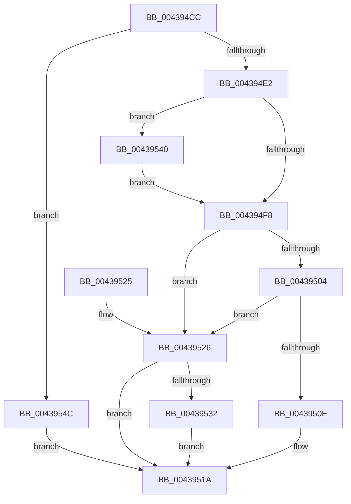

# HalpPCIAcquireConfigSpaceLock

- RVA: `0x004394CC`–`0x00439551` (길이 `133` bytes)
- VA: `0x00000001404394CC`
- 실행 섹션: `.text`
- PDB 이름 있음: `예`; PDB Function 태그: `아니요`
- unwind 정보 RVA: `0x0005D210`
- 디코드: `35`개 명령, `133/133` bytes 표시
- 미해석 바이트: `0` (있으면 어셈블리에 `.byte`로 보존)

> 이 문서는 커널 이미지의 기계어와 PDB 기호를 분석해 생성했습니다. 4번과 5번은 함수 원형과 자료형을 바이너리 사용 방식에서 추정한 C 해석이며 원본 소스 복구 결과는 아닙니다.

## 1. Dependencies

- 직접 호출 지점: **3**; 고유 호출 대상: **3**
- 직접 호출자로 확인된 함수: **1**
- RIP 상대 이미지 참조: **6**

### Outgoing calls
- `0x00439515` → [KiAcquireSpinLockInstrumented](../20/KiAcquireSpinLockInstrumented_function_002084F0.md) (function, `0x002084F0`)
- `0x00439539` → [KxWaitForSpinLockAndAcquire](../20/KxWaitForSpinLockAndAcquire_function_002085C0.md) (function, `0x002085C0`)
- `0x00439545` → [KiRaiseIrqlProcessIrqlFlags](../4F/KiRaiseIrqlProcessIrqlFlags_function_004F56FC.md) (function, `0x004F56FC`)

### Direct callers
- [HaliPciInterfaceReadConfig](HaliPciInterfaceReadConfig_function_004391A0.md) at `0x004392BB`

### Static image references
- `0x004394D6` → RVA `0x00FC19B8` (`.data`; read)
- `0x004394EF` → RVA `0x00FC6D20` (`ALMOSTRO`; read)
- `0x004394F8` → RVA `0x00FC6B06` (`ALMOSTRO`; read)
- `0x00439504` → RVA `0x00F0DE58` (`.data`; read)
- `0x0043950E` → RVA `0x00FC1708` (`.data`; read)
- `0x00439526` → RVA `0x00FC1708` (`.data`; read/write)

## 2. Other-region calls and transfers

- 다른 실행 섹션으로 향하는 call: **0**
- 별도 외부 분기/꼬리 이동을 확인하지 못했습니다.

## 3. Assembly (complete function range)

```asm
004394CC  48 89 5C 24 08                  mov qword ptr [rsp + 8], rbx
004394D1  57                              push rdi
004394D2  48 83 EC 20                     sub rsp, 0x20
004394D6  80 3D DB 84 B8 00 00            cmp byte ptr [rip + 0xb884db], 0
004394DD  48 8B D9                        mov rbx, rcx
004394E0  75 6A                           jne 0x14043954c
004394E2  44 0F 20 C7                     mov rdi, cr8
004394E6  B8 0F 00 00 00                  mov eax, 0xf
004394EB  44 0F 22 C0                     mov cr8, rax
004394EF  83 3D 2A D8 B8 00 00            cmp dword ptr [rip + 0xb8d82a], 0
004394F6  75 48                           jne 0x140439540
004394F8  F6 05 07 D6 B8 00 21            test byte ptr [rip + 0xb8d607], 0x21
004394FF  40 88 3B                        mov byte ptr [rbx], dil
00439502  74 22                           je 0x140439526
00439504  8B 05 4E 49 AD 00               mov eax, dword ptr [rip + 0xad494e]
0043950A  85 C0                           test eax, eax
0043950C  75 18                           jne 0x140439526
0043950E  48 8D 0D F3 81 B8 00            lea rcx, [rip + 0xb881f3]
00439515  E8 D6 EF DC FF                  call 0x1402084f0
0043951A  48 8B 5C 24 30                  mov rbx, qword ptr [rsp + 0x30]
0043951F  48 83 C4 20                     add rsp, 0x20
00439523  5F                              pop rdi
00439524  C3                              ret
00439525  CC                              int3
00439526  F0 48 0F BA 2D D8 81 B8 00 00   lock bts qword ptr [rip + 0xb881d8], 0
00439530  73 E8                           jae 0x14043951a
00439532  48 8D 0D CF 81 B8 00            lea rcx, [rip + 0xb881cf]
00439539  E8 82 F0 DC FF                  call 0x1402085c0
0043953E  EB DA                           jmp 0x14043951a
00439540  8A D0                           mov dl, al
00439542  40 8A CF                        mov cl, dil
00439545  E8 B2 C1 0B 00                  call 0x1404f56fc
0043954A  EB AC                           jmp 0x1404394f8
0043954C  C6 01 0F                        mov byte ptr [rcx], 0xf
0043954F  EB C9                           jmp 0x14043951a
```

## 4. C-style interpretation (structured pseudocode)

```c
__int64 __fastcall HalpPCIAcquireConfigSpaceLock(__int64 a1)
{
    __int64 result;
    __int64 v_rsp;
    unsigned __int64 v_stack_p8;

    v_stack_p8 = v_rbx;
    v_rsp = (v_rsp) - (32);
    if ((*(unsigned __int8 *)(v_rip + 12092635)) != 0) goto loc_0043954C;
    if ((*(unsigned int *)(v_rip + 12113962)) != 0) goto loc_00439540;
loc_004394F8:
    *(unsigned __int8 *)(a1) = (unsigned __int8)(v_cr8);
    if (((*(unsigned __int8 *)(v_rip + 12113415)) & (33)) == 0) goto loc_00439526;
    if ((unsigned int)((unsigned int)(*(unsigned int *)(v_rip + 11356494))) != 0) goto loc_00439526;
    result = KiAcquireSpinLockInstrumented(v_rip + 12091891, a2, a3, a4);
loc_0043951A:
    v_rsp = (v_rsp) + (32);
    return result;
loc_00439526:
    if (condition_is_above_or_equal) goto loc_0043951A;
    result = KxWaitForSpinLockAndAcquire(v_rip + 12091855, a2, a3, a4);
    goto loc_0043951A;
loc_00439540:
    result = KiRaiseIrqlProcessIrqlFlags((unsigned __int8)(v_cr8), (unsigned __int8)(result), a3, a4);
    goto loc_004394F8;
loc_0043954C:
    *(unsigned __int8 *)((unsigned __int8)(v_cr8)) = 15;
    goto loc_0043951A;
}
```

## 5. (Beta) C Style

```c
int64_t HalpPCIAcquireConfigSpaceLock(void *Arg1)
{
    uint8_t *arg1 = (uint8_t *)Arg1;

    int64_t result;
    int64_t local_rsp;
    uint64_t v_stack_p8;

    v_stack_p8 = local_rbx;
    local_rsp = (local_rsp) - (32);
    if ((*(uint8_t *)(v_rip + 0xB884DB)) != 0) goto loc_0043954C;
    if ((*(uint32_t *)(v_rip + 0xB8D82A)) != 0) goto loc_00439540;
loc_004394F8:
    *(uint8_t *)(arg1) = (uint8_t)(v_cr8);
    if (((*(uint8_t *)(v_rip + 0xB8D607)) & (33)) == 0) goto loc_00439526;
    if ((uint32_t)((uint32_t)(*(uint32_t *)(v_rip + 0xAD494E))) != 0) goto loc_00439526;
    result = KiAcquireSpinLockInstrumented(v_rip + 12091891, a2, a3, a4);
loc_0043951A:
    local_rsp = (local_rsp) + (32);
    return result;
loc_00439526:
    if (condition_is_above_or_equal) goto loc_0043951A;
    result = KxWaitForSpinLockAndAcquire(v_rip + 12091855, a2, a3, a4);
    goto loc_0043951A;
loc_00439540:
    result = KiRaiseIrqlProcessIrqlFlags((uint8_t)(v_cr8), (uint8_t)(result), a3, a4);
    goto loc_004394F8;
loc_0043954C:
    *(uint8_t *)((uint8_t)(v_cr8)) = 15;
    goto loc_0043951A;
}
```

### 관측된 메모리 오프셋

구조체 형식이 확인되지 않은 접근은 인자 기준의 오프셋으로만 기록했습니다.

| 기준 인자 | 오프셋 표현 | 폭 (bit) | 접근 |
|---|---:|---:|---|
| `Arg1` | `+ 0x0` | `8` | `W` |

## 6. Execution-region graph

[열기: 2D/3D 그래프와 함수 탐색 컨트롤 패널](../../../control-panel.html?section=text&rva=0x004394CC&view=graph)

- 2D 그래프는 위에서 아래로 흐르고, 3D 그래프는 빈 공간을 드래그해 회전합니다. Shift+드래그는 이동, 휠은 확대·축소, 함수 노드 선택은 대상 보고서 이동입니다.

### Static fallback


