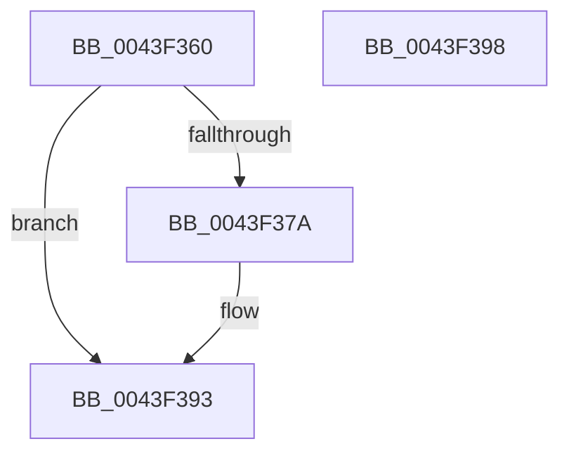

# HalpPciGetDeviceLocationFromPhysicalAddress

- RVA: `0x0043F360`–`0x0043F399` (길이 `57` bytes)
- VA: `0x000000014043F360`
- 실행 섹션: `.text`
- PDB 이름 있음: `예`; PDB Function 태그: `아니요`
- unwind 정보 RVA: `0x0005C788`
- 디코드: `18`개 명령, `57/57` bytes 표시
- 미해석 바이트: `0` (있으면 어셈블리에 `.byte`로 보존)

> 이 문서는 커널 이미지의 기계어와 PDB 기호를 분석해 생성했습니다. 4번과 5번은 함수 원형과 자료형을 바이너리 사용 방식에서 추정한 C 해석이며 원본 소스 복구 결과는 아닙니다.

## 1. Dependencies

- 직접 호출 지점: **1**; 고유 호출 대상: **1**
- 직접 호출자로 확인된 함수: **0**
- RIP 상대 이미지 참조: **0**

### Outgoing calls
- `0x0043F371` → [HalpPciIsAddressWithinMcfg](HalpPciIsAddressWithinMcfg_function_0043F3A0.md) (function, `0x0043F3A0`)

### Direct callers
- 이 함수 시작 RVA로 연결되는 직접 call은 확인되지 않았습니다. 간접 호출은 완전히 역산할 수 없습니다.

### Static image references
- 디코드된 RIP-relative 메모리 참조가 없습니다.

## 2. Other-region calls and transfers

- 다른 실행 섹션으로 향하는 call: **0**
- 별도 외부 분기/꼬리 이동을 확인하지 못했습니다.

## 3. Assembly (complete function range)

```asm
0043F360  48 83 EC 28                     sub rsp, 0x28
0043F364  83 64 24 30 00                  and dword ptr [rsp + 0x30], 0
0043F369  4D 8B D1                        mov r10, r9
0043F36C  4C 8D 4C 24 30                  lea r9, [rsp + 0x30]
0043F371  E8 2A 00 00 00                  call 0x14043f3a0
0043F376  84 C0                           test al, al
0043F378  74 19                           je 0x14043f393
0043F37A  8B 4C 24 30                     mov ecx, dword ptr [rsp + 0x30]
0043F37E  8A D1                           mov dl, cl
0043F380  80 E2 1F                        and dl, 0x1f
0043F383  C1 E9 05                        shr ecx, 5
0043F386  41 88 12                        mov byte ptr [r10], dl
0043F389  80 E1 07                        and cl, 7
0043F38C  48 8B 54 24 50                  mov rdx, qword ptr [rsp + 0x50]
0043F391  88 0A                           mov byte ptr [rdx], cl
0043F393  48 83 C4 28                     add rsp, 0x28
0043F397  C3                              ret
0043F398  CC                              int3
```

## 4. C-style interpretation (structured pseudocode)

```c
__int64 __fastcall HalpPciGetDeviceLocationFromPhysicalAddress(__int64 a1, __int64 a2, __int64 a3, __int64 a4, __int64 a5)
{
    __int64 result;
    __int64 v_rsp;
    unsigned int v_stack_p8;

    v_rsp = (v_rsp) - (40);
    result = HalpPciIsAddressWithinMcfg(a1, a2, a3, v_stack_p8);
    if ((unsigned __int8)(result) != 0) {
        a1 = v_stack_p8;
        a2 = (unsigned __int8)(a1);
        a2 = (unsigned __int8)((a2) & (31));
        a1 = (unsigned int)((a1) >> (5));
        *(unsigned __int8 *)(a4) = (unsigned __int8)(a2);
        a1 = (unsigned __int8)((a1) & (7));
        a2 = a5;
        *(unsigned __int8 *)(a2) = (unsigned __int8)(a1);
    }
    v_rsp = (v_rsp) + (40);
    return result;
}
```

## 5. (Beta) C Style

```c
int64_t HalpPciGetDeviceLocationFromPhysicalAddress(int64_t Arg1, int64_t Arg2, int64_t Arg3, int64_t Arg4, void *Arg5)
{
    uint8_t *arg5 = (uint8_t *)Arg5;

    int64_t result;
    int64_t local_rsp;
    uint32_t v_stack_p8;

    local_rsp = (local_rsp) - (40);
    result = HalpPciIsAddressWithinMcfg(Arg1, Arg2, Arg3, v_stack_p8);
    if ((uint8_t)(result) != 0) {
        Arg1 = v_stack_p8;
        Arg2 = (uint8_t)(Arg1);
        Arg2 = (uint8_t)((Arg2) & (31));
        Arg1 = (uint32_t)((Arg1) >> (5));
        *(uint8_t *)(Arg4) = (uint8_t)(Arg2);
        Arg1 = (uint8_t)((Arg1) & (7));
        Arg2 = Arg5;
        *(uint8_t *)(Arg2) = (uint8_t)(Arg1);
    }
    local_rsp = (local_rsp) + (40);
    return result;
}
```

### 관측된 메모리 오프셋

구조체 형식이 확인되지 않은 접근은 인자 기준의 오프셋으로만 기록했습니다.

| 기준 인자 | 오프셋 표현 | 폭 (bit) | 접근 |
|---|---:|---:|---|
| `Arg5` | `+ 0x0` | `8` | `W` |

## 6. Execution-region graph

[열기: 2D/3D 그래프와 함수 탐색 컨트롤 패널](../../../control-panel.html?section=text&rva=0x0043F360&view=graph)

- 2D 그래프는 위에서 아래로 흐르고, 3D 그래프는 빈 공간을 드래그해 회전합니다. Shift+드래그는 이동, 휠은 확대·축소, 함수 노드 선택은 대상 보고서 이동입니다.

### Static fallback


