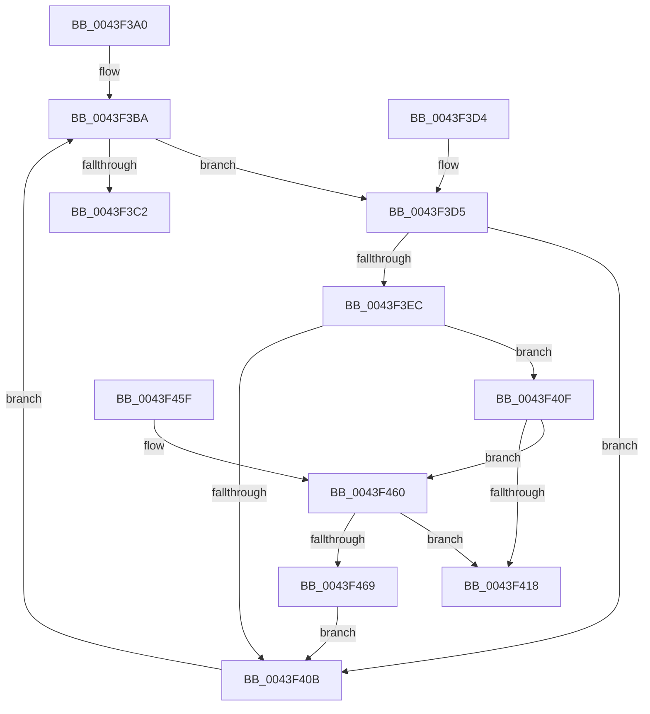

# HalpPciIsAddressWithinMcfg

- RVA: `0x0043F3A0`–`0x0043F46B` (길이 `203` bytes)
- VA: `0x000000014043F3A0`
- 실행 섹션: `.text`
- PDB 이름 있음: `예`; PDB Function 태그: `아니요`
- unwind 정보 RVA: `0x000A4C58`
- 디코드: `61`개 명령, `203/203` bytes 표시
- 미해석 바이트: `0` (있으면 어셈블리에 `.byte`로 보존)

> 이 문서는 커널 이미지의 기계어와 PDB 기호를 분석해 생성했습니다. 4번과 5번은 함수 원형과 자료형을 바이너리 사용 방식에서 추정한 C 해석이며 원본 소스 복구 결과는 아닙니다.

## 1. Dependencies

- 직접 호출 지점: **0**; 고유 호출 대상: **0**
- 직접 호출자로 확인된 함수: **1**
- RIP 상대 이미지 참조: **3**

### Outgoing calls
- 직접 디코드된 call 명령이 없습니다.

### Direct callers
- [HalpPciGetDeviceLocationFromPhysicalAddress](HalpPciGetDeviceLocationFromPhysicalAddress_function_0043F360.md) at `0x0043F371`

### Static image references
- `0x0043F3BA` → RVA `0x00F901E0` (`.data`; read)
- `0x0043F3DC` → RVA `0x00F90200` (`.data`; read)
- `0x0043F40F` → RVA `0x00E11748` (`.data`; read)

## 2. Other-region calls and transfers

- 다른 실행 섹션으로 향하는 call: **0**
- 별도 외부 분기/꼬리 이동을 확인하지 못했습니다.

## 3. Assembly (complete function range)

```asm
0043F3A0  48 89 5C 24 08                  mov qword ptr [rsp + 8], rbx
0043F3A5  48 89 74 24 10                  mov qword ptr [rsp + 0x10], rsi
0043F3AA  48 89 7C 24 18                  mov qword ptr [rsp + 0x18], rdi
0043F3AF  49 8B D9                        mov rbx, r9
0043F3B2  49 8B F8                        mov rdi, r8
0043F3B5  48 8B F2                        mov rsi, rdx
0043F3B8  33 C0                           xor eax, eax
0043F3BA  3B 05 20 0E B5 00               cmp eax, dword ptr [rip + 0xb50e20]
0043F3C0  72 13                           jb 0x14043f3d5
0043F3C2  32 C0                           xor al, al
0043F3C4  48 8B 5C 24 08                  mov rbx, qword ptr [rsp + 8]
0043F3C9  48 8B 74 24 10                  mov rsi, qword ptr [rsp + 0x10]
0043F3CE  48 8B 7C 24 18                  mov rdi, qword ptr [rsp + 0x18]
0043F3D3  C3                              ret
0043F3D4  CC                              int3
0043F3D5  44 8B D8                        mov r11d, eax
0043F3D8  49 C1 E3 04                     shl r11, 4
0043F3DC  4C 03 1D 1D 0E B5 00            add r11, qword ptr [rip + 0xb50e1d]
0043F3E3  4D 8B 4B 2C                     mov r9, qword ptr [r11 + 0x2c]
0043F3E7  49 3B C9                        cmp rcx, r9
0043F3EA  72 1F                           jb 0x14043f40b
0043F3EC  41 0F B6 53 36                  movzx edx, byte ptr [r11 + 0x36]
0043F3F1  45 0F B6 43 37                  movzx r8d, byte ptr [r11 + 0x37]
0043F3F6  4C 2B C2                        sub r8, rdx
0043F3F9  49 8D 50 01                     lea rdx, [r8 + 1]
0043F3FD  48 C1 E2 14                     shl rdx, 0x14
0043F401  8B D2                           mov edx, edx
0043F403  49 03 D1                        add rdx, r9
0043F406  48 3B CA                        cmp rcx, rdx
0043F409  72 04                           jb 0x14043f40f
0043F40B  FF C0                           inc eax
0043F40D  EB AB                           jmp 0x14043f3ba
0043F40F  80 3D 32 23 9D 00 00            cmp byte ptr [rip + 0x9d2332], 0
0043F416  75 48                           jne 0x14043f460
0043F418  41 0F B7 43 34                  movzx eax, word ptr [r11 + 0x34]
0043F41D  49 2B C9                        sub rcx, r9
0043F420  66 89 06                        mov word ptr [rsi], ax
0043F423  48 8B D1                        mov rdx, rcx
0043F426  48 8B 74 24 10                  mov rsi, qword ptr [rsp + 0x10]
0043F42B  48 8B C1                        mov rax, rcx
0043F42E  48 C1 F8 14                     sar rax, 0x14
0043F432  88 07                           mov byte ptr [rdi], al
0043F434  8B 03                           mov eax, dword ptr [rbx]
0043F436  48 8B 7C 24 18                  mov rdi, qword ptr [rsp + 0x18]
0043F43B  48 C1 FA 0F                     sar rdx, 0xf
0043F43F  33 D0                           xor edx, eax
0043F441  48 C1 F9 0C                     sar rcx, 0xc
0043F445  83 E2 1F                        and edx, 0x1f
0043F448  C1 E1 05                        shl ecx, 5
0043F44B  33 D0                           xor edx, eax
0043F44D  83 E2 1F                        and edx, 0x1f
0043F450  33 CA                           xor ecx, edx
0043F452  0F B6 C1                        movzx eax, cl
0043F455  89 03                           mov dword ptr [rbx], eax
0043F457  B0 01                           mov al, 1
0043F459  48 8B 5C 24 08                  mov rbx, qword ptr [rsp + 8]
0043F45E  C3                              ret
0043F45F  CC                              int3
0043F460  48 F7 C1 00 0F 00 00            test rcx, 0xf00
0043F467  74 AF                           je 0x14043f418
0043F469  EB A0                           jmp 0x14043f40b
```

## 4. C-style interpretation (structured pseudocode)

```c
__int64 __fastcall HalpPciIsAddressWithinMcfg(__int64 a1, __int64 a2, __int64 a3, __int64 a4)
{
    __int64 result;
    __int64 v_r11;
    unsigned __int64 v_stack_p10;
    unsigned __int64 v_stack_p18;
    unsigned __int64 v_stack_p8;

    v_stack_p8 = v_rbx;
    v_stack_p10 = v_rsi;
    v_stack_p18 = v_rdi;
    result = 0;
loc_0043F3BA:
    if (0 < (*(unsigned int *)(v_rip + 11865632))) goto loc_0043F3D5;
    result = 0;
    return result;
loc_0043F3D5:
    v_r11 = (0) << (4);
    v_r11 = (v_r11) + (*(unsigned __int64 *)(v_rip + 11865629));
    if (a1 < (*(unsigned __int64 *)(v_r11 + 44))) goto loc_0043F40B;
    a3 = (*(unsigned __int8 *)(v_r11 + 55)) - (*(unsigned __int8 *)(v_r11 + 54));
    a2 = (a3 + 1) << (20);
    a2 = ((unsigned int)((unsigned int)(a2))) + (*(unsigned __int64 *)(v_r11 + 44));
    if (a1 < a2) goto loc_0043F40F;
loc_0043F40B:
    result = (unsigned int)((result) + 1);
    goto loc_0043F3BA;
loc_0043F40F:
    if ((*(unsigned __int8 *)(v_rip + 10298162)) != 0) goto loc_0043F460;
loc_0043F418:
    a1 = (a1) - (*(unsigned __int64 *)(v_r11 + 44));
    *(unsigned __int16 *)(v_stack_p10) = (unsigned __int16)(*(unsigned __int16 *)(v_r11 + 52));
    result = (a1) >> (20);
    *(unsigned __int8 *)(v_stack_p18) = (unsigned __int8)(result);
    a2 = (a1) >> (15);
    a2 = (unsigned int)((a2) ^ ((unsigned int)((unsigned int)(*(unsigned int *)(v_stack_p8)))));
    a1 = (a1) >> (12);
    a2 = (unsigned int)((a2) & (31));
    a1 = (unsigned int)((a1) << (5));
    a2 = (unsigned int)((a2) ^ ((unsigned int)((unsigned int)(*(unsigned int *)(v_stack_p8)))));
    a2 = (unsigned int)((a2) & (31));
    a1 = (unsigned int)((a1) ^ ((unsigned int)(a2)));
    *(unsigned int *)(v_stack_p8) = (unsigned int)((unsigned __int8)(a1));
    return 1;
loc_0043F460:
    if (((a1) & (0xF00ULL)) == 0) goto loc_0043F418;
    goto loc_0043F40B;
}
```

## 5. (Beta) C Style

```c
int64_t HalpPciIsAddressWithinMcfg(int64_t Arg1, void *Arg2, void *Arg3, void *Arg4)
{
    uint8_t *arg2 = (uint8_t *)Arg2;
    uint8_t *arg3 = (uint8_t *)Arg3;
    uint8_t *arg4 = (uint8_t *)Arg4;

    int64_t result;
    int64_t local_r11;
    uint64_t v_stack_p10;
    uint64_t v_stack_p18;
    uint64_t v_stack_p8;

    v_stack_p8 = local_rbx;
    v_stack_p10 = local_rsi;
    v_stack_p18 = local_rdi;
    result = 0;
loc_0043F3BA:
    if (0 < (*(uint32_t *)(v_rip + 0xB50E20))) goto loc_0043F3D5;
    result = 0;
    return result;
loc_0043F3D5:
    local_r11 = (0) << (4);
    local_r11 = (local_r11) + (*(uint64_t *)(v_rip + 0xB50E1D));
    if (Arg1 < (*(uint64_t *)(local_r11 + 0x2C))) goto loc_0043F40B;
    Arg3 = (*(uint8_t *)(local_r11 + 0x37)) - (*(uint8_t *)(local_r11 + 0x36));
    Arg2 = (Arg3 + 1) << (20);
    Arg2 = ((uint32_t)((uint32_t)(Arg2))) + (*(uint64_t *)(local_r11 + 0x2C));
    if (Arg1 < Arg2) goto loc_0043F40F;
loc_0043F40B:
    result = (uint32_t)((result) + 1);
    goto loc_0043F3BA;
loc_0043F40F:
    if ((*(uint8_t *)(v_rip + 0x9D2332)) != 0) goto loc_0043F460;
loc_0043F418:
    Arg1 = (Arg1) - (*(uint64_t *)(local_r11 + 0x2C));
    *(uint16_t *)(v_stack_p10) = (uint16_t)(*(uint16_t *)(local_r11 + 0x34));
    result = (Arg1) >> (20);
    *(uint8_t *)(v_stack_p18) = (uint8_t)(result);
    Arg2 = (Arg1) >> (15);
    Arg2 = (uint32_t)((Arg2) ^ ((uint32_t)((uint32_t)(*(uint32_t *)(v_stack_p8)))));
    Arg1 = (Arg1) >> (12);
    Arg2 = (uint32_t)((Arg2) & (31));
    Arg1 = (uint32_t)((Arg1) << (5));
    Arg2 = (uint32_t)((Arg2) ^ ((uint32_t)((uint32_t)(*(uint32_t *)(v_stack_p8)))));
    Arg2 = (uint32_t)((Arg2) & (31));
    Arg1 = (uint32_t)((Arg1) ^ ((uint32_t)(Arg2)));
    *(uint32_t *)(v_stack_p8) = (uint32_t)((uint8_t)(Arg1));
    return 1;
loc_0043F460:
    if (((Arg1) & (0xF00ULL)) == 0) goto loc_0043F418;
    goto loc_0043F40B;
}
```

### 관측된 메모리 오프셋

구조체 형식이 확인되지 않은 접근은 인자 기준의 오프셋으로만 기록했습니다.

| 기준 인자 | 오프셋 표현 | 폭 (bit) | 접근 |
|---|---:|---:|---|
| `Arg2` | `+ 0x0` | `16` | `W` |
| `Arg3` | `+ 0x0` | `8` | `W` |
| `Arg4` | `+ 0x0` | `32` | `R` |
| `Arg4` | `+ 0x0` | `32` | `W` |

## 6. Execution-region graph

[열기: 2D/3D 그래프와 함수 탐색 컨트롤 패널](../../../control-panel.html?section=text&rva=0x0043F3A0&view=graph)

- 2D 그래프는 위에서 아래로 흐르고, 3D 그래프는 빈 공간을 드래그해 회전합니다. Shift+드래그는 이동, 휠은 확대·축소, 함수 노드 선택은 대상 보고서 이동입니다.

### Static fallback


