# HvUnCOWReconciledPages

- RVA: `0x0043DC20`–`0x0043DF1D` (길이 `765` bytes)
- VA: `0x000000014043DC20`
- 실행 섹션: `.text`
- PDB 이름 있음: `예`; PDB Function 태그: `아니요`
- unwind 정보 RVA: `0x000A4A0C`
- 디코드: `217`개 명령, `765/765` bytes 표시
- 미해석 바이트: `0` (있으면 어셈블리에 `.byte`로 보존)

> 이 문서는 커널 이미지의 기계어와 PDB 기호를 분석해 생성했습니다. 4번과 5번은 함수 원형과 자료형을 바이너리 사용 방식에서 추정한 C 해석이며 원본 소스 복구 결과는 아닙니다.

## 1. Dependencies

- 직접 호출 지점: **6**; 고유 호출 대상: **3**
- 직접 호출자로 확인된 함수: **1**
- RIP 상대 이미지 참조: **0**

### Outgoing calls
- `0x0043DC6E` → [RtlMergeBitMaps](RtlMergeBitMaps_function_0043DF30.md) (function, `0x0043DF30`)
- `0x0043DCB5` → [RtlMergeBitMaps](RtlMergeBitMaps_function_0043DF30.md) (function, `0x0043DF30`)
- `0x0043DCC1` → [RtlMergeBitMaps](RtlMergeBitMaps_function_0043DF30.md) (function, `0x0043DF30`)
- `0x0043DD86` → [HvpViewMapGetStorageLength](../../page/A8/HvpViewMapGetStorageLength_function_00A86F6C.md) (function, `0x00A86F6C`)
- `0x0043DEB5` → [HvpViewMapUnCOWAndSealRange](../../page/9B/HvpViewMapUnCOWAndSealRange_function_009B542C.md) (function, `0x009B542C`)
- `0x0043DEE8` → [RtlMergeBitMaps](RtlMergeBitMaps_function_0043DF30.md) (function, `0x0043DF30`)

### Direct callers
- [CmpFlushHive](../../page/9B/CmpFlushHive_function_009B3DC0.md) at `0x009B4623`

### Static image references
- 디코드된 RIP-relative 메모리 참조가 없습니다.

## 2. Other-region calls and transfers

- 다른 실행 섹션으로 향하는 call: **2**
  - `0x0043DD86` → [HvpViewMapGetStorageLength](../../page/A8/HvpViewMapGetStorageLength_function_00A86F6C.md) (`.text` → `PAGE`)
  - `0x0043DEB5` → [HvpViewMapUnCOWAndSealRange](../../page/9B/HvpViewMapUnCOWAndSealRange_function_009B542C.md) (`.text` → `PAGE`)
- 별도 외부 분기/꼬리 이동을 확인하지 못했습니다.

## 3. Assembly (complete function range)

```asm
0043DC20  48 89 5C 24 10                  mov qword ptr [rsp + 0x10], rbx
0043DC25  48 89 6C 24 18                  mov qword ptr [rsp + 0x18], rbp
0043DC2A  48 89 74 24 20                  mov qword ptr [rsp + 0x20], rsi
0043DC2F  57                              push rdi
0043DC30  41 56                           push r14
0043DC32  41 57                           push r15
0043DC34  48 83 EC 20                     sub rsp, 0x20
0043DC38  F7 81 A0 00 00 00 00 00 02 00   test dword ptr [rcx + 0xa0], 0x20000
0043DC42  48 8B F1                        mov rsi, rcx
0043DC45  0F 84 46 01 00 00               je 0x14043dd91
0043DC4B  65 48 8B 04 25 88 01 00 00      mov rax, qword ptr gs:[0x188]
0043DC54  4C 8D B1 C8 06 00 00            lea r14, [rcx + 0x6c8]
0043DC5B  48 39 81 60 10 00 00            cmp qword ptr [rcx + 0x1060], rax
0043DC62  75 0F                           jne 0x14043dc73
0043DC64  48 8D 91 98 06 00 00            lea rdx, [rcx + 0x698]
0043DC6B  49 8B CE                        mov rcx, r14
0043DC6E  E8 BD 02 00 00                  call 0x14043df30
0043DC73  41 8B 0E                        mov ecx, dword ptr [r14]
0043DC76  33 C0                           xor eax, eax
0043DC78  44 8D 78 01                     lea r15d, [rax + 1]
0043DC7C  85 C9                           test ecx, ecx
0043DC7E  74 2E                           je 0x14043dcae
0043DC80  4D 8B 4E 08                     mov r9, qword ptr [r14 + 8]
0043DC84  44 8B C0                        mov r8d, eax
0043DC87  41 8B 14 81                     mov edx, dword ptr [r9 + rax*4]
0043DC8B  83 F9 20                        cmp ecx, 0x20
0043DC8E  72 10                           jb 0x14043dca0
0043DC90  F7 D2                           not edx
0043DC92  41 89 14 81                     mov dword ptr [r9 + rax*4], edx
0043DC96  41 03 C7                        add eax, r15d
0043DC99  83 C1 E0                        add ecx, -0x20
0043DC9C  75 E2                           jne 0x14043dc80
0043DC9E  EB 0E                           jmp 0x14043dcae
0043DCA0  41 8B C7                        mov eax, r15d
0043DCA3  D3 E0                           shl eax, cl
0043DCA5  41 2B C7                        sub eax, r15d
0043DCA8  33 C2                           xor eax, edx
0043DCAA  43 89 04 81                     mov dword ptr [r9 + r8*4], eax
0043DCAE  48 8D 56 58                     lea rdx, [rsi + 0x58]
0043DCB2  49 8B CE                        mov rcx, r14
0043DCB5  E8 76 02 00 00                  call 0x14043df30
0043DCBA  48 8D 56 70                     lea rdx, [rsi + 0x70]
0043DCBE  49 8B CE                        mov rcx, r14
0043DCC1  E8 6A 02 00 00                  call 0x14043df30
0043DCC6  48 8B 8E 60 10 00 00            mov rcx, qword ptr [rsi + 0x1060]
0043DCCD  48 85 C9                        test rcx, rcx
0043DCD0  0F 85 F6 01 00 00               jne 0x14043decc
0043DCD6  83 64 24 40 00                  and dword ptr [rsp + 0x40], 0
0043DCDB  45 8B 06                        mov r8d, dword ptr [r14]
0043DCDE  45 85 C0                        test r8d, r8d
0043DCE1  0F 84 0B 02 00 00               je 0x14043def2
0043DCE7  4D 8B 56 08                     mov r10, qword ptr [r14 + 8]
0043DCEB  41 8D 48 FF                     lea ecx, [r8 - 1]
0043DCEF  33 FF                           xor edi, edi
0043DCF1  49 8B D2                        mov rdx, r10
0043DCF4  48 C1 E9 05                     shr rcx, 5
0043DCF8  45 8B 0A                        mov r9d, dword ptr [r10]
0043DCFB  4D 8D 1C 8A                     lea r11, [r10 + rcx*4]
0043DCFF  41 F7 D1                        not r9d
0043DD02  45 85 C9                        test r9d, r9d
0043DD05  75 15                           jne 0x14043dd1c
0043DD07  48 8D 42 04                     lea rax, [rdx + 4]
0043DD0B  48 8B D0                        mov rdx, rax
0043DD0E  49 3B C3                        cmp rax, r11
0043DD11  0F 87 A8 01 00 00               ja 0x14043debf
0043DD17  44 8B 08                        mov r9d, dword ptr [rax]
0043DD1A  EB E3                           jmp 0x14043dcff
0043DD1C  41 8B C1                        mov eax, r9d
0043DD1F  48 8B DA                        mov rbx, rdx
0043DD22  49 2B DA                        sub rbx, r10
0043DD25  48 C1 FB 02                     sar rbx, 2
0043DD29  48 0F BC C8                     bsf rcx, rax
0043DD2D  C1 E3 05                        shl ebx, 5
0043DD30  03 D9                           add ebx, ecx
0043DD32  41 3B D8                        cmp ebx, r8d
0043DD35  0F 87 84 01 00 00               ja 0x14043debf
0043DD3B  41 8B C7                        mov eax, r15d
0043DD3E  D3 E0                           shl eax, cl
0043DD40  41 2B C7                        sub eax, r15d
0043DD43  41 0B C1                        or eax, r9d
0043DD46  F7 D0                           not eax
0043DD48  85 C0                           test eax, eax
0043DD4A  75 14                           jne 0x14043dd60
0043DD4C  48 8D 42 04                     lea rax, [rdx + 4]
0043DD50  49 3B C3                        cmp rax, r11
0043DD53  0F 87 A2 01 00 00               ja 0x14043defb
0043DD59  48 8B D0                        mov rdx, rax
0043DD5C  8B 00                           mov eax, dword ptr [rax]
0043DD5E  EB E8                           jmp 0x14043dd48
0043DD60  48 0F BC C0                     bsf rax, rax
0043DD64  49 2B D2                        sub rdx, r10
0043DD67  48 8B FA                        mov rdi, rdx
0043DD6A  48 C1 FF 02                     sar rdi, 2
0043DD6E  C1 E7 05                        shl edi, 5
0043DD71  03 F8                           add edi, eax
0043DD73  41 3B F8                        cmp edi, r8d
0043DD76  41 0F 47 F8                     cmova edi, r8d
0043DD7A  2B FB                           sub edi, ebx
0043DD7C  48 8D AE E0 00 00 00            lea rbp, [rsi + 0xe0]
0043DD83  48 8B CD                        mov rcx, rbp
0043DD86  E8 E1 91 64 00                  call 0x140a86f6c
0043DD8B  8B F0                           mov esi, eax
0043DD8D  85 FF                           test edi, edi
0043DD8F  75 1A                           jne 0x14043ddab
0043DD91  48 8B 5C 24 48                  mov rbx, qword ptr [rsp + 0x48]
0043DD96  48 8B 6C 24 50                  mov rbp, qword ptr [rsp + 0x50]
0043DD9B  48 8B 74 24 58                  mov rsi, qword ptr [rsp + 0x58]
0043DDA0  48 83 C4 20                     add rsp, 0x20
0043DDA4  41 5F                           pop r15
0043DDA6  41 5E                           pop r14
0043DDA8  5F                              pop rdi
0043DDA9  C3                              ret
0043DDAA  CC                              int3
0043DDAB  8B CB                           mov ecx, ebx
0043DDAD  44 8B C7                        mov r8d, edi
0043DDB0  C1 E1 09                        shl ecx, 9
0043DDB3  41 C1 E0 09                     shl r8d, 9
0043DDB7  44 03 C1                        add r8d, ecx
0043DDBA  41 81 E0 00 F0 FF FF            and r8d, 0xfffff000
0043DDC1  8D 91 FF 0F 00 00               lea edx, [rcx + 0xfff]
0043DDC7  81 E2 00 F0 FF FF               and edx, 0xfffff000
0043DDCD  41 3B D0                        cmp edx, r8d
0043DDD0  0F 85 D0 00 00 00               jne 0x14043dea6
0043DDD6  83 64 24 40 00                  and dword ptr [rsp + 0x40], 0
0043DDDB  8D 0C 3B                        lea ecx, [rbx + rdi]
0043DDDE  45 8B 16                        mov r10d, dword ptr [r14]
0043DDE1  44 3B D1                        cmp r10d, ecx
0043DDE4  76 AB                           jbe 0x14043dd91
0043DDE6  49 8B 7E 08                     mov rdi, qword ptr [r14 + 8]
0043DDEA  41 8D 52 FF                     lea edx, [r10 - 1]
0043DDEE  48 C1 EA 05                     shr rdx, 5
0043DDF2  45 33 C0                        xor r8d, r8d
0043DDF5  8B C1                           mov eax, ecx
0043DDF7  83 E1 1F                        and ecx, 0x1f
0043DDFA  48 C1 E8 05                     shr rax, 5
0043DDFE  4C 8D 1C 97                     lea r11, [rdi + rdx*4]
0043DE02  48 8D 14 87                     lea rdx, [rdi + rax*4]
0043DE06  41 8B C7                        mov eax, r15d
0043DE09  44 8B 0A                        mov r9d, dword ptr [rdx]
0043DE0C  D3 E0                           shl eax, cl
0043DE0E  41 2B C7                        sub eax, r15d
0043DE11  44 0B C8                        or r9d, eax
0043DE14  48 8D 42 04                     lea rax, [rdx + 4]
0043DE18  41 F7 D1                        not r9d
0043DE1B  45 85 C9                        test r9d, r9d
0043DE1E  75 16                           jne 0x14043de36
0043DE20  49 3B C3                        cmp rax, r11
0043DE23  0F 87 9E 00 00 00               ja 0x14043dec7
0043DE29  48 83 C2 04                     add rdx, 4
0043DE2D  48 83 C0 04                     add rax, 4
0043DE31  44 8B 0A                        mov r9d, dword ptr [rdx]
0043DE34  EB E2                           jmp 0x14043de18
0043DE36  41 8B C1                        mov eax, r9d
0043DE39  48 8B DA                        mov rbx, rdx
0043DE3C  48 2B DF                        sub rbx, rdi
0043DE3F  48 C1 FB 02                     sar rbx, 2
0043DE43  48 0F BC C8                     bsf rcx, rax
0043DE47  C1 E3 05                        shl ebx, 5
0043DE4A  03 D9                           add ebx, ecx
0043DE4C  41 3B DA                        cmp ebx, r10d
0043DE4F  77 76                           ja 0x14043dec7
0043DE51  41 8B C7                        mov eax, r15d
0043DE54  D3 E0                           shl eax, cl
0043DE56  41 2B C7                        sub eax, r15d
0043DE59  41 0B C1                        or eax, r9d
0043DE5C  F7 D0                           not eax
0043DE5E  85 C0                           test eax, eax
0043DE60  75 14                           jne 0x14043de76
0043DE62  48 8D 42 04                     lea rax, [rdx + 4]
0043DE66  49 3B C3                        cmp rax, r11
0043DE69  0F 87 A4 00 00 00               ja 0x14043df13
0043DE6F  48 8B D0                        mov rdx, rax
0043DE72  8B 00                           mov eax, dword ptr [rax]
0043DE74  EB E8                           jmp 0x14043de5e
0043DE76  48 0F BC C0                     bsf rax, rax
0043DE7A  48 2B D7                        sub rdx, rdi
0043DE7D  4C 8B C2                        mov r8, rdx
0043DE80  49 C1 F8 02                     sar r8, 2
0043DE84  41 C1 E0 05                     shl r8d, 5
0043DE88  44 03 C0                        add r8d, eax
0043DE8B  45 3B C2                        cmp r8d, r10d
0043DE8E  45 0F 47 C2                     cmova r8d, r10d
0043DE92  44 2B C3                        sub r8d, ebx
0043DE95  41 8B F8                        mov edi, r8d
0043DE98  45 85 C0                        test r8d, r8d
0043DE9B  0F 84 F0 FE FF FF               je 0x14043dd91
0043DEA1  E9 05 FF FF FF                  jmp 0x14043ddab
0043DEA6  3B D6                           cmp edx, esi
0043DEA8  73 5B                           jae 0x14043df05
0043DEAA  44 3B C6                        cmp r8d, esi
0043DEAD  77 5F                           ja 0x14043df0e
0043DEAF  44 2B C2                        sub r8d, edx
0043DEB2  48 8B CD                        mov rcx, rbp
0043DEB5  E8 72 75 57 00                  call 0x1409b542c
0043DEBA  E9 17 FF FF FF                  jmp 0x14043ddd6
0043DEBF  41 8B D8                        mov ebx, r8d
0043DEC2  E9 B5 FE FF FF                  jmp 0x14043dd7c
0043DEC7  41 8B DA                        mov ebx, r10d
0043DECA  EB C9                           jmp 0x14043de95
0043DECC  65 48 8B 04 25 88 01 00 00      mov rax, qword ptr gs:[0x188]
0043DED5  48 3B C8                        cmp rcx, rax
0043DED8  0F 84 F8 FD FF FF               je 0x14043dcd6
0043DEDE  48 8D 96 98 06 00 00            lea rdx, [rsi + 0x698]
0043DEE5  49 8B CE                        mov rcx, r14
0043DEE8  E8 43 00 00 00                  call 0x14043df30
0043DEED  E9 E4 FD FF FF                  jmp 0x14043dcd6
0043DEF2  33 DB                           xor ebx, ebx
0043DEF4  33 FF                           xor edi, edi
0043DEF6  E9 81 FE FF FF                  jmp 0x14043dd7c
0043DEFB  B8 20 00 00 00                  mov eax, 0x20
0043DF00  E9 5F FE FF FF                  jmp 0x14043dd64
0043DF05  44 3B C6                        cmp r8d, esi
0043DF08  0F 87 C8 FE FF FF               ja 0x14043ddd6
0043DF0E  44 8B C6                        mov r8d, esi
0043DF11  EB 9C                           jmp 0x14043deaf
0043DF13  B8 20 00 00 00                  mov eax, 0x20
0043DF18  E9 5D FF FF FF                  jmp 0x14043de7a
```

## 4. C-style interpretation (structured pseudocode)

```c
__int64 __fastcall HvUnCOWReconciledPages(__int64 a1)
{
    __int64 result;
    __int64 v_rbx;
    __int64 v_rdi;
    __int64 v_rsp;
    unsigned __int64 v_stack_p10;
    unsigned __int64 v_stack_p18;
    unsigned __int64 v_stack_p20;
    unsigned int v_stack_p40;
    unsigned int v_stack_p8;

    v_stack_p10 = v_rbx;
    v_stack_p18 = v_rbp;
    v_stack_p20 = v_rsi;
    v_rsp = (v_rsp) - (32);
    if (((*(unsigned int *)(a1 + 160)) & (0x20000ULL)) == 0) goto loc_0043DD91;
    result = *(unsigned __int64 *)(gs_base + (0 + 392));
    if ((*(unsigned __int64 *)(a1 + 4192)) == (*(unsigned __int64 *)(gs_base + (0 + 392)))) {
        a2 = a1 + 1688;
        a1 = a1 + 1736;
        result = RtlMergeBitMaps(a1, a2, a3, a4);
    }
    result = 0;
    if ((unsigned int)((unsigned int)(*(unsigned int *)(a1 + 1736))) == 0) goto loc_0043DCAE;
loc_0043DC80:
    if (((unsigned int)((unsigned int)(*(unsigned int *)(a1 + 1736)))) < 32) goto loc_0043DCA0;
    a2 = (unsigned int)(~((unsigned int)(*(unsigned int *)(*(unsigned __int64 *)(a1 + 1736 + 8) + result * 4))));
    *(unsigned int *)(*(unsigned __int64 *)(a1 + 1736 + 8) + result * 4) = (unsigned int)(a2);
    result = (unsigned int)((result) + ((unsigned int)(result + 1)));
    a1 = (unsigned int)(((unsigned int)(*(unsigned int *)(a1 + 1736))) + (-32));
    if (condition_is_not_equal) goto loc_0043DC80;
    goto loc_0043DCAE;
loc_0043DCA0:
    result = (unsigned int)(((unsigned int)((unsigned int)(result + 1))) << ((unsigned __int8)(a1)));
    result = (unsigned int)((result) - ((unsigned int)(result + 1)));
    result = (unsigned int)((result) ^ ((unsigned int)(a2)));
    *(unsigned int *)(*(unsigned __int64 *)(a1 + 1736 + 8) + 0 * 4) = (unsigned int)(result);
loc_0043DCAE:
    result = RtlMergeBitMaps(a1 + 1736, a1 + 88, 0, *(unsigned __int64 *)(a1 + 1736 + 8));
    result = RtlMergeBitMaps(a1 + 1736, a1 + 112, 0, *(unsigned __int64 *)(a1 + 1736 + 8));
    if (*(unsigned __int64 *)(a1 + 4192) != 0) goto loc_0043DECC;
loc_0043DCD6:
    if ((unsigned int)((unsigned int)(*(unsigned int *)(a1 + 1736))) == 0) goto loc_0043DEF2;
    v_rdi = 0;
    a1 = ((unsigned int)(*(unsigned int *)(a1 + 1736)) - 1) >> (5);
loc_0043DCFF:
    a4 = (unsigned int)(~((unsigned int)(*(unsigned int *)(*(unsigned __int64 *)(a1 + 1736 + 8)))));
    if ((unsigned int)(a4) != 0) goto loc_0043DD1C;
    if ((*(unsigned __int64 *)(a1 + 1736 + 8) + 4) > (*(unsigned __int64 *)(a1 + 1736 + 8) + a1 * 4)) goto loc_0043DEBF;
    goto loc_0043DCFF;
loc_0043DD1C:
    v_rbx = (*(unsigned __int64 *)(a1 + 1736 + 8) + 4) - (*(unsigned __int64 *)(a1 + 1736 + 8));
    v_rbx = (v_rbx) >> (2);
    v_rbx = (unsigned int)((v_rbx) << (5));
    v_rbx = (unsigned int)((v_rbx) + ((unsigned int)(a1)));
    if (((unsigned int)(v_rbx)) > ((unsigned int)((unsigned int)(*(unsigned int *)(a1 + 1736))))) goto loc_0043DEBF;
    result = (unsigned int)(((unsigned int)((unsigned int)(result + 1))) << ((unsigned __int8)(a1)));
    result = (unsigned int)((result) - ((unsigned int)(result + 1)));
    result = (unsigned int)((result) | ((unsigned int)((unsigned int)(*(unsigned int *)(*(unsigned __int64 *)(a1 + 1736 + 8) + 4)))));
    result = (unsigned int)(~(result));
loc_0043DD48:
    if ((unsigned int)(result) != 0) goto loc_0043DD60;
    if ((*(unsigned __int64 *)(a1 + 1736 + 8) + 4 + 4) > (*(unsigned __int64 *)(a1 + 1736 + 8) + a1 * 4)) goto loc_0043DEFB;
    goto loc_0043DD48;
loc_0043DD60:
loc_0043DD64:
    a2 = (*(unsigned __int64 *)(a1 + 1736 + 8) + 4 + 4) - (*(unsigned __int64 *)(a1 + 1736 + 8));
    v_rdi = (a2) >> (2);
    v_rdi = (unsigned int)((v_rdi) << (5));
    v_rdi = (unsigned int)((v_rdi) + ((unsigned int)((unsigned int)(*(unsigned int *)(*(unsigned __int64 *)(a1 + 1736 + 8) + 4 + 4)))));
    if (((unsigned int)(v_rdi)) > ((unsigned int)((unsigned int)(*(unsigned int *)(a1 + 1736))))) { v_rdi = (unsigned int)((unsigned int)(*(unsigned int *)(a1 + 1736))); }
    v_rdi = (unsigned int)((v_rdi) - ((unsigned int)(v_rbx)));
loc_0043DD7C:
    result = HvpViewMapGetStorageLength(a1 + 224, a2, (unsigned int)(*(unsigned int *)(a1 + 1736)), (unsigned int)(*(unsigned int *)(*(unsigned __int64 *)(a1 + 1736 + 8) + 4)));
    if ((unsigned int)(v_rdi) != 0) goto loc_0043DDAB;
loc_0043DD91:
    v_rsp = (v_rsp) + (32);
    return result;
loc_0043DDAB:
    a1 = (unsigned int)(((unsigned int)((unsigned int)(v_stack_p10))) << (9));
    a3 = (unsigned int)(((unsigned int)((unsigned int)(v_rdi))) << (9));
    a3 = (unsigned int)((a3) + ((unsigned int)(a1)));
    a3 = (unsigned int)((a3) & (0xFFFFF000ULL));
    a2 = (unsigned int)((a1 + 4095) & (0xFFFFF000ULL));
    if (((unsigned int)(a2)) != ((unsigned int)(a3))) goto loc_0043DEA6;
loc_0043DDD6:
    if (((unsigned int)((unsigned int)(*(unsigned int *)(a1 + 1736)))) <= ((unsigned int)(v_stack_p10 + v_rdi * 1))) goto loc_0043DD91;
    a2 = ((unsigned int)(*(unsigned int *)(a1 + 1736)) - 1) >> (5);
    a3 = 0;
    a1 = (unsigned int)((v_stack_p10 + v_rdi * 1) & (31));
    result = ((unsigned int)((unsigned int)(v_stack_p10 + v_rdi * 1))) >> (5);
    result = (unsigned int)(((unsigned int)((unsigned int)(result + 1))) << ((unsigned __int8)(a1)));
    result = (unsigned int)((result) - ((unsigned int)(result + 1)));
    a4 = (unsigned int)(((unsigned int)(*(unsigned int *)(*(unsigned __int64 *)(a1 + 1736 + 8) + result * 4))) | ((unsigned int)(result)));
loc_0043DE18:
    a4 = (unsigned int)(~(a4));
    if ((unsigned int)(a4) != 0) goto loc_0043DE36;
    if ((*(unsigned __int64 *)(a1 + 1736 + 8) + result * 4 + 4) > (*(unsigned __int64 *)(a1 + 1736 + 8) + a2 * 4)) goto loc_0043DEC7;
    a2 = (*(unsigned __int64 *)(a1 + 1736 + 8) + result * 4) + (4);
    result = (*(unsigned __int64 *)(a1 + 1736 + 8) + result * 4 + 4) + (4);
    goto loc_0043DE18;
loc_0043DE36:
    v_rbx = (a2) - (*(unsigned __int64 *)(a1 + 1736 + 8));
    v_rbx = (v_rbx) >> (2);
    v_rbx = (unsigned int)((v_rbx) << (5));
    v_rbx = (unsigned int)((v_rbx) + ((unsigned int)(a1)));
    if (((unsigned int)(v_rbx)) > ((unsigned int)((unsigned int)(*(unsigned int *)(a1 + 1736))))) goto loc_0043DEC7;
    result = (unsigned int)(((unsigned int)((unsigned int)(result + 1))) << ((unsigned __int8)(a1)));
    result = (unsigned int)((result) - ((unsigned int)(result + 1)));
    result = (unsigned int)((result) | ((unsigned int)((unsigned int)(*(unsigned int *)(a2)))));
    result = (unsigned int)(~(result));
loc_0043DE5E:
    if ((unsigned int)(result) != 0) goto loc_0043DE76;
    if ((a2 + 4) > (*(unsigned __int64 *)(a1 + 1736 + 8) + a2 * 4)) goto loc_0043DF13;
    goto loc_0043DE5E;
loc_0043DE76:
loc_0043DE7A:
    a2 = (a2 + 4) - (*(unsigned __int64 *)(a1 + 1736 + 8));
    a3 = (a2) >> (2);
    a3 = (unsigned int)((a3) << (5));
    a3 = (unsigned int)((a3) + ((unsigned int)((unsigned int)(*(unsigned int *)(a2 + 4)))));
    if (((unsigned int)(a3)) > ((unsigned int)((unsigned int)(*(unsigned int *)(a1 + 1736))))) { a3 = (unsigned int)((unsigned int)(*(unsigned int *)(a1 + 1736))); }
    a3 = (unsigned int)((a3) - ((unsigned int)(v_rbx)));
loc_0043DE95:
    if ((unsigned int)(a3) == 0) goto loc_0043DD91;
    goto loc_0043DDAB;
loc_0043DEA6:
    if (((unsigned int)(a2)) >= ((unsigned int)(v_stack_p20))) goto loc_0043DF05;
    if (((unsigned int)(a3)) > ((unsigned int)(v_stack_p20))) goto loc_0043DF0E;
loc_0043DEAF:
    a3 = (unsigned int)((a3) - ((unsigned int)(a2)));
    result = HvpViewMapUnCOWAndSealRange(v_stack_p18, a2, a3, (unsigned int)(*(unsigned int *)(a2)));
    goto loc_0043DDD6;
loc_0043DEBF:
    goto loc_0043DD7C;
loc_0043DEC7:
    goto loc_0043DE95;
loc_0043DECC:
    if (v_stack_p18 == (*(unsigned __int64 *)(gs_base + (0 + 392)))) goto loc_0043DCD6;
    result = RtlMergeBitMaps(a1 + 1736, v_stack_p20 + 1688, a3, (unsigned int)(*(unsigned int *)(a2)));
    goto loc_0043DCD6;
loc_0043DEF2:
    v_rbx = 0;
    v_rdi = 0;
    goto loc_0043DD7C;
loc_0043DEFB:
    goto loc_0043DD64;
loc_0043DF05:
    if (((unsigned int)(a3)) > ((unsigned int)(v_stack_p20))) goto loc_0043DDD6;
loc_0043DF0E:
    goto loc_0043DEAF;
loc_0043DF13:
    goto loc_0043DE7A;
}
```

## 5. (Beta) C Style

```c
int64_t HvUnCOWReconciledPages(void *Arg1)
{
    uint8_t *arg1 = (uint8_t *)Arg1;

    int64_t result;
    int64_t local_rbx;
    int64_t local_rdi;
    int64_t local_rsp;
    uint64_t v_stack_p10;
    uint64_t v_stack_p18;
    uint64_t v_stack_p20;
    uint32_t v_stack_p40;
    uint32_t v_stack_p8;

    v_stack_p10 = local_rbx;
    v_stack_p18 = local_rbp;
    v_stack_p20 = local_rsi;
    local_rsp = (local_rsp) - (32);
    if (((*(uint32_t *)(arg1 + 0xA0)) & (0x20000ULL)) == 0) goto loc_0043DD91;
    result = *(uint64_t *)(gs_base + (0 + 0x188));
    if ((*(uint64_t *)(arg1 + 0x1060)) == (*(uint64_t *)(gs_base + (0 + 0x188)))) {
        a2 = Arg1 + 1688;
        Arg1 = Arg1 + 1736;
        result = RtlMergeBitMaps(Arg1, a2, a3, a4);
    }
    result = 0;
    if ((uint32_t)((uint32_t)(*(uint32_t *)(arg1 + 0x6C8))) == 0) goto loc_0043DCAE;
loc_0043DC80:
    if (((uint32_t)((uint32_t)(*(uint32_t *)(arg1 + 0x6C8)))) < 32) goto loc_0043DCA0;
    a2 = (uint32_t)(~((uint32_t)(*(uint32_t *)(*(uint64_t *)(arg1 + 0x6C8 + 0x8) + result * 4))));
    *(uint32_t *)(*(uint64_t *)(arg1 + 0x6C8 + 0x8) + result * 4) = (uint32_t)(a2);
    result = (uint32_t)((result) + ((uint32_t)(result + 1)));
    Arg1 = (uint32_t)(((uint32_t)(*(uint32_t *)(arg1 + 0x6C8))) + (-32));
    if (condition_is_not_equal) goto loc_0043DC80;
    goto loc_0043DCAE;
loc_0043DCA0:
    result = (uint32_t)(((uint32_t)((uint32_t)(result + 1))) << ((uint8_t)(Arg1)));
    result = (uint32_t)((result) - ((uint32_t)(result + 1)));
    result = (uint32_t)((result) ^ ((uint32_t)(a2)));
    *(uint32_t *)(*(uint64_t *)(arg1 + 0x6C8 + 0x8) + 0x0 * 4) = (uint32_t)(result);
loc_0043DCAE:
    result = RtlMergeBitMaps(Arg1 + 1736, Arg1 + 88, 0, *(uint64_t *)(arg1 + 0x6C8 + 0x8));
    result = RtlMergeBitMaps(Arg1 + 1736, Arg1 + 112, 0, *(uint64_t *)(arg1 + 0x6C8 + 0x8));
    if (*(uint64_t *)(arg1 + 0x1060) != 0) goto loc_0043DECC;
loc_0043DCD6:
    if ((uint32_t)((uint32_t)(*(uint32_t *)(arg1 + 0x6C8))) == 0) goto loc_0043DEF2;
    local_rdi = 0;
    Arg1 = ((uint32_t)(*(uint32_t *)(arg1 + 0x6C8)) - 1) >> (5);
loc_0043DCFF:
    a4 = (uint32_t)(~((uint32_t)(*(uint32_t *)(*(uint64_t *)(arg1 + 0x6C8 + 0x8)))));
    if ((uint32_t)(a4) != 0) goto loc_0043DD1C;
    if ((*(uint64_t *)(arg1 + 0x6C8 + 0x8) + 4) > (*(uint64_t *)(arg1 + 0x6C8 + 0x8) + Arg1 * 4)) goto loc_0043DEBF;
    goto loc_0043DCFF;
loc_0043DD1C:
    local_rbx = (*(uint64_t *)(arg1 + 0x6C8 + 0x8) + 4) - (*(uint64_t *)(arg1 + 0x6C8 + 0x8));
    local_rbx = (local_rbx) >> (2);
    local_rbx = (uint32_t)((local_rbx) << (5));
    local_rbx = (uint32_t)((local_rbx) + ((uint32_t)(Arg1)));
    if (((uint32_t)(local_rbx)) > ((uint32_t)((uint32_t)(*(uint32_t *)(arg1 + 0x6C8))))) goto loc_0043DEBF;
    result = (uint32_t)(((uint32_t)((uint32_t)(result + 1))) << ((uint8_t)(Arg1)));
    result = (uint32_t)((result) - ((uint32_t)(result + 1)));
    result = (uint32_t)((result) | ((uint32_t)((uint32_t)(*(uint32_t *)(*(uint64_t *)(arg1 + 0x6C8 + 0x8) + 0x4)))));
    result = (uint32_t)(~(result));
loc_0043DD48:
    if ((uint32_t)(result) != 0) goto loc_0043DD60;
    if ((*(uint64_t *)(arg1 + 0x6C8 + 0x8) + 4 + 4) > (*(uint64_t *)(arg1 + 0x6C8 + 0x8) + Arg1 * 4)) goto loc_0043DEFB;
    goto loc_0043DD48;
loc_0043DD60:
loc_0043DD64:
    a2 = (*(uint64_t *)(arg1 + 0x6C8 + 0x8) + 4 + 4) - (*(uint64_t *)(arg1 + 0x6C8 + 0x8));
    local_rdi = (a2) >> (2);
    local_rdi = (uint32_t)((local_rdi) << (5));
    local_rdi = (uint32_t)((local_rdi) + ((uint32_t)((uint32_t)(*(uint32_t *)(*(uint64_t *)(arg1 + 0x6C8 + 0x8) + 0x4 + 0x4)))));
    if (((uint32_t)(local_rdi)) > ((uint32_t)((uint32_t)(*(uint32_t *)(arg1 + 0x6C8))))) { local_rdi = (uint32_t)((uint32_t)(*(uint32_t *)(arg1 + 0x6C8))); }
    local_rdi = (uint32_t)((local_rdi) - ((uint32_t)(local_rbx)));
loc_0043DD7C:
    result = HvpViewMapGetStorageLength(Arg1 + 224, a2, (uint32_t)(*(uint32_t *)(arg1 + 0x6C8)), (uint32_t)(*(uint32_t *)(*(uint64_t *)(arg1 + 0x6C8 + 0x8) + 0x4)));
    if ((uint32_t)(local_rdi) != 0) goto loc_0043DDAB;
loc_0043DD91:
    local_rsp = (local_rsp) + (32);
    return result;
loc_0043DDAB:
    Arg1 = (uint32_t)(((uint32_t)((uint32_t)(v_stack_p10))) << (9));
    a3 = (uint32_t)(((uint32_t)((uint32_t)(local_rdi))) << (9));
    a3 = (uint32_t)((a3) + ((uint32_t)(Arg1)));
    a3 = (uint32_t)((a3) & (0xFFFFF000ULL));
    a2 = (uint32_t)((Arg1 + 4095) & (0xFFFFF000ULL));
    if (((uint32_t)(a2)) != ((uint32_t)(a3))) goto loc_0043DEA6;
loc_0043DDD6:
    if (((uint32_t)((uint32_t)(*(uint32_t *)(arg1 + 0x6C8)))) <= ((uint32_t)(v_stack_p10 + local_rdi * 1))) goto loc_0043DD91;
    a2 = ((uint32_t)(*(uint32_t *)(arg1 + 0x6C8)) - 1) >> (5);
    a3 = 0;
    Arg1 = (uint32_t)((v_stack_p10 + local_rdi * 1) & (31));
    result = ((uint32_t)((uint32_t)(v_stack_p10 + local_rdi * 1))) >> (5);
    result = (uint32_t)(((uint32_t)((uint32_t)(result + 1))) << ((uint8_t)(Arg1)));
    result = (uint32_t)((result) - ((uint32_t)(result + 1)));
    a4 = (uint32_t)(((uint32_t)(*(uint32_t *)(*(uint64_t *)(arg1 + 0x6C8 + 0x8) + result * 4))) | ((uint32_t)(result)));
loc_0043DE18:
    a4 = (uint32_t)(~(a4));
    if ((uint32_t)(a4) != 0) goto loc_0043DE36;
    if ((*(uint64_t *)(arg1 + 0x6C8 + 0x8) + result * 4 + 4) > (*(uint64_t *)(arg1 + 0x6C8 + 0x8) + a2 * 4)) goto loc_0043DEC7;
    a2 = (*(uint64_t *)(arg1 + 0x6C8 + 0x8) + result * 4) + (4);
    result = (*(uint64_t *)(arg1 + 0x6C8 + 0x8) + result * 4 + 4) + (4);
    goto loc_0043DE18;
loc_0043DE36:
    local_rbx = (a2) - (*(uint64_t *)(arg1 + 0x6C8 + 0x8));
    local_rbx = (local_rbx) >> (2);
    local_rbx = (uint32_t)((local_rbx) << (5));
    local_rbx = (uint32_t)((local_rbx) + ((uint32_t)(Arg1)));
    if (((uint32_t)(local_rbx)) > ((uint32_t)((uint32_t)(*(uint32_t *)(arg1 + 0x6C8))))) goto loc_0043DEC7;
    result = (uint32_t)(((uint32_t)((uint32_t)(result + 1))) << ((uint8_t)(Arg1)));
    result = (uint32_t)((result) - ((uint32_t)(result + 1)));
    result = (uint32_t)((result) | ((uint32_t)((uint32_t)(*(uint32_t *)(a2)))));
    result = (uint32_t)(~(result));
loc_0043DE5E:
    if ((uint32_t)(result) != 0) goto loc_0043DE76;
    if ((a2 + 4) > (*(uint64_t *)(arg1 + 0x6C8 + 0x8) + a2 * 4)) goto loc_0043DF13;
    goto loc_0043DE5E;
loc_0043DE76:
loc_0043DE7A:
    a2 = (a2 + 4) - (*(uint64_t *)(arg1 + 0x6C8 + 0x8));
    a3 = (a2) >> (2);
    a3 = (uint32_t)((a3) << (5));
    a3 = (uint32_t)((a3) + ((uint32_t)((uint32_t)(*(uint32_t *)(a2 + 0x4)))));
    if (((uint32_t)(a3)) > ((uint32_t)((uint32_t)(*(uint32_t *)(arg1 + 0x6C8))))) { a3 = (uint32_t)((uint32_t)(*(uint32_t *)(arg1 + 0x6C8))); }
    a3 = (uint32_t)((a3) - ((uint32_t)(local_rbx)));
loc_0043DE95:
    if ((uint32_t)(a3) == 0) goto loc_0043DD91;
    goto loc_0043DDAB;
loc_0043DEA6:
    if (((uint32_t)(a2)) >= ((uint32_t)(v_stack_p20))) goto loc_0043DF05;
    if (((uint32_t)(a3)) > ((uint32_t)(v_stack_p20))) goto loc_0043DF0E;
loc_0043DEAF:
    a3 = (uint32_t)((a3) - ((uint32_t)(a2)));
    result = HvpViewMapUnCOWAndSealRange(v_stack_p18, a2, a3, (uint32_t)(*(uint32_t *)(a2)));
    goto loc_0043DDD6;
loc_0043DEBF:
    goto loc_0043DD7C;
loc_0043DEC7:
    goto loc_0043DE95;
loc_0043DECC:
    if (v_stack_p18 == (*(uint64_t *)(gs_base + (0 + 0x188)))) goto loc_0043DCD6;
    result = RtlMergeBitMaps(Arg1 + 1736, v_stack_p20 + 1688, a3, (uint32_t)(*(uint32_t *)(a2)));
    goto loc_0043DCD6;
loc_0043DEF2:
    local_rbx = 0;
    local_rdi = 0;
    goto loc_0043DD7C;
loc_0043DEFB:
    goto loc_0043DD64;
loc_0043DF05:
    if (((uint32_t)(a3)) > ((uint32_t)(v_stack_p20))) goto loc_0043DDD6;
loc_0043DF0E:
    goto loc_0043DEAF;
loc_0043DF13:
    goto loc_0043DE7A;
}
```

### 관측된 메모리 오프셋

구조체 형식이 확인되지 않은 접근은 인자 기준의 오프셋으로만 기록했습니다.

| 기준 인자 | 오프셋 표현 | 폭 (bit) | 접근 |
|---|---:|---:|---|
| `Arg1` | `+ 0x0` | `32` | `R` |
| `Arg1` | `+ 0x8` | `64` | `R` |
| `Arg1` | `+ 0x58` | `64` | `R` |
| `Arg1` | `+ 0x70` | `64` | `R` |
| `Arg1` | `+ 0xA0` | `32` | `R` |
| `Arg1` | `+ 0xE0` | `64` | `R` |
| `Arg1` | `+ 0x698` | `64` | `R` |
| `Arg1` | `+ 0x6C8` | `64` | `R` |
| `Arg1` | `+ 0x1060` | `64` | `R` |

## 6. Execution-region graph

[열기: 2D/3D 그래프와 함수 탐색 컨트롤 패널](../../../control-panel.html?section=text&rva=0x0043DC20&view=graph)

- 2D 그래프는 위에서 아래로 흐르고, 3D 그래프는 빈 공간을 드래그해 회전합니다. Shift+드래그는 이동, 휠은 확대·축소, 함수 노드 선택은 대상 보고서 이동입니다.

### Static fallback

```mermaid
flowchart TD
  bb_0043DC20[BB_0043DC20]
  bb_0043DC4B[BB_0043DC4B]
  bb_0043DC64[BB_0043DC64]
  bb_0043DC73[BB_0043DC73]
  bb_0043DC80[BB_0043DC80]
  bb_0043DC90[BB_0043DC90]
  bb_0043DC9E[BB_0043DC9E]
  bb_0043DCA0[BB_0043DCA0]
  bb_0043DCAE[BB_0043DCAE]
  bb_0043DCD6[BB_0043DCD6]
  bb_0043DCE7[BB_0043DCE7]
  bb_0043DCFF[BB_0043DCFF]
  bb_0043DD07[BB_0043DD07]
  bb_0043DD17[BB_0043DD17]
  bb_0043DD1C[BB_0043DD1C]
  bb_0043DD3B[BB_0043DD3B]
  bb_0043DD48[BB_0043DD48]
  bb_0043DD4C[BB_0043DD4C]
  bb_0043DD59[BB_0043DD59]
  bb_0043DD60[BB_0043DD60]
  bb_0043DD64[BB_0043DD64]
  bb_0043DD7C[BB_0043DD7C]
  bb_0043DD91[BB_0043DD91]
  bb_0043DDAA[BB_0043DDAA]
  bb_0043DDAB[BB_0043DDAB]
  bb_0043DDD6[BB_0043DDD6]
  bb_0043DDE6[BB_0043DDE6]
  bb_0043DE18[BB_0043DE18]
  bb_0043DE20[BB_0043DE20]
  bb_0043DE29[BB_0043DE29]
  bb_0043DE36[BB_0043DE36]
  bb_0043DE51[BB_0043DE51]
  bb_0043DE5E[BB_0043DE5E]
  bb_0043DE62[BB_0043DE62]
  bb_0043DE6F[BB_0043DE6F]
  bb_0043DE76[BB_0043DE76]
  bb_0043DE7A[BB_0043DE7A]
  bb_0043DE95[BB_0043DE95]
  bb_0043DEA1[BB_0043DEA1]
  bb_0043DEA6[BB_0043DEA6]
  bb_0043DEAA[BB_0043DEAA]
  bb_0043DEAF[BB_0043DEAF]
  bb_0043DEBF[BB_0043DEBF]
  bb_0043DEC7[BB_0043DEC7]
  bb_0043DECC[BB_0043DECC]
  bb_0043DEDE[BB_0043DEDE]
  bb_0043DEF2[BB_0043DEF2]
  bb_0043DEFB[BB_0043DEFB]
  bb_0043DF05[BB_0043DF05]
  bb_0043DF0E[BB_0043DF0E]
  bb_0043DF13[BB_0043DF13]
  bb_0043DC20 -->|branch| bb_0043DD91
  bb_0043DC20 -->|fallthrough| bb_0043DC4B
  bb_0043DC4B -->|branch| bb_0043DC73
  bb_0043DC4B -->|fallthrough| bb_0043DC64
  bb_0043DC64 -->|flow| bb_0043DC73
  bb_0043DC73 -->|branch| bb_0043DCAE
  bb_0043DC73 -->|fallthrough| bb_0043DC80
  bb_0043DC80 -->|branch| bb_0043DCA0
  bb_0043DC80 -->|fallthrough| bb_0043DC90
  bb_0043DC90 -->|branch| bb_0043DC80
  bb_0043DC90 -->|fallthrough| bb_0043DC9E
  bb_0043DC9E -->|branch| bb_0043DCAE
  bb_0043DCA0 -->|flow| bb_0043DCAE
  bb_0043DCAE -->|branch| bb_0043DECC
  bb_0043DCAE -->|fallthrough| bb_0043DCD6
  bb_0043DCD6 -->|branch| bb_0043DEF2
  bb_0043DCD6 -->|fallthrough| bb_0043DCE7
  bb_0043DCE7 -->|flow| bb_0043DCFF
  bb_0043DCFF -->|branch| bb_0043DD1C
  bb_0043DCFF -->|fallthrough| bb_0043DD07
  bb_0043DD07 -->|branch| bb_0043DEBF
  bb_0043DD07 -->|fallthrough| bb_0043DD17
  bb_0043DD17 -->|branch| bb_0043DCFF
  bb_0043DD1C -->|branch| bb_0043DEBF
  bb_0043DD1C -->|fallthrough| bb_0043DD3B
  bb_0043DD3B -->|flow| bb_0043DD48
  bb_0043DD48 -->|branch| bb_0043DD60
  bb_0043DD48 -->|fallthrough| bb_0043DD4C
  bb_0043DD4C -->|branch| bb_0043DEFB
  bb_0043DD4C -->|fallthrough| bb_0043DD59
  bb_0043DD59 -->|branch| bb_0043DD48
  bb_0043DD60 -->|flow| bb_0043DD64
  bb_0043DD64 -->|flow| bb_0043DD7C
  bb_0043DD7C -->|branch| bb_0043DDAB
  bb_0043DD7C -->|fallthrough| bb_0043DD91
  bb_0043DDAA -->|flow| bb_0043DDAB
  bb_0043DDAB -->|branch| bb_0043DEA6
  bb_0043DDAB -->|fallthrough| bb_0043DDD6
  bb_0043DDD6 -->|branch| bb_0043DD91
  bb_0043DDD6 -->|fallthrough| bb_0043DDE6
  bb_0043DDE6 -->|flow| bb_0043DE18
  bb_0043DE18 -->|branch| bb_0043DE36
  bb_0043DE18 -->|fallthrough| bb_0043DE20
  bb_0043DE20 -->|branch| bb_0043DEC7
  bb_0043DE20 -->|fallthrough| bb_0043DE29
  bb_0043DE29 -->|branch| bb_0043DE18
  bb_0043DE36 -->|branch| bb_0043DEC7
  bb_0043DE36 -->|fallthrough| bb_0043DE51
  bb_0043DE51 -->|flow| bb_0043DE5E
  bb_0043DE5E -->|branch| bb_0043DE76
  bb_0043DE5E -->|fallthrough| bb_0043DE62
  bb_0043DE62 -->|branch| bb_0043DF13
  bb_0043DE62 -->|fallthrough| bb_0043DE6F
  bb_0043DE6F -->|branch| bb_0043DE5E
  bb_0043DE76 -->|flow| bb_0043DE7A
  bb_0043DE7A -->|flow| bb_0043DE95
  bb_0043DE95 -->|branch| bb_0043DD91
  bb_0043DE95 -->|fallthrough| bb_0043DEA1
  bb_0043DEA1 -->|branch| bb_0043DDAB
  bb_0043DEA6 -->|branch| bb_0043DF05
  bb_0043DEA6 -->|fallthrough| bb_0043DEAA
  bb_0043DEAA -->|branch| bb_0043DF0E
  bb_0043DEAA -->|fallthrough| bb_0043DEAF
  bb_0043DEAF -->|branch| bb_0043DDD6
  bb_0043DEBF -->|branch| bb_0043DD7C
  bb_0043DEC7 -->|branch| bb_0043DE95
  bb_0043DECC -->|branch| bb_0043DCD6
  bb_0043DECC -->|fallthrough| bb_0043DEDE
  bb_0043DEDE -->|branch| bb_0043DCD6
  bb_0043DEF2 -->|branch| bb_0043DD7C
  bb_0043DEFB -->|branch| bb_0043DD64
  bb_0043DF05 -->|branch| bb_0043DDD6
  bb_0043DF05 -->|fallthrough| bb_0043DF0E
  bb_0043DF0E -->|branch| bb_0043DEAF
  bb_0043DF13 -->|branch| bb_0043DE7A
```


