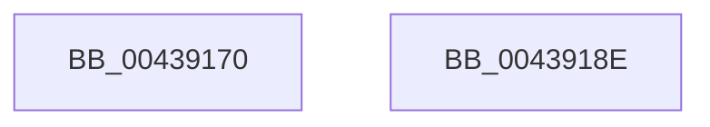

# HvlWriteApicCommandRegister

- RVA: `0x00439170`–`0x0043918F` (길이 `31` bytes)
- VA: `0x0000000140439170`
- 실행 섹션: `.text`
- PDB 이름 있음: `예`; PDB Function 태그: `아니요`
- unwind 정보 RVA: `0x000DB714`
- 디코드: `11`개 명령, `31/31` bytes 표시
- 미해석 바이트: `0` (있으면 어셈블리에 `.byte`로 보존)

> 이 문서는 커널 이미지의 기계어와 PDB 기호를 분석해 생성했습니다. 4번과 5번은 함수 원형과 자료형을 바이너리 사용 방식에서 추정한 C 해석이며 원본 소스 복구 결과는 아닙니다.

## 1. Dependencies

- 직접 호출 지점: **0**; 고유 호출 대상: **0**
- 직접 호출자로 확인된 함수: **0**
- RIP 상대 이미지 참조: **0**

### Outgoing calls
- 직접 디코드된 call 명령이 없습니다.

### Direct callers
- 이 함수 시작 RVA로 연결되는 직접 call은 확인되지 않았습니다. 간접 호출은 완전히 역산할 수 없습니다.

### Static image references
- 디코드된 RIP-relative 메모리 참조가 없습니다.

## 2. Other-region calls and transfers

- 다른 실행 섹션으로 향하는 call: **0**
- 별도 외부 분기/꼬리 이동을 확인하지 못했습니다.

## 3. Assembly (complete function range)

```asm
00439170  8B C2                           mov eax, edx
00439172  44 8B C1                        mov r8d, ecx
00439175  B9 71 00 00 40                  mov ecx, 0x40000071
0043917A  49 C1 E0 20                     shl r8, 0x20
0043917E  4C 0B C0                        or r8, rax
00439181  49 8B D0                        mov rdx, r8
00439184  49 8B C0                        mov rax, r8
00439187  48 C1 EA 20                     shr rdx, 0x20
0043918B  0F 30                           wrmsr
0043918D  C3                              ret
0043918E  CC                              int3
```

## 4. C-style interpretation (structured pseudocode)

```c
__int64 __fastcall HvlWriteApicCommandRegister(int a1, int a2)
{
    a3 = ((unsigned int)(a1)) << (32);
    a3 = (a3) | ((unsigned int)(a2));
    a2 = (a3) >> (32);
    return a3;
}
```

## 5. (Beta) C Style

```c
int64_t HvlWriteApicCommandRegister(int32_t Arg1, int32_t Arg2)
{
    a3 = ((uint32_t)(Arg1)) << (32);
    a3 = (a3) | ((uint32_t)(Arg2));
    Arg2 = (a3) >> (32);
    return a3;
}
```

## 6. Execution-region graph

[열기: 2D/3D 그래프와 함수 탐색 컨트롤 패널](../../../control-panel.html?section=text&rva=0x00439170&view=graph)

- 2D 그래프는 위에서 아래로 흐르고, 3D 그래프는 빈 공간을 드래그해 회전합니다. Shift+드래그는 이동, 휠은 확대·축소, 함수 노드 선택은 대상 보고서 이동입니다.

### Static fallback


