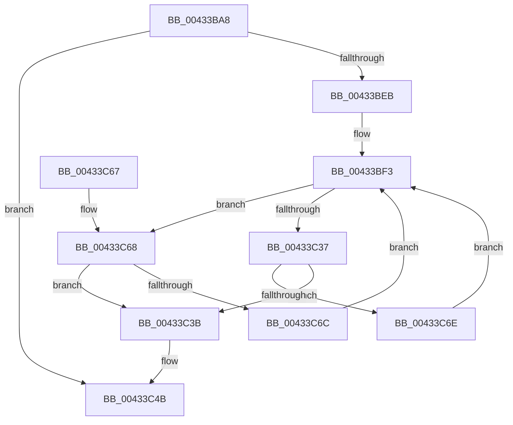

# HvpCopyDataToOffsetArray

- RVA: `0x00433BA8`–`0x00433C78` (길이 `208` bytes)
- VA: `0x0000000140433BA8`
- 실행 섹션: `.text`
- PDB 이름 있음: `예`; PDB Function 태그: `아니요`
- unwind 정보 RVA: `0x000A26BC`
- 디코드: `67`개 명령, `208/208` bytes 표시
- 미해석 바이트: `0` (있으면 어셈블리에 `.byte`로 보존)

> 이 문서는 커널 이미지의 기계어와 PDB 기호를 분석해 생성했습니다. 4번과 5번은 함수 원형과 자료형을 바이너리 사용 방식에서 추정한 C 해석이며 원본 소스 복구 결과는 아닙니다.

## 1. Dependencies

- 직접 호출 지점: **1**; 고유 호출 대상: **1**
- 직접 호출자로 확인된 함수: **2**
- RIP 상대 이미지 참조: **0**

### Outgoing calls
- `0x00433C23` → [memcpy](../6C/memcpy_function_006C6840.md) (function, `0x006C6840`)

### Direct callers
- [HvpGenerateLogEntryMetadata](HvpGenerateLogEntryMetadata_function_00433A4C.md) at `0x00433A9D`
- [HvpGenerateLogEntryDirtyData](HvpGenerateLogEntryDirtyData_function_00433ABC.md) at `0x00433B34`

### Static image references
- 디코드된 RIP-relative 메모리 참조가 없습니다.

## 2. Other-region calls and transfers

- 다른 실행 섹션으로 향하는 call: **0**
- 별도 외부 분기/꼬리 이동을 확인하지 못했습니다.

## 3. Assembly (complete function range)

```asm
00433BA8  48 8B C4                        mov rax, rsp
00433BAB  48 89 58 10                     mov qword ptr [rax + 0x10], rbx
00433BAF  44 89 48 20                     mov dword ptr [rax + 0x20], r9d
00433BB3  48 89 48 08                     mov qword ptr [rax + 8], rcx
00433BB7  55                              push rbp
00433BB8  56                              push rsi
00433BB9  57                              push rdi
00433BBA  41 54                           push r12
00433BBC  41 55                           push r13
00433BBE  41 56                           push r14
00433BC0  41 57                           push r15
00433BC2  48 83 EC 20                     sub rsp, 0x20
00433BC6  4C 8B BC 24 88 00 00 00         mov r15, qword ptr [rsp + 0x88]
00433BCE  4D 8B E8                        mov r13, r8
00433BD1  4C 8B A4 24 80 00 00 00         mov r12, qword ptr [rsp + 0x80]
00433BD9  8B EA                           mov ebp, edx
00433BDB  83 64 24 78 00                  and dword ptr [rsp + 0x78], 0
00433BE0  45 8B 37                        mov r14d, dword ptr [r15]
00433BE3  41 8B 34 24                     mov esi, dword ptr [r12]
00433BE7  85 D2                           test edx, edx
00433BE9  74 60                           je 0x140433c4b
00433BEB  44 8B 7C 24 78                  mov r15d, dword ptr [rsp + 0x78]
00433BF0  4C 8B E1                        mov r12, rcx
00433BF3  8B C6                           mov eax, esi
00433BF5  41 8D 14 2E                     lea edx, [r14 + rbp]
00433BF9  48 8D 3C 40                     lea rdi, [rax + rax*2]
00433BFD  8B C5                           mov eax, ebp
00433BFF  45 8B 44 FD 10                  mov r8d, dword ptr [r13 + rdi*8 + 0x10]
00433C04  41 8B C8                        mov ecx, r8d
00433C07  41 2B CE                        sub ecx, r14d
00433C0A  41 3B D0                        cmp edx, r8d
00433C0D  41 8B D7                        mov edx, r15d
00433C10  0F 47 C1                        cmova eax, ecx
00433C13  41 8B CE                        mov ecx, r14d
00433C16  49 03 4C FD 08                  add rcx, qword ptr [r13 + rdi*8 + 8]
00433C1B  49 03 D4                        add rdx, r12
00433C1E  44 8B C0                        mov r8d, eax
00433C21  8B D8                           mov ebx, eax
00433C23  E8 18 2C 29 00                  call 0x1406c6840
00433C28  44 03 FB                        add r15d, ebx
00433C2B  44 03 F3                        add r14d, ebx
00433C2E  2B EB                           sub ebp, ebx
00433C30  45 3B 74 FD 10                  cmp r14d, dword ptr [r13 + rdi*8 + 0x10]
00433C35  75 31                           jne 0x140433c68
00433C37  85 ED                           test ebp, ebp
00433C39  75 33                           jne 0x140433c6e
00433C3B  4C 8B BC 24 88 00 00 00         mov r15, qword ptr [rsp + 0x88]
00433C43  4C 8B A4 24 80 00 00 00         mov r12, qword ptr [rsp + 0x80]
00433C4B  48 8B 5C 24 68                  mov rbx, qword ptr [rsp + 0x68]
00433C50  41 89 34 24                     mov dword ptr [r12], esi
00433C54  45 89 37                        mov dword ptr [r15], r14d
00433C57  48 83 C4 20                     add rsp, 0x20
00433C5B  41 5F                           pop r15
00433C5D  41 5E                           pop r14
00433C5F  41 5D                           pop r13
00433C61  41 5C                           pop r12
00433C63  5F                              pop rdi
00433C64  5E                              pop rsi
00433C65  5D                              pop rbp
00433C66  C3                              ret
00433C67  CC                              int3
00433C68  85 ED                           test ebp, ebp
00433C6A  74 CF                           je 0x140433c3b
00433C6C  EB 85                           jmp 0x140433bf3
00433C6E  FF C6                           inc esi
00433C70  45 33 F6                        xor r14d, r14d
00433C73  E9 7B FF FF FF                  jmp 0x140433bf3
```

## 4. C-style interpretation (structured pseudocode)

```c
__int64 __fastcall HvpCopyDataToOffsetArray(__int64 a1, int a2, __int64 a3, int a4, __int64 a5, __int64 a6)
{
    __int64 result;
    __int64 v_r14;
    __int64 v_r15;
    __int64 v_rbp;
    __int64 v_rsi;
    __int64 v_rsp;
    unsigned __int64 v_stack_p10;
    unsigned int v_stack_p20;

    *(unsigned __int64 *)(v_rsp + 16) = v_rbx;
    *(unsigned int *)(v_rsp + 32) = a4;
    *(unsigned __int64 *)(v_rsp + 8) = a1;
    v_rsp = (v_rsp) - (32);
    if (a2 == 0) goto loc_00433C4B;
loc_00433BF3:
    a1 = (unsigned int)(((unsigned int)((unsigned int)((unsigned int)(*(unsigned int *)(a3 + (unsigned int)((unsigned int)((unsigned int)(*(unsigned int *)(a5)))) + (unsigned int)((unsigned int)((unsigned int)(*(unsigned int *)(a5)))) * 2 * 8 + 16))))) - ((unsigned int)((unsigned int)(*(unsigned int *)(a6)))));
    result = (unsigned int)((unsigned int)((unsigned int)(a2)));
    if (((unsigned int)((unsigned int)(*(unsigned int *)(a6)) + (unsigned int)(a2) * 1)) > ((unsigned int)((unsigned int)(*(unsigned int *)(a3 + (unsigned int)((unsigned int)((unsigned int)(*(unsigned int *)(a5)))) + (unsigned int)((unsigned int)((unsigned int)(*(unsigned int *)(a5)))) * 2 * 8 + 16))))) { result = (unsigned int)(a1); }
    a1 = ((unsigned int)((unsigned int)((unsigned int)(*(unsigned int *)(a6))))) + (*(unsigned __int64 *)(a3 + (unsigned int)((unsigned int)((unsigned int)(*(unsigned int *)(a5)))) + (unsigned int)((unsigned int)((unsigned int)(*(unsigned int *)(a5)))) * 2 * 8 + 8));
    a2 = ((unsigned int)((unsigned int)((unsigned int)(v_stack_p20)))) + (a1);
    result = memcpy(a1, a2, (unsigned int)((unsigned int)(result)), a4);
    v_r15 = (unsigned int)(((unsigned int)(v_stack_p20)) + ((unsigned int)((unsigned int)((unsigned int)(result)))));
    v_r14 = (unsigned int)(((unsigned int)(*(unsigned int *)(a6))) + ((unsigned int)((unsigned int)((unsigned int)(result)))));
    v_rbp = (unsigned int)(((unsigned int)(a2)) - ((unsigned int)((unsigned int)((unsigned int)(result)))));
    if (((unsigned int)(v_r14)) != (*(unsigned int *)(a3 + (unsigned int)((unsigned int)((unsigned int)(*(unsigned int *)(a5)))) + (unsigned int)((unsigned int)((unsigned int)(*(unsigned int *)(a5)))) * 2 * 8 + 16))) goto loc_00433C68;
    if ((unsigned int)(v_rbp) != 0) goto loc_00433C6E;
loc_00433C3B:
loc_00433C4B:
    *(unsigned int *)(a5) = (unsigned int)((unsigned int)(*(unsigned int *)(a5)));
    *(unsigned int *)(a6) = (unsigned int)(v_r14);
    v_rsp = (v_rsp) + (32);
    return result;
loc_00433C68:
    if ((unsigned int)(v_rbp) == 0) goto loc_00433C3B;
    goto loc_00433BF3;
loc_00433C6E:
    v_rsi = (unsigned int)(((unsigned int)(*(unsigned int *)(a5))) + 1);
    v_r14 = 0;
    goto loc_00433BF3;
}
```

## 5. (Beta) C Style

```c
int64_t HvpCopyDataToOffsetArray(int64_t Arg1, int32_t Arg2, void *Arg3, int32_t Arg4, void *Arg5, void *Arg6)
{
    uint8_t *arg3 = (uint8_t *)Arg3;
    uint8_t *arg5 = (uint8_t *)Arg5;
    uint8_t *arg6 = (uint8_t *)Arg6;

    int64_t result;
    int64_t local_r14;
    int64_t local_r15;
    int64_t local_rbp;
    int64_t local_rsi;
    int64_t local_rsp;
    uint64_t v_stack_p10;
    uint32_t v_stack_p20;

    *(uint64_t *)(local_rsp + 0x10) = local_rbx;
    *(uint32_t *)(local_rsp + 0x20) = Arg4;
    *(uint64_t *)(local_rsp + 0x8) = Arg1;
    local_rsp = (local_rsp) - (32);
    if (Arg2 == 0) goto loc_00433C4B;
loc_00433BF3:
    Arg1 = (uint32_t)(((uint32_t)((uint32_t)((uint32_t)(*(uint32_t *)(arg3 + (uint32_t)((uint32_t)((uint32_t)(*(uint32_t *)(arg5)))) + (uint32_t)((uint32_t)((uint32_t)(*(uint32_t *)(arg5)))) * 2 * 8 + 0x10))))) - ((uint32_t)((uint32_t)(*(uint32_t *)(arg6)))));
    result = (uint32_t)((uint32_t)((uint32_t)(Arg2)));
    if (((uint32_t)((uint32_t)(*(uint32_t *)(arg6)) + (uint32_t)(Arg2) * 1)) > ((uint32_t)((uint32_t)(*(uint32_t *)(arg3 + (uint32_t)((uint32_t)((uint32_t)(*(uint32_t *)(arg5)))) + (uint32_t)((uint32_t)((uint32_t)(*(uint32_t *)(arg5)))) * 2 * 8 + 0x10))))) { result = (uint32_t)(Arg1); }
    Arg1 = ((uint32_t)((uint32_t)((uint32_t)(*(uint32_t *)(arg6))))) + (*(uint64_t *)(arg3 + (uint32_t)((uint32_t)((uint32_t)(*(uint32_t *)(arg5)))) + (uint32_t)((uint32_t)((uint32_t)(*(uint32_t *)(arg5)))) * 2 * 8 + 0x8));
    Arg2 = ((uint32_t)((uint32_t)((uint32_t)(v_stack_p20)))) + (Arg1);
    result = memcpy(Arg1, Arg2, (uint32_t)((uint32_t)(result)), Arg4);
    local_r15 = (uint32_t)(((uint32_t)(v_stack_p20)) + ((uint32_t)((uint32_t)((uint32_t)(result)))));
    local_r14 = (uint32_t)(((uint32_t)(*(uint32_t *)(arg6))) + ((uint32_t)((uint32_t)((uint32_t)(result)))));
    local_rbp = (uint32_t)(((uint32_t)(Arg2)) - ((uint32_t)((uint32_t)((uint32_t)(result)))));
    if (((uint32_t)(local_r14)) != (*(uint32_t *)(arg3 + (uint32_t)((uint32_t)((uint32_t)(*(uint32_t *)(arg5)))) + (uint32_t)((uint32_t)((uint32_t)(*(uint32_t *)(arg5)))) * 2 * 8 + 0x10))) goto loc_00433C68;
    if ((uint32_t)(local_rbp) != 0) goto loc_00433C6E;
loc_00433C3B:
loc_00433C4B:
    *(uint32_t *)(arg5) = (uint32_t)((uint32_t)(*(uint32_t *)(arg5)));
    *(uint32_t *)(arg6) = (uint32_t)(local_r14);
    local_rsp = (local_rsp) + (32);
    return result;
loc_00433C68:
    if ((uint32_t)(local_rbp) == 0) goto loc_00433C3B;
    goto loc_00433BF3;
loc_00433C6E:
    local_rsi = (uint32_t)(((uint32_t)(*(uint32_t *)(arg5))) + 1);
    local_r14 = 0;
    goto loc_00433BF3;
}
```

### 관측된 메모리 오프셋

구조체 형식이 확인되지 않은 접근은 인자 기준의 오프셋으로만 기록했습니다.

| 기준 인자 | 오프셋 표현 | 폭 (bit) | 접근 |
|---|---:|---:|---|
| `Arg3` | `+ 0x8 + rdi*8` | `64` | `R` |
| `Arg3` | `+ 0x10 + rdi*8` | `32` | `R` |
| `Arg5` | `+ 0x0` | `32` | `R` |
| `Arg5` | `+ 0x0` | `32` | `W` |
| `Arg6` | `+ 0x0` | `32` | `R` |
| `Arg6` | `+ 0x0` | `32` | `W` |

## 6. Execution-region graph

[열기: 2D/3D 그래프와 함수 탐색 컨트롤 패널](../../../control-panel.html?section=text&rva=0x00433BA8&view=graph)

- 2D 그래프는 위에서 아래로 흐르고, 3D 그래프는 빈 공간을 드래그해 회전합니다. Shift+드래그는 이동, 휠은 확대·축소, 함수 노드 선택은 대상 보고서 이동입니다.

### Static fallback


