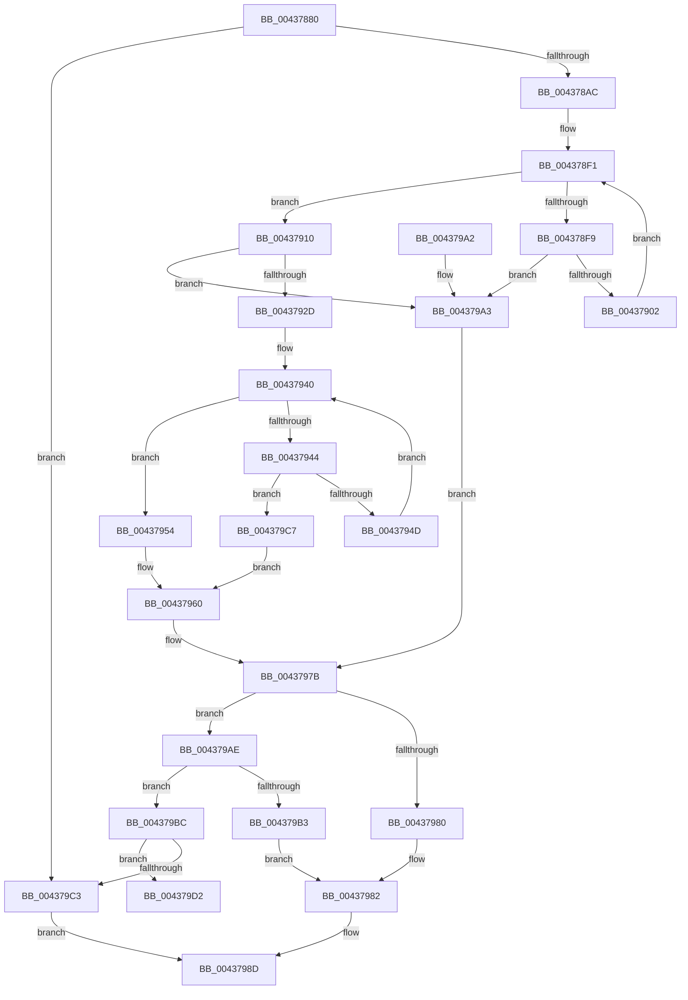

# HvpFindNextDirtyRun

- RVA: `0x00437880`–`0x00437A0E` (길이 `398` bytes)
- VA: `0x0000000140437880`
- 실행 섹션: `.text`
- PDB 이름 있음: `예`; PDB Function 태그: `예`
- unwind 정보 RVA: `0x000A31EC`
- 디코드: `129`개 명령, `398/398` bytes 표시
- 미해석 바이트: `0` (있으면 어셈블리에 `.byte`로 보존)

> 이 문서는 커널 이미지의 기계어와 PDB 기호를 분석해 생성했습니다. 4번과 5번은 함수 원형과 자료형을 바이너리 사용 방식에서 추정한 C 해석이며 원본 소스 복구 결과는 아닙니다.

## 1. Dependencies

- 직접 호출 지점: **0**; 고유 호출 대상: **0**
- 직접 호출자로 확인된 함수: **1**
- RIP 상대 이미지 참조: **0**

### Outgoing calls
- 직접 디코드된 call 명령이 없습니다.

### Direct callers
- [HvpFindNextDirtyBlock](../../page/9B/HvpFindNextDirtyBlock_function_009B5540.md) at `0x009B55A2`

### Static image references
- 디코드된 RIP-relative 메모리 참조가 없습니다.

## 2. Other-region calls and transfers

- 다른 실행 섹션으로 향하는 call: **0**
- call이 아닌 외부 분기/꼬리 이동: **1**
  - `0x00437A09` → [sub_006EF06C](../6E/Unknown_function_006EF06C.md) (`tail-transfer`)

## 3. Assembly (complete function range)

```asm
00437880  48 89 5C 24 18                  mov qword ptr [rsp + 0x18], rbx
00437885  48 89 6C 24 20                  mov qword ptr [rsp + 0x20], rbp
0043788A  56                              push rsi
0043788B  57                              push rdi
0043788C  41 54                           push r12
0043788E  41 55                           push r13
00437890  41 56                           push r14
00437892  41 57                           push r15
00437894  8B 32                           mov esi, dword ptr [rdx]
00437896  4D 8B F9                        mov r15, r9
00437899  8B 39                           mov edi, dword ptr [rcx]
0043789B  49 8B E8                        mov rbp, r8
0043789E  4C 8B F2                        mov r14, rdx
004378A1  48 8B D9                        mov rbx, rcx
004378A4  3B F7                           cmp esi, edi
004378A6  0F 83 17 01 00 00               jae 0x1404379c3
004378AC  4C 8B 61 08                     mov r12, qword ptr [rcx + 8]
004378B0  33 C0                           xor eax, eax
004378B2  48 89 44 24 40                  mov qword ptr [rsp + 0x40], rax
004378B7  44 8B D0                        mov r10d, eax
004378BA  8D 47 FF                        lea eax, [rdi - 1]
004378BD  8B CE                           mov ecx, esi
004378BF  48 89 44 24 58                  mov qword ptr [rsp + 0x58], rax
004378C4  83 E1 1F                        and ecx, 0x1f
004378C7  48 C1 E8 05                     shr rax, 5
004378CB  41 BD 01 00 00 00               mov r13d, 1
004378D1  41 8B D5                        mov edx, r13d
004378D4  D3 E2                           shl edx, cl
004378D6  FF CA                           dec edx
004378D8  4D 8D 04 84                     lea r8, [r12 + rax*4]
004378DC  8B C6                           mov eax, esi
004378DE  48 C1 E8 05                     shr rax, 5
004378E2  45 8B 0C 84                     mov r9d, dword ptr [r12 + rax*4]
004378E6  49 8D 04 84                     lea rax, [r12 + rax*4]
004378EA  44 0B CA                        or r9d, edx
004378ED  48 8D 48 04                     lea rcx, [rax + 4]
004378F1  41 F7 D1                        not r9d
004378F4  45 85 C9                        test r9d, r9d
004378F7  75 17                           jne 0x140437910
004378F9  49 3B C8                        cmp rcx, r8
004378FC  0F 87 A1 00 00 00               ja 0x1404379a3
00437902  44 8B 48 04                     mov r9d, dword ptr [rax + 4]
00437906  48 83 C0 04                     add rax, 4
0043790A  48 83 C1 04                     add rcx, 4
0043790E  EB E1                           jmp 0x1404378f1
00437910  41 8B C9                        mov ecx, r9d
00437913  4C 8B D8                        mov r11, rax
00437916  4D 2B DC                        sub r11, r12
00437919  49 C1 FB 02                     sar r11, 2
0043791D  48 0F BC C9                     bsf rcx, rcx
00437921  41 C1 E3 05                     shl r11d, 5
00437925  44 03 D9                        add r11d, ecx
00437928  44 3B DF                        cmp r11d, edi
0043792B  77 76                           ja 0x1404379a3
0043792D  41 8B D5                        mov edx, r13d
00437930  D3 E2                           shl edx, cl
00437932  FF CA                           dec edx
00437934  41 0B D1                        or edx, r9d
00437937  F7 D2                           not edx
00437939  0F 1F 80 00 00 00 00            nop dword ptr [rax]
00437940  85 D2                           test edx, edx
00437942  75 10                           jne 0x140437954
00437944  48 8D 48 04                     lea rcx, [rax + 4]
00437948  49 3B C8                        cmp rcx, r8
0043794B  77 7A                           ja 0x1404379c7
0043794D  8B 11                           mov edx, dword ptr [rcx]
0043794F  48 8B C1                        mov rax, rcx
00437952  EB EC                           jmp 0x140437940
00437954  8B CA                           mov ecx, edx
00437956  41 B8 20 00 00 00               mov r8d, 0x20
0043795C  48 0F BC C9                     bsf rcx, rcx
00437960  49 2B C4                        sub rax, r12
00437963  4C 8B D0                        mov r10, rax
00437966  49 C1 FA 02                     sar r10, 2
0043796A  41 C1 E2 05                     shl r10d, 5
0043796E  44 03 D1                        add r10d, ecx
00437971  44 3B D7                        cmp r10d, edi
00437974  44 0F 47 D7                     cmova r10d, edi
00437978  45 2B D3                        sub r10d, r11d
0043797B  45 85 D2                        test r10d, r10d
0043797E  75 2E                           jne 0x1404379ae
00437980  8B D7                           mov edx, edi
00437982  41 89 3E                        mov dword ptr [r14], edi
00437985  B0 01                           mov al, 1
00437987  89 75 00                        mov dword ptr [rbp], esi
0043798A  41 89 17                        mov dword ptr [r15], edx
0043798D  48 8B 5C 24 48                  mov rbx, qword ptr [rsp + 0x48]
00437992  48 8B 6C 24 50                  mov rbp, qword ptr [rsp + 0x50]
00437997  41 5F                           pop r15
00437999  41 5E                           pop r14
0043799B  41 5D                           pop r13
0043799D  41 5C                           pop r12
0043799F  5F                              pop rdi
004379A0  5E                              pop rsi
004379A1  C3                              ret
004379A2  CC                              int3
004379A3  44 8B DF                        mov r11d, edi
004379A6  41 B8 20 00 00 00               mov r8d, 0x20
004379AC  EB CD                           jmp 0x14043797b
004379AE  44 3B DE                        cmp r11d, esi
004379B1  74 09                           je 0x1404379bc
004379B3  41 8B D3                        mov edx, r11d
004379B6  43 8D 3C 13                     lea edi, [r11 + r10]
004379BA  EB C6                           jmp 0x140437982
004379BC  41 03 F2                        add esi, r10d
004379BF  3B F7                           cmp esi, edi
004379C1  72 0F                           jb 0x1404379d2
004379C3  32 C0                           xor al, al
004379C5  EB C6                           jmp 0x14043798d
004379C7  41 B8 20 00 00 00               mov r8d, 0x20
004379CD  41 8B C8                        mov ecx, r8d
004379D0  EB 8E                           jmp 0x140437960
004379D2  4C 8B 5B 08                     mov r11, qword ptr [rbx + 8]
004379D6  8B CE                           mov ecx, esi
004379D8  48 8B 44 24 58                  mov rax, qword ptr [rsp + 0x58]
004379DD  83 E1 1F                        and ecx, 0x1f
004379E0  4C 8B 64 24 40                  mov r12, qword ptr [rsp + 0x40]
004379E5  48 C1 E8 05                     shr rax, 5
004379E9  49 8D 1C 83                     lea rbx, [r11 + rax*4]
004379ED  8B C6                           mov eax, esi
004379EF  48 C1 E8 05                     shr rax, 5
004379F3  45 8B 14 83                     mov r10d, dword ptr [r11 + rax*4]
004379F7  4D 8D 0C 83                     lea r9, [r11 + rax*4]
004379FB  41 8B C5                        mov eax, r13d
004379FE  D3 E0                           shl eax, cl
00437A00  FF C8                           dec eax
00437A02  44 0B D0                        or r10d, eax
00437A05  49 8D 41 04                     lea rax, [r9 + 4]
00437A09  E9 5E 76 2B 00                  jmp 0x1406ef06c
```

## 4. C-style interpretation (structured pseudocode)

```c
__int64 __fastcall HvpFindNextDirtyRun(__int64 a1, __int64 a2, __int64 a3, __int64 a4, __int64 a5)
{
    __int64 result;
    __int64 v_r10;
    __int64 v_r11;
    __int64 v_rsi;
    unsigned __int64 v_stack_p10;
    unsigned __int64 v_stack_p18;
    unsigned __int64 v_stack_p20;
    unsigned __int64 v_stack_p28;
    unsigned __int64 v_stack_p40;

    v_stack_p18 = v_rbx;
    v_stack_p20 = v_rbp;
    if (((unsigned int)((unsigned int)(*(unsigned int *)(a2)))) >= ((unsigned int)((unsigned int)(*(unsigned int *)(a1))))) goto loc_004379C3;
    result = 0;
    v_stack_p10 = 0;
    v_stack_p28 = (unsigned int)(*(unsigned int *)(a1)) - 1;
    a1 = (unsigned int)(((unsigned int)((unsigned int)((unsigned int)(*(unsigned int *)(a2))))) & (31));
    result = ((unsigned int)(*(unsigned int *)(a1)) - 1) >> (5);
    a2 = (unsigned int)((1) << ((unsigned __int8)(a1)));
    a2 = (unsigned int)((a2) - 1);
    result = ((unsigned int)((unsigned int)((unsigned int)(*(unsigned int *)(a2))))) >> (5);
    a4 = (unsigned int)(((unsigned int)(*(unsigned int *)(*(unsigned __int64 *)(a1 + 8) + result * 4))) | ((unsigned int)(a2)));
loc_004378F1:
    a4 = (unsigned int)(~(a4));
    if ((unsigned int)(a4) != 0) goto loc_00437910;
    if ((*(unsigned __int64 *)(a1 + 8) + result * 4 + 4) > (*(unsigned __int64 *)(a1 + 8) + result * 4)) goto loc_004379A3;
    result = (*(unsigned __int64 *)(a1 + 8) + result * 4) + (4);
    a1 = (*(unsigned __int64 *)(a1 + 8) + result * 4 + 4) + (4);
    goto loc_004378F1;
loc_00437910:
    v_r11 = (result) - (*(unsigned __int64 *)(a1 + 8));
    v_r11 = (v_r11) >> (2);
    v_r11 = (unsigned int)((v_r11) << (5));
    v_r11 = (unsigned int)((v_r11) + ((unsigned int)((unsigned int)((unsigned int)((unsigned int)(*(unsigned int *)(*(unsigned __int64 *)(a1 + 8) + result * 4 + 4)))))));
    if (((unsigned int)(v_r11)) > ((unsigned int)((unsigned int)(*(unsigned int *)(a1))))) goto loc_004379A3;
    a2 = (unsigned int)((1) << ((unsigned __int8)((unsigned int)((unsigned int)((unsigned int)(*(unsigned int *)(*(unsigned __int64 *)(a1 + 8) + result * 4 + 4)))))));
    a2 = (unsigned int)((a2) - 1);
    a2 = (unsigned int)((a2) | ((unsigned int)((unsigned int)(*(unsigned int *)(*(unsigned __int64 *)(a1 + 8) + result * 4 + 4)))));
    a2 = (unsigned int)(~(a2));
loc_00437940:
    if ((unsigned int)(a2) != 0) goto loc_00437954;
    if ((result + 4) > (*(unsigned __int64 *)(a1 + 8) + result * 4)) goto loc_004379C7;
    goto loc_00437940;
loc_00437954:
loc_00437960:
    result = (result + 4) - (*(unsigned __int64 *)(a1 + 8));
    v_r10 = (result) >> (2);
    v_r10 = (unsigned int)((v_r10) << (5));
    v_r10 = (unsigned int)((v_r10) + ((unsigned int)((unsigned int)((unsigned int)((unsigned int)(*(unsigned int *)(result + 4)))))));
    if (((unsigned int)(v_r10)) > ((unsigned int)((unsigned int)(*(unsigned int *)(a1))))) { v_r10 = (unsigned int)((unsigned int)(*(unsigned int *)(a1))); }
    v_r10 = (unsigned int)((v_r10) - ((unsigned int)(v_r11)));
loc_0043797B:
    if ((unsigned int)(v_r10) != 0) goto loc_004379AE;
loc_00437982:
    *(unsigned int *)(a2) = (unsigned int)((unsigned int)(*(unsigned int *)(a1)));
    *(unsigned int *)(a3) = (unsigned int)((unsigned int)(*(unsigned int *)(a2)));
    *(unsigned int *)(a4) = (unsigned int)((unsigned int)((unsigned int)((unsigned int)(*(unsigned int *)(a1)))));
loc_0043798D:
    return 1;
loc_004379A3:
    goto loc_0043797B;
loc_004379AE:
    if (((unsigned int)((unsigned int)((unsigned int)((unsigned int)(*(unsigned int *)(a1)))))) == ((unsigned int)((unsigned int)(*(unsigned int *)(a2))))) goto loc_004379BC;
    goto loc_00437982;
loc_004379BC:
    v_rsi = (unsigned int)(((unsigned int)(*(unsigned int *)(a2))) + ((unsigned int)(v_r10)));
    if (((unsigned int)(v_rsi)) < ((unsigned int)((unsigned int)((unsigned int)((unsigned int)(*(unsigned int *)(a1)))) + v_r10 * 1))) goto loc_004379D2;
loc_004379C3:
    result = 0;
    goto loc_0043798D;
loc_004379C7:
    goto loc_00437960;
loc_004379D2:
    a1 = (unsigned int)(((unsigned int)((unsigned int)(v_rsi))) & (31));
    result = (a5) >> (5);
    result = ((unsigned int)((unsigned int)(v_rsi))) >> (5);
    result = (unsigned int)((1) << ((unsigned __int8)(a1)));
    result = (unsigned int)((result) - 1);
    v_r10 = (unsigned int)(((unsigned int)(*(unsigned int *)(*(unsigned __int64 *)(v_stack_p18 + 8) + result * 4))) | ((unsigned int)(result)));
}
```

## 5. (Beta) C Style

```c
int64_t HvpFindNextDirtyRun(void *Arg1, void *Arg2, void *Arg3, void *Arg4, int64_t Arg5)
{
    uint8_t *arg1 = (uint8_t *)Arg1;
    uint8_t *arg2 = (uint8_t *)Arg2;
    uint8_t *arg3 = (uint8_t *)Arg3;
    uint8_t *arg4 = (uint8_t *)Arg4;

    int64_t result;
    int64_t local_r10;
    int64_t local_r11;
    int64_t local_rsi;
    uint64_t v_stack_p10;
    uint64_t v_stack_p18;
    uint64_t v_stack_p20;
    uint64_t v_stack_p28;
    uint64_t v_stack_p40;

    v_stack_p18 = local_rbx;
    v_stack_p20 = local_rbp;
    if (((uint32_t)((uint32_t)(*(uint32_t *)(arg2)))) >= ((uint32_t)((uint32_t)(*(uint32_t *)(arg1))))) goto loc_004379C3;
    result = 0;
    v_stack_p10 = 0;
    v_stack_p28 = (uint32_t)(*(uint32_t *)(arg1)) - 1;
    Arg1 = (uint32_t)(((uint32_t)((uint32_t)((uint32_t)(*(uint32_t *)(arg2))))) & (31));
    result = ((uint32_t)(*(uint32_t *)(arg1)) - 1) >> (5);
    Arg2 = (uint32_t)((1) << ((uint8_t)(Arg1)));
    Arg2 = (uint32_t)((Arg2) - 1);
    result = ((uint32_t)((uint32_t)((uint32_t)(*(uint32_t *)(arg2))))) >> (5);
    Arg4 = (uint32_t)(((uint32_t)(*(uint32_t *)(*(uint64_t *)(arg1 + 0x8) + result * 4))) | ((uint32_t)(Arg2)));
loc_004378F1:
    Arg4 = (uint32_t)(~(Arg4));
    if ((uint32_t)(Arg4) != 0) goto loc_00437910;
    if ((*(uint64_t *)(arg1 + 0x8) + result * 4 + 4) > (*(uint64_t *)(arg1 + 0x8) + result * 4)) goto loc_004379A3;
    result = (*(uint64_t *)(arg1 + 0x8) + result * 4) + (4);
    Arg1 = (*(uint64_t *)(arg1 + 0x8) + result * 4 + 4) + (4);
    goto loc_004378F1;
loc_00437910:
    local_r11 = (result) - (*(uint64_t *)(arg1 + 0x8));
    local_r11 = (local_r11) >> (2);
    local_r11 = (uint32_t)((local_r11) << (5));
    local_r11 = (uint32_t)((local_r11) + ((uint32_t)((uint32_t)((uint32_t)((uint32_t)(*(uint32_t *)(*(uint64_t *)(arg1 + 0x8) + result * 4 + 0x4)))))));
    if (((uint32_t)(local_r11)) > ((uint32_t)((uint32_t)(*(uint32_t *)(arg1))))) goto loc_004379A3;
    Arg2 = (uint32_t)((1) << ((uint8_t)((uint32_t)((uint32_t)((uint32_t)(*(uint32_t *)(*(uint64_t *)(arg1 + 0x8) + result * 4 + 0x4)))))));
    Arg2 = (uint32_t)((Arg2) - 1);
    Arg2 = (uint32_t)((Arg2) | ((uint32_t)((uint32_t)(*(uint32_t *)(*(uint64_t *)(arg1 + 0x8) + result * 4 + 0x4)))));
    Arg2 = (uint32_t)(~(Arg2));
loc_00437940:
    if ((uint32_t)(Arg2) != 0) goto loc_00437954;
    if ((result + 4) > (*(uint64_t *)(arg1 + 0x8) + result * 4)) goto loc_004379C7;
    goto loc_00437940;
loc_00437954:
loc_00437960:
    result = (result + 4) - (*(uint64_t *)(arg1 + 0x8));
    local_r10 = (result) >> (2);
    local_r10 = (uint32_t)((local_r10) << (5));
    local_r10 = (uint32_t)((local_r10) + ((uint32_t)((uint32_t)((uint32_t)((uint32_t)(*(uint32_t *)(result + 0x4)))))));
    if (((uint32_t)(local_r10)) > ((uint32_t)((uint32_t)(*(uint32_t *)(arg1))))) { local_r10 = (uint32_t)((uint32_t)(*(uint32_t *)(arg1))); }
    local_r10 = (uint32_t)((local_r10) - ((uint32_t)(local_r11)));
loc_0043797B:
    if ((uint32_t)(local_r10) != 0) goto loc_004379AE;
loc_00437982:
    *(uint32_t *)(arg2) = (uint32_t)((uint32_t)(*(uint32_t *)(arg1)));
    *(uint32_t *)(arg3) = (uint32_t)((uint32_t)(*(uint32_t *)(arg2)));
    *(uint32_t *)(arg4) = (uint32_t)((uint32_t)((uint32_t)((uint32_t)(*(uint32_t *)(arg1)))));
loc_0043798D:
    return 1;
loc_004379A3:
    goto loc_0043797B;
loc_004379AE:
    if (((uint32_t)((uint32_t)((uint32_t)((uint32_t)(*(uint32_t *)(arg1)))))) == ((uint32_t)((uint32_t)(*(uint32_t *)(arg2))))) goto loc_004379BC;
    goto loc_00437982;
loc_004379BC:
    local_rsi = (uint32_t)(((uint32_t)(*(uint32_t *)(arg2))) + ((uint32_t)(local_r10)));
    if (((uint32_t)(local_rsi)) < ((uint32_t)((uint32_t)((uint32_t)((uint32_t)(*(uint32_t *)(arg1)))) + local_r10 * 1))) goto loc_004379D2;
loc_004379C3:
    result = 0;
    goto loc_0043798D;
loc_004379C7:
    goto loc_00437960;
loc_004379D2:
    Arg1 = (uint32_t)(((uint32_t)((uint32_t)(local_rsi))) & (31));
    result = (Arg5) >> (5);
    result = ((uint32_t)((uint32_t)(local_rsi))) >> (5);
    result = (uint32_t)((1) << ((uint8_t)(Arg1)));
    result = (uint32_t)((result) - 1);
    local_r10 = (uint32_t)(((uint32_t)(*(uint32_t *)(*(uint64_t *)(v_stack_p18 + 0x8) + result * 4))) | ((uint32_t)(result)));
}
```

### 관측된 메모리 오프셋

구조체 형식이 확인되지 않은 접근은 인자 기준의 오프셋으로만 기록했습니다.

| 기준 인자 | 오프셋 표현 | 폭 (bit) | 접근 |
|---|---:|---:|---|
| `Arg1` | `+ 0x0` | `32` | `R` |
| `Arg1` | `+ 0x8` | `64` | `R` |
| `Arg2` | `+ 0x0` | `32` | `R` |
| `Arg2` | `+ 0x0` | `32` | `W` |
| `Arg3` | `+ 0x0` | `32` | `W` |
| `Arg4` | `+ 0x0` | `32` | `W` |

## 6. Execution-region graph

[열기: 2D/3D 그래프와 함수 탐색 컨트롤 패널](../../../control-panel.html?section=text&rva=0x00437880&view=graph)

- 2D 그래프는 위에서 아래로 흐르고, 3D 그래프는 빈 공간을 드래그해 회전합니다. Shift+드래그는 이동, 휠은 확대·축소, 함수 노드 선택은 대상 보고서 이동입니다.

### Static fallback


