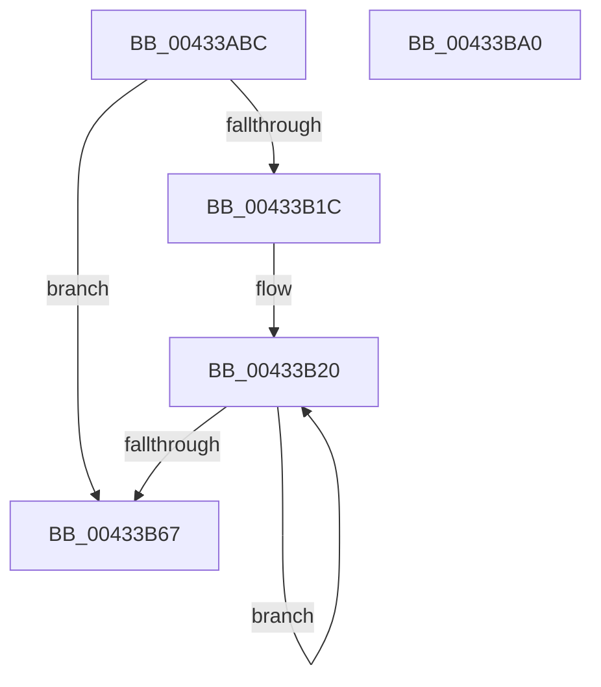

# HvpGenerateLogEntryDirtyData

- RVA: `0x00433ABC`–`0x00433BA1` (길이 `229` bytes)
- VA: `0x0000000140433ABC`
- 실행 섹션: `.text`
- PDB 이름 있음: `예`; PDB Function 태그: `아니요`
- unwind 정보 RVA: `0x000A26A4`
- 디코드: `67`개 명령, `229/229` bytes 표시
- 미해석 바이트: `0` (있으면 어셈블리에 `.byte`로 보존)

> 이 문서는 커널 이미지의 기계어와 PDB 기호를 분석해 생성했습니다. 4번과 5번은 함수 원형과 자료형을 바이너리 사용 방식에서 추정한 C 해석이며 원본 소스 복구 결과는 아닙니다.

## 1. Dependencies

- 직접 호출 지점: **6**; 고유 호출 대상: **5**
- 직접 호출자로 확인된 함수: **1**
- RIP 상대 이미지 참조: **0**

### Outgoing calls
- `0x00433B13` → [HvpFindNextDirtyBlock](../../page/9B/HvpFindNextDirtyBlock_function_009B5540.md) (function, `0x009B5540`)
- `0x00433B34` → [HvpCopyDataToOffsetArray](HvpCopyDataToOffsetArray_function_00433BA8.md) (function, `0x00433BA8`)
- `0x00433B5E` → [HvpFindNextDirtyBlock](../../page/9B/HvpFindNextDirtyBlock_function_009B5540.md) (function, `0x009B5540`)
- `0x00433B6A` → [RtlNumberOfSetBits](RtlNumberOfSetBits_function_00433F70.md) (function, `0x00433F70`)
- `0x00433B74` → [HvpCountSetRangesInVector](../../page/9B/HvpCountSetRangesInVector_function_009B6974.md) (function, `0x009B6974`)
- `0x00433B87` → [CmpLogDirtyVectorUse](../../page/9B/CmpLogDirtyVectorUse_function_009B69D4.md) (function, `0x009B69D4`)

### Direct callers
- [HvpGenerateLogEntry](../../page/9B/HvpGenerateLogEntry_function_009B65F0.md) at `0x009B671F`

### Static image references
- 디코드된 RIP-relative 메모리 참조가 없습니다.

## 2. Other-region calls and transfers

- 다른 실행 섹션으로 향하는 call: **4**
  - `0x00433B13` → [HvpFindNextDirtyBlock](../../page/9B/HvpFindNextDirtyBlock_function_009B5540.md) (`.text` → `PAGE`)
  - `0x00433B5E` → [HvpFindNextDirtyBlock](../../page/9B/HvpFindNextDirtyBlock_function_009B5540.md) (`.text` → `PAGE`)
  - `0x00433B74` → [HvpCountSetRangesInVector](../../page/9B/HvpCountSetRangesInVector_function_009B6974.md) (`.text` → `PAGE`)
  - `0x00433B87` → [CmpLogDirtyVectorUse](../../page/9B/CmpLogDirtyVectorUse_function_009B69D4.md) (`.text` → `PAGE`)
- 별도 외부 분기/꼬리 이동을 확인하지 못했습니다.

## 3. Assembly (complete function range)

```asm
00433ABC  4C 8B DC                        mov r11, rsp
00433ABF  49 89 5B 10                     mov qword ptr [r11 + 0x10], rbx
00433AC3  45 89 43 18                     mov dword ptr [r11 + 0x18], r8d
00433AC7  55                              push rbp
00433AC8  56                              push rsi
00433AC9  57                              push rdi
00433ACA  41 56                           push r14
00433ACC  41 57                           push r15
00433ACE  48 8B EC                        mov rbp, rsp
00433AD1  48 83 EC 50                     sub rsp, 0x50
00433AD5  48 83 65 F0 00                  and qword ptr [rbp - 0x10], 0
00433ADA  48 8D 45 58                     lea rax, [rbp + 0x58]
00433ADE  83 65 40 00                     and dword ptr [rbp + 0x40], 0
00433AE2  48 8D 79 58                     lea rdi, [rcx + 0x58]
00433AE6  83 65 58 00                     and dword ptr [rbp + 0x58], 0
00433AEA  4C 8D 45 30                     lea r8, [rbp + 0x30]
00433AEE  83 65 30 00                     and dword ptr [rbp + 0x30], 0
00433AF2  4D 8B F1                        mov r14, r9
00433AF5  C6 44 24 30 00                  mov byte ptr [rsp + 0x30], 0
00433AFA  4C 8D 4D F0                     lea r9, [rbp - 0x10]
00433AFE  49 89 43 B0                     mov qword ptr [r11 - 0x50], rax
00433B02  4C 8B FA                        mov r15, rdx
00433B05  48 8D 45 40                     lea rax, [rbp + 0x40]
00433B09  48 8B D7                        mov rdx, rdi
00433B0C  49 89 43 A8                     mov qword ptr [r11 - 0x58], rax
00433B10  48 8B F1                        mov rsi, rcx
00433B13  E8 28 1A 58 00                  call 0x1409b5540
00433B18  84 C0                           test al, al
00433B1A  74 4B                           je 0x140433b67
00433B1C  48 8B 5D 50                     mov rbx, qword ptr [rbp + 0x50]
00433B20  8B 55 40                        mov edx, dword ptr [rbp + 0x40]
00433B23  4D 8B C7                        mov r8, r15
00433B26  48 8B 4D F0                     mov rcx, qword ptr [rbp - 0x10]
00433B2A  48 89 5C 24 28                  mov qword ptr [rsp + 0x28], rbx
00433B2F  4C 89 74 24 20                  mov qword ptr [rsp + 0x20], r14
00433B34  E8 6F 00 00 00                  call 0x140433ba8
00433B39  48 8D 45 58                     lea rax, [rbp + 0x58]
00433B3D  C6 44 24 30 00                  mov byte ptr [rsp + 0x30], 0
00433B42  48 89 44 24 28                  mov qword ptr [rsp + 0x28], rax
00433B47  4C 8D 4D F0                     lea r9, [rbp - 0x10]
00433B4B  48 8D 45 40                     lea rax, [rbp + 0x40]
00433B4F  48 8B D7                        mov rdx, rdi
00433B52  4C 8D 45 30                     lea r8, [rbp + 0x30]
00433B56  48 89 44 24 20                  mov qword ptr [rsp + 0x20], rax
00433B5B  48 8B CE                        mov rcx, rsi
00433B5E  E8 DD 19 58 00                  call 0x1409b5540
00433B63  84 C0                           test al, al
00433B65  75 B9                           jne 0x140433b20
00433B67  48 8B CF                        mov rcx, rdi
00433B6A  E8 01 04 00 00                  call 0x140433f70
00433B6F  48 8B CF                        mov rcx, rdi
00433B72  8B D8                           mov ebx, eax
00433B74  E8 FB 2D 58 00                  call 0x1409b6974
00433B79  44 8B C0                        mov r8d, eax
00433B7C  44 8B CB                        mov r9d, ebx
00433B7F  BA 02 00 00 00                  mov edx, 2
00433B84  48 8B CE                        mov rcx, rsi
00433B87  E8 48 2E 58 00                  call 0x1409b69d4
00433B8C  48 8B 9C 24 88 00 00 00         mov rbx, qword ptr [rsp + 0x88]
00433B94  48 83 C4 50                     add rsp, 0x50
00433B98  41 5F                           pop r15
00433B9A  41 5E                           pop r14
00433B9C  5F                              pop rdi
00433B9D  5E                              pop rsi
00433B9E  5D                              pop rbp
00433B9F  C3                              ret
00433BA0  CC                              int3
```

## 4. C-style interpretation (structured pseudocode)

```c
__int64 __fastcall HvpGenerateLogEntryDirtyData(__int64 a1, __int64 a2, int a3, __int64 a4, __int64 a5, unsigned int a6)
{
    __int64 result;
    __int64 v_rsp;
    unsigned __int64 v_stack_m38;
    unsigned __int8 v_stack_m48;
    unsigned __int64 v_stack_m50;
    unsigned __int64 v_stack_m58;
    unsigned __int64 v_stack_p10;
    unsigned int v_stack_p18;
    unsigned __int64 v_stack_p8;

    *(unsigned __int64 *)(v_rsp + 16) = v_rbx;
    *(unsigned int *)(v_rsp + 24) = a3;
    v_rsp = (v_rsp) - (80);
    v_stack_m48 = 0;
    *(unsigned __int64 *)(v_rsp - 80) = a6;
    *(unsigned __int64 *)(v_rsp - 88) = v_stack_p18;
    result = HvpFindNextDirtyBlock(a1, a1 + 88, v_stack_p8, v_stack_m38);
    if ((unsigned __int8)(result) == 0) goto loc_00433B67;
loc_00433B20:
    v_stack_m50 = a5;
    v_stack_m58 = a4;
    result = HvpCopyDataToOffsetArray(v_stack_m38, (unsigned int)(v_stack_p18), a2, v_stack_m38);
    v_stack_m48 = 0;
    v_stack_m50 = a6;
    v_stack_m58 = v_stack_p18;
    result = HvpFindNextDirtyBlock(a1, a1 + 88, v_stack_p8, v_stack_m38);
    if ((unsigned __int8)(result) != 0) goto loc_00433B20;
loc_00433B67:
    result = RtlNumberOfSetBits(a1 + 88, a1 + 88, v_stack_p8, v_stack_m38);
    result = HvpCountSetRangesInVector(a1 + 88, a1 + 88, v_stack_p8, v_stack_m38);
    result = CmpLogDirtyVectorUse(a1, 2, (unsigned int)((unsigned int)(result)), (unsigned int)((unsigned int)((unsigned int)((unsigned int)(result)))));
    v_rsp = (v_rsp) + (80);
    return result;
}
```

## 5. (Beta) C Style

```c
int64_t HvpGenerateLogEntryDirtyData(void *Arg1, int64_t Arg2, int32_t Arg3, int64_t Arg4, int64_t Arg5, uint32_t Arg6)
{
    uint8_t *arg1 = (uint8_t *)Arg1;

    int64_t result;
    int64_t local_rsp;
    uint64_t v_stack_m38;
    uint8_t v_stack_m48;
    uint64_t v_stack_m50;
    uint64_t v_stack_m58;
    uint64_t v_stack_p10;
    uint32_t v_stack_p18;
    uint64_t v_stack_p8;

    *(uint64_t *)(local_rsp + 0x10) = local_rbx;
    *(uint32_t *)(local_rsp + 0x18) = Arg3;
    local_rsp = (local_rsp) - (80);
    v_stack_m48 = 0;
    *(uint64_t *)(local_rsp - 0x50) = Arg6;
    *(uint64_t *)(local_rsp - 0x58) = v_stack_p18;
    result = HvpFindNextDirtyBlock(Arg1, Arg1 + 88, v_stack_p8, v_stack_m38);
    if ((uint8_t)(result) == 0) goto loc_00433B67;
loc_00433B20:
    v_stack_m50 = Arg5;
    v_stack_m58 = Arg4;
    result = HvpCopyDataToOffsetArray(v_stack_m38, (uint32_t)(v_stack_p18), Arg2, v_stack_m38);
    v_stack_m48 = 0;
    v_stack_m50 = Arg6;
    v_stack_m58 = v_stack_p18;
    result = HvpFindNextDirtyBlock(Arg1, Arg1 + 88, v_stack_p8, v_stack_m38);
    if ((uint8_t)(result) != 0) goto loc_00433B20;
loc_00433B67:
    result = RtlNumberOfSetBits(Arg1 + 88, Arg1 + 88, v_stack_p8, v_stack_m38);
    result = HvpCountSetRangesInVector(Arg1 + 88, Arg1 + 88, v_stack_p8, v_stack_m38);
    result = CmpLogDirtyVectorUse(Arg1, 2, (uint32_t)((uint32_t)(result)), (uint32_t)((uint32_t)((uint32_t)((uint32_t)(result)))));
    local_rsp = (local_rsp) + (80);
    return result;
}
```

### 관측된 메모리 오프셋

구조체 형식이 확인되지 않은 접근은 인자 기준의 오프셋으로만 기록했습니다.

| 기준 인자 | 오프셋 표현 | 폭 (bit) | 접근 |
|---|---:|---:|---|
| `Arg1` | `+ 0x58` | `64` | `R` |

## 6. Execution-region graph

[열기: 2D/3D 그래프와 함수 탐색 컨트롤 패널](../../../control-panel.html?section=text&rva=0x00433ABC&view=graph)

- 2D 그래프는 위에서 아래로 흐르고, 3D 그래프는 빈 공간을 드래그해 회전합니다. Shift+드래그는 이동, 휠은 확대·축소, 함수 노드 선택은 대상 보고서 이동입니다.

### Static fallback


