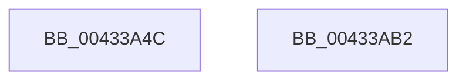

# HvpGenerateLogEntryMetadata

- RVA: `0x00433A4C`–`0x00433AB3` (길이 `103` bytes)
- VA: `0x0000000140433A4C`
- 실행 섹션: `.text`
- PDB 이름 있음: `예`; PDB Function 태그: `아니요`
- unwind 정보 RVA: `0x000A2690`
- 디코드: `27`개 명령, `103/103` bytes 표시
- 미해석 바이트: `0` (있으면 어셈블리에 `.byte`로 보존)

> 이 문서는 커널 이미지의 기계어와 PDB 기호를 분석해 생성했습니다. 4번과 5번은 함수 원형과 자료형을 바이너리 사용 방식에서 추정한 C 해석이며 원본 소스 복구 결과는 아닙니다.

## 1. Dependencies

- 직접 호출 지점: **2**; 고유 호출 대상: **2**
- 직접 호출자로 확인된 함수: **1**
- RIP 상대 이미지 참조: **0**

### Outgoing calls
- `0x00433A7A` → [HvpGenerateLogMetadata](../../page/9B/HvpGenerateLogMetadata_function_009B68B0.md) (function, `0x009B68B0`)
- `0x00433A9D` → [HvpCopyDataToOffsetArray](HvpCopyDataToOffsetArray_function_00433BA8.md) (function, `0x00433BA8`)

### Direct callers
- [HvpGenerateLogEntry](../../page/9B/HvpGenerateLogEntry_function_009B65F0.md) at `0x009B6707`

### Static image references
- 디코드된 RIP-relative 메모리 참조가 없습니다.

## 2. Other-region calls and transfers

- 다른 실행 섹션으로 향하는 call: **1**
  - `0x00433A7A` → [HvpGenerateLogMetadata](../../page/9B/HvpGenerateLogMetadata_function_009B68B0.md) (`.text` → `PAGE`)
- 별도 외부 분기/꼬리 이동을 확인하지 못했습니다.

## 3. Assembly (complete function range)

```asm
00433A4C  48 8B C4                        mov rax, rsp
00433A4F  48 89 58 08                     mov qword ptr [rax + 8], rbx
00433A53  48 89 70 10                     mov qword ptr [rax + 0x10], rsi
00433A57  44 89 40 18                     mov dword ptr [rax + 0x18], r8d
00433A5B  57                              push rdi
00433A5C  48 83 EC 30                     sub rsp, 0x30
00433A60  8B 5C 24 70                     mov ebx, dword ptr [rsp + 0x70]
00433A64  4C 8D 40 18                     lea r8, [rax + 0x18]
00433A68  48 8B FA                        mov rdi, rdx
00433A6B  89 58 18                        mov dword ptr [rax + 0x18], ebx
00433A6E  48 8B 54 24 68                  mov rdx, qword ptr [rsp + 0x68]
00433A73  48 83 C1 58                     add rcx, 0x58
00433A77  49 8B F1                        mov rsi, r9
00433A7A  E8 31 2E 58 00                  call 0x1409b68b0
00433A7F  48 8B 44 24 60                  mov rax, qword ptr [rsp + 0x60]
00433A84  8D 14 DD 00 00 00 00            lea edx, [rbx*8]
00433A8B  48 8B 4C 24 68                  mov rcx, qword ptr [rsp + 0x68]
00433A90  4C 8B C7                        mov r8, rdi
00433A93  48 89 44 24 28                  mov qword ptr [rsp + 0x28], rax
00433A98  48 89 74 24 20                  mov qword ptr [rsp + 0x20], rsi
00433A9D  E8 06 01 00 00                  call 0x140433ba8
00433AA2  48 8B 5C 24 40                  mov rbx, qword ptr [rsp + 0x40]
00433AA7  48 8B 74 24 48                  mov rsi, qword ptr [rsp + 0x48]
00433AAC  48 83 C4 30                     add rsp, 0x30
00433AB0  5F                              pop rdi
00433AB1  C3                              ret
00433AB2  CC                              int3
```

## 4. C-style interpretation (structured pseudocode)

```c
__int64 __fastcall HvpGenerateLogEntryMetadata(__int64 a1, __int64 a2, int a3, __int64 a4, __int64 a5, __int64 a6, unsigned int a7)
{
    __int64 result;
    __int64 v_rsp;
    unsigned __int64 v_stack_m10;
    unsigned __int64 v_stack_m18;
    unsigned __int64 v_stack_p10;
    unsigned __int64 v_stack_p8;

    *(unsigned __int64 *)(v_rsp + 8) = v_rbx;
    *(unsigned __int64 *)(v_rsp + 16) = v_rsi;
    *(unsigned int *)(v_rsp + 24) = a3;
    v_rsp = (v_rsp) - (48);
    *(unsigned int *)(v_rsp + 24) = (unsigned int)((unsigned int)(a7));
    a1 = (a1) + (88);
    result = HvpGenerateLogMetadata(a1, a6, v_rsp + 24, a4);
    v_stack_m10 = a5;
    v_stack_m18 = a4;
    result = HvpCopyDataToOffsetArray(a6, (unsigned int)(a7) * 8, a2, a4);
    v_rsp = (v_rsp) + (48);
    return result;
}
```

## 5. (Beta) C Style

```c
int64_t HvpGenerateLogEntryMetadata(int64_t Arg1, int64_t Arg2, int32_t Arg3, int64_t Arg4, int64_t Arg5, int64_t Arg6, uint32_t Arg7)
{
    int64_t result;
    int64_t local_rsp;
    uint64_t v_stack_m10;
    uint64_t v_stack_m18;
    uint64_t v_stack_p10;
    uint64_t v_stack_p8;

    *(uint64_t *)(local_rsp + 0x8) = local_rbx;
    *(uint64_t *)(local_rsp + 0x10) = local_rsi;
    *(uint32_t *)(local_rsp + 0x18) = Arg3;
    local_rsp = (local_rsp) - (48);
    *(uint32_t *)(local_rsp + 0x18) = (uint32_t)((uint32_t)(Arg7));
    Arg1 = (Arg1) + (88);
    result = HvpGenerateLogMetadata(Arg1, Arg6, local_rsp + 24, Arg4);
    v_stack_m10 = Arg5;
    v_stack_m18 = Arg4;
    result = HvpCopyDataToOffsetArray(Arg6, (uint32_t)(Arg7) * 8, Arg2, Arg4);
    local_rsp = (local_rsp) + (48);
    return result;
}
```

## 6. Execution-region graph

[열기: 2D/3D 그래프와 함수 탐색 컨트롤 패널](../../../control-panel.html?section=text&rva=0x00433A4C&view=graph)

- 2D 그래프는 위에서 아래로 흐르고, 3D 그래프는 빈 공간을 드래그해 회전합니다. Shift+드래그는 이동, 휠은 확대·축소, 함수 노드 선택은 대상 보고서 이동입니다.

### Static fallback


