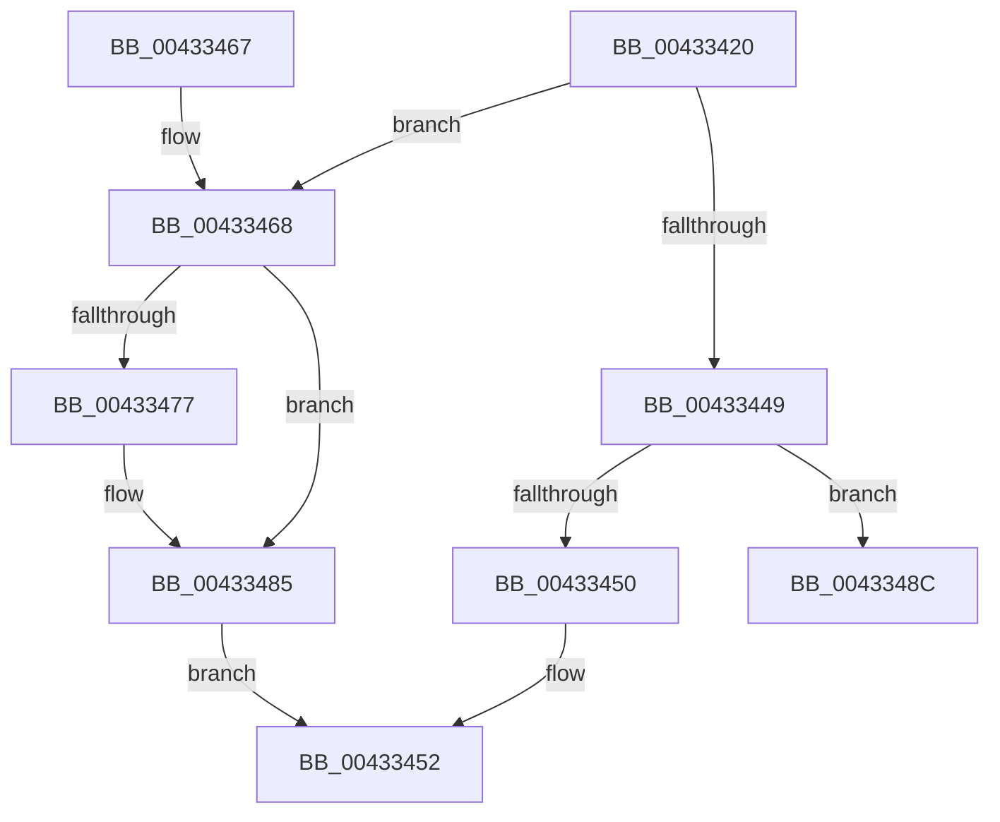

# IoAcquireRemoveLockEx

- RVA: `0x00433420`–`0x00433495` (길이 `117` bytes)
- VA: `0x0000000140433420`
- 실행 섹션: `.text`
- PDB 이름 있음: `예`; PDB Function 태그: `아니요`
- unwind 정보 RVA: `0x000A24F0`
- 디코드: `34`개 명령, `117/117` bytes 표시
- 미해석 바이트: `0` (있으면 어셈블리에 `.byte`로 보존)

> 이 문서는 커널 이미지의 기계어와 PDB 기호를 분석해 생성했습니다. 4번과 5번은 함수 원형과 자료형을 바이너리 사용 방식에서 추정한 C 해석이며 원본 소스 복구 결과는 아닙니다.

## 1. Dependencies

- 직접 호출 지점: **1**; 고유 호출 대상: **1**
- 직접 호출자로 확인된 함수: **8**
- RIP 상대 이미지 참조: **0**

### Outgoing calls
- `0x00433480` → [KeSetEvent](../33/KeSetEvent_function_0033F310.md) (function, `0x0033F310`)

### Direct callers
- [PopFxFindAcpiDeviceByUniqueId](../4C/PopFxFindAcpiDeviceByUniqueId_function_004C5C30.md) at `0x004C5D13`
- [PopFxFindAndReferenceAcpiDevice](../4C/PopFxFindAndReferenceAcpiDevice_function_004C76E0.md) at `0x004C779A`
- [PopFxAcpiForwardNotification](../5D/PopFxAcpiForwardNotification_function_005DD554.md) at `0x005DD599`
- [PopFxAcpiUnregisterDevice](../5D/PopFxAcpiUnregisterDevice_function_005DD830.md) at `0x005DD86D`
- [DifIoAcquireRemoveLockExWrapper](../62/DifIoAcquireRemoveLockExWrapper_function_00627200.md) at `0x00627300`
- [ViFilterDispatchGeneric](../../pagevrfy/BA/ViFilterDispatchGeneric_function_00BACFD0.md) at `0x00BAD009`
- [ViFilterDispatchPnp](../../pagevrfy/BA/ViFilterDispatchPnp_function_00BAD0A0.md) at `0x00BAD0E1`
- [ViFilterDispatchPower](../../pagevrfy/BA/ViFilterDispatchPower_function_00BAD260.md) at `0x00BAD299`

### Static image references
- 디코드된 RIP-relative 메모리 참조가 없습니다.

## 2. Other-region calls and transfers

- 다른 실행 섹션으로 향하는 call: **0**
- 별도 외부 분기/꼬리 이동을 확인하지 못했습니다.

## 3. Assembly (complete function range)

```asm
00433420  48 89 5C 24 10                  mov qword ptr [rsp + 0x10], rbx
00433425  48 89 6C 24 18                  mov qword ptr [rsp + 0x18], rbp
0043342A  48 89 74 24 20                  mov qword ptr [rsp + 0x20], rsi
0043342F  57                              push rdi
00433430  48 83 EC 20                     sub rsp, 0x20
00433434  41 8B F9                        mov edi, r9d
00433437  49 8B F0                        mov rsi, r8
0043343A  48 8B EA                        mov rbp, rdx
0043343D  48 8B D9                        mov rbx, rcx
00433440  F0 FF 41 04                     lock inc dword ptr [rcx + 4]
00433444  80 39 00                        cmp byte ptr [rcx], 0
00433447  75 1F                           jne 0x140433468
00433449  83 7C 24 50 78                  cmp dword ptr [rsp + 0x50], 0x78
0043344E  74 3C                           je 0x14043348c
00433450  33 C0                           xor eax, eax
00433452  48 8B 5C 24 38                  mov rbx, qword ptr [rsp + 0x38]
00433457  48 8B 6C 24 40                  mov rbp, qword ptr [rsp + 0x40]
0043345C  48 8B 74 24 48                  mov rsi, qword ptr [rsp + 0x48]
00433461  48 83 C4 20                     add rsp, 0x20
00433465  5F                              pop rdi
00433466  C3                              ret
00433467  CC                              int3
00433468  B8 FF FF FF FF                  mov eax, 0xffffffff
0043346D  F0 0F C1 41 04                  lock xadd dword ptr [rcx + 4], eax
00433472  83 F8 01                        cmp eax, 1
00433475  75 0E                           jne 0x140433485
00433477  48 83 C1 08                     add rcx, 8
0043347B  45 33 C0                        xor r8d, r8d
0043347E  33 D2                           xor edx, edx
00433480  E8 8B BE F0 FF                  call 0x14033f310
00433485  B8 56 00 00 C0                  mov eax, 0xc0000056
0043348A  EB C6                           jmp 0x140433452
0043348C  44 8B 41 30                     mov r8d, dword ptr [rcx + 0x30]
00433490  BA 28 00 00 00                  mov edx, 0x28
```

## 4. C-style interpretation (structured pseudocode)

```c
__int64 __fastcall IoAcquireRemoveLockEx(__int64 a1, __int64 a2, __int64 a3, int a4, unsigned int a5)
{
    __int64 result;
    __int64 v_rsp;
    unsigned __int64 v_stack_p10;
    unsigned __int64 v_stack_p18;
    unsigned __int64 v_stack_p20;

    v_stack_p10 = v_rbx;
    v_stack_p18 = v_rbp;
    v_stack_p20 = v_rsi;
    v_rsp = (v_rsp) - (32);
    if ((*(unsigned __int8 *)(a1)) != 0) goto loc_00433468;
    if (a5 == 120) goto loc_0043348C;
    result = 0;
loc_00433452:
    v_rsp = (v_rsp) + (32);
    return result;
loc_00433468:
    result = (unsigned int)(0xFFFFFFFFULL);
    if (((unsigned int)((unsigned int)(0xFFFFFFFFULL))) == 1) {
        a1 = (a1) + (8);
        a3 = 0;
        a2 = 0;
        result = KeSetEvent(a1, a2, a3, a4);
    }
    goto loc_00433452;
loc_0043348C:
    return (unsigned int)(0xC0000056ULL);
}
```

## 5. (Beta) C Style

```c
int64_t IoAcquireRemoveLockEx(void *Arg1, int64_t Arg2, int64_t Arg3, int32_t Arg4, uint32_t Arg5)
{
    uint8_t *arg1 = (uint8_t *)Arg1;

    int64_t result;
    int64_t local_rsp;
    uint64_t v_stack_p10;
    uint64_t v_stack_p18;
    uint64_t v_stack_p20;

    v_stack_p10 = local_rbx;
    v_stack_p18 = local_rbp;
    v_stack_p20 = local_rsi;
    local_rsp = (local_rsp) - (32);
    if ((*(uint8_t *)(arg1)) != 0) goto loc_00433468;
    if (Arg5 == 120) goto loc_0043348C;
    result = 0;
loc_00433452:
    local_rsp = (local_rsp) + (32);
    return result;
loc_00433468:
    result = (uint32_t)(0xFFFFFFFFULL);
    if (((uint32_t)((uint32_t)(0xFFFFFFFFULL))) == 1) {
        Arg1 = (Arg1) + (8);
        Arg3 = 0;
        Arg2 = 0;
        result = KeSetEvent(Arg1, Arg2, Arg3, Arg4);
    }
    goto loc_00433452;
loc_0043348C:
    return (uint32_t)(0xC0000056ULL);
}
```

### 관측된 메모리 오프셋

구조체 형식이 확인되지 않은 접근은 인자 기준의 오프셋으로만 기록했습니다.

| 기준 인자 | 오프셋 표현 | 폭 (bit) | 접근 |
|---|---:|---:|---|
| `Arg1` | `+ 0x0` | `8` | `R` |
| `Arg1` | `+ 0x4` | `32` | `R/W` |
| `Arg1` | `+ 0x30` | `32` | `R` |

## 6. Execution-region graph

[열기: 2D/3D 그래프와 함수 탐색 컨트롤 패널](../../../control-panel.html?section=text&rva=0x00433420&view=graph)

- 2D 그래프는 위에서 아래로 흐르고, 3D 그래프는 빈 공간을 드래그해 회전합니다. Shift+드래그는 이동, 휠은 확대·축소, 함수 노드 선택은 대상 보고서 이동입니다.

### Static fallback


