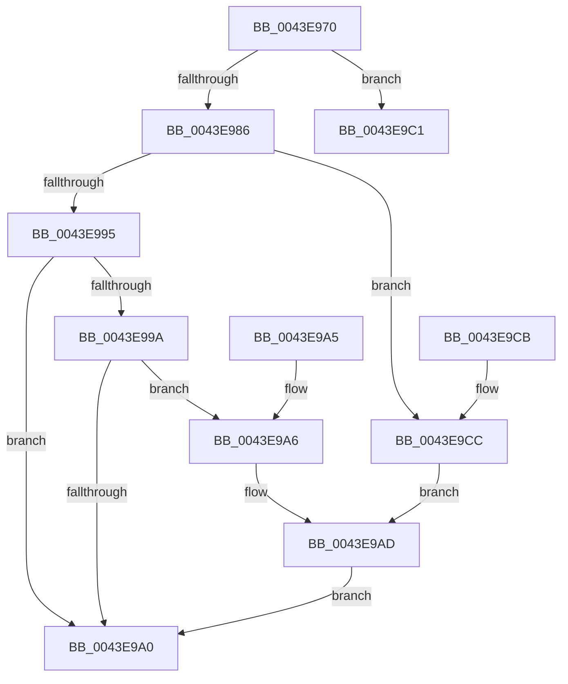

# IoGetGenericIrpExtension

- RVA: `0x0043E970`–`0x0043E9D5` (길이 `101` bytes)
- VA: `0x000000014043E970`
- 실행 섹션: `.text`
- PDB 이름 있음: `예`; PDB Function 태그: `아니요`
- unwind 정보 RVA: `0x000A4B7C`
- 디코드: `30`개 명령, `101/101` bytes 표시
- 미해석 바이트: `0` (있으면 어셈블리에 `.byte`로 보존)

> 이 문서는 커널 이미지의 기계어와 PDB 기호를 분석해 생성했습니다. 4번과 5번은 함수 원형과 자료형을 바이너리 사용 방식에서 추정한 C 해석이며 원본 소스 복구 결과는 아닙니다.

## 1. Dependencies

- 직접 호출 지점: **1**; 고유 호출 대상: **1**
- 직접 호출자로 확인된 함수: **1**
- RIP 상대 이미지 참조: **0**

### Outgoing calls
- `0x0043E9B8` → [memcpy](../6C/memcpy_function_006C6840.md) (function, `0x006C6840`)

### Direct callers
- [StRtlIoStorInfoSetNvCachePriority](../6A/StRtlIoStorInfoSetNvCachePriority_function_006A5D50.md) at `0x006A5D7B`

### Static image references
- 디코드된 RIP-relative 메모리 참조가 없습니다.

## 2. Other-region calls and transfers

- 다른 실행 섹션으로 향하는 call: **0**
- 별도 외부 분기/꼬리 이동을 확인하지 못했습니다.

## 3. Assembly (complete function range)

```asm
0043E970  48 83 EC 28                     sub rsp, 0x28
0043E974  4C 8B D2                        mov r10, rdx
0043E977  4C 8B C9                        mov r9, rcx
0043E97A  B8 25 02 00 C0                  mov eax, 0xc0000225
0043E97F  66 41 83 F8 04                  cmp r8w, 4
0043E984  77 3B                           ja 0x14043e9c1
0043E986  48 8B 89 C8 00 00 00            mov rcx, qword ptr [rcx + 0xc8]
0043E98D  90                              nop
0043E98E  41 80 79 47 00                  cmp byte ptr [r9 + 0x47], 0
0043E993  7C 37                           jl 0x14043e9cc
0043E995  48 85 C9                        test rcx, rcx
0043E998  74 06                           je 0x14043e9a0
0043E99A  F6 41 02 04                     test byte ptr [rcx + 2], 4
0043E99E  75 06                           jne 0x14043e9a6
0043E9A0  48 83 C4 28                     add rsp, 0x28
0043E9A4  C3                              ret
0043E9A5  CC                              int3
0043E9A6  49 8B 91 C8 00 00 00            mov rdx, qword ptr [r9 + 0xc8]
0043E9AD  45 0F B7 C0                     movzx r8d, r8w
0043E9B1  48 83 C2 04                     add rdx, 4
0043E9B5  49 8B CA                        mov rcx, r10
0043E9B8  E8 83 7E 28 00                  call 0x1406c6840
0043E9BD  33 C0                           xor eax, eax
0043E9BF  EB DF                           jmp 0x14043e9a0
0043E9C1  B8 0D 00 00 C0                  mov eax, 0xc000000d
0043E9C6  48 83 C4 28                     add rsp, 0x28
0043E9CA  C3                              ret
0043E9CB  CC                              int3
0043E9CC  49 8D 91 C4 00 00 00            lea rdx, [r9 + 0xc4]
0043E9D3  EB D8                           jmp 0x14043e9ad
```

## 4. C-style interpretation (structured pseudocode)

```c
__int64 __fastcall IoGetGenericIrpExtension(__int64 a1, __int64 a2, unsigned __int16 a3)
{
    __int64 result;
    __int64 v_rsp;

    v_rsp = (v_rsp) - (40);
    if (a3 > 4) goto loc_0043E9C1;
    if ((*(unsigned __int8 *)(a1 + 71)) < 0) goto loc_0043E9CC;
    if (*(unsigned __int64 *)(a1 + 200) == 0) goto loc_0043E9A0;
    if (((*(unsigned __int8 *)(*(unsigned __int64 *)(a1 + 200) + 2)) & (4)) != 0) goto loc_0043E9A6;
loc_0043E9A0:
    v_rsp = (v_rsp) + (40);
    return (unsigned int)(0xC0000225ULL);
loc_0043E9A6:
loc_0043E9AD:
    a2 = (*(unsigned __int64 *)(a1 + 200)) + (4);
    result = memcpy(a2, a2, a3, a1);
    result = 0;
    goto loc_0043E9A0;
loc_0043E9C1:
    v_rsp = (v_rsp) + (40);
    return (unsigned int)(0xC000000DULL);
loc_0043E9CC:
    goto loc_0043E9AD;
}
```

## 5. (Beta) C Style

```c
int64_t IoGetGenericIrpExtension(void *Arg1, int64_t Arg2, uint16_t Arg3)
{
    uint8_t *arg1 = (uint8_t *)Arg1;

    int64_t result;
    int64_t local_rsp;

    local_rsp = (local_rsp) - (40);
    if (Arg3 > 4) goto loc_0043E9C1;
    if ((*(uint8_t *)(arg1 + 0x47)) < 0) goto loc_0043E9CC;
    if (*(uint64_t *)(arg1 + 0xC8) == 0) goto loc_0043E9A0;
    if (((*(uint8_t *)(*(uint64_t *)(arg1 + 0xC8) + 0x2)) & (4)) != 0) goto loc_0043E9A6;
loc_0043E9A0:
    local_rsp = (local_rsp) + (40);
    return (uint32_t)(0xC0000225ULL);
loc_0043E9A6:
loc_0043E9AD:
    Arg2 = (*(uint64_t *)(arg1 + 0xC8)) + (4);
    result = memcpy(Arg2, Arg2, Arg3, Arg1);
    result = 0;
    goto loc_0043E9A0;
loc_0043E9C1:
    local_rsp = (local_rsp) + (40);
    return (uint32_t)(0xC000000DULL);
loc_0043E9CC:
    goto loc_0043E9AD;
}
```

### 관측된 메모리 오프셋

구조체 형식이 확인되지 않은 접근은 인자 기준의 오프셋으로만 기록했습니다.

| 기준 인자 | 오프셋 표현 | 폭 (bit) | 접근 |
|---|---:|---:|---|
| `Arg1` | `+ 0x47` | `8` | `R` |
| `Arg1` | `+ 0xC4` | `64` | `R` |
| `Arg1` | `+ 0xC8` | `64` | `R` |

## 6. Execution-region graph

[열기: 2D/3D 그래프와 함수 탐색 컨트롤 패널](../../../control-panel.html?section=text&rva=0x0043E970&view=graph)

- 2D 그래프는 위에서 아래로 흐르고, 3D 그래프는 빈 공간을 드래그해 회전합니다. Shift+드래그는 이동, 휠은 확대·축소, 함수 노드 선택은 대상 보고서 이동입니다.

### Static fallback


