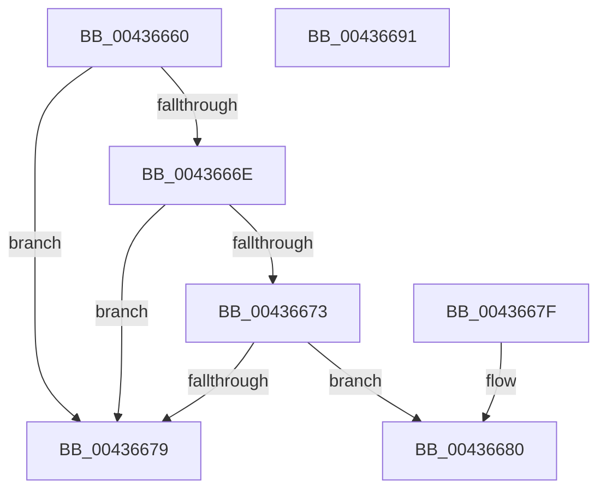

# IoGetIoAttributionHandle

- RVA: `0x00436660`–`0x00436692` (길이 `50` bytes)
- VA: `0x0000000140436660`
- 실행 섹션: `.text`
- PDB 이름 있음: `예`; PDB Function 태그: `아니요`
- unwind 정보 RVA: `0x000DB714`
- 디코드: `17`개 명령, `50/50` bytes 표시
- 미해석 바이트: `0` (있으면 어셈블리에 `.byte`로 보존)

> 이 문서는 커널 이미지의 기계어와 PDB 기호를 분석해 생성했습니다. 4번과 5번은 함수 원형과 자료형을 바이너리 사용 방식에서 추정한 C 해석이며 원본 소스 복구 결과는 아닙니다.

## 1. Dependencies

- 직접 호출 지점: **0**; 고유 호출 대상: **0**
- 직접 호출자로 확인된 함수: **0**
- RIP 상대 이미지 참조: **0**

### Outgoing calls
- 직접 디코드된 call 명령이 없습니다.

### Direct callers
- 이 함수 시작 RVA로 연결되는 직접 call은 확인되지 않았습니다. 간접 호출은 완전히 역산할 수 없습니다.

### Static image references
- 디코드된 RIP-relative 메모리 참조가 없습니다.

## 2. Other-region calls and transfers

- 다른 실행 섹션으로 향하는 call: **0**
- 별도 외부 분기/꼬리 이동을 확인하지 못했습니다.

## 3. Assembly (complete function range)

```asm
00436660  48 8B 81 C8 00 00 00            mov rax, qword ptr [rcx + 0xc8]
00436667  90                              nop
00436668  80 79 47 00                     cmp byte ptr [rcx + 0x47], 0
0043666C  7C 0B                           jl 0x140436679
0043666E  48 85 C0                        test rax, rax
00436671  74 06                           je 0x140436679
00436673  F6 40 02 40                     test byte ptr [rax + 2], 0x40
00436677  75 07                           jne 0x140436680
00436679  B8 25 02 00 C0                  mov eax, 0xc0000225
0043667E  C3                              ret
0043667F  CC                              int3
00436680  48 8B 81 C8 00 00 00            mov rax, qword ptr [rcx + 0xc8]
00436687  48 8B 48 10                     mov rcx, qword ptr [rax + 0x10]
0043668B  33 C0                           xor eax, eax
0043668D  48 89 0A                        mov qword ptr [rdx], rcx
00436690  C3                              ret
00436691  CC                              int3
```

## 4. C-style interpretation (structured pseudocode)

```c
__int64 __fastcall IoGetIoAttributionHandle(__int64 a1, __int64 a2)
{
    __int64 result;

    if ((*(unsigned __int8 *)(a1 + 71)) < 0) goto loc_00436679;
    if (*(unsigned __int64 *)(a1 + 200) == 0) goto loc_00436679;
    if (((*(unsigned __int8 *)(*(unsigned __int64 *)(a1 + 200) + 2)) & (64)) != 0) goto loc_00436680;
loc_00436679:
    return (unsigned int)(0xC0000225ULL);
loc_00436680:
    result = 0;
    *(unsigned __int64 *)(a2) = *(unsigned __int64 *)(*(unsigned __int64 *)(a1 + 200) + 16);
    return result;
}
```

## 5. (Beta) C Style

```c
int64_t IoGetIoAttributionHandle(void *Arg1, void *Arg2)
{
    uint8_t *arg1 = (uint8_t *)Arg1;
    uint8_t *arg2 = (uint8_t *)Arg2;

    int64_t result;

    if ((*(uint8_t *)(arg1 + 0x47)) < 0) goto loc_00436679;
    if (*(uint64_t *)(arg1 + 0xC8) == 0) goto loc_00436679;
    if (((*(uint8_t *)(*(uint64_t *)(arg1 + 0xC8) + 0x2)) & (64)) != 0) goto loc_00436680;
loc_00436679:
    return (uint32_t)(0xC0000225ULL);
loc_00436680:
    result = 0;
    *(uint64_t *)(arg2) = *(uint64_t *)(*(uint64_t *)(arg1 + 0xC8) + 0x10);
    return result;
}
```

### 관측된 메모리 오프셋

구조체 형식이 확인되지 않은 접근은 인자 기준의 오프셋으로만 기록했습니다.

| 기준 인자 | 오프셋 표현 | 폭 (bit) | 접근 |
|---|---:|---:|---|
| `Arg1` | `+ 0x47` | `8` | `R` |
| `Arg1` | `+ 0xC8` | `64` | `R` |
| `Arg2` | `+ 0x0` | `64` | `W` |

## 6. Execution-region graph

[열기: 2D/3D 그래프와 함수 탐색 컨트롤 패널](../../../control-panel.html?section=text&rva=0x00436660&view=graph)

- 2D 그래프는 위에서 아래로 흐르고, 3D 그래프는 빈 공간을 드래그해 회전합니다. Shift+드래그는 이동, 휠은 확대·축소, 함수 노드 선택은 대상 보고서 이동입니다.

### Static fallback


