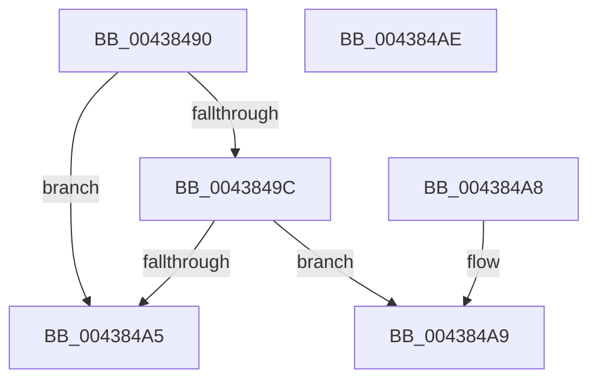

# IoGetSilo

- RVA: `0x00438490`–`0x004384AF` (길이 `31` bytes)
- VA: `0x0000000140438490`
- 실행 섹션: `.text`
- PDB 이름 있음: `예`; PDB Function 태그: `아니요`
- unwind 정보 RVA: `0x000DB714`
- 디코드: `12`개 명령, `31/31` bytes 표시
- 미해석 바이트: `0` (있으면 어셈블리에 `.byte`로 보존)

> 이 문서는 커널 이미지의 기계어와 PDB 기호를 분석해 생성했습니다. 4번과 5번은 함수 원형과 자료형을 바이너리 사용 방식에서 추정한 C 해석이며 원본 소스 복구 결과는 아닙니다.

## 1. Dependencies

- 직접 호출 지점: **0**; 고유 호출 대상: **0**
- 직접 호출자로 확인된 함수: **2**
- RIP 상대 이미지 참조: **0**

### Outgoing calls
- 직접 디코드된 call 명령이 없습니다.

### Direct callers
- [IopAllocRealFileObject](../../page/89/IopAllocRealFileObject_function_00899720.md) at `0x00899D5A`
- [IopAllocRealFileObject](../../page/89/IopAllocRealFileObject_function_00899720.md) at `0x00899D8E`
- [IopAllocRealFileObject](../../page/89/IopAllocRealFileObject_function_00899720.md) at `0x00899E2A`
- [IopParseDevice](../../page/89/IopParseDevice_function_0089E510.md) at `0x0089F70D`
- [IopParseDevice](../../page/89/IopParseDevice_function_0089E510.md) at `0x008A0571`

### Static image references
- 디코드된 RIP-relative 메모리 참조가 없습니다.

## 2. Other-region calls and transfers

- 다른 실행 섹션으로 향하는 call: **0**
- 별도 외부 분기/꼬리 이동을 확인하지 못했습니다.

## 3. Assembly (complete function range)

```asm
00438490  48 8B 81 D0 00 00 00            mov rax, qword ptr [rcx + 0xd0]
00438497  48 85 C0                        test rax, rax
0043849A  74 09                           je 0x1404384a5
0043849C  48 8B 40 40                     mov rax, qword ptr [rax + 0x40]
004384A0  48 85 C0                        test rax, rax
004384A3  75 04                           jne 0x1404384a9
004384A5  33 C0                           xor eax, eax
004384A7  C3                              ret
004384A8  CC                              int3
004384A9  48 8B 40 08                     mov rax, qword ptr [rax + 8]
004384AD  C3                              ret
004384AE  CC                              int3
```

## 4. C-style interpretation (structured pseudocode)

```c
__int64 __fastcall IoGetSilo(__int64 a1)
{
    __int64 result;

    if (*(unsigned __int64 *)(a1 + 208) == 0) goto loc_004384A5;
    if (*(unsigned __int64 *)(*(unsigned __int64 *)(a1 + 208) + 64) != 0) goto loc_004384A9;
loc_004384A5:
    result = 0;
    return result;
loc_004384A9:
    return *(unsigned __int64 *)(result + 8);
}
```

## 5. (Beta) C Style

```c
int64_t IoGetSilo(void *Arg1)
{
    uint8_t *arg1 = (uint8_t *)Arg1;

    int64_t result;

    if (*(uint64_t *)(arg1 + 0xD0) == 0) goto loc_004384A5;
    if (*(uint64_t *)(*(uint64_t *)(arg1 + 0xD0) + 0x40) != 0) goto loc_004384A9;
loc_004384A5:
    result = 0;
    return result;
loc_004384A9:
    return *(uint64_t *)(result + 0x8);
}
```

### 관측된 메모리 오프셋

구조체 형식이 확인되지 않은 접근은 인자 기준의 오프셋으로만 기록했습니다.

| 기준 인자 | 오프셋 표현 | 폭 (bit) | 접근 |
|---|---:|---:|---|
| `Arg1` | `+ 0xD0` | `64` | `R` |

## 6. Execution-region graph

[열기: 2D/3D 그래프와 함수 탐색 컨트롤 패널](../../../control-panel.html?section=text&rva=0x00438490&view=graph)

- 2D 그래프는 위에서 아래로 흐르고, 3D 그래프는 빈 공간을 드래그해 회전합니다. Shift+드래그는 이동, 휠은 확대·축소, 함수 노드 선택은 대상 보고서 이동입니다.

### Static fallback


