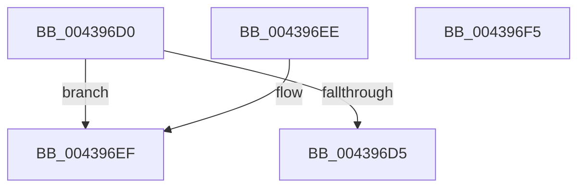

# IoSetIoPriorityHint

- RVA: `0x004396D0`–`0x004396F6` (길이 `38` bytes)
- VA: `0x00000001404396D0`
- 실행 섹션: `.text`
- PDB 이름 있음: `예`; PDB Function 태그: `아니요`
- unwind 정보 RVA: `0x000DB714`
- 디코드: `14`개 명령, `38/38` bytes 표시
- 미해석 바이트: `0` (있으면 어셈블리에 `.byte`로 보존)

> 이 문서는 커널 이미지의 기계어와 PDB 기호를 분석해 생성했습니다. 4번과 5번은 함수 원형과 자료형을 바이너리 사용 방식에서 추정한 C 해석이며 원본 소스 복구 결과는 아닙니다.

## 1. Dependencies

- 직접 호출 지점: **0**; 고유 호출 대상: **0**
- 직접 호출자로 확인된 함수: **0**
- RIP 상대 이미지 참조: **0**

### Outgoing calls
- 직접 디코드된 call 명령이 없습니다.

### Direct callers
- 이 함수 시작 RVA로 연결되는 직접 call은 확인되지 않았습니다. 간접 호출은 완전히 역산할 수 없습니다.

### Static image references
- 디코드된 RIP-relative 메모리 참조가 없습니다.

## 2. Other-region calls and transfers

- 다른 실행 섹션으로 향하는 call: **0**
- 별도 외부 분기/꼬리 이동을 확인하지 못했습니다.

## 3. Assembly (complete function range)

```asm
004396D0  83 FA 05                        cmp edx, 5
004396D3  73 1A                           jae 0x1404396ef
004396D5  8B 41 10                        mov eax, dword ptr [rcx + 0x10]
004396D8  C1 E2 11                        shl edx, 0x11
004396DB  25 FF FF F1 FF                  and eax, 0xfff1ffff
004396E0  81 C2 00 00 02 00               add edx, 0x20000
004396E6  0B D0                           or edx, eax
004396E8  89 51 10                        mov dword ptr [rcx + 0x10], edx
004396EB  33 C0                           xor eax, eax
004396ED  C3                              ret
004396EE  CC                              int3
004396EF  B8 0D 00 00 C0                  mov eax, 0xc000000d
004396F4  C3                              ret
004396F5  CC                              int3
```

## 4. C-style interpretation (structured pseudocode)

```c
__int64 __fastcall IoSetIoPriorityHint(__int64 a1, int a2)
{
    __int64 result;

    if (a2 >= 5) goto loc_004396EF;
    a2 = (unsigned int)((a2) << (17));
    result = (unsigned int)(((unsigned int)(*(unsigned int *)(a1 + 16))) & (0xFFF1FFFFULL));
    a2 = (unsigned int)((a2) + (0x20000ULL));
    a2 = (unsigned int)((a2) | ((unsigned int)(result)));
    *(unsigned int *)(a1 + 16) = a2;
    result = 0;
    return result;
loc_004396EF:
    return (unsigned int)(0xC000000DULL);
}
```

## 5. (Beta) C Style

```c
int64_t IoSetIoPriorityHint(void *Arg1, int32_t Arg2)
{
    uint8_t *arg1 = (uint8_t *)Arg1;

    int64_t result;

    if (Arg2 >= 5) goto loc_004396EF;
    Arg2 = (uint32_t)((Arg2) << (17));
    result = (uint32_t)(((uint32_t)(*(uint32_t *)(arg1 + 0x10))) & (0xFFF1FFFFULL));
    Arg2 = (uint32_t)((Arg2) + (0x20000ULL));
    Arg2 = (uint32_t)((Arg2) | ((uint32_t)(result)));
    *(uint32_t *)(arg1 + 0x10) = Arg2;
    result = 0;
    return result;
loc_004396EF:
    return (uint32_t)(0xC000000DULL);
}
```

### 관측된 메모리 오프셋

구조체 형식이 확인되지 않은 접근은 인자 기준의 오프셋으로만 기록했습니다.

| 기준 인자 | 오프셋 표현 | 폭 (bit) | 접근 |
|---|---:|---:|---|
| `Arg1` | `+ 0x10` | `32` | `R` |
| `Arg1` | `+ 0x10` | `32` | `W` |

## 6. Execution-region graph

[열기: 2D/3D 그래프와 함수 탐색 컨트롤 패널](../../../control-panel.html?section=text&rva=0x004396D0&view=graph)

- 2D 그래프는 위에서 아래로 흐르고, 3D 그래프는 빈 공간을 드래그해 회전합니다. Shift+드래그는 이동, 휠은 확대·축소, 함수 노드 선택은 대상 보고서 이동입니다.

### Static fallback


