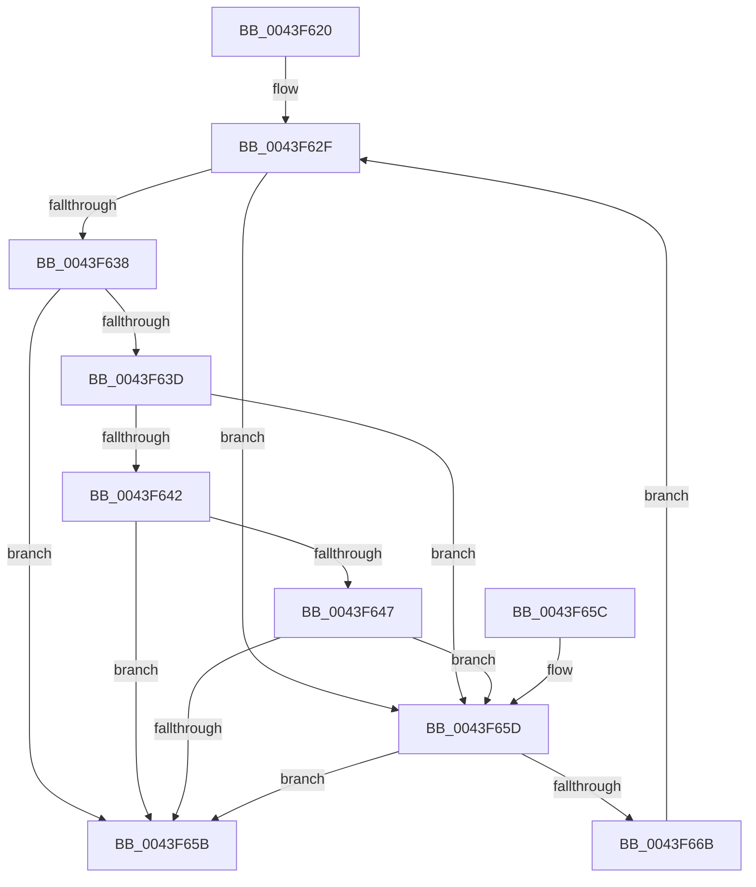

# IoSetMasterIrpStatus

- RVA: `0x0043F620`–`0x0043F66D` (길이 `77` bytes)
- VA: `0x000000014043F620`
- 실행 섹션: `.text`
- PDB 이름 있음: `예`; PDB Function 태그: `아니요`
- unwind 정보 RVA: `0x000DB714`
- 디코드: `25`개 명령, `77/77` bytes 표시
- 미해석 바이트: `0` (있으면 어셈블리에 `.byte`로 보존)

> 이 문서는 커널 이미지의 기계어와 PDB 기호를 분석해 생성했습니다. 4번과 5번은 함수 원형과 자료형을 바이너리 사용 방식에서 추정한 C 해석이며 원본 소스 복구 결과는 아닙니다.

## 1. Dependencies

- 직접 호출 지점: **0**; 고유 호출 대상: **0**
- 직접 호출자로 확인된 함수: **0**
- RIP 상대 이미지 참조: **0**

### Outgoing calls
- 직접 디코드된 call 명령이 없습니다.

### Direct callers
- 이 함수 시작 RVA로 연결되는 직접 call은 확인되지 않았습니다. 간접 호출은 완전히 역산할 수 없습니다.

### Static image references
- 디코드된 RIP-relative 메모리 참조가 없습니다.

## 2. Other-region calls and transfers

- 다른 실행 섹션으로 향하는 call: **0**
- 별도 외부 분기/꼬리 이동을 확인하지 못했습니다.

## 3. Assembly (complete function range)

```asm
0043F620  4C 8B C9                        mov r9, rcx
0043F623  41 BA 16 00 00 80               mov r10d, 0x80000016
0043F629  41 BB 35 00 00 40               mov r11d, 0x40000035
0043F62F  45 8B 41 30                     mov r8d, dword ptr [r9 + 0x30]
0043F633  41 3B D2                        cmp edx, r10d
0043F636  74 25                           je 0x14043f65d
0043F638  45 3B C2                        cmp r8d, r10d
0043F63B  74 1E                           je 0x14043f65b
0043F63D  45 3B C3                        cmp r8d, r11d
0043F640  74 1B                           je 0x14043f65d
0043F642  41 3B D3                        cmp edx, r11d
0043F645  74 14                           je 0x14043f65b
0043F647  41 8B C8                        mov ecx, r8d
0043F64A  8B C2                           mov eax, edx
0043F64C  81 E1 00 00 00 C0               and ecx, 0xc0000000
0043F652  25 00 00 00 C0                  and eax, 0xc0000000
0043F657  3B C1                           cmp eax, ecx
0043F659  77 02                           ja 0x14043f65d
0043F65B  C3                              ret
0043F65C  CC                              int3
0043F65D  41 8B C0                        mov eax, r8d
0043F660  F0 41 0F B1 51 30               lock cmpxchg dword ptr [r9 + 0x30], edx
0043F666  44 3B C0                        cmp r8d, eax
0043F669  74 F0                           je 0x14043f65b
0043F66B  EB C2                           jmp 0x14043f62f
```

## 4. C-style interpretation (structured pseudocode)

```c
__int64 __fastcall IoSetMasterIrpStatus(__int64 a1, int a2)
{
    __int64 result;

loc_0043F62F:
    if (a2 == ((unsigned int)((unsigned int)(0x80000016ULL)))) goto loc_0043F65D;
    if (((unsigned int)((unsigned int)(*(unsigned int *)(a1 + 48)))) == ((unsigned int)((unsigned int)(0x80000016ULL)))) goto loc_0043F65B;
    if (((unsigned int)((unsigned int)(*(unsigned int *)(a1 + 48)))) == ((unsigned int)((unsigned int)(0x40000035ULL)))) goto loc_0043F65D;
    if (a2 == ((unsigned int)((unsigned int)(0x40000035ULL)))) goto loc_0043F65B;
    a1 = (unsigned int)(((unsigned int)((unsigned int)((unsigned int)(*(unsigned int *)(a1 + 48))))) & (0xC0000000ULL));
    result = (unsigned int)(((unsigned int)(a2)) & (0xC0000000ULL));
    if (((unsigned int)(result)) > ((unsigned int)(a1))) goto loc_0043F65D;
loc_0043F65B:
    return result;
loc_0043F65D:
    if (((unsigned int)((unsigned int)(*(unsigned int *)(a1 + 48)))) == ((unsigned int)((unsigned int)((unsigned int)((unsigned int)(*(unsigned int *)(a1 + 48))))))) goto loc_0043F65B;
    goto loc_0043F62F;
}
```

## 5. (Beta) C Style

```c
int64_t IoSetMasterIrpStatus(void *Arg1, int32_t Arg2)
{
    uint8_t *arg1 = (uint8_t *)Arg1;

    int64_t result;

loc_0043F62F:
    if (Arg2 == ((uint32_t)((uint32_t)(0x80000016ULL)))) goto loc_0043F65D;
    if (((uint32_t)((uint32_t)(*(uint32_t *)(arg1 + 0x30)))) == ((uint32_t)((uint32_t)(0x80000016ULL)))) goto loc_0043F65B;
    if (((uint32_t)((uint32_t)(*(uint32_t *)(arg1 + 0x30)))) == ((uint32_t)((uint32_t)(0x40000035ULL)))) goto loc_0043F65D;
    if (Arg2 == ((uint32_t)((uint32_t)(0x40000035ULL)))) goto loc_0043F65B;
    Arg1 = (uint32_t)(((uint32_t)((uint32_t)((uint32_t)(*(uint32_t *)(arg1 + 0x30))))) & (0xC0000000ULL));
    result = (uint32_t)(((uint32_t)(Arg2)) & (0xC0000000ULL));
    if (((uint32_t)(result)) > ((uint32_t)(Arg1))) goto loc_0043F65D;
loc_0043F65B:
    return result;
loc_0043F65D:
    if (((uint32_t)((uint32_t)(*(uint32_t *)(arg1 + 0x30)))) == ((uint32_t)((uint32_t)((uint32_t)((uint32_t)(*(uint32_t *)(arg1 + 0x30))))))) goto loc_0043F65B;
    goto loc_0043F62F;
}
```

### 관측된 메모리 오프셋

구조체 형식이 확인되지 않은 접근은 인자 기준의 오프셋으로만 기록했습니다.

| 기준 인자 | 오프셋 표현 | 폭 (bit) | 접근 |
|---|---:|---:|---|
| `Arg1` | `+ 0x30` | `32` | `R` |

## 6. Execution-region graph

[열기: 2D/3D 그래프와 함수 탐색 컨트롤 패널](../../../control-panel.html?section=text&rva=0x0043F620&view=graph)

- 2D 그래프는 위에서 아래로 흐르고, 3D 그래프는 빈 공간을 드래그해 회전합니다. Shift+드래그는 이동, 휠은 확대·축소, 함수 노드 선택은 대상 보고서 이동입니다.

### Static fallback


