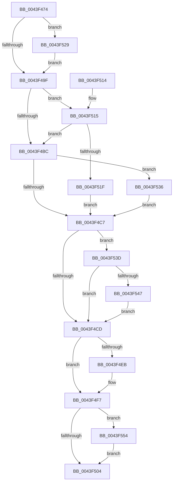

# IopDereferenceVpbAndFree

- RVA: `0x0043F474`–`0x0043F560` (길이 `236` bytes)
- VA: `0x000000014043F474`
- 실행 섹션: `.text`
- PDB 이름 있음: `예`; PDB Function 태그: `아니요`
- unwind 정보 RVA: `0x0006D4EC`
- 디코드: `61`개 명령, `236/236` bytes 표시
- 미해석 바이트: `0` (있으면 어셈블리에 `.byte`로 보존)

> 이 문서는 커널 이미지의 기계어와 PDB 기호를 분석해 생성했습니다. 4번과 5번은 함수 원형과 자료형을 바이너리 사용 방식에서 추정한 C 해석이며 원본 소스 복구 결과는 아닙니다.

## 1. Dependencies

- 직접 호출 지점: **6**; 고유 호출 대상: **6**
- 직접 호출자로 확인된 함수: **2**
- RIP 상대 이미지 참조: **3**

### Outgoing calls
- `0x0043F4DD` → [KeReleaseInStackQueuedSpinLockFromDpcLevel](../21/KeReleaseInStackQueuedSpinLockFromDpcLevel_function_002171B0.md) (function, `0x002171B0`)
- `0x0043F4F2` → [KiLowerIrqlProcessIrqlFlags](../4F/KiLowerIrqlProcessIrqlFlags_function_004F5698.md) (function, `0x004F5698`)
- `0x0043F522` → [KiAcquireQueuedSpinLockInstrumented](../27/KiAcquireQueuedSpinLockInstrumented_function_00275850.md) (function, `0x00275850`)
- `0x0043F52C` → [KiRaiseIrqlProcessIrqlFlags](../4F/KiRaiseIrqlProcessIrqlFlags_function_004F56FC.md) (function, `0x004F56FC`)
- `0x0043F536` → [KxWaitForLockOwnerShip](../25/KxWaitForLockOwnerShip_function_00257EB0.md) (function, `0x00257EB0`)
- `0x0043F559` → [ExFreePoolWithTag](../../poolcode/B8/ExFreePoolWithTag_function_00B82870.md) (function, `0x00B82870`)

### Direct callers
- [IopParseDevice](../../page/89/IopParseDevice_function_0089E510.md) at `0x0089E9B7`
- [IopParseDevice](../../page/89/IopParseDevice_function_0089E510.md) at `0x0089F01A`
- [IopParseDevice](../../page/89/IopParseDevice_function_0089E510.md) at `0x0089F14B`
- [IopParseDevice](../../page/89/IopParseDevice_function_0089E510.md) at `0x0089F8A3`
- [IopParseDevice](../../page/89/IopParseDevice_function_0089E510.md) at `0x0089FA27`
- [IopParseDevice](../../page/89/IopParseDevice_function_0089E510.md) at `0x0089FAE1`
- [IopParseDevice](../../page/89/IopParseDevice_function_0089E510.md) at `0x0089FB27`
- [IopParseDevice](../../page/89/IopParseDevice_function_0089E510.md) at `0x0089FC42`
- [IopParseDevice](../../page/89/IopParseDevice_function_0089E510.md) at `0x008A01D0`
- [IopParseDevice](../../page/89/IopParseDevice_function_0089E510.md) at `0x008A0648`
- [IopParseDevice](../../page/89/IopParseDevice_function_0089E510.md) at `0x008A0702`
- [IopParseDevice](../../page/89/IopParseDevice_function_0089E510.md) at `0x008A086A`
- [IoVerifyVolume](../../page/AC/IoVerifyVolume_function_00ACF200.md) at `0x00ACF2C4`
- [IoVerifyVolume](../../page/AC/IoVerifyVolume_function_00ACF200.md) at `0x00ACF35D`

### Static image references
- `0x0043F493` → RVA `0x00FC6D20` (`ALMOSTRO`; read)
- `0x0043F4B3` → RVA `0x00FC6B06` (`ALMOSTRO`; read)
- `0x0043F515` → RVA `0x00F0DE58` (`.data`; read)

## 2. Other-region calls and transfers

- 다른 실행 섹션으로 향하는 call: **1**
  - `0x0043F559` → [ExFreePoolWithTag](../../poolcode/B8/ExFreePoolWithTag_function_00B82870.md) (`.text` → `POOLCODE`)
- 별도 외부 분기/꼬리 이동을 확인하지 못했습니다.

## 3. Assembly (complete function range)

```asm
0043F474  48 89 5C 24 08                  mov qword ptr [rsp + 8], rbx
0043F479  48 89 74 24 10                  mov qword ptr [rsp + 0x10], rsi
0043F47E  57                              push rdi
0043F47F  48 83 EC 20                     sub rsp, 0x20
0043F483  48 8B D9                        mov rbx, rcx
0043F486  33 FF                           xor edi, edi
0043F488  44 0F 20 C6                     mov rsi, cr8
0043F48C  8D 57 02                        lea edx, [rdi + 2]
0043F48F  44 0F 22 C2                     mov cr8, rdx
0043F493  39 3D 87 78 B8 00               cmp dword ptr [rip + 0xb87887], edi
0043F499  0F 85 8A 00 00 00               jne 0x14043f529
0043F49F  65 48 8B 04 25 28 00 00 00      mov rax, qword ptr gs:[0x28]
0043F4A8  48 8D 88 90 00 00 00            lea rcx, [rax + 0x90]
0043F4AF  4C 8B 41 08                     mov r8, qword ptr [rcx + 8]
0043F4B3  F6 05 4C 76 B8 00 21            test byte ptr [rip + 0xb8764c], 0x21
0043F4BA  75 59                           jne 0x14043f515
0043F4BC  48 8B D1                        mov rdx, rcx
0043F4BF  49 87 10                        xchg qword ptr [r8], rdx
0043F4C2  48 85 D2                        test rdx, rdx
0043F4C5  75 6F                           jne 0x14043f536
0043F4C7  83 43 1C FF                     add dword ptr [rbx + 0x1c], -1
0043F4CB  74 70                           je 0x14043f53d
0043F4CD  65 48 8B 0C 25 28 00 00 00      mov rcx, qword ptr gs:[0x28]
0043F4D6  48 81 C1 90 00 00 00            add rcx, 0x90
0043F4DD  E8 CE 7C DD FF                  call 0x1402171b0
0043F4E2  83 3D 37 78 B8 00 00            cmp dword ptr [rip + 0xb87837], 0
0043F4E9  74 0C                           je 0x14043f4f7
0043F4EB  44 0F 20 C1                     mov rcx, cr8
0043F4EF  40 8A D6                        mov dl, sil
0043F4F2  E8 A1 61 0B 00                  call 0x1404f5698
0043F4F7  40 0F B6 C6                     movzx eax, sil
0043F4FB  44 0F 22 C0                     mov cr8, rax
0043F4FF  48 85 FF                        test rdi, rdi
0043F502  75 50                           jne 0x14043f554
0043F504  48 8B 5C 24 30                  mov rbx, qword ptr [rsp + 0x30]
0043F509  48 8B 74 24 38                  mov rsi, qword ptr [rsp + 0x38]
0043F50E  48 83 C4 20                     add rsp, 0x20
0043F512  5F                              pop rdi
0043F513  C3                              ret
0043F514  CC                              int3
0043F515  8B 05 3D E9 AC 00               mov eax, dword ptr [rip + 0xace93d]
0043F51B  85 C0                           test eax, eax
0043F51D  75 9D                           jne 0x14043f4bc
0043F51F  49 8B D0                        mov rdx, r8
0043F522  E8 29 63 E3 FF                  call 0x140275850
0043F527  EB 9E                           jmp 0x14043f4c7
0043F529  40 8A CE                        mov cl, sil
0043F52C  E8 CB 61 0B 00                  call 0x1404f56fc
0043F531  E9 69 FF FF FF                  jmp 0x14043f49f
0043F536  E8 75 89 E1 FF                  call 0x140257eb0
0043F53B  EB 8A                           jmp 0x14043f4c7
0043F53D  48 8B 43 10                     mov rax, qword ptr [rbx + 0x10]
0043F541  48 39 58 38                     cmp qword ptr [rax + 0x38], rbx
0043F545  74 86                           je 0x14043f4cd
0043F547  F6 43 04 04                     test byte ptr [rbx + 4], 4
0043F54B  48 0F 44 FB                     cmove rdi, rbx
0043F54F  E9 79 FF FF FF                  jmp 0x14043f4cd
0043F554  33 D2                           xor edx, edx
0043F556  48 8B CF                        mov rcx, rdi
0043F559  E8 12 33 74 00                  call 0x140b82870
0043F55E  EB A4                           jmp 0x14043f504
```

## 4. C-style interpretation (structured pseudocode)

```c
__int64 __fastcall IopDereferenceVpbAndFree(__int64 a1)
{
    __int64 result;
    __int64 v_rdi;
    __int64 v_rsp;
    unsigned __int64 v_stack_p10;
    unsigned __int64 v_stack_p8;

    v_stack_p8 = v_rbx;
    v_stack_p10 = v_rsi;
    v_rsp = (v_rsp) - (32);
    v_rdi = 0;
    if ((*(unsigned int *)(v_rip + 12089479)) != 0) goto loc_0043F529;
loc_0043F49F:
    if (((*(unsigned __int8 *)(v_rip + 12088908)) & (33)) != 0) goto loc_0043F515;
loc_0043F4BC:
    if (*(unsigned __int64 *)(gs_base + (0 + 40)) + 144 != 0) goto loc_0043F536;
loc_0043F4C7:
    if (*(unsigned __int64 *)(gs_base + (0 + 40)) + 144 == 0) goto loc_0043F53D;
loc_0043F4CD:
    a1 = (*(unsigned __int64 *)(gs_base + (0 + 40))) + (144);
    result = KeReleaseInStackQueuedSpinLockFromDpcLevel(a1, *(unsigned __int64 *)(gs_base + (0 + 40)) + 144, *(unsigned __int64 *)(*(unsigned __int64 *)(gs_base + (0 + 40)) + 144 + 8), a4);
    if ((*(unsigned int *)(v_rip + 12089399)) != 0) {
        a1 = v_rdi + 2;
        a2 = (unsigned __int8)(v_cr8);
        result = KiLowerIrqlProcessIrqlFlags(a1, a2, *(unsigned __int64 *)(*(unsigned __int64 *)(gs_base + (0 + 40)) + 144 + 8), a4);
    }
    if (0 != 0) goto loc_0043F554;
loc_0043F504:
    v_rsp = (v_rsp) + (32);
    return (unsigned __int8)(v_cr8);
loc_0043F515:
    if ((unsigned int)((unsigned int)(*(unsigned int *)(v_rip + 11331901))) != 0) goto loc_0043F4BC;
    result = KiAcquireQueuedSpinLockInstrumented(a1, *(unsigned __int64 *)(*(unsigned __int64 *)(gs_base + (0 + 40)) + 144 + 8), *(unsigned __int64 *)(*(unsigned __int64 *)(gs_base + (0 + 40)) + 144 + 8), a4);
    goto loc_0043F4C7;
loc_0043F529:
    result = KiRaiseIrqlProcessIrqlFlags((unsigned __int8)(v_stack_p10), *(unsigned __int64 *)(*(unsigned __int64 *)(gs_base + (0 + 40)) + 144 + 8), *(unsigned __int64 *)(*(unsigned __int64 *)(gs_base + (0 + 40)) + 144 + 8), a4);
    goto loc_0043F49F;
loc_0043F536:
    result = KxWaitForLockOwnerShip((unsigned __int8)(v_stack_p10), *(unsigned __int64 *)(*(unsigned __int64 *)(gs_base + (0 + 40)) + 144 + 8), *(unsigned __int64 *)(*(unsigned __int64 *)(gs_base + (0 + 40)) + 144 + 8), a4);
    goto loc_0043F4C7;
loc_0043F53D:
    if ((*(unsigned __int64 *)(*(unsigned __int64 *)(v_stack_p8 + 16) + 56)) == v_stack_p8) goto loc_0043F4CD;
    if (((*(unsigned __int8 *)(v_stack_p8 + 4)) & (4)) == 0) { v_rdi = v_stack_p8; }
    goto loc_0043F4CD;
loc_0043F554:
    a2 = 0;
    result = ExFreePoolWithTag(v_rdi, a2, *(unsigned __int64 *)(*(unsigned __int64 *)(gs_base + (0 + 40)) + 144 + 8), a4);
    goto loc_0043F504;
}
```

## 5. (Beta) C Style

```c
int64_t IopDereferenceVpbAndFree(void *Arg1)
{
    uint8_t *arg1 = (uint8_t *)Arg1;

    int64_t result;
    int64_t local_rdi;
    int64_t local_rsp;
    uint64_t v_stack_p10;
    uint64_t v_stack_p8;

    v_stack_p8 = local_rbx;
    v_stack_p10 = local_rsi;
    local_rsp = (local_rsp) - (32);
    local_rdi = 0;
    if ((*(uint32_t *)(v_rip + 0xB87887)) != 0) goto loc_0043F529;
loc_0043F49F:
    if (((*(uint8_t *)(v_rip + 0xB8764C)) & (33)) != 0) goto loc_0043F515;
loc_0043F4BC:
    if (*(uint64_t *)(gs_base + (0 + 0x28)) + 144 != 0) goto loc_0043F536;
loc_0043F4C7:
    if (*(uint64_t *)(gs_base + (0 + 0x28)) + 144 == 0) goto loc_0043F53D;
loc_0043F4CD:
    Arg1 = (*(uint64_t *)(gs_base + (0 + 0x28))) + (144);
    result = KeReleaseInStackQueuedSpinLockFromDpcLevel(Arg1, *(uint64_t *)(gs_base + (0 + 0x28)) + 144, *(uint64_t *)(*(uint64_t *)(gs_base + (0 + 0x28)) + 0x90 + 0x8), a4);
    if ((*(uint32_t *)(v_rip + 0xB87837)) != 0) {
        Arg1 = local_rdi + 2;
        a2 = (uint8_t)(v_cr8);
        result = KiLowerIrqlProcessIrqlFlags(Arg1, a2, *(uint64_t *)(*(uint64_t *)(gs_base + (0 + 0x28)) + 0x90 + 0x8), a4);
    }
    if (0 != 0) goto loc_0043F554;
loc_0043F504:
    local_rsp = (local_rsp) + (32);
    return (uint8_t)(v_cr8);
loc_0043F515:
    if ((uint32_t)((uint32_t)(*(uint32_t *)(v_rip + 0xACE93D))) != 0) goto loc_0043F4BC;
    result = KiAcquireQueuedSpinLockInstrumented(Arg1, *(uint64_t *)(*(uint64_t *)(gs_base + (0 + 0x28)) + 0x90 + 0x8), *(uint64_t *)(*(uint64_t *)(gs_base + (0 + 0x28)) + 0x90 + 0x8), a4);
    goto loc_0043F4C7;
loc_0043F529:
    result = KiRaiseIrqlProcessIrqlFlags((uint8_t)(v_stack_p10), *(uint64_t *)(*(uint64_t *)(gs_base + (0 + 0x28)) + 0x90 + 0x8), *(uint64_t *)(*(uint64_t *)(gs_base + (0 + 0x28)) + 0x90 + 0x8), a4);
    goto loc_0043F49F;
loc_0043F536:
    result = KxWaitForLockOwnerShip((uint8_t)(v_stack_p10), *(uint64_t *)(*(uint64_t *)(gs_base + (0 + 0x28)) + 0x90 + 0x8), *(uint64_t *)(*(uint64_t *)(gs_base + (0 + 0x28)) + 0x90 + 0x8), a4);
    goto loc_0043F4C7;
loc_0043F53D:
    if ((*(uint64_t *)(*(uint64_t *)(v_stack_p8 + 0x10) + 0x38)) == v_stack_p8) goto loc_0043F4CD;
    if (((*(uint8_t *)(v_stack_p8 + 0x4)) & (4)) == 0) { local_rdi = v_stack_p8; }
    goto loc_0043F4CD;
loc_0043F554:
    a2 = 0;
    result = ExFreePoolWithTag(local_rdi, a2, *(uint64_t *)(*(uint64_t *)(gs_base + (0 + 0x28)) + 0x90 + 0x8), a4);
    goto loc_0043F504;
}
```

### 관측된 메모리 오프셋

구조체 형식이 확인되지 않은 접근은 인자 기준의 오프셋으로만 기록했습니다.

| 기준 인자 | 오프셋 표현 | 폭 (bit) | 접근 |
|---|---:|---:|---|
| `Arg1` | `+ 0x4` | `8` | `R` |
| `Arg1` | `+ 0x10` | `64` | `R` |
| `Arg1` | `+ 0x1C` | `32` | `R/W` |

## 6. Execution-region graph

[열기: 2D/3D 그래프와 함수 탐색 컨트롤 패널](../../../control-panel.html?section=text&rva=0x0043F474&view=graph)

- 2D 그래프는 위에서 아래로 흐르고, 3D 그래프는 빈 공간을 드래그해 회전합니다. Shift+드래그는 이동, 휠은 확대·축소, 함수 노드 선택은 대상 보고서 이동입니다.

### Static fallback


