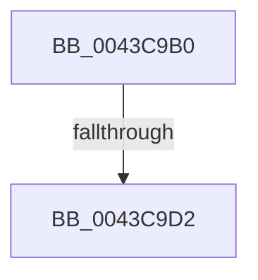

# IopQueueWorkItemProlog

- RVA: `0x0043C9B0`–`0x0043C9E8` (길이 `56` bytes)
- VA: `0x000000014043C9B0`
- 실행 섹션: `.text`
- PDB 이름 있음: `예`; PDB Function 태그: `예`
- unwind 정보 RVA: `0x000A460C`
- 디코드: `17`개 명령, `56/56` bytes 표시
- 미해석 바이트: `0` (있으면 어셈블리에 `.byte`로 보존)

> 이 문서는 커널 이미지의 기계어와 PDB 기호를 분석해 생성했습니다. 4번과 5번은 함수 원형과 자료형을 바이너리 사용 방식에서 추정한 C 해석이며 원본 소스 복구 결과는 아닙니다.

## 1. Dependencies

- 직접 호출 지점: **0**; 고유 호출 대상: **0**
- 직접 호출자로 확인된 함수: **2**
- RIP 상대 이미지 참조: **1**

### Outgoing calls
- 직접 디코드된 call 명령이 없습니다.

### Direct callers
- [IoQueueWorkItemToNode](IoQueueWorkItemToNode_function_0043C960.md) at `0x0043C975`
- [IoTryQueueWorkItem](../4E/IoTryQueueWorkItem_function_004E8390.md) at `0x004E83A5`

### Static image references
- `0x0043C9B9` → RVA `0x00E66114` (`.data`; read)

## 2. Other-region calls and transfers

- 다른 실행 섹션으로 향하는 call: **0**
- call이 아닌 외부 분기/꼬리 이동: **2**
  - `0x0043C9CC` → [sub_0043CB13](Unknown_function_0043CB13.md) (`tail-transfer`)
  - `0x0043C9E6` → [sub_0043CA64](Unknown_function_0043CA64.md) (`tail-transfer`)

## 3. Assembly (complete function range)

```asm
0043C9B0  40 53                           push rbx
0043C9B2  55                              push rbp
0043C9B3  56                              push rsi
0043C9B4  57                              push rdi
0043C9B5  48 83 EC 28                     sub rsp, 0x28
0043C9B9  8B 05 55 97 A2 00               mov eax, dword ptr [rip + 0xa29755]
0043C9BF  49 8B F9                        mov rdi, r9
0043C9C2  49 8B F0                        mov rsi, r8
0043C9C5  8B EA                           mov ebp, edx
0043C9C7  48 8B D9                        mov rbx, rcx
0043C9CA  A8 04                           test al, 4
0043C9CC  0F 85 41 01 00 00               jne 0x14043cb13
0043C9D2  0F 57 C0                        xorps xmm0, xmm0
0043C9D5  0F 11 41 44                     movups xmmword ptr [rcx + 0x44], xmm0
0043C9D9  65 8B 04 25 3C 3A 00 00         mov eax, dword ptr gs:[0x3a3c]
0043C9E1  A9 01 00 01 00                  test eax, 0x10001
0043C9E6  75 7C                           jne 0x14043ca64
```

## 4. C-style interpretation (structured pseudocode)

```c
__int64 __fastcall IopQueueWorkItemProlog(__int64 a1, int a2, __int64 a3, __int64 a4)
{
    __int64 v_rsp;

    v_rsp = (v_rsp) - (40);
    *(unsigned __int64 *)(a1 + 68) = v_xmm0;
}
```

## 5. (Beta) C Style

```c
int64_t IopQueueWorkItemProlog(void *Arg1, int32_t Arg2, int64_t Arg3, int64_t Arg4)
{
    uint8_t *arg1 = (uint8_t *)Arg1;

    int64_t local_rsp;

    local_rsp = (local_rsp) - (40);
    *(uint64_t *)(arg1 + 0x44) = v_xmm0;
}
```

### 관측된 메모리 오프셋

구조체 형식이 확인되지 않은 접근은 인자 기준의 오프셋으로만 기록했습니다.

| 기준 인자 | 오프셋 표현 | 폭 (bit) | 접근 |
|---|---:|---:|---|
| `Arg1` | `+ 0x44` | `128` | `R` |

## 6. Execution-region graph

[열기: 2D/3D 그래프와 함수 탐색 컨트롤 패널](../../../control-panel.html?section=text&rva=0x0043C9B0&view=graph)

- 2D 그래프는 위에서 아래로 흐르고, 3D 그래프는 빈 공간을 드래그해 회전합니다. Shift+드래그는 이동, 휠은 확대·축소, 함수 노드 선택은 대상 보고서 이동입니다.

### Static fallback


