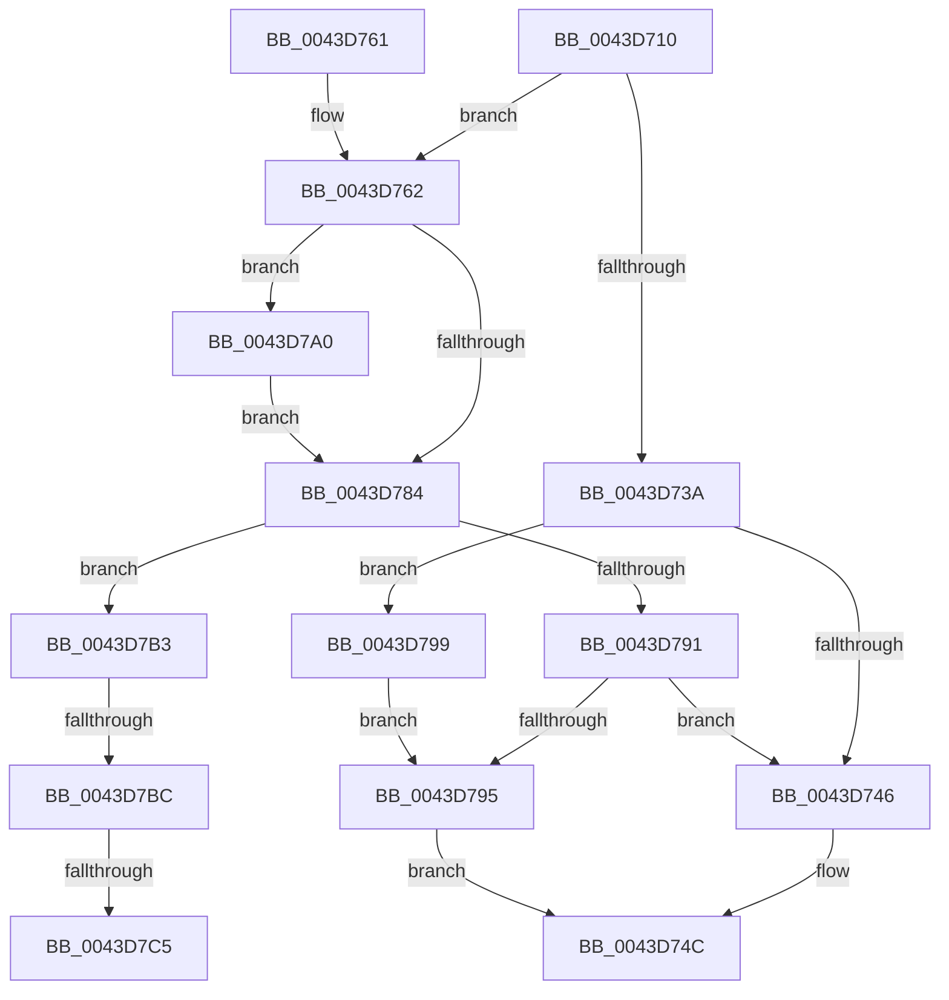

# IopSetFileObjectExtensionFlag

- RVA: `0x0043D710`–`0x0043D7D5` (길이 `197` bytes)
- VA: `0x000000014043D710`
- 실행 섹션: `.text`
- PDB 이름 있음: `예`; PDB Function 태그: `예`
- unwind 정보 RVA: `0x000A4854`
- 디코드: `57`개 명령, `197/197` bytes 표시
- 미해석 바이트: `0` (있으면 어셈블리에 `.byte`로 보존)

> 이 문서는 커널 이미지의 기계어와 PDB 기호를 분석해 생성했습니다. 4번과 5번은 함수 원형과 자료형을 바이너리 사용 방식에서 추정한 C 해석이며 원본 소스 복구 결과는 아닙니다.

## 1. Dependencies

- 직접 호출 지점: **2**; 고유 호출 대상: **2**
- 직접 호출자로 확인된 함수: **7**
- RIP 상대 이미지 참조: **1**

### Outgoing calls
- `0x0043D770` → [ExAllocatePool2](../../poolcode/B8/ExAllocatePool2_function_00B820F0.md) (function, `0x00B820F0`)
- `0x0043D7CA` → [ExFreePoolWithTag](../../poolcode/B8/ExFreePoolWithTag_function_00B82870.md) (function, `0x00B82870`)

### Direct callers
- [IopCheckInitiatorHint](../45/IopCheckInitiatorHint_function_00457134.md) at `0x00457275`
- [IopCheckHandleForRevocation](../59/IopCheckHandleForRevocation_function_00598340.md) at `0x005983AE`
- [IoRegisterContainerNotification](../../page/71/IoRegisterContainerNotification_function_0071E700.md) at `0x0071E857`
- [IopAllocRealFileObject](../../page/89/IopAllocRealFileObject_function_00899720.md) at `0x00899D27`
- [IopParseDevice](../../page/89/IopParseDevice_function_0089E510.md) at `0x0089F4A9`
- [IopXxxControlFile](../../page/8E/IopXxxControlFile_function_008E9AD0.md) at `0x008EB214`
- [IoSetFileObjectIgnoreSharing](../../page/A7/IoSetFileObjectIgnoreSharing_function_00A70E50.md) at `0x00A70E59`

### Static image references
- `0x0043D73A` → RVA `0x00014730` (`.rdata`; read)

## 2. Other-region calls and transfers

- 다른 실행 섹션으로 향하는 call: **2**
  - `0x0043D770` → [ExAllocatePool2](../../poolcode/B8/ExAllocatePool2_function_00B820F0.md) (`.text` → `POOLCODE`)
  - `0x0043D7CA` → [ExFreePoolWithTag](../../poolcode/B8/ExFreePoolWithTag_function_00B82870.md) (`.text` → `POOLCODE`)
- call이 아닌 외부 분기/꼬리 이동: **3**
  - `0x0043D7B6` → [sub_006EF77C](../6E/Unknown_function_006EF77C.md) (`tail-transfer`)
  - `0x0043D7BF` → [sub_006EF77C](../6E/Unknown_function_006EF77C.md) (`tail-transfer`)
  - `0x0043D7D0` → [sub_006EF77C](../6E/Unknown_function_006EF77C.md) (`tail-transfer`)

## 3. Assembly (complete function range)

```asm
0043D710  48 89 5C 24 08                  mov qword ptr [rsp + 8], rbx
0043D715  48 89 6C 24 10                  mov qword ptr [rsp + 0x10], rbp
0043D71A  48 89 74 24 18                  mov qword ptr [rsp + 0x18], rsi
0043D71F  57                              push rdi
0043D720  48 83 EC 20                     sub rsp, 0x20
0043D724  4C 8B 81 D0 00 00 00            mov r8, qword ptr [rcx + 0xd0]
0043D72B  8B DA                           mov ebx, edx
0043D72D  83 E3 04                        and ebx, 4
0043D730  8B F2                           mov esi, edx
0043D732  48 8B F9                        mov rdi, rcx
0043D735  4D 85 C0                        test r8, r8
0043D738  74 28                           je 0x14043d762
0043D73A  48 8D 0D EF 6F BD FF            lea rcx, [rip - 0x429011]
0043D741  4C 3B C1                        cmp r8, rcx
0043D744  74 53                           je 0x14043d799
0043D746  F0 41 09 30                     lock or dword ptr [r8], esi
0043D74A  33 C0                           xor eax, eax
0043D74C  48 8B 5C 24 30                  mov rbx, qword ptr [rsp + 0x30]
0043D751  48 8B 6C 24 38                  mov rbp, qword ptr [rsp + 0x38]
0043D756  48 8B 74 24 40                  mov rsi, qword ptr [rsp + 0x40]
0043D75B  48 83 C4 20                     add rsp, 0x20
0043D75F  5F                              pop rdi
0043D760  C3                              ret
0043D761  CC                              int3
0043D762  33 ED                           xor ebp, ebp
0043D764  41 B8 49 6F 46 45               mov r8d, 0x45466f49
0043D76A  8D 55 60                        lea edx, [rbp + 0x60]
0043D76D  8D 4D 40                        lea ecx, [rbp + 0x40]
0043D770  E8 7B 49 74 00                  call 0x140b820f0
0043D775  48 8D 0D B4 6F BD FF            lea rcx, [rip - 0x42904c]
0043D77C  4C 8B C0                        mov r8, rax
0043D77F  48 85 C0                        test rax, rax
0043D782  74 1C                           je 0x14043d7a0
0043D784  33 C0                           xor eax, eax
0043D786  F0 4C 0F B1 87 D0 00 00 00      lock cmpxchg qword ptr [rdi + 0xd0], r8
0043D78F  75 22                           jne 0x14043d7b3
0043D791  85 ED                           test ebp, ebp
0043D793  79 B1                           jns 0x14043d746
0043D795  8B C5                           mov eax, ebp
0043D797  EB B3                           jmp 0x14043d74c
0043D799  BD 9A 00 00 C0                  mov ebp, 0xc000009a
0043D79E  EB F5                           jmp 0x14043d795
0043D7A0  85 DB                           test ebx, ebx
0043D7A2  48 8B C1                        mov rax, rcx
0043D7A5  BD 9A 00 00 C0                  mov ebp, 0xc000009a
0043D7AA  49 0F 44 C0                     cmove rax, r8
0043D7AE  4C 8B C0                        mov r8, rax
0043D7B1  EB D1                           jmp 0x14043d784
0043D7B3  4D 85 C0                        test r8, r8
0043D7B6  0F 84 C0 1F 2B 00               je 0x1406ef77c
0043D7BC  4C 3B C1                        cmp r8, rcx
0043D7BF  0F 84 B7 1F 2B 00               je 0x1406ef77c
0043D7C5  33 D2                           xor edx, edx
0043D7C7  49 8B C8                        mov rcx, r8
0043D7CA  E8 A1 50 74 00                  call 0x140b82870
0043D7CF  90                              nop
0043D7D0  E9 A7 1F 2B 00                  jmp 0x1406ef77c
```

## 4. C-style interpretation (structured pseudocode)

```c
__int64 __fastcall IopSetFileObjectExtensionFlag(__int64 a1, int a2)
{
    __int64 result;
    __int64 v_rbp;
    __int64 v_rbx;
    __int64 v_rsp;
    unsigned __int64 v_stack_p10;
    unsigned __int64 v_stack_p18;
    unsigned __int64 v_stack_p8;

    v_stack_p8 = v_rbx;
    v_stack_p10 = v_rbp;
    v_stack_p18 = v_rsi;
    v_rsp = (v_rsp) - (32);
    v_rbx = (unsigned int)(((unsigned int)(a2)) & (4));
    if (*(unsigned __int64 *)(a1 + 208) == 0) goto loc_0043D762;
    if ((*(unsigned __int64 *)(a1 + 208)) == (v_rip - 4362257)) goto loc_0043D799;
loc_0043D746:
    result = 0;
loc_0043D74C:
    v_rsp = (v_rsp) + (32);
    return result;
loc_0043D762:
    v_rbp = 0;
    result = ExAllocatePool2(v_rbp + 64, v_rbp + 96, (unsigned int)(0x45466F49ULL), a4);
    if (result == 0) goto loc_0043D7A0;
loc_0043D784:
    result = 0;
    if (condition_is_not_equal) goto loc_0043D7B3;
    if (!sign_flag) goto loc_0043D746;
loc_0043D795:
    goto loc_0043D74C;
loc_0043D799:
    goto loc_0043D795;
loc_0043D7A0:
    result = v_rip - 4362316;
    if ((unsigned int)(v_stack_p8) == 0) { result = 0; }
    goto loc_0043D784;
loc_0043D7B3:
    a2 = 0;
    result = ExFreePoolWithTag(result, a2, result, a4);
}
```

## 5. (Beta) C Style

```c
int64_t IopSetFileObjectExtensionFlag(void *Arg1, int32_t Arg2)
{
    uint8_t *arg1 = (uint8_t *)Arg1;

    int64_t result;
    int64_t local_rbp;
    int64_t local_rbx;
    int64_t local_rsp;
    uint64_t v_stack_p10;
    uint64_t v_stack_p18;
    uint64_t v_stack_p8;

    v_stack_p8 = local_rbx;
    v_stack_p10 = local_rbp;
    v_stack_p18 = local_rsi;
    local_rsp = (local_rsp) - (32);
    local_rbx = (uint32_t)(((uint32_t)(Arg2)) & (4));
    if (*(uint64_t *)(arg1 + 0xD0) == 0) goto loc_0043D762;
    if ((*(uint64_t *)(arg1 + 0xD0)) == (v_rip - 4362257)) goto loc_0043D799;
loc_0043D746:
    result = 0;
loc_0043D74C:
    local_rsp = (local_rsp) + (32);
    return result;
loc_0043D762:
    local_rbp = 0;
    result = ExAllocatePool2(local_rbp + 64, local_rbp + 96, (uint32_t)(0x45466F49ULL), a4);
    if (result == 0) goto loc_0043D7A0;
loc_0043D784:
    result = 0;
    if (condition_is_not_equal) goto loc_0043D7B3;
    if (!sign_flag) goto loc_0043D746;
loc_0043D795:
    goto loc_0043D74C;
loc_0043D799:
    goto loc_0043D795;
loc_0043D7A0:
    result = v_rip - 4362316;
    if ((uint32_t)(v_stack_p8) == 0) { result = 0; }
    goto loc_0043D784;
loc_0043D7B3:
    Arg2 = 0;
    result = ExFreePoolWithTag(result, Arg2, result, a4);
}
```

### 관측된 메모리 오프셋

구조체 형식이 확인되지 않은 접근은 인자 기준의 오프셋으로만 기록했습니다.

| 기준 인자 | 오프셋 표현 | 폭 (bit) | 접근 |
|---|---:|---:|---|
| `Arg1` | `+ 0xD0` | `64` | `R` |

## 6. Execution-region graph

[열기: 2D/3D 그래프와 함수 탐색 컨트롤 패널](../../../control-panel.html?section=text&rva=0x0043D710&view=graph)

- 2D 그래프는 위에서 아래로 흐르고, 3D 그래프는 빈 공간을 드래그해 회전합니다. Shift+드래그는 이동, 휠은 확대·축소, 함수 노드 선택은 대상 보고서 이동입니다.

### Static fallback


