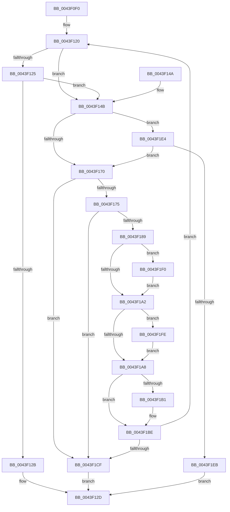

# IopWaitForSynchronousIoEvent

- RVA: `0x0043F0F0`–`0x0043F20A` (길이 `282` bytes)
- VA: `0x000000014043F0F0`
- 실행 섹션: `.text`
- PDB 이름 있음: `예`; PDB Function 태그: `아니요`
- unwind 정보 RVA: `0x000A4BE0`
- 디코드: `80`개 명령, `282/282` bytes 표시
- 미해석 바이트: `0` (있으면 어셈블리에 `.byte`로 보존)

> 이 문서는 커널 이미지의 기계어와 PDB 기호를 분석해 생성했습니다. 4번과 5번은 함수 원형과 자료형을 바이너리 사용 방식에서 추정한 C 해석이며 원본 소스 복구 결과는 아닙니다.

## 1. Dependencies

- 직접 호출 지점: **4**; 고유 호출 대상: **4**
- 직접 호출자로 확인된 함수: **1**
- RIP 상대 이미지 참조: **1**

### Outgoing calls
- `0x0043F162` → [KeWaitForSingleObject](../20/KeWaitForSingleObject_function_0020E6B0.md) (function, `0x0020E6B0`)
- `0x0043F1B9` → [KiLowerIrqlProcessIrqlFlags](../4F/KiLowerIrqlProcessIrqlFlags_function_004F5698.md) (function, `0x004F5698`)
- `0x0043F1D5` → [IopCancelAlertedRequest](../../page/A9/IopCancelAlertedRequest_function_00A948F8.md) (function, `0x00A948F8`)
- `0x0043F1F7` → [KiRaiseIrqlProcessIrqlFlags](../4F/KiRaiseIrqlProcessIrqlFlags_function_004F56FC.md) (function, `0x004F56FC`)

### Direct callers
- [NtCopyFileChunk](../../page/94/NtCopyFileChunk_function_0094B600.md) at `0x0094BCB8`

### Static image references
- `0x0043F199` → RVA `0x00FC6D20` (`ALMOSTRO`; read)

## 2. Other-region calls and transfers

- 다른 실행 섹션으로 향하는 call: **1**
  - `0x0043F1D5` → [IopCancelAlertedRequest](../../page/A9/IopCancelAlertedRequest_function_00A948F8.md) (`.text` → `PAGE`)
- 별도 외부 분기/꼬리 이동을 확인하지 못했습니다.

## 3. Assembly (complete function range)

```asm
0043F0F0  48 89 5C 24 18                  mov qword ptr [rsp + 0x18], rbx
0043F0F5  56                              push rsi
0043F0F6  41 54                           push r12
0043F0F8  41 55                           push r13
0043F0FA  41 56                           push r14
0043F0FC  41 57                           push r15
0043F0FE  48 83 EC 30                     sub rsp, 0x30
0043F102  45 33 ED                        xor r13d, r13d
0043F105  48 89 6C 24 60                  mov qword ptr [rsp + 0x60], rbp
0043F10A  41 8B F5                        mov esi, r13d
0043F10D  44 0F B6 FA                     movzx r15d, dl
0043F111  49 8B D9                        mov rbx, r9
0043F114  48 89 7C 24 68                  mov qword ptr [rsp + 0x68], rdi
0043F119  45 0F B6 F0                     movzx r14d, r8b
0043F11D  4C 8B E1                        mov r12, rcx
0043F120  F6 03 7F                        test byte ptr [rbx], 0x7f
0043F123  75 26                           jne 0x14043f14b
0043F125  44 39 6B 04                     cmp dword ptr [rbx + 4], r13d
0043F129  74 20                           je 0x14043f14b
0043F12B  8B C6                           mov eax, esi
0043F12D  48 8B 7C 24 68                  mov rdi, qword ptr [rsp + 0x68]
0043F132  48 8B 6C 24 60                  mov rbp, qword ptr [rsp + 0x60]
0043F137  48 8B 5C 24 70                  mov rbx, qword ptr [rsp + 0x70]
0043F13C  48 83 C4 30                     add rsp, 0x30
0043F140  41 5F                           pop r15
0043F142  41 5E                           pop r14
0043F144  41 5D                           pop r13
0043F146  41 5C                           pop r12
0043F148  5E                              pop rsi
0043F149  C3                              ret
0043F14A  CC                              int3
0043F14B  45 8B C7                        mov r8d, r15d
0043F14E  4C 89 6C 24 20                  mov qword ptr [rsp + 0x20], r13
0043F153  45 84 F6                        test r14b, r14b
0043F156  41 B1 01                        mov r9b, 1
0043F159  48 8B CB                        mov rcx, rbx
0043F15C  45 0F 44 C5                     cmove r8d, r13d
0043F160  33 D2                           xor edx, edx
0043F162  E8 49 F5 DC FF                  call 0x14020e6b0
0043F167  8B F0                           mov esi, eax
0043F169  3D C0 00 00 00                  cmp eax, 0xc0
0043F16E  75 74                           jne 0x14043f1e4
0043F170  45 84 F6                        test r14b, r14b
0043F173  75 5A                           jne 0x14043f1cf
0043F175  65 48 8B 0C 25 88 01 00 00      mov rcx, qword ptr gs:[0x188]
0043F17E  8B 89 A0 05 00 00               mov ecx, dword ptr [rcx + 0x5a0]
0043F184  F6 C1 01                        test cl, 1
0043F187  75 46                           jne 0x14043f1cf
0043F189  40 32 ED                        xor bpl, bpl
0043F18C  44 0F 20 C7                     mov rdi, cr8
0043F190  B8 01 00 00 00                  mov eax, 1
0043F195  44 0F 22 C0                     mov cr8, rax
0043F199  44 39 2D 80 7B B8 00            cmp dword ptr [rip + 0xb87b80], r13d
0043F1A0  75 4E                           jne 0x14043f1f0
0043F1A2  44 39 6B 04                     cmp dword ptr [rbx + 4], r13d
0043F1A6  74 56                           je 0x14043f1fe
0043F1A8  44 39 2D 71 7B B8 00            cmp dword ptr [rip + 0xb87b71], r13d
0043F1AF  74 0D                           je 0x14043f1be
0043F1B1  44 0F 20 C1                     mov rcx, cr8
0043F1B5  40 0F B6 D7                     movzx edx, dil
0043F1B9  E8 DA 64 0B 00                  call 0x1404f5698
0043F1BE  40 0F B6 C7                     movzx eax, dil
0043F1C2  44 0F 22 C0                     mov cr8, rax
0043F1C6  40 84 ED                        test bpl, bpl
0043F1C9  0F 84 51 FF FF FF               je 0x14043f120
0043F1CF  49 8B D4                        mov rdx, r12
0043F1D2  48 8B CB                        mov rcx, rbx
0043F1D5  E8 1E 57 65 00                  call 0x140a948f8
0043F1DA  B8 20 01 00 C0                  mov eax, 0xc0000120
0043F1DF  E9 49 FF FF FF                  jmp 0x14043f12d
0043F1E4  3D 01 01 00 00                  cmp eax, 0x101
0043F1E9  74 85                           je 0x14043f170
0043F1EB  E9 3D FF FF FF                  jmp 0x14043f12d
0043F1F0  0F B6 D0                        movzx edx, al
0043F1F3  40 0F B6 CF                     movzx ecx, dil
0043F1F7  E8 00 65 0B 00                  call 0x1404f56fc
0043F1FC  EB A4                           jmp 0x14043f1a2
0043F1FE  41 80 7C 24 44 01               cmp byte ptr [r12 + 0x44], 1
0043F204  40 0F 94 C5                     sete bpl
0043F208  EB 9E                           jmp 0x14043f1a8
```

## 4. C-style interpretation (structured pseudocode)

```c
__int64 __fastcall IopWaitForSynchronousIoEvent(__int64 a1, int a2, unsigned __int8 a3, __int64 a4)
{
    __int64 result;
    __int64 v_r13;
    __int64 v_rbp;
    __int64 v_rsp;
    unsigned __int64 v_stack_p10;
    unsigned __int64 v_stack_p18;
    unsigned __int64 v_stack_p20;
    unsigned __int64 v_stack_p8;

    v_stack_p18 = v_rbx;
    v_rsp = (v_rsp) - (48);
    v_r13 = 0;
    v_stack_p8 = v_rbp;
    v_stack_p10 = v_rdi;
loc_0043F120:
    if (((*(unsigned __int8 *)(a4)) & (127)) != 0) goto loc_0043F14B;
    if ((*(unsigned int *)(a4 + 4)) == 0) goto loc_0043F14B;
loc_0043F12D:
    v_rsp = (v_rsp) + (48);
    return 0;
loc_0043F14B:
    v_stack_p20 = 0;
    a3 = (unsigned int)((unsigned int)((unsigned __int8)(a2)));
    if (a3 == 0) { a3 = 0; }
    a2 = 0;
    result = KeWaitForSingleObject(v_stack_p18, a2, a3, 1);
    if (((unsigned int)(result)) != 192) goto loc_0043F1E4;
loc_0043F170:
    if (a3 != 0) goto loc_0043F1CF;
    if ((((unsigned __int8)((unsigned int)(*(unsigned int *)(*(unsigned __int64 *)(gs_base + (0 + 392)) + 1440)))) & (1)) != 0) goto loc_0043F1CF;
    v_rbp = 0;
    if ((*(unsigned int *)(v_rip + 12090240)) != 0) goto loc_0043F1F0;
loc_0043F1A2:
    if ((*(unsigned int *)(v_stack_p18 + 4)) == 0) goto loc_0043F1FE;
loc_0043F1A8:
    result = 1;
    if ((*(unsigned int *)(v_rip + 12090225)) != 0) {
        a1 = 1;
        a2 = (unsigned __int8)(v_cr8);
        result = KiLowerIrqlProcessIrqlFlags(a1, a2, a3, 1);
    }
    if (0 == 0) goto loc_0043F120;
loc_0043F1CF:
    result = IopCancelAlertedRequest(v_stack_p18, a1, a3, 1);
    goto loc_0043F12D;
loc_0043F1E4:
    if (((unsigned int)((unsigned int)(0xC0000120ULL))) == 257) goto loc_0043F170;
    goto loc_0043F12D;
loc_0043F1F0:
    result = KiRaiseIrqlProcessIrqlFlags((unsigned __int8)(v_cr8), (unsigned __int8)((unsigned int)(0xC0000120ULL)), a3, 1);
    goto loc_0043F1A2;
loc_0043F1FE:
    v_rbp = ((*(unsigned __int8 *)(a1 + 68)) == 1) ? 1 : 0;
    goto loc_0043F1A8;
}
```

## 5. (Beta) C Style

```c
int64_t IopWaitForSynchronousIoEvent(void *Arg1, int32_t Arg2, uint8_t Arg3, void *Arg4)
{
    uint8_t *arg1 = (uint8_t *)Arg1;
    uint8_t *arg4 = (uint8_t *)Arg4;

    int64_t result;
    int64_t local_r13;
    int64_t local_rbp;
    int64_t local_rsp;
    uint64_t v_stack_p10;
    uint64_t v_stack_p18;
    uint64_t v_stack_p20;
    uint64_t v_stack_p8;

    v_stack_p18 = local_rbx;
    local_rsp = (local_rsp) - (48);
    local_r13 = 0;
    v_stack_p8 = local_rbp;
    v_stack_p10 = local_rdi;
loc_0043F120:
    if (((*(uint8_t *)(arg4)) & (127)) != 0) goto loc_0043F14B;
    if ((*(uint32_t *)(arg4 + 0x4)) == 0) goto loc_0043F14B;
loc_0043F12D:
    local_rsp = (local_rsp) + (48);
    return 0;
loc_0043F14B:
    v_stack_p20 = 0;
    Arg3 = (uint32_t)((uint32_t)((uint8_t)(Arg2)));
    if (Arg3 == 0) { Arg3 = 0; }
    Arg2 = 0;
    result = KeWaitForSingleObject(v_stack_p18, Arg2, Arg3, 1);
    if (((uint32_t)(result)) != 192) goto loc_0043F1E4;
loc_0043F170:
    if (Arg3 != 0) goto loc_0043F1CF;
    if ((((uint8_t)((uint32_t)(*(uint32_t *)(*(uint64_t *)(gs_base + (0 + 0x188)) + 0x5A0)))) & (1)) != 0) goto loc_0043F1CF;
    local_rbp = 0;
    if ((*(uint32_t *)(v_rip + 0xB87B80)) != 0) goto loc_0043F1F0;
loc_0043F1A2:
    if ((*(uint32_t *)(v_stack_p18 + 0x4)) == 0) goto loc_0043F1FE;
loc_0043F1A8:
    result = 1;
    if ((*(uint32_t *)(v_rip + 0xB87B71)) != 0) {
        Arg1 = 1;
        Arg2 = (uint8_t)(v_cr8);
        result = KiLowerIrqlProcessIrqlFlags(Arg1, Arg2, Arg3, 1);
    }
    if (0 == 0) goto loc_0043F120;
loc_0043F1CF:
    result = IopCancelAlertedRequest(v_stack_p18, Arg1, Arg3, 1);
    goto loc_0043F12D;
loc_0043F1E4:
    if (((uint32_t)((uint32_t)(0xC0000120ULL))) == 257) goto loc_0043F170;
    goto loc_0043F12D;
loc_0043F1F0:
    result = KiRaiseIrqlProcessIrqlFlags((uint8_t)(v_cr8), (uint8_t)((uint32_t)(0xC0000120ULL)), Arg3, 1);
    goto loc_0043F1A2;
loc_0043F1FE:
    local_rbp = ((*(uint8_t *)(arg1 + 0x44)) == 1) ? 1 : 0;
    goto loc_0043F1A8;
}
```

### 관측된 메모리 오프셋

구조체 형식이 확인되지 않은 접근은 인자 기준의 오프셋으로만 기록했습니다.

| 기준 인자 | 오프셋 표현 | 폭 (bit) | 접근 |
|---|---:|---:|---|
| `Arg1` | `+ 0x44` | `8` | `R` |
| `Arg4` | `+ 0x0` | `8` | `R` |
| `Arg4` | `+ 0x4` | `32` | `R` |

## 6. Execution-region graph

[열기: 2D/3D 그래프와 함수 탐색 컨트롤 패널](../../../control-panel.html?section=text&rva=0x0043F0F0&view=graph)

- 2D 그래프는 위에서 아래로 흐르고, 3D 그래프는 빈 공간을 드래그해 회전합니다. Shift+드래그는 이동, 휠은 확대·축소, 함수 노드 선택은 대상 보고서 이동입니다.

### Static fallback


